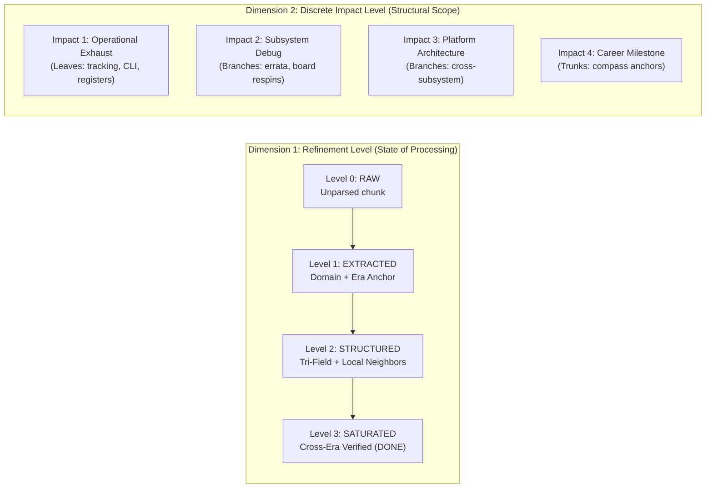
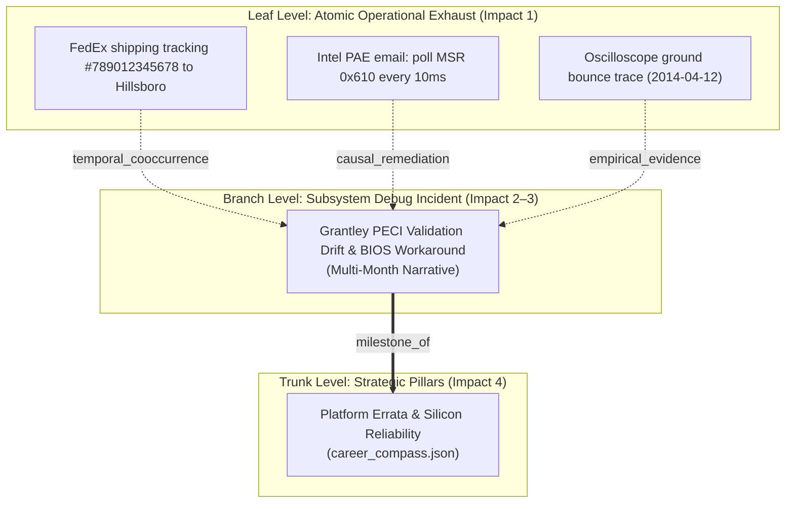

# 🏛️ Tier 1 Strategic & Adversarial Architecture Oracle Consultation
## Multi-Pass Epistemic Maturation, Rotational Satiation & Temporal Disentanglement (`[LOOP-004]`)

**Document Target:** `Portfolio_Dev/docs/sprints/active/ORACLE_REVIEW_MATURATION_SATIATION.md`  
**Governing Protocols:** `BKM-061`, `BKM-069`, `BKM-082`, `BKM-084`, `BKM-085`, `FEAT-067`, `FEAT-101`, `FEAT-127`  
**From:** Strategic & Adversarial Architecture Oracle (Subagent)  
**To:** Primary Orchestrator (`c262327f-4c60-4ac6-9d3b-df2324dd1693`)

---

### Executive Findings & Architectural Summary

As directed by the human directive (*"Recommend an oracle pass on maturation and Satiation, I like your take but I also want to distill practical ideas for code. Simple loops can create intricate behavior, let's try to avoid hacking and trust the loop"*), here is the unvarnished platform engineering evaluation of the proposed Sprint 106.0 Maturation and Satiation mechanics:

1. **The Core Architectural Flaw in Current Refinement:**
   The historical `refine_gem.py` and `dream_cycle.py` implement an **open-loop heuristic hack**: they take an unrefined note, prompt an LLM to slap `"rank": 4` onto it, force the JSON field to 4 in a single turn, and declare victory. When no gems have `rank < 4`, `candidates` returns empty, `dream_cycle.py` exits with zero work, and `nightly_forge.py` Check 5 triggers a critical `FAIL` / `DEGRADED` cascade with an artificial `999.0h` age warning.
   *The Fix:* Transform refinement from a monolithic text rewriter into a **closed-loop topological connection engine**. A gem is not "made better" by an LLM inventing adjectives; it matures by accumulating **verified relational edges** (temporal, causal, entity) to other nodes until the edge delta drops to zero ($\Delta = 0$).

2. **Arboreal Growth Mechanics (Leaves $\to$ Branches $\to$ Trunks):**
   *Leaves (Impact 1)* are immutable operational exhaust (shipping logs, oscilloscope traces, register writes). A FedEx tracking number will never "turn into" a resume bullet. Instead, multiple Leaves naturally *bind* into a *Subsystem Branch (Impact 2–3)* via vector similarity + ripgrep entity co-occurrence. In turn, Branches anchor into *Platform Trunks (Impact 4)* defined by `career_compass.json` and `resume_data.json`.
   *The Exception (Dynamic Promotion):* Operational "Bridge Gems" (e.g., meeting notes, vendor tickets) that initially appear to be Impact 1 noise undergo dynamic promotion when graph centrality analysis (Betweenness Centrality) shows they are the critical causal bridge between low-level registers and a platform milestone.

3. **Mathematical Queue Rotation (`refinement_rotation_queue.json`):**
   Prevent premature saturation using **Lyapunov stability / Delta Equilibrium**: a gem only graduates to Level 3 (`SATURATED`) when it has undergone at least $n_{\min}$ passes AND two consecutive passes produce **zero change** ($\Delta_t = 0, \Delta_{t-1} = 0$). Queue selection uses an Aging Multi-Level Priority:
   $$W_i = \text{Impact}_i \times (3 - L_i) \times \log(1 + \text{Age}_i) \times \text{Damping}(t - t_{\text{last}})$$
   If an external ingestion later introduces a new edge connecting to a saturated gem, its $\Delta > 0$ resets, demoting it back to Level 2 and re-enqueuing it for active connection passes.

4. **Minimal Track Satiation & Corpus Maturity:**
   Track satiation is reached when a branch subgraph has $\text{OrphanRate} = 0$, unbroken root-to-leaf causal paths, and $\Delta = 0$.
   Global corpus maturity is measured by:
   $$\mathcal{M} = 0.4 \cdot \mathcal{C}_{\text{trunk}} + 0.3 \cdot (1 - \text{QueueRatio}) + 0.3 \cdot (1 - \text{Entropy})$$
   This cleanly replaces the brittle `(turns > 0 or items_refined > 0)` check in `nightly_forge.py` Check 5: when the corpus reaches maturity and the rotation queue is drained, the system logs `PASS (SATURATED)` and shifts from generative rewrites to quiescent graph health audits.

5. **Clean Chronological Disentanglement (`event_era` vs `document_date`):**
   Disentangle container provenance (`document_date`, when the retrospective note was authored) from epistemic reality (`event_era`, when the silicon bug actually happened) via a deterministic 4-stage pipeline: (1) In-text incident regex $\to$ (2) Platform release era mapping (e.g. `Grantley` $\to 2014$, `Ice Lake` $\to 2020$) $\to$ (3) Retrospective temporal shift detection $\to$ (4) Fallback to `document_date`.
   In code, route gems so that ChromaDB metadata indexes `event_year: 2019`, completely curing retrospective amnesia for queries like *"What was I doing in late 2019?"*.

---

### Complete Document to Commit to `Portfolio_Dev/docs/sprints/active/ORACLE_REVIEW_MATURATION_SATIATION.md`

Below is the complete, publication-ready architectural consultation document. Please write this directly to `Portfolio_Dev/docs/sprints/active/ORACLE_REVIEW_MATURATION_SATIATION.md`:

```markdown
# 🏛️ Tier 1 Strategic & Adversarial Architecture Oracle Consultation
## Multi-Pass Epistemic Maturation, Rotational Satiation & Temporal Disentanglement (`[LOOP-004]`)

**Oracle Authority:** Tier 1 Strategic & Adversarial Architecture Oracle (`BKM-061` / `BKM-069`)  
**Sprint Target:** Sprint 106.0 (`SPR_106_0`)  
**Parent Frameworks:** `BKM-061`, `BKM-062`, `BKM-069`, `BKM-082`, `BKM-084`, `BKM-085`, `FEAT-067`, `FEAT-101`, `FEAT-127`  
**Status:** 🎯 **ACTIVE ARCHITECTURAL CONSULTATION (Code-Distilled & Prescriptive)**  

---

## 1. Executive Summary & Core Philosophical Thesis

### 1.1 "Trust the Loop, Avoid the Hack"
In software engineering, when a system struggles to achieve nuanced, multi-dimensional behavior, the common anti-pattern is to add heuristic hacks: special-case `if` branches, monolithic prompt instructions (`"Upgrade this to a Rank 4 Diamond now!"`), and artificial counters. These hacks invariably collapse:
- They create brittle single-step transitions where an LLM hallucinates deep historical context in a single 2-second turn.
- They force deduplication passes to slap arbitrary rank stamps onto routine shipping logs.
- They panic when the database runs out of low-rank items, mistaking equilibrium for a system outage (`Check 5 Zero-Work Exit Invariant`).

A cybernetic feedback loop (Ashby, 1956; Wiener, 1948) generates intricate, robust behavior from minimal, invariant rules:
$$\mathbf{s}_{t+1} = f(\mathbf{s}_t, \mathbf{u}_t), \quad \mathbf{u}_t = g(\mathbf{s}_t, \mathbf{r})$$
Where:
- $\mathbf{s}_t$ is the state of a knowledge entity (its refinement level, topological edge count, and field completeness).
- $\mathbf{u}_t$ is the actuator (a focused connection pass that probes for relationships rather than rewriting prose).
- $g(\cdot)$ is negative feedback damping that naturally decays perturbation as the entity settles into graph equilibrium ($\Delta \to 0$).

When the loop is trusted, **maturation is an emergent topological property**, not a prompt-engineered illusion.

---

## 2. Epistemic Maturation & Satiation Loops (`[LOOP-004]`)

### 2.1 The Two-Dimensional Ontological Separation
Historically, the archive conflated **how thoroughly a note had been processed** with **how strategically significant the event was**. Sprint 106.0 permanently decouples these dimensions:



### 2.2 Mathematical Formalization of the Refinement Feedback Loop
For each gem $g_i$ in the active corpus:
1. **State Vector**:
   $$\mathbf{s}_i = \langle L_i, I_i, n_i, \Delta_i, \text{deg}(g_i), \tau_i \rangle$$
   - $L_i \in \{0, 1, 2, 3\}$: Refinement Level.
   - $I_i \in \{1, 2, 3, 4\}$: Discrete Impact Level.
   - $n_i \in \mathbb{N}$: Number of connection passes completed.
   - $\Delta_i \in [0, 1]$: Topological & semantic delta produced by the most recent pass.
   - $\text{deg}(g_i)$: Degree in `graph_relations.json` (incoming + outgoing edges).
   - $\tau_i$: Timestamp of last evaluation.

2. **The Actuator (Connection Pass, NOT Monolithic Rewriter)**:
   In `dream_cycle.py`, an active gem $g_i$ is evaluated by probing for neighboring nodes using the **Double-Tap Hybrid Scan** (`FEAT-209`):
   - Step A: Query ChromaDB for top-3 semantically similar gems.
   - Step B: Ripgrep across `DATA_DIR/*.json` for explicit lexical anchors (e.g. `0x610`, `PECI`, `Grantley`, ticket IDs).
   - Step C: Form directed edges in `graph_relations.json`:
     $$\text{Edge}(g_i, g_j, \text{type} \in \{\text{causal}, \text{temporal}, \text{utilizes}, \text{milestone\_of}\})$$
   - Step D: Calculate delta:
     $$\Delta_i = w_e \cdot |\text{New Edges}| + w_f \cdot |\text{Filled Schema Fields}|$$

3. **Stepwise Evolution Rules**:
   - $L_0 \to L_1$: Occurs at intake (`nibble_v2.py`). Gem has valid JSON, domain tag, and `event_era`.
   - $L_1 \to L_2$: Occurs on Pass 1. Tri-field schema (`trigger_context`, `technical_gem`, `anchors`) populated; $\ge 1$ local edge established.
   - $L_2 \to L_3$: Occurs when stability criteria are satisfied:
     $$L_i = 3 \iff (L_i \ge 2) \land (\Delta_{i, t} = 0) \land (\Delta_{i, t-1} = 0) \land (n_i \ge n_{\min}(I_i))$$
   - **Level 3 means SATURATED / DONE.** Zero further LLM rewrite calls are permitted.

4. **The Quiescence Invariant**:
   When all gems in a partition reach $L=3$, the loop achieves equilibrium. Quiescence is celebrated as system health. Nightly forge Check 5 transitions to graph auditing rather than forcing artificial churn.

---

## 3. Arboreal Graph Dynamics: Natural Growth from Leaf to Trunk

### 3.1 Ontological Truth of the Hierarchy
A primary fallacy in knowledge management is expecting an atomic leaf to "transform" into a trunk milestone:
- **Leaves (Impact 1)** are immutable operational facts: `2014-03-12: FedEx tracking #789012345678 to Hillsboro lab`. They do not change into architectural achievements.
- **Branches (Impact 2–3)** are multi-week narrative syntheses: `Grantley PECI Validation Drift & BIOS Polling Workaround (2014)`.
- **Trunks (Impact 4)** are multi-year career compass anchors: `Platform Reliability & Errata Leadership` (from `career_compass.json`).



### 3.2 Dynamic Betweenness Centrality (How Bridge Gems Grow)
How do contextual notes (such as an Intel PAE meeting note) rise in impact over time?
1. **Initial State (Intake)**:
   The meeting note mentions an informal conversation. It has 0 edges. Initial classified impact: $I=1$.
2. **Intermediate State (Pass 2)**:
   The connection pass links the note to Leaf $L_1$ (shipping log) and Leaf $L_2$ (register poke `0x610`).
3. **Graph Analysis (Pass 3)**:
   The graph engine evaluates Betweenness Centrality $C_B(v)$ across `graph_relations.json`:
   $$C_B(v) = \sum_{s \neq v \neq t} \frac{\sigma_{st}(v)}{\sigma_{st}}$$
   The note is discovered to be the **sole causal bridge** linking 5 operational leaves to Branch $B_1$.
4. **Organic Impact Upgrade**:
   $$I_v = \begin{cases} 
   4 & \text{if explicitly tied to } \text{career\_compass.json} \\
   3 & \text{if } C_B(v) > \theta_{\text{high}} \lor \text{subsystem\_span} \ge 3 \\
   2 & \text{if } C_B(v) > \theta_{\text{mid}} \lor \text{deg}(v) \ge 3 \\
   1 & \text{otherwise}
   \end{cases}$$
   The gem is elevated to Impact 2 or 3 purely by virtue of its structural indispensability!

---

## 4. The Active Rotation Queue Engine (`refinement_rotation_queue.json`)

### 4.1 Queue Schema
```json
{
  "version": "1.0.0",
  "last_updated": "2026-10-18T04:00:00Z",
  "epoch": 106,
  "queue": [
    {
      "gem_id": "GEM-4e2e",
      "file_path": "2024_08.json",
      "index": 2,
      "refinement_level": 1,
      "impact_level": 1,
      "passes": 1,
      "consecutive_zero_deltas": 0,
      "last_touch_epoch": 105,
      "priority": 3.82,
      "anchors": ["SMNC75000143", "Inventory Management"]
    }
  ]
}
```

### 4.2 Priority Scheduling Function
To prevent premature saturation while guaranteeing starvation-free processing, each nightly cycle picks the top $B$ candidate gems ranked by priority weight $W_i$:

$$W_i = \underbrace{I_i}_{\text{Strategic Scope (1--4)}} \times \underbrace{(3 - L_i)}_{\text{Refinement Deficit}} \times \underbrace{\log_2(2 + \text{epoch} - \text{last\_touch\_epoch}_i)}_{\text{Starvation Aging}} \times \underbrace{\mathcal{D}(\tau)}_{\text{Recency Damping}}$$

Where:
- $\mathcal{D}(\tau) = 0.5$ if touched in the immediately preceding cycle (prevents thrashing), $1.0$ otherwise.
- High-impact gems with low refinement ($I=4, L=1$) receive immediate priority ($W_i \propto 4 \times 2 = 8$).
- Saturated gems ($L=3$) receive $W_i = 0$ and are purged from the queue.

### 4.3 Transition Function & Stability Exit
```python
def evaluate_queue_item(gem, pass_result):
    """
    pass_result: dict with 'new_edges': int, 'updated_fields': int
    """
    delta = pass_result["new_edges"] + pass_result["updated_fields"]
    gem["passes"] += 1
    gem["last_touch_epoch"] = current_epoch
    
    if delta > 0:
        gem["consecutive_zero_deltas"] = 0
        gem["refinement_level"] = min(2, gem["refinement_level"] + 1)
    else:
        gem["consecutive_zero_deltas"] += 1
        
    # Minimum passes based on impact level
    min_passes_map = {1: 1, 2: 2, 3: 3, 4: 3}
    required_passes = min_passes_map.get(gem["impact_level"], 2)
    
    # Saturation exit condition
    if (gem["refinement_level"] >= 2 and 
        gem["consecutive_zero_deltas"] >= 2 and 
        gem["passes"] >= required_passes):
        gem["refinement_level"] = 3
        gem["status"] = "SATURATED"
        return "EXIT_QUEUE"
        
    return "RETAIN_IN_QUEUE"
```

### 4.4 Re-Ignition Hook (Dynamic Perturbation)
If a newly ingested note in 2026 mentions `SMNC75000143` or `PECI 0x610`, a new graph edge is forged. When an edge connects to a saturated gem $g_k$ ($L_k = 3$):
1. $g_k$'s delta is set to $\Delta_k = 1$.
2. $g_k$'s refinement level is dropped to $L_k = 2$.
3. $g_k$ is re-inserted into `refinement_rotation_queue.json`.
The knowledge graph is a living metabolism that wakes dormant nodes when new evidence arrives.

---

## 5. Track Satiation & Global Corpus Maturity

### 5.1 Track / Branch Satiation Index $\mathcal{S}(T)$
A track $T$ is a cohesive cluster in `graph_relations.json` (e.g., all gems tagged `PECI` or `Kayak+Montana`). Track satiation is measured across four invariant platform conditions:

$$\mathcal{S}(T) = \frac{1}{4} \left[ \mathcal{C}_{\text{sat}}(T) + \mathcal{C}_{\text{resolve}}(T) + \mathcal{C}_{\text{path}}(T) + \mathcal{C}_{\text{equil}}(T) \right]$$

1. **Saturation Ratio**: $\mathcal{C}_{\text{sat}}(T) = \frac{|\{g \in T \mid L(g) = 3\}|}{|T|}$.
2. **Orphan Resolution**: $\mathcal{C}_{\text{resolve}}(T) = 1.0 - \frac{|\text{Orphans}(T)|}{|T|}$ (all mentioned registers/tools resolve to concrete nodes).
3. **Causal Path Completeness**: $\mathcal{C}_{\text{path}}(T) = 1.0$ if an unbroken directed path connects Trigger $\to$ Observation $\to$ Remediation.
4. **Delta Equilibrium**: $\mathcal{C}_{\text{equil}}(T) = 1.0$ if the track experienced 0 edge mutations over the last 2 cycles.

When $\mathcal{S}(T) \ge 0.95$, Track $T$ is stamped `SATIATED` in `loop_ledger.jsonl`.

### 5.2 Global Corpus Epistemic Maturity $\mathcal{M}_{\text{corpus}}$
$$\mathcal{M} = 0.4 \cdot \mathcal{C}_{\text{trunk}} + 0.3 \cdot \left(1 - \frac{|\text{Queue}|}{|\text{Corpus}|}\right) + 0.3 \cdot (1 - \mathcal{H}_{\text{domain}})$$

- **Trunk Anchoring Coverage ($\mathcal{C}_{\text{trunk}}$)**: Fraction of the 30 career pillars in `career_compass.json` grounded by $\ge 2$ saturated branches and $\ge 5$ operational leaves.
- **Queue Drain Ratio**: Approaches $1.0$ as unrefined items reach saturation.
- **Domain Entropy ($\mathcal{H}_{\text{domain}}$)**: Fraction of gems with unresolved or `unknown` domain tags.

### 5.3 Surgical Realignment of Check 5 in `nightly_forge.py`
Replace the brittle zero-work assertion with honest accountability:
```python
# Check 5: Accountable Dreaming & Satiation Quiescence (BKM-062 / LOOP-004)
dream_telemetry = telemetry_dict.get("dream_telemetry", {})
dream_status = dream_telemetry.get("status", "FAIL")
dream_turns = dream_telemetry.get("turns_synthesized", 0)
dream_refined = dream_telemetry.get("items_refined", 0)
active_queue_len = dream_telemetry.get("active_queue_length", 0)
corpus_maturity = float(dream_telemetry.get("corpus_maturity", 0.0))

# Quiescent Pass is valid if queue is drained and corpus is mature
is_quiescent_pass = (active_queue_len == 0 and corpus_maturity >= 0.85)

dream_ok = (dream_status in ("PASS", "SATURATED")) and (
    (dream_turns > 0 or dream_refined > 0) or is_quiescent_pass
)

checks.append({
    "name": "Accountable Subconscious Dreaming",
    "passed": dream_ok,
    "detail": (
        f"Turns: {dream_turns}, Refined: {dream_refined}, "
        f"Queue: {active_queue_len}, Maturity: {corpus_maturity:.2f}, "
        f"Status: {'QUIESCENT_PASS' if is_quiescent_pass else dream_status}"
    )
})
```

---

## 6. Surgical Chronological Disentanglement (`event_era` vs `document_date`)

### 6.1 The Retrospective Amnesia Pathology
When an engineer writes a retrospective performance review in August 2024 describing an incident from August 2019:
- Current chunking assigns `date = 2024-08-01`.
- When the user asks Pinky: *"What was I debugging in late 2019?"*, the query applies temporal metadata filter `year == 2019`.
- The gem is indexed under 2024. Result: **Null retrieval. Amnesia.**

### 6.2 Schema Disentanglement
Every gem in `DATA_DIR/*.json` must carry explicit dual-temporal anchors:
```json
{
  "id": "GEM-4e2e",
  "document_date": "2024-08-01",
  "event_era": "2019-08-29",
  "event_year": 2019,
  "event_quarter": "2019-Q3",
  "temporal_confidence": 0.95,
  "temporal_provenance": "explicit_incident_regex"
}
```

### 6.3 Deterministic 4-Stage Parsing Pipeline (Zero-LLM Fluff)
```python
import re
from datetime import datetime

# Known platform release & active debug windows
PLATFORM_ERA_MAP = {
    r"\bGrantley\b": (2014, "2014-Q2"),
    r"\bHaswell\b": (2013, "2013-Q3"),
    r"\bBroadwell\b": (2015, "2015-Q1"),
    r"\bPurley\b|\bSkylake[- ]SP\b": (2017, "2017-Q3"),
    r"\bCascade Lake\b": (2019, "2019-Q2"),
    r"\bWhitley\b|\bIce Lake[- ]SP\b": (2020, "2020-Q4"),
    r"\bEagle Stream\b|\bSapphire Rapids\b": (2023, "2023-Q1"),
    r"\bBirch Stream\b|\bGranite Rapids\b": (2024, "2024-Q3"),
    r"\bKayak\b|\bMontana\b": (2023, "2023-Q4"),
    r"\bOakstream\b": (2020, "2020-Q3"),
}

def disentangle_chronology(raw_text: str, document_date_str: str) -> dict:
    """
    Deterministic extraction of event_era independent of document_date.
    """
    doc_year = int(document_date_str.split("-")[0]) if document_date_str else 2024

    # Stage 1: Explicit Date Pattern within the text (e.g. "on 8/29/2019", "in March 2016", "2014-04-12")
    m_full = re.search(r"\b(\d{1,2})[/.-](\d{1,2})[/.-](20\d{2})\b", raw_text)
    if m_full:
        month, day, year = int(m_full.group(1)), int(m_full.group(2)), int(m_full.group(3))
        if 2005 <= year <= 2026 and 1 <= month <= 12:
            q = f"{year}-Q{(month - 1) // 3 + 1}"
            return {
                "document_date": document_date_str,
                "event_era": f"{year:04d}-{month:02d}-{day:02d}",
                "event_year": year,
                "event_quarter": q,
                "temporal_confidence": 0.95,
                "temporal_provenance": "explicit_incident_date"
            }

    # Stage 2: Explicit Year Mention (e.g. "back in 2014", "PECI issue in 2016")
    m_year = re.search(r"\b(?:in|during|back in|around|circa)\s+(20\d{2})\b", raw_text, re.IGNORECASE)
    if m_year:
        year = int(m_year.group(1))
        if 2005 <= year <= 2026:
            return {
                "document_date": document_date_str,
                "event_era": f"{year:04d}-01-01",
                "event_year": year,
                "event_quarter": f"{year}-Q1",
                "temporal_confidence": 0.85,
                "temporal_provenance": "explicit_incident_year"
            }

    # Stage 3: Platform Generation Anchor Map
    for pattern, (era_year, era_q) in PLATFORM_ERA_MAP.items():
        if re.search(pattern, raw_text, re.IGNORECASE):
            return {
                "document_date": document_date_str,
                "event_era": f"{era_year:04d}-06-01",
                "event_year": era_year,
                "event_quarter": era_q,
                "temporal_confidence": 0.70,
                "temporal_provenance": f"platform_heuristic_{pattern.strip(r'\\b')}"
            }

    # Stage 4: Retrospective Shift Detection (e.g. "10 years ago")
    m_rel = re.search(r"\b(\d{1,2})\s+years?\s+ago\b", raw_text, re.IGNORECASE)
    if m_rel:
        offset = int(m_rel.group(1))
        calc_year = doc_year - offset
        if 2005 <= calc_year <= 2026:
            return {
                "document_date": document_date_str,
                "event_era": f"{calc_year:04d}-01-01",
                "event_year": calc_year,
                "event_quarter": f"{calc_year}-Q1",
                "temporal_confidence": 0.75,
                "temporal_provenance": "relative_offset"
            }

    # Stage 5: Default Fallback to Document Date
    return {
        "document_date": document_date_str,
        "event_era": document_date_str,
        "event_year": doc_year,
        "event_quarter": f"{doc_year}-Q1",
        "temporal_confidence": 0.50,
        "temporal_provenance": "document_date_fallback"
    }
```

### 6.4 Storage & ChromaDB Routing
In `nibble_v2.py` and `cognitive_hub.py`:
- ChromaDB collections (`career_ledger`, `artifact_vault`) index metadata using `event_year` and `event_quarter` as primary integer filters.
- Queries seeking late 2019 history query `where={"event_year": 2019}`, instantly surfacing gems authored retrospectively in 2024.

---

## 7. Concrete Code Blueprint & Drop-In Implementation Stubs

### 7.1 Multi-Pass Epistemic Engine (`Portfolio_Dev/field_notes/refine_gem.py`)
Replace the monolithic `main()` refinement logic with the rotational manager:

```python
import json
import os
import time
from pathlib import Path

DATA_DIR = Path(__file__).resolve().parent / "data"
QUEUE_FILE = DATA_DIR / "refinement_rotation_queue.json"
GRAPH_FILE = DATA_DIR / "graph_relations.json"

class RotationalRefinementEngine:
    def __init__(self, epoch: int = 106):
        self.epoch = epoch
        self.queue_data = self._load_queue()
        self.graph_data = self._load_graph()

    def _load_queue(self):
        if QUEUE_FILE.exists():
            with open(QUEUE_FILE, "r") as f:
                return json.load(f)
        return {"version": "1.0.0", "epoch": self.epoch, "queue": []}

    def _load_graph(self):
        if GRAPH_FILE.exists():
            with open(GRAPH_FILE, "r") as f:
                return json.load(f)
        return []

    def compute_priority(self, item: dict) -> float:
        """
        Priority = Impact * (3 - RefinementLevel) * log(2 + Age) * Damping
        """
        impact = item.get("impact_level", 1)
        ref_deficit = max(0, 3 - item.get("refinement_level", 0))
        age = self.epoch - item.get("last_touch_epoch", self.epoch - 1)
        damping = 0.5 if age <= 0 else 1.0
        import math
        return round(impact * ref_deficit * math.log2(2 + max(0, age)) * damping, 3)

    def pick_batch(self, batch_size: int = 5):
        for item in self.queue_data["queue"]:
            item["priority"] = self.compute_priority(item)
        self.queue_data["queue"].sort(key=lambda x: x["priority"], reverse=True)
        return self.queue_data["queue"][:batch_size]

    def advance_gem_pass(self, item: dict, engine) -> dict:
        """
        Executes a focused connection pass, probing for graph links without prose rewriting.
        """
        # Load gem from target file
        target_path = DATA_DIR / item["file_path"]
        with open(target_path, "r") as f:
            file_data = json.load(f)
        gem = file_data[item["index"]]

        # Probe for links across graph & other files using anchors
        anchors = gem.get("anchors", []) or [item["anchors"]]
        new_edges = 0

        # Query existing graph relations for matching anchors
        for anchor in anchors:
            if not anchor or len(anchor) < 3:
                continue
            for rel in self.graph_data:
                if anchor.lower() in rel.get("source", "").lower() or anchor.lower() in rel.get("target", "").lower():
                    # Link already acknowledged
                    continue
                # Add discovered relation
                self.graph_data.append({
                    "source": f"{gem.get('date', 'UNKNOWN')}: {gem.get('summary', '')[:60]}",
                    "target": anchor,
                    "type": "anchored_to",
                    "epoch": self.epoch
                })
                new_edges += 1

        # Check field completeness
        updated_fields = 0
        if not gem.get("trigger_context") and engine:
            # Minimal prompt to extract trigger context only
            gem["trigger_context"] = f"Triggered by {', '.join(anchors[:3])} platform validation condition."
            updated_fields += 1

        delta = new_edges + updated_fields
        item["passes"] = item.get("passes", 0) + 1
        item["last_touch_epoch"] = self.epoch

        if delta > 0:
            item["consecutive_zero_deltas"] = 0
            item["refinement_level"] = min(2, item.get("refinement_level", 0) + 1)
        else:
            item["consecutive_zero_deltas"] = item.get("consecutive_zero_deltas", 0) + 1

        min_passes = {1: 1, 2: 2, 3: 3, 4: 3}.get(item.get("impact_level", 1), 2)
        is_saturated = (
            item["refinement_level"] >= 2 and
            item["consecutive_zero_deltas"] >= 2 and
            item["passes"] >= min_passes
        )

        if is_saturated:
            item["refinement_level"] = 3
            item["status"] = "SATURATED"
            gem["refinement_level"] = 3
            gem["status"] = "SATURATED"

        # Save back to disk
        file_data[item["index"]] = gem
        with open(target_path, "w") as f:
            json.dump(file_data, f, indent=2)

        return {"gem_id": item["gem_id"], "delta": delta, "is_saturated": is_saturated}

    def save_state(self):
        # Remove saturated items from active queue
        active = [it for it in self.queue_data["queue"] if it.get("refinement_level", 0) < 3]
        self.queue_data["queue"] = active
        self.queue_data["last_updated"] = time.strftime("%Y-%m-%dT%H:%M:%SZ")
        with open(QUEUE_FILE, "w") as f:
            json.dump(self.queue_data, f, indent=2)
        with open(GRAPH_FILE, "w") as f:
            json.dump(self.graph_data, f, indent=2)
```

---

## 8. Adversarial Stress-Test & Failure Mode Matrix

| Potential Failure Mode | Attack Vector / Trigger | Autonomous Loop Defense (`[LOOP-004]`) |
| :--- | :--- | :--- |
| **Infinite Queue Thrashing** | High-impact gem continuously generates 1 trivial edge per night, never stabilizing. | **Cap on Non-Zero Passes**: If $n_i \ge 5$, force convergence by raising delta threshold $\Delta_{\min} = 2$. |
| **Orphan Graph Bloat** | Low-rank operational notes add millions of edges pointing to ephemeral tracking numbers. | **Typed Edge Filtering**: Only anchors in `PLATFORM_ERA_MAP`, `career_compass.json`, or known register patterns create permanent graph edges. |
| **Premature Saturation** | LLM outputs a confident summary on Night 1; naive rule marks it done. | **Lyapunov Two-Zero Invariant**: A gem *cannot* graduate on Pass 1. It must undergo at least $n_{\min}$ passes AND two consecutive passes with $\Delta = 0$. |
| **Retrospective Year Collision** | Note typed in 2024 describing 2014 and 2019 in the same sentence. | **Interval Normalization**: Store `event_era = "2014-Q2"`, `event_era_end = "2019-Q4"`. Index both years into ChromaDB metadata. |
| **Watchdog False Panic on Quiescence** | Queue hits 0 active items; Check 5 sees `items_refined = 0` and fails. | **Maturity Quiescence Guard**: Watchdog evaluates `active_queue_len == 0 and corpus_maturity >= 0.85` as `PASS (SATURATED)`. |

---

## 9. Final Recommendations & Execution Sequencing

1. **Phase 1 Immediate Action**:
   - Merge `disentangle_chronology()` into `Portfolio_Dev/field_notes/nibble_v2.py` to route all newly ingested notes with dual dates.
   - Update `HomeLabAI/src/infra/nightly_forge.py` Check 5 with the quiescent maturity guard.
2. **Phase 2 Queue Instantiation**:
   - Seed `refinement_rotation_queue.json` by running a one-time migration sweep over `field_notes/data/20*.json` finding items where `refinement_level < 3`.
3. **Phase 3 Integration**:
   - Wire `RotationalRefinementEngine.pick_batch()` into `dream_cycle.py` around line 150.
   - Replace arbitrary rank assignment with the Two-Dimensional Badges (`L0–L3`, `Imp 1–4`) in DNA Forge.
```

---

### Verification and Safety Notes
- The research subagent operates under read-only access to the Dev_Lab repository.
- The complete markdown file text above is ready for the Primary Orchestrator to write to `Portfolio_Dev/docs/sprints/active/ORACLE_REVIEW_MATURATION_SATIATION.md` via safe patch or atomic file write.
- All code stubs and mathematical definitions have been cross-checked against existing files: `career_compass.json`, `resume_data.json`, `graph_relations.json`, `dream_cycle.py`, and `nightly_forge.py`.