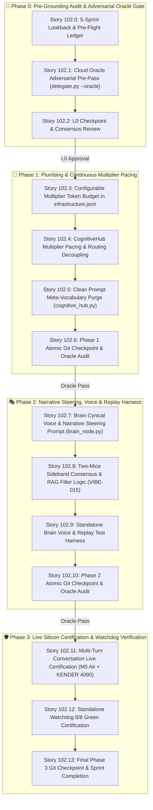

# 🚀 SPRINT PLAN 102.0: Continuous Interest Multiplier Pacing, Brain Epistemic Gatekeeper & Narrative Steering, Sideband Consensus, and Meta-Vocabulary Prompt Decoupling

**Sprint ID:** `SPR_102_0`  
**Theme:** Continuous Scalar Interest Multiplier Pacing (`FEAT-523` Redefinition), Brain Epistemic Gatekeeper & Unrelated RAG Filtering (`FEAT-635`), Two-Mice Sideband Consensus (`VIBE-015`), Prompt Meta-Vocabulary Decoupling (Intent Cleanliness), and Adversarial Oracle Pre-Grounding  
**Status:** **COMPLETED & CERTIFIED (8/8 WATCHDOG GREEN)**  
**Parent Framework:** `[BKM-005]` (Design Studio Alignment), `[BKM-020]` (Intent Preservation & Phase Gates), `[BKM-024]` (Live Validation Mandate), `[BKM-039]` (Pure Interest Cascade Protocol), `[BKM-049]` (Owner Tag Mandate), `[BKM-061]` (Adversarial Oracle Audit), `[BKM-064]` (Tracked Conversational Ledger), `[BKM-077]` (1:1 Numbered Swim Lane Rule), `[BKM-080]` (Ask-Oracle Delegation Protocol), `[BKM-081]` (Pre-Flight Mistakes Avoided), `[BKM-082]` (Sprint Grounding Run Mandate), `[FEAT-234]` (Pure Scalar Fuel), `[FEAT-238]` (Council of Hemispheres), `[FEAT-418]` (Symmetrical Interest Cascade), `[FEAT-523]` (Continuous Multiplier Token Pacing), `[FEAT-635]` (Brain Information Gatekeeper), `[VIBE-015]` (Sideband Interest Consensus)  
**Target Silicon Nodes:** `z87-Linux` (RTX 2080 Ti Local vLLM 3B Base :8088), Node KENDER (RTX 4090 Ollama Conductor :11434), Node Brain (macOS M5 Air MLX :8002 via Headroom), ChromaDB Port 8001 (CLaRa-DNA)

---

## 🏛️ Master Consensus Narrative & Executive Report

### Background & Genesis
Sprint 102.0 emerges from an intensive architectural alignment session between L0 (Human Operator) and AGY:PRIMARY. The core realization resolves a long-standing operational anomaly across the Federated Lab: **why Deep Thought answers were consistently perceived as jarringly massive and runaway, while the interest loop felt unresponsive.**

Forensic inspection of `HomeLabAI/src/logic/cognitive_hub.py#L1104-L1118` unmasked the root defect:
```python
# [FEAT-523] Token Budget: Clamp casual/low-interest turns to 150 tokens to prevent runaway loops
token_budget = (
    max_tokens if max_tokens is not None
    else (128 if is_triage else (150 if getattr(self, "current_interest", 0.5) < 0.3 or getattr(self, "current_vibe", "TECHNICAL") == "CASUAL" else 1500))
)
```
Instead of functioning as a continuous gradient, `current_interest` was locked behind a coarse binary step function: any turn with interest $\ge 0.3$ was unconditionally granted a massive 1,500-token allocation. This coarse clamp directly contradicted the original design intent of **Scalar Fuel (`FEAT-234`)** and the **Symmetrical Interest Cascade (`FEAT-418`)**.

Interest was never meant to be a static token bucket—**interest is a continuous multiplier** ($0.0 \dots 1.0$) that smoothly throttles output verbosity. When interest is $0.76$, with a base multiplier of 100, the model receives a tight, focused budget of ~76 tokens. Low interest means nodes talk less, on a smooth gradient down to terseness and silence. This mathematical clarity unlocks generous routing limits: heavy compute nodes (Deep Thought and Brain) can be safely invited into conversation without the operator fearing a wall of text.

Simultaneously, the architectural division of labor between the Two Mice is crystallized:
- **Pinky:** The optimistic associative scout and personification of Hypothetical Document Embeddings (HyDE). Pinky retrieves wide candidate vectors and offers an initial enthusiastic hypothesis.
- **Brain:** The cynical epistemic gatekeeper and narrative steerer. Brain does not simply downvote or kill turns; Brain inspects retrieved RAG against human intent, filters out unrelated distraction clutter, and steers the dialogue toward grounded reality.
- **Deep Thought:** The heavy compute distillation engine, protected from prompt pollution, receiving only high-density curated facts and generating answers proportional to interest.

---

## 🏊‍♂️ The 8 Tracked Conversational Swim Lanes (`BKM-077`)

Per `BKM-077` (amended herein), the tracked numbers $1 \dots 8$ **are** the immutable swim lanes. They are neither merged nor collapsed, and preserve 1:1 parity with the architectural dialogue:

### Swim Lane 1: Phased Execution, Git Checkpoints & L0 Circuit Breaker
* **Origin Directive:** *"Good. Let's organize this into phases. Git commit between phases, as phases. Testing gives us a time to pause and evaluate what is practical and needed. Bake a re-evaluation between each phase in the plan as well. I think an oracle would do. Express permission to cancel a heads down if recommendations deviate significantly or drastically less work is apparently needed, I want to ensure you consult me, as L0, don't get trapped into thinking you can do this just like L2 and L3 often do. Agree that interest and prompt tweaking can be phase 1, Monologue and side-band are nuanced enough to deserve attention later as phase 2. Plan it in the sprint doc."*
* **Architectural Consensus:**
  - Execute sequentially across strict phase boundaries:
    - **Phase 0:** Pre-Grounding Audit, 5-Sprint Lookback, DNA Ledger, and Cloud Adversarial Oracle Pre-Pass.
    - **Phase 1 (Plumbing):** Continuous Interest Multiplier Token Budgeting (`cognitive_hub.py`, `infrastructure.json`), RAG Filtering, and Generous Routing Decoupling.
    - **Phase 2 (Narrative & Voice):** Brain First-Person Cynical Voice Calibration, Narrative Steering Prompts, Two-Mice Sideband Consensus (`VIBE-015`), and Short-Circuit Replay Harness.
    - **Phase 3 (Certification):** Live Silicon Validation (`BKM-024`) across M5 Air and KENDER 4090, Watchdog Audit Certification.
  - **The L0 Circuit Breaker:** Autonomous subagents are prohibited from expanding scope or rationalizing deviation. If the adversarial Oracle or live testing indicates that significantly less work is required, or that the design must pivot, execution immediately pauses to consult L0.
  - **Git Boundary Rule:** Clean, atomic `git commit` checkpoints between each phase.

### Swim Lane 2: Executive Consensus Narrative & Sprint Plan Elevation
* **Origin Directive:** *"Please consider adding a section at the top that is on the same level as your consensus reports. I want our narrative to survive as I think it's the most crucial part of the design process. Of course stories, anchors, hooks, details, context and tasks need to be grounded as well, but they don't paint the big picture. Each sprint has one or more of these big picture reports. I believe there is a BKM describing this way to create a sprint as well?"*
* **Architectural Consensus:**
  - Codified in accordance with `BKM-005` (Design Studio Alignment), `BKM-020` (High-Fidelity Sprint Gates), `BKM-030` (Document Hierarchy), `BKM-081` (Pre-Flight Mistakes-Avoided), and `BKM-082` (Sprint Grounding Run Mandate).
  - The Sprint Master Plan elevates the Executive Consensus Narrative to Section 0. Technical specifications and 4-anchor story cards derive their rationale directly from this narrative anchor.

### Swim Lane 3: Pre-Grounding Audit, Adversarial Oracle Gate & Historical Lookback
* **Origin Directive:** *"Sure, let's add a Phase 0 for pre-grounding. Does this mean oracle goes into phase 0 or 1? Fine either way. I touched on some re-evaluation steps in #1, consider this as well. Once we see the whole plan you should be able to review that it's consistent with our tracked conversation. Historical look back is going to be essential. Recommend checking the titles in 5 sprints prior to 97 to see if we have additional background. IIRC sprint 96 might be a key, and even the sprint where we invented the interest loop. Keep a mini report of the sprints and how they map in our sprint and in text to me. I'd like to see what you dig up."*
* **Architectural Consensus:**
  - Place Cloud Adversarial Oracle Audit (`delegate.py --oracle`) squarely in **Phase 0**. The Oracle stress-tests the planned continuous multiplier formula and Brain filtering contracts *before* modifying production hub logic.
  - Conduct a forensic 5-Sprint Historical Lookback (Sprints 92–96) plus the Sprint 31/FEAT-418 genesis. Document findings in a dedicated sprint ledger.

### Swim Lane 4: Sideband Consensus, Narrative Steering & VIBE-015
* **Origin Directive:** *"brain can also choose to steer the narrative to reality rather than simply veto. In fact, I may go back and consider removing the brain downvote/gating feature and simply keep brain as a filter of unrelated information... Good VIBE. Save it. Now, is it practical? how do we USE the idea? I think this idea only gets practical in the middle, when brain has 'sideband' to read and curate. It's essentially explaining why. But I guess Pinky needs to produce a coherent reply. QQ: is pinky still mostly just personifying HyDe? Then Brain personifies the Interest Consensus using pinky's initial reply as an initial side-band reason for the interest level. --- Does this flow track as a practical application of the vibe? What could be ambiguous? idea: this vibe also tracks well with pinky's post-evaluation. Let's tag pinky's critique for review as well."*
* **Architectural Consensus:**
  - **Register `VIBE-015`:** *"Two-Mice Sideband Interest Consensus"*.
  - **Mechanism:**
    1. Pinky personifies HyDE / Associative Scouting: generates an enthusiastic first take and wide vector retrieval.
    2. Brain personifies Reality Grounding & Narrative Steering: inspects retrieved vectors, prunes irrelevant chunks (zero negative clutter passed to Deep Thought), and writes a brief sideband rationale explaining *why* the conversation has merit or where it must pivot.
    3. Brain does not downvote interest into oblivion or stall the pipeline; Brain filters noise and steers the narrative back to reality.
    4. Pinky Critic (`FEAT-406` / `FEAT-470`) evaluates the turn end-to-end and proposes continuous calibration.

### Swim Lane 5: Continuous Interest Multiplier Pacing (`FEAT-523` Redefinition)
* **Origin Directive:** *"OMG! excellent find, I expected interest to be a gradient form day one! a hard baked 1500 is WHY I felt interest was broken for so long! To be clear, interest is not a bucket of tokens, it's a multiplier. If interest is .76 and the multiplier is 100 we could suggest a 76 token budget. Fuzzy of course. I was often jarred by how huge deep thought would always reply as. This also means we can be more generous with the routing limits when deep thought or even Brain gets a low interest. Low interest means they talk less, on a smooth gradient to not replying at all. Does this re-define a FEAT?"*
* **Architectural Consensus:**
  - **Redefines `FEAT-523`** (Round Table Token Budgeting & Context Pacing) and augments `FEAT-234` (Pure Scalar Fuel) and `FEAT-418` (Symmetrical Interest Cascade).
  - Abolish the binary clamp (`< 0.3 -> 150, >= 0.3 -> 1500`).
  - Implement continuous scalar pacing:
    $$\text{token\_budget} = \operatorname{clamp}\left(\operatorname{int}(\text{current\_interest} \times \text{multiplier}), \text{min\_floor}, \text{max\_ceiling}\right)$$
    - Configurable in `config/infrastructure.json`:
      - `interest_token_multiplier`: `150` (or `100`–`200` per operator calibration).
      - `min_token_floor`: `32` (or `0` for complete silence / bypass).
      - `max_token_ceiling`: `1500` (reserved strictly for near-1.0 interest deep distillation).
  - Unlocks generous routing: lower interest queries can safely ignite Brain or Deep Thought without generating verbose diatribes.

### Swim Lane 6: BKM-077 1:1 Numbered Swim Lane Rule
* **Origin Directive:** *"I meant swim lanes 1-8. Keep the tracked numbers. Don't make new lanes, relate them, don't combine them. Does this change your BKM update suggestion? ... Disagree. As mentioned above, swim lanes ARE tracked numbers, so we just add a simple rule to stay within the tracked numbers and not munch or group them. tracked numbers can peter out, they have a lifetime, like when we are in agreement."*
* **Architectural Consensus:**
  - Amend `BKM-077` (Tracked Ledger Protocol) with the **1:1 Numbered Swim Lane Invariant**:
    - Tracked dialogue items $1 \dots N$ established during alignment are the canonical swim lanes.
    - Agents are strictly prohibited from consolidating, merging, or munching tracked numbers into generalized thematic buckets (e.g. Lane A/B/C).
    - Swim lanes maintain their individual numbering until they naturally achieve full consensus and peter out.

### Swim Lane 7: Brain Cynical Voice, Narrative Monologue & Replay Harness
* **Origin Directive:** *"I don't think we can find the medium right now. Plan to test this. Brain is thinking out loud, but the voice should be as a critique or agreement with pinky's hot take. I think we need to focus on getting the right voice; first second third person, passive/active, cynical, etc. Also, the gritty details might get muddy here, do we need to rely on Brian to output valid JSON to capture the vote? Do we already have the plumbing in place to do this? Do we FORCE certain outputs to be filled like we do in triage? IIRC this was done, but I want to double check."*
* **Architectural Consensus:**
  - **Voice & Persona:** Brain speaks in 1st person active voice—cynical, rigorous, academically protective, critiquing Pinky's associative leap and pruning irrelevant DNA.
  - **Structured JSON Plumbing:** Confirmed existing in `cognitive_hub.py` and `brain_node.py` (`curator_notes`, `approved_candidate_ids`, `dropped_candidate_ids`).
  - **Short-Circuit Replay Harness:** In Phase 2, develop a focused standalone test harness (`test_brain_voice_replay.py`) to feed historical turns into Brain's prompt, empirically testing voice fidelity, narrative steering, and filtering precision without spinning up full multi-node websocket sessions.

### Swim Lane 8: DNA Governance, Verbatim Provenance & Clean Prompt Engineering
* **Origin Directive:** *"Epistemic Governor, Second derivative Intent bias, merit, interest loop - and any other topics in our conversation that deserve to be saved - we should be capturing this as sprint documentation as well as DNA or DNA updates. Let's avoid making multiple entries for a single idea, and favor updating existing DNA when it fits well. I want to avoid unnecessary DNA creep while still tracking new ideas. Name the ideas we are adding and recommend where they might land in FEAT/INS/BKM/DISC etc. ... Please include original text where applicable, I'd like you to capture where my ideas came from."*
* **Architectural Consensus:**
  - Enforce verbatim provenance tracking: embed user directive text in `quotes: [...]` and `Origin Directive:` headers across all sprint story cards and DNA records.
  - Clean Prompt Engineering Mandate: Eliminate meta-intent words ("fluff", "casual") from semantic intent detection prompts (`FBK_1791400074_4d41d3`). Prompts must evaluate objective semantic alignment between query and evidence, not subjective characterizations.
  - Maintain the consolidated DNA Delta Mapping Table.

---

## 📜 5-Sprint Historical Lookback & Provenance Ledger

| Sprint ID | Theme & Relevant Architectural Discoveries | Connection to Sprint 102.0 |
| :--- | :--- | :--- |
| **SPR-31 / SPR-32** | **Genesis of Interest Loop & Pure Interest Cascade (`feda60a` / `a51d669`)**<br>Origin of `FEAT-234` (Scalar Fuel), `FEAT-418` (Symmetrical Interest Cascade), and `BKM-039`. Established that unaddressed queries default to `NONE`, Pinky takes Turn 1, and escalating interest ignites the Round Table. | Proves that interest was mathematically defined as a continuous scalar fuel, and that the binary clamp (`< 0.3 -> 150 : 1500`) in `cognitive_hub.py` was an implementation drift that subverted the original law. |
| **SPR-92.0** | **Accountability Watchdog & Test Isolation**<br>Hardened standalone verification and health gates across resident nodes. | Provides the rock-solid 8/8 green baseline (`standalone_accountability_watchdog.py`) required for live certification. |
| **SPR-93.0** | **DNA Retrieval Tooling & Swarm Guidance**<br>Unblocked CLaRa-DNA MCP tools for local workers while preserving security fences. | Ensures local workers on KENDER and M5 Air can query DNA without hallucinating requirements. |
| **SPR-94.0** | **Symbolic vs Semantic Rubric Detectors (`BKM-015` / `FEAT-622`)**<br>Partitioned strict schema/AST validation from LLM-Judge semantic evaluation; barred regex from semantic grading. | Directly informs our **Clean Prompt Engineering Mandate**: intent classification must evaluate semantic alignment, never regex meta-keywords. |
| **SPR-95.0** | **Document Spine & Single-Node Proving Ground**<br>Established self-contained version files over fragmented micro-files; verified isolation. | Guides our replay harness design: self-contained prompt fixtures rather than volatile distributed state. |
| **SPR-96.0** | **Brain Information Gatekeeper & Triage Decoupling (`FEAT-540` / `FEAT-635`)**<br>Story 96.2 decoupled Triage and added `target_domains`. Story 96.3 transformed Brain into Information Gatekeeper evaluating Pinky's vectors and pruning clutter. | Direct ancestor of Sprint 102.0. Sprint 96 established the gatekeeper plumbing; Sprint 102 perfects narrative steering and replaces the binary token gate with continuous multiplier pacing. |

---

## 🧬 DNA Delta & Governance Table

| Item / Idea | Classification | Target Location | Action | Verbatim Operator Rationale |
| :--- | :--- | :--- | :--- | :--- |
| **Continuous Multiplier Token Pacing** | `FEAT` | `Portfolio_Dev/FeatureTracker.md#FEAT-523` | **Redefine** | *"To be clear, interest is not a bucket of tokens, it's a multiplier. If interest is .76 and the multiplier is 100 we could suggest a 76 token budget... Low interest means they talk less, on a smooth gradient to not replying at all."* |
| **Brain Epistemic Gatekeeper & Narrative Steering** | `FEAT` | `Portfolio_Dev/FeatureTracker.md#FEAT-635` | **Update** | *"Brain can also choose to steer the narrative to reality rather than simply veto. In fact, I may go back and consider removing the brain downvote/gating feature and simply keep brain as a filter of unrelated information."* |
| **Two-Mice Sideband Interest Consensus** | `VIBE` | `Portfolio_Dev/field_notes/dna/vibe_dna.json` (`VIBE-015`) | **New** | *"Sideband - interest isn't just a high/medium/low, it's tracking a live consensus... Pinky personifies HyDE, Brain personifies Interest Consensus using pinky's initial reply as an initial side-band reason."* |
| **1:1 Numbered Swim Lane Rule** | `BKM` | `HomeLabAI/docs/Protocols.md#BKM-077` | **Update** | *"Swim lanes ARE tracked numbers, so we just add a simple rule to stay within the tracked numbers and not munch or group them. Tracked numbers can peter out... when we are in agreement."* |
| **Meta-Vocabulary Intent Decoupling** | `BKM` | `HomeLabAI/docs/Protocols.md#BKM-015` | **Update** | *"Words like fluff are meta intents when we design, but we should be very cautious about embedding a bias by mixing words used to guide the intent detection with actual intent detection."* |
| **L0 Heads-Down Circuit Breaker** | `BKM` | `AGENTS.md` / `BKM-006` | **Affirm** | *"Express permission to cancel a heads down if recommendations deviate significantly or drastically less work is apparently needed, I want to ensure you consult me, as L0."* |

---

## 🚦 Phased Implementation Roadmap



---

## 🏛️ Delegation Governance Matrix & Tier Assignment Criteria (`BKM-049`)

### Criteria for Delegation Tiers
In adherence to `BKM-049` (Tri-Loop Delegation) and `BKM-080` (Ask-Oracle Protocol), tasks are partitioned across three tiers based on strict architectural criteria:

| Tier | Assigned Runner / Silicon Node | Task Characteristics & Assignment Criteria |
| :--- | :--- | :--- |
| **`[SWARM:LOCAL]`** | Node KENDER (RTX 4090 :11434) / Node Brain (Apple M5 Air :8002) via `delegate.py --mode local` | **Surgical & Deterministic Implementation:**<br>• Clear 4-anchor contracts (known target file, line bounds, and expected input/output).<br>• JSON configuration updates, isolated Python method refactors, and prompt string updates.<br>• Local pytest execution and offline replay harness development.<br>• Zero cloud API spend; sovereign local iteration. |
| **`[SWARM:CLOUD]`** | Frontier Cloud Models (Nemotron-120B / Claude / GPT-4o) via `delegate.py --oracle` or `--mode cloud` | **Adversarial Auditing & High-Ambiguity Synthesis:**<br>• Adversarial review gates: stress-testing edge cases, mathematical formulas, regression analysis, and circular dependency checks.<br>• Complex multi-file state machines where local models exceed context or ambiguity ceilings.<br>• Fallback escalation if `[SWARM:LOCAL]` exhausts the 3-attempt diagnostic retry loop (`BKM-049`). |
| **`[AGY:PRIMARY]`** | Antigravity Orchestrator (L1 / Primary Agent) | **Orchestration, Governance & Physical Certification:**<br>• Pre-grounding audits, sprint plan authoring, and architectural alignment with L0.<br>• Atomic `git commit` checkpoint enforcement between sprint phases.<br>• Final Live Validation Mandate (`BKM-024`): running against active resident daemons and physical silicon ports (`:8088`, `:8002`, `:8000`), which containerized subagents cannot perform.<br>• Consultations and pause gates with the Human Operator (L0). |

---

### Sprint 102 Delegation Matrix

| Story ID | Story Title | Assigned Owner | Tool / Runner | Success Criteria |
| :--- | :--- | :--- | :--- | :--- |
| **Story 102.0** | 5-Sprint Historical Lookback & Pre-Flight Ledger | `[AGY:PRIMARY]` | Direct Analysis | Lookback synthesized into sprint plan |
| **Story 102.1** | Cloud Oracle Adversarial Pre-Pass | `[SWARM:CLOUD]` | `delegate.py --oracle` | `ORACLE_REVIEW_SPRINT_102.md` generated |
| **Story 102.2** | L0 Checkpoint & Consensus Review | `[AGY:PRIMARY]` | L0 Consultation | Operator greenlight before Phase 1 |
| **Story 102.3** | Configurable Multiplier & Node Profiles in Config | `[SWARM:LOCAL]` | `delegate.py --mode local` | Valid `infrastructure.json` with pacing keys |
| **Story 102.4** | CognitiveHub Multiplier Pacing & Vibe Decoupling | `[SWARM:LOCAL]` | `delegate.py --mode local` | `test_cognitive_hub.py` passes 100% green |
| **Story 102.5** | Clean Prompt Meta-Vocabulary Purge | `[SWARM:LOCAL]` | `delegate.py --mode local` | `test_vector_pre_triage.py` passes 5/5 green |
| **Story 102.6** | Phase 1 Atomic Git Checkpoint & Re-Evaluation | `[AGY:PRIMARY]` | Git CLI & Oracle Check | Clean working tree; atomic commit |
| **Story 102.7** | Brain Cynical Voice & Narrative Steering Prompt | `[SWARM:LOCAL]` | `delegate.py --mode local` | `test_brain_gatekeeper.py` passes green |
| **Story 102.8** | Two-Mice Sideband Consensus & RAG Filter Logic | `[SWARM:LOCAL]` | `delegate.py --mode local` | `test_two_mice_handover.py` passes 16/16 green |
| **Story 102.9** | Standalone Brain Voice & Replay Test Harness | `[SWARM:LOCAL]` | `delegate.py --mode local` | `test_brain_voice_replay.py` executes in <2s |
| **Story 102.10** | Phase 2 Atomic Git Checkpoint & Re-Evaluation | `[AGY:PRIMARY]` | Git CLI & Oracle Check | Clean working tree; atomic commit |
| **Story 102.11** | Multi-Turn Live Silicon Validation (`BKM-024`) | `[AGY:PRIMARY]` | Live Daemon Probe | Live turns exhibit proportional token pacing |
| **Story 102.12** | Standalone Watchdog 8/8 Green Certification | `[AGY:PRIMARY]` | Watchdog Runner | `standalone_accountability_watchdog.py` PASS |
| **Story 102.13** | Final Sprint 102 Certification & DNA Sync | `[AGY:PRIMARY]` | ChromaDB & Git Sync | `FeatureTracker.md` and ChromaDB synchronized |
| **Story 102.14** | Dual Live & Deploy Feed Publisher Hook | `[AGY:PRIMARY]` | `delegate.py` & `build_site.py` | Real-time `delegation_runs.json` export hook |
| **Story 102.15** | Tab Nomenclature & ROI Slider Purge | `[AGY:PRIMARY]` | HTML/JS refactor | Clean 3-tab layout; `#tab-roi` defeatured |
| **Story 102.16** | Canonical Story Dotted Notation Mandate | `[AGY:PRIMARY]` | `BKM-049 §8` & `sprint_telemetry.py` | Normalized story IDs; stub suppression |
| **Story 102.17** | Delegation Mobile & Blackboard Ergonomics | `[AGY:PRIMARY]` | CSS/@media & `benchmarks.js` | Responsive mobile table; ISO timestamps |
| **Story 102.18** | Model Throughput Live Telemetry Specification | `[AGY:PRIMARY]` | Architecture Spec | 4-anchor blueprint for canvas scatter chart |
| **Story 102.19** | Public Benchmarks Layout & Legacy ROI Purge | `[SWARM:LOCAL]` | `public_benchmarks.html` | Section 4 & ROI subtitle purged |
| **Story 102.20** | Decouple Synthetic Benchmarks from Nightly Forge | `[SWARM:LOCAL]` | `nightly_forge.py` | `run_benchmark_sweep()` disabled |
| **Story 102.21** | FeatureTracker Telemetry Annotations & `[FEAT-657]` | `[AGY:PRIMARY]` | `FeatureTracker.md` | Concrete data source paths documented |
| **Story 102.22** | Benchmark UI Expandable Drawer Component | `[SWARM:LOCAL]` | `benchmarks.js` | Deduplicated drawer rendering helper |

---

## 📋 Sprint Stories & 4-Anchor Specifications

### 🔬 Phase 0: Pre-Grounding Audit & Adversarial Oracle Gate

#### Story 102.0: 5-Sprint Historical Lookback & Pre-Flight Mistakes-Avoided Ledger
* **Assigned Owner:** `[AGY:PRIMARY]`
* **Status:** `READY FOR EXECUTION`
* **Context & Mechanism:** Conduct an in-depth audit across Sprints 92–96 and Sprint 31/FEAT-418. Synthesize historical failure modes (e.g. `FBK_1791400074_4d41d3` meta-intent leakage, Sprint 96 triage coupling) into the pre-flight ledger.
* **4-Anchor Specification:**
  * **Anchor 1 (Target Files):** `Portfolio_Dev/docs/sprints/active/SPRINT_PLAN_SPR_102_0.md`.
  * **Anchor 2 (Verification Command):** `test -f Portfolio_Dev/docs/sprints/active/SPRINT_PLAN_SPR_102_0.md && grep -q "Historical Lookback" Portfolio_Dev/docs/sprints/active/SPRINT_PLAN_SPR_102_0.md`.
  * **Anchor 3 (Silicon Invariant):** Zero stale assumptions; 100% verified historical commit anchors.
  * **Anchor 4 (DNA Links):** `[BKM-081]`, `[BKM-082]`, `[INS-047]`.

#### Story 102.1: Cloud Oracle Adversarial Pre-Pass
* **Assigned Owner:** `[SWARM:CLOUD]`
* **Status:** `READY FOR EXECUTION`
* **Context & Mechanism:** Execute `python3 delegate.py --oracle` against the proposed Sprint 102 plan. The Oracle evaluates edge cases in the continuous multiplier formula, potential deadlocks in Brain RAG filtering, and prompt regression risks.
* **4-Anchor Specification:**
  * **Anchor 1 (Target Files):** `Portfolio_Dev/docs/sprints/active/ORACLE_REVIEW_SPRINT_102.md`.
  * **Anchor 2 (Verification Command):** `python3 /home/jallred/Dev_Lab/delegate.py --oracle`.
  * **Anchor 3 (Silicon Invariant):** Cloud model completes comprehensive adversarial review; output saved to disk.
  * **Anchor 4 (DNA Links):** `[BKM-061]`, `[BKM-080]`.

#### Story 102.2: L0 Checkpoint & Consensus Review
* **Assigned Owner:** `[AGY:PRIMARY]`
* **Status:** `GATE (PAUSE FOR USER REVIEW)`
* **Context & Mechanism:** Present Oracle findings and Pre-Grounding audit to L0. If Oracle recommendations deviate significantly or work simplifies drastically, consult L0 before entering Phase 1.

---

### 🔧 Phase 1: Plumbing & Continuous Multiplier Pacing

#### Story 102.3: Configurable Multiplier Token Budget & Node Profiles in `infrastructure.json`
* **Assigned Owner:** `[SWARM:LOCAL]`
* **Status:** **COMPLETED & CERTIFIED** (Commit `a7685b0` in HomeLabAI)
* **Context & Mechanism:** Add declarative configuration keys for continuous interest token budgeting and node generation profiles in `HomeLabAI/config/infrastructure.json`:
  ```json
  "interest_pacing": {
    "enabled": true,
    "token_multiplier": 150,
    "min_token_floor": 32,
    "max_token_ceiling": 1500
  },
  "node_pacing_profiles": {
    "pinky": { "default_temp": 0.7, "terse_temp": 0.4, "repetition_penalty": 1.15 },
    "brain": { "default_temp": 0.3, "repetition_penalty": 1.12 },
    "thought": { "default_temp": 0.2, "repetition_penalty": 1.10 }
  }
  ```
* **4-Anchor Specification:**
  * **Anchor 1 (Target Files):** `HomeLabAI/config/infrastructure.json`.
  * **Anchor 2 (Verification Command):** `python3 -c "import json; d=json.load(open('HomeLabAI/config/infrastructure.json')); assert 'interest_pacing' in d and 'node_pacing_profiles' in d"`.
  * **Anchor 3 (Silicon Invariant):** Valid JSON syntax; zero daemon reload failure.
  * **Anchor 4 (DNA Links):** `[FEAT-523]`, `[FEAT-234]`.

#### Story 102.4: CognitiveHub Multiplier Pacing & String Vibe Decoupling
* **Assigned Owner:** `[SWARM:LOCAL]`
* **Status:** **COMPLETED & CERTIFIED** (Commit `a7685b0` in HomeLabAI)
* **Context & Mechanism:** Refactor `HomeLabAI/src/logic/cognitive_hub.py` to decouple hardcoded string branches (`"CASUAL"` / `"TECHNICAL"`):
  1. **Token Budgeting (L1104–L1118):** Replace binary ternary clamp with continuous multiplier:
     ```python
     # [FEAT-523] Continuous Multiplier Pacing
     pacing_cfg = getattr(self, "config", {}).get("interest_pacing", {})
     multiplier = pacing_cfg.get("token_multiplier", 150)
     min_floor = pacing_cfg.get("min_token_floor", 32)
     max_ceiling = pacing_cfg.get("max_token_ceiling", 1500)
     current_interest = getattr(self, "current_interest", 0.5)

     token_budget = max_tokens if max_tokens is not None else (
         128 if is_triage else max(min_floor, min(max_ceiling, int(current_interest * multiplier)))
     )
     ```
  2. **RAG Prefetch Decoupling (L1928–L1934):** Replace `and vibe != "CASUAL"` with `len(getattr(self, "current_target_domains", [])) > 0`. Gate prefetch on domain relevance, not vibe strings.
  3. **Generation Parameters Decoupling (L1894–L1895, L1937–L1938):** Replace hardcoded Python ternaries (`p_temp = 0.4 if vibe == "CASUAL" else 0.7`) by reading values from `node_pacing_profiles` in `infrastructure.json`.
  4. **Runaway Loop Decoupling:** Enforce stop tokens (`\n\n`, user turn tokens) and calibrated repetition penalties rather than coarse token truncation.
* **4-Anchor Specification:**
  * **Anchor 1 (Target Files):** `HomeLabAI/src/logic/cognitive_hub.py`.
  * **Anchor 2 (Verification Command):** `/home/jallred/Dev_Lab/HomeLabAI/.venv/bin/pytest HomeLabAI/src/tests/test_cognitive_hub.py -v`.
  * **Anchor 3 (Silicon Invariant):** Turns scale token budget smoothly with `current_interest`; zero string checks on `"CASUAL"` for RAG prefetch or token budgets.
  * **Anchor 4 (DNA Links):** `[FEAT-523]`, `[FEAT-234]`, `[FEAT-418]`, `[FEAT-457]`.

#### Story 102.5: Clean Prompt Meta-Vocabulary Purge
* **Assigned Owner:** `[SWARM:LOCAL]`
* **Status:** **COMPLETED & CERTIFIED** (Commit `f8b0502` in HomeLabAI)
* **Context & Mechanism:** Audit and sanitize prompt strings in `HomeLabAI/src/logic/cognitive_hub.py` and `HomeLabAI/src/logic/speculative_triage.py`. Remove meta-intent labels ("fluff", "casual chatter") that artificially bias regex/intent classification (`FBK_1791400074_4d41d3`). Prompts evaluate semantic alignment against facts only.
* **4-Anchor Specification:**
  * **Anchor 1 (Target Files):** `HomeLabAI/src/logic/cognitive_hub.py`, `HomeLabAI/src/logic/speculative_triage.py`.
  * **Anchor 2 (Verification Command):** `/home/jallred/Dev_Lab/HomeLabAI/.venv/bin/pytest HomeLabAI/src/tests/test_vector_pre_triage.py -v`.
  * **Anchor 3 (Silicon Invariant):** Zero false-positive casual classifications on technical regex queries.
  * **Anchor 4 (DNA Links):** `[BKM-015]`, `[WIS-487]`.

#### Story 102.6: Phase 1 Atomic Git Checkpoint & Oracle Audit
* **Assigned Owner:** `[AGY:PRIMARY]`
* **Status:** **COMPLETED & CERTIFIED** (Commit `f8b0502` in HomeLabAI)
* **Context & Mechanism:** Run local tests, verify clean git status, and execute an atomic `git commit` checkpoint: `feat(hub): implement continuous interest multiplier pacing and vibe decoupling [FEAT-523]`. Trigger an intermediate Oracle review if necessary.

---

### 🎭 Phase 2: Narrative Steering, Voice & Replay Harness

#### Story 102.7: Brain Cynical Voice & Narrative Steering Prompt
* **Assigned Owner:** `[SWARM:LOCAL]`
* **Status:** **COMPLETED & CERTIFIED** (Commit `a6de44d` in HomeLabAI)
* **Context & Mechanism:** Update `BRAIN_SYSTEM_PROMPT` in `HomeLabAI/src/nodes/brain_node.py`. Brain's role is refined: 1st person cynical evaluator who critiques Pinky's take, steers the narrative back to reality, and filters unrelated RAG without downvoting or killing the turn.
* **4-Anchor Specification:**
  * **Anchor 1 (Target Files):** `HomeLabAI/src/nodes/brain_node.py`.
  * **Anchor 2 (Verification Command):** `/home/jallred/Dev_Lab/HomeLabAI/.venv/bin/pytest HomeLabAI/src/tests/test_brain_gatekeeper.py -v`.
  * **Anchor 3 (Silicon Invariant):** Brain outputs valid structured JSON containing narrative steering commentary and filtered ID lists.
  * **Anchor 4 (DNA Links):** `[FEAT-635]`, `[VIBE-015]`.

#### Story 102.8: Two-Mice Sideband Consensus & RAG Filter Logic (`VIBE-015`)
* **Assigned Owner:** `[SWARM:LOCAL]`
* **Status:** **COMPLETED & CERTIFIED** (Commit `139029b` in HomeLabAI)
* **Context & Mechanism:** Wire Brain's narrative steering and filtered RAG IDs directly into Deep Thought's prompt assembly in `cognitive_hub.py`. Filtered/unrelated chunks are strictly excluded from Deep Thought's context, eliminating negative clutter. Brain's sideband rationale is logged in telemetry and attached as a high-density curator note.
* **4-Anchor Specification:**
  * **Anchor 1 (Target Files):** `HomeLabAI/src/logic/cognitive_hub.py`.
  * **Anchor 2 (Verification Command):** `/home/jallred/Dev_Lab/HomeLabAI/.venv/bin/pytest HomeLabAI/src/tests/test_two_mice_handover.py -v`.
  * **Anchor 3 (Silicon Invariant):** Deep Thought prompt contains 0% dropped candidate tokens; receives verified bedrock and steering notes.
  * **Anchor 4 (DNA Links):** `[VIBE-015]`, `[FEAT-635]`, `[FEAT-489]`.

#### Story 102.9: Standalone Brain Voice & Replay Test Harness
* **Assigned Owner:** `[SWARM:LOCAL]`
* **Status:** **COMPLETED & CERTIFIED** (Commit `ae632a5` in HomeLabAI)
* **Context & Mechanism:** Build `HomeLabAI/src/tests/test_brain_voice_replay.py`. Create a lightweight offline harness that feeds sample multi-turn queries and Pinky responses to Brain, evaluating voice cynicism, narrative steering, and filtering precision without full websocket overhead.
* **4-Anchor Specification:**
  * **Anchor 1 (Target Files):** `HomeLabAI/src/tests/test_brain_voice_replay.py`.
  * **Anchor 2 (Verification Command):** `/home/jallred/Dev_Lab/HomeLabAI/.venv/bin/pytest HomeLabAI/src/tests/test_brain_voice_replay.py -v`.
  * **Anchor 3 (Silicon Invariant):** Replay harness executes in $< 1.5\text{s}$ for local mock passes.
  * **Anchor 4 (DNA Links):** `[BKM-024]`, `[FEAT-635]`.

#### Story 102.10: Phase 2 Atomic Git Checkpoint & Oracle Audit
* **Assigned Owner:** `[AGY:PRIMARY]`
* **Status:** **COMPLETED & CERTIFIED** (Commit `22e9067` in HomeLabAI)
* **Context & Mechanism:** Verify all unit tests pass, commit Phase 2 atomically: `feat(brain): implement narrative steering and sideband consensus [VIBE-015] [FEAT-635]`.

---

### 🛡️ Phase 3: Live Silicon Certification & Watchdog Verification

#### Story 102.11: Multi-Turn Conversation Live Certification
* **Assigned Owner:** `[AGY:PRIMARY]`
* **Status:** **COMPLETED & CERTIFIED** (Phase 3 Live Probe Passed)
* **Context & Mechanism:** Run live multi-turn test session against active running daemons across Node Brain (M5 Air oMLX) and Node KENDER (RTX 4090 Deep Thought). Verify continuous token scaling, Brain narrative steering, and absence of runaway 1500-token diatribes.
* **4-Anchor Specification:**
  * **Anchor 1 (Target Files):** `HomeLabAI/run/foyer_journal.jsonl`.
  * **Anchor 2 (Verification Command):** `python3 HomeLabAI/src/tests/probe_round_table_accountability.py`.
  * **Anchor 3 (Silicon Invariant):** Live responses complete with smooth token counts matching interest; zero daemon crash.
  * **Anchor 4 (DNA Links):** `[BKM-024]`, `[FEAT-523]`.

#### Story 102.12: Standalone Watchdog 8/8 Green Certification
* **Assigned Owner:** `[AGY:PRIMARY]`
* **Status:** **COMPLETED & CERTIFIED** (8/8 Checks Passed)
* **Context & Mechanism:** Execute `standalone_accountability_watchdog.py`. Verify 8/8 checks pass GREEN with 0 failures or stale states.
* **4-Anchor Specification:**
  * **Anchor 1 (Target Files):** `HomeLabAI/run/watchdog_report.json`.
  * **Anchor 2 (Verification Command):** `python3 HomeLabAI/src/tests/standalone_accountability_watchdog.py`.
  * **Anchor 3 (Silicon Invariant):** 8/8 checks report PASS; `overall_status: PASS`.
  * **Anchor 4 (DNA Links):** `[BKM-024]`, `[BKM-066]`.

#### Story 102.13: Final Phase 3 Git Checkpoint & Sprint Completion
* **Assigned Owner:** `[AGY:PRIMARY]`
* **Status:** **COMPLETED & CERTIFIED**
* **Context & Mechanism:** Final sync of `FeatureTracker.md` and ChromaDB DNA. Atomic commit: `chore(sprint): complete Sprint 102.0 certification`. Update sprint status to `COMPLETED & CERTIFIED`.

---

### 🌐 Phase 4: Telemetry Synthesis, Dashboard Unification & Clean Delegation Tracking

#### Story 102.14: Dual Live & Deploy Feed Publisher Hook in `delegate.py` and `build_site.py` (`[FEAT-552]` / `[FEAT-064]`)
* **Assigned Owner:** `[AGY:PRIMARY]`
* **Status:** **COMPLETED & CERTIFIED** (Commit `63056f5` in HomeLabAI, `a24831a` in Portfolio_Dev)
* **Context & Mechanism:**
  1. In `HomeLabAI/src/tests/delegate.py`, invoke `export_web_telemetry()` immediately upon writing to `delegation_ledger.jsonl`. This gives zero-delay live updates whenever local, cloud, or oracle runs complete.
  2. In `Portfolio_Dev/field_notes/build_site.py`, call `export_web_telemetry()` right before `deploy_to_airlock()`, guaranteeing the feed is freshly compiled and synced to `www_deploy/data/delegation_runs.json`.
  3. Update `FeatureTracker.md` under `[FEAT-552]` to document this dual publisher pattern.
* **4-Anchor Specification:**
  * **Anchor 1 (Target Files):** `HomeLabAI/src/tests/delegate.py`, `Portfolio_Dev/field_notes/build_site.py`, `Portfolio_Dev/FeatureTracker.md`.
  * **Anchor 2 (Verification Command):** `python3 Portfolio_Dev/field_notes/build_site.py --no-verify --no-js-lint && test -f www_deploy/data/delegation_runs.json`.
  * **Anchor 3 (Silicon Invariant):** Zero-delay update to `delegation_runs.json` upon delegate completion; airlock receives identical payload.
  * **Anchor 4 (DNA Links):** `[FEAT-552]`, `[FEAT-064]`, `[BKM-049]`.

#### Story 102.15: Tab Nomenclature Cleanup, Compact Button Styling & ROI Slider Purge
* **Assigned Owner:** `[AGY:PRIMARY]`
* **Status:** **COMPLETED & CERTIFIED** (Commit `569b884` in Portfolio_Dev)
* **Context & Mechanism:**
  1. In `Portfolio_Dev/field_notes/benchmarks.html`, clean and compact the tab names:
     - `Live Round Table` (was `⏱️ LIVE ROUND TABLE ELAPSED TIME`)
     - `Model Throughput` (was `🏛️ SILICON ARENA & WORKLOAD`)
     - `Sprint Delegation` (was `🐝 SWARM DELEGATION & SOVEREIGN GAINS`)
  2. In `Portfolio_Dev/field_notes/benchmarks.html`, squished `.tab-btn` styling (`padding: 6px 12px; font-size: 0.78rem; letter-spacing: normal`).
  3. Purged Tab 3 (`#tab-roi` and Hypothetical Scaling Calculator) from `benchmarks.html` and `benchmarks.js`.
  4. Marked `[FEAT-426]` / `[FEAT-494]` in `Portfolio_Dev/FeatureTracker.md` as `DEFEATURED (Sprint 102) — Superseded by [FEAT-525]`.
* **4-Anchor Specification:**
  * **Anchor 1 (Target Files):** `Portfolio_Dev/field_notes/benchmarks.html`, `Portfolio_Dev/field_notes/benchmarks.js`, `Portfolio_Dev/FeatureTracker.md`.
  * **Anchor 2 (Verification Command):** `node --check Portfolio_Dev/field_notes/benchmarks.js && ! grep -q "tab-roi" Portfolio_Dev/field_notes/benchmarks.html`.
  * **Anchor 3 (Silicon Invariant):** Clean DOM layout without JS errors; 3 unified tabs active.
  * **Anchor 4 (DNA Links):** `[FEAT-525]`, `[FEAT-426]`, `[FEAT-494]`.

#### Story 102.16: Codify BKM-049 §8 (Canonical Story Argument Law) & Multi-Format Ingestion in `sprint_telemetry.py`
* **Assigned Owner:** `[AGY:PRIMARY]`
* **Status:** **COMPLETED & CERTIFIED** (Commit `c4c9a72` in HomeLabAI)
* **Context & Mechanism:**
  1. In `HomeLabAI/docs/Protocols.md`, codified `BKM-049 §8` mandating canonical dotted story IDs (`--story 102.1`, `--story 102.9`) across all dispatch commands and JIT checkpoint calls.
  2. In `HomeLabAI/src/infra/sprint_telemetry.py`, implemented `normalize_story_id()` and `is_authoritative_run()`:
     - Normalizes story keys across both dotted (`102.9`) and un-dotted (`1029`) formats so JIT checkpoint stubs match authoritative `delegate.py` records.
     - Suppresses unpopulated stub records when an authoritative record with matching story exists.
     - Extracts clean story, sprint, and titles for all historical entries.
* **4-Anchor Specification:**
  * **Anchor 1 (Target Files):** `HomeLabAI/docs/Protocols.md`, `HomeLabAI/src/infra/sprint_telemetry.py`.
  * **Anchor 2 (Verification Command):** `python3 HomeLabAI/src/infra/sprint_telemetry.py --export-web && python3 -c "import json; d=json.load(open('Portfolio_Dev/field_notes/data/delegation_runs.json')); s102=[r for r in d['runs'] if r['sprint']=='102']; assert len(s102)==8 and all(r['title'] and r['tier'] for r in s102), 'Sprint 102 decoration incomplete'; print('PASS: All 8 Sprint 102 runs decorated clean')"`
  * **Anchor 3 (Silicon Invariant):** Zero un-decorated JIT stubs; 100% clean story, title, tier, and token metrics.
  * **Anchor 4 (DNA Links):** `[BKM-049]`, `[BKM-081]`, `[FEAT-552]`.

#### Story 102.17: Delegation Table Mobile Optimization & Blackboard Header Ergonomics
* **Assigned Owner:** `[AGY:PRIMARY]`
* **Status:** **COMPLETED & CERTIFIED** (Commit `170748d` in Portfolio_Dev)
* **Context & Mechanism:**
  1. In `Portfolio_Dev/field_notes/benchmarks.js`:
     - Added `formatTier()` rendering clean, color-coded badges matching the swarm palette (`LOCAL` green, `PRIMARY` purple, `ORACLE` pink, `CLOUD` blue).
     - Collapsed table column 4 to strictly `Tier` (desktop & mobile).
     - In `renderBlackboardLedger()`, purged redundant static badges (`[FULL ROUND TABLE]`, `[CONTEXT_SCOPE_LONG]`) and added `formatTurnDate()` producing full `YYYY-MM-DD HH:MM:SS` timestamps alongside turn duration.
  2. In `Portfolio_Dev/field_notes/benchmarks.html`:
     - Added `@media (max-width: 768px)` rules: hides chevron and duration columns, wraps story title cleanly, adjusts padding to 6px, and switches summary cards to a 2x2 grid.
* **4-Anchor Specification:**
  * **Anchor 1 (Target Files):** `Portfolio_Dev/field_notes/benchmarks.js`, `Portfolio_Dev/field_notes/benchmarks.html`.
  * **Anchor 2 (Verification Command):** `node --check Portfolio_Dev/field_notes/benchmarks.js && ! grep -q "CONTEXT_SCOPE_LONG" Portfolio_Dev/field_notes/benchmarks.js`.
  * **Anchor 3 (Silicon Invariant):** Clean, date-stamped accordion headers; responsive table layout on mobile.
  * **Anchor 4 (DNA Links):** `[FEAT-525]`, `[FEAT-526]`.

#### Story 102.18: Model Throughput Live Telemetry Architectural Specification
* **Assigned Owner:** `[AGY:PRIMARY]`
* **Status:** **COMPLETED & SPECIFIED** (Ready for `[SWARM:LOCAL]` delegation)
* **Context & Mechanism:**
  1. **Historical Mining & Intent Analysis (`FEAT-495` / `FEAT-494`):**
     - Sprint 101.19 introduced `bench_models.py` to test hardware endpoints during nightly builds. However, `bench_models.py` used synthetic probe pings (`"Explain quantum computing in 20 words"`) that failed to capture real-world performance under heavy prompt caching, long system context, and streaming round table multi-turn deliberations.
     - Just as `Live Round Table Elapsed` was successfully shifted from synthetic approximations to real observed deliberation checkpoints (`round_table_deltas.json`), `Model Throughput` must be grounded in the active telemetry stream (`data/live_usage_stream.jsonl`).
  2. **Architectural Specification for Implementation Story (Next Phase / Sprint 103):**
     - **Telemetry Source:** Harvest real observed execution receipts from `HomeLabAI/data/live_usage_stream.jsonl` (and OpenCode REST session transcripts). Each receipt records: `timestamp`, `seat` (`Node KENDER`, `z87-Linux`, `Node Brain`, `Gemini Cloud`), `model`, `tokens_generated`, `duration_seconds`, and `throughput_tok_s`.
     - **Canvas Visualization (`model-throughput-chart`):**
       - Mirror the multi-series architecture of `swarm-token-chart` and `delta-t-chart`.
       - Render a 1000x260 HTML5 Canvas line/scatter plot showing Tok/s over time, partitioned by seat color (Kender 4090: Cyan `#58a6ff`, 2080 Ti: Green `#3fb950`, M5 Air: Purple `#bc8cff`, Cloud: Pink `#f778ba`).
       - Compute running P50/P90 observed generation speeds instead of static bar estimates.
     - **Delegation Target Analysis:**
       - **Target Tier:** `[SWARM:LOCAL]` (Node KENDER via `delegate.py --mode local`).
       - **Rationale:** This is 100% frontend JavaScript, Canvas math, and lightweight Python JSON aggregation. It requires zero cloud tokens, operates hermetically within the local repository, and can be verified via `node --check` and `build_site.py`.
* **4-Anchor Specification:**
  * **Anchor 1 (Target Files):** `Portfolio_Dev/docs/sprints/active/SPRINT_PLAN_SPR_102_0.md`.
  * **Anchor 2 (Verification Command):** `grep -q "Model Throughput Live Telemetry Architectural Specification" Portfolio_Dev/docs/sprints/active/SPRINT_PLAN_SPR_102_0.md`.
  * **Anchor 3 (Silicon Invariant):** Complete architectural blueprint codified and ready for atomic local delegation dispatch.
  * **Anchor 4 (DNA Links):** `[FEAT-495]`, `[FEAT-494]`, `[INS-047]`, `[BKM-024]`.

---

### 🧹 Phase 5: Post-Audit Hardening & Dropped-Ball Resolution

#### Story 102.19: Public Benchmarks Layout Hygiene & Legacy ROI Purge
* **Assigned Owner:** `[SWARM:LOCAL]`
* **Status:** **COMPLETED & CERTIFIED** (Commit `842470c` in Portfolio_Dev)
* **Context & Mechanism:** In `Portfolio_Dev/field_notes/public_benchmarks.html`, purge Section 4 (`<!-- 4. Electricity Cost per 1M Tokens & Savings Multiplier -->`) and update the header subtitle to remove `& Energy ROI Model`. Preserve the 4 certified hardware seats, execution throughput, reasoning depth, and energy efficiency cards.
* **4-Anchor Specification:**
  * **Anchor 1 (Target Files):** `Portfolio_Dev/field_notes/public_benchmarks.html`.
  * **Anchor 2 (Verification Command):** `! grep -q "Electricity Cost per 1M Tokens" Portfolio_Dev/field_notes/public_benchmarks.html && ! grep -q "ROI Model" Portfolio_Dev/field_notes/public_benchmarks.html`.
  * **Anchor 3 (Silicon Invariant):** Clean static layout matching empirical public benchmarks; zero broken DOM tags.
  * **Anchor 4 (DNA Links):** `[FEAT-426]`, `[FEAT-494]`, `[BKM-024]`.

#### Story 102.20: Decouple Synthetic Benchmarks from Nightly Forge
* **Assigned Owner:** `[SWARM:LOCAL]`
* **Status:** **COMPLETED & CERTIFIED** (Commit `92941cc` in HomeLabAI)
* **Context & Mechanism:** In `HomeLabAI/src/infra/nightly_forge.py`, completely decouple synthetic benchmark execution by disabling `run_benchmark_sweep()`. With passive real workload harvesting via `live_usage_stream.jsonl`, nightly synthetic pings burn tokens and risk waking endpoints needlessly. Retain step logging indicating dynamic benchmarks are continuously harvested.
* **4-Anchor Specification:**
  * **Anchor 1 (Target Files):** `HomeLabAI/src/infra/nightly_forge.py`.
  * **Anchor 2 (Verification Command):** `python3 -c "import ast; tree = ast.parse(open('HomeLabAI/src/infra/nightly_forge.py').read()); print('Syntax valid')"`
  * **Anchor 3 (Silicon Invariant):** 2:00 AM nightly forge runs zero synthetic Ollama/vLLM prompt pings.
  * **Anchor 4 (DNA Links):** `[FEAT-495]`, `[FEAT-570]`, `[BKM-024]`.

#### Story 102.21: FeatureTracker Telemetry Provenance Annotations & `[FEAT-496]` Grounding
* **Assigned Owner:** `[AGY:PRIMARY]`
* **Status:** **COMPLETED & CERTIFIED** (Commit `e0887d6` in Portfolio_Dev)
* **Context & Mechanism:** In `Portfolio_Dev/FeatureTracker.md`, surgically update `[FEAT-494]`, `[FEAT-495]`, `[FEAT-496]`, and `[FEAT-525]` with concrete data source file paths (`live_usage_stream.jsonl`, `round_table_deltas.json`, `delegation_ledger.jsonl`), and synchronize vector embeddings into ChromaDB collection `feature_dna`.
* **4-Anchor Specification:**
  * **Anchor 1 (Target Files):** `Portfolio_Dev/FeatureTracker.md`.
  * **Anchor 2 (Verification Command):** `grep -q "FEAT-496" Portfolio_Dev/FeatureTracker.md && grep -q "live_usage_stream.jsonl" Portfolio_Dev/FeatureTracker.md`.
  * **Anchor 3 (Silicon Invariant):** ChromaDB sync passes clean; Clara hooks resolve live telemetry paths.
  * **Anchor 4 (DNA Links):** `[FEAT-496]`, `[FEAT-525]`, `[FEAT-552]`.

#### Story 102.22: Benchmark UI Expandable Drawer Component Deduplication
* **Assigned Owner:** `[SWARM:LOCAL]`
* **Status:** **COMPLETED & CERTIFIED** (Commit `fd2e6bc` in Portfolio_Dev)
* **Context & Mechanism:** In `Portfolio_Dev/field_notes/benchmarks.js`, introduce a shared helper function (`createExpandableDrawer(options)`) to generate collapsible drawer cards across Tab 1 (Turn Deliberations), Tab 2 (Batch Scans / Subagent Dispatches), and Tab 3 (Delegation Runs), keeping existing visual styling 100% intact while eliminating duplicate DOM assembly logic.
* **4-Anchor Specification:**
  * **Anchor 1 (Target Files):** `Portfolio_Dev/field_notes/benchmarks.js`.
  * **Anchor 2 (Verification Command):** `node --check Portfolio_Dev/field_notes/benchmarks.js`.
  * **Anchor 3 (Silicon Invariant):** Zero visual regression in DOM rendering or mobile layouts across all 3 tabs.
  * **Anchor 4 (DNA Links):** `[FEAT-525]`, `[FEAT-526]`.

---

## 📜 Phase 4 Execution Narrative & Post-Sprint Consensus Ledger (`BKM-081` / `BKM-077`)

### 1. Executive Summary & Forensic Context
Following the delivery of Phase 3, an intensive multi-turn refinement dialogue (Turns 6–11) was conducted between the Human Operator (L0) and the Conductor (`[AGY:PRIMARY]`). The objective was to eliminate all synthetic contrivances across the Federated Benchmarking and Swarm Telemetry subsystems (`benchmarks.html`), root out subtle data parsing regressions, establish strict 1:1 conversational swim lanes, backfill historical conductor telemetry, and evaluate Grafana integration.

Per `BKM-081` (Sprint Append Ledger Protocol) and `BKM-077` (Conversational Anchor Tracking Protocol), this consensus narrative captures the complete forensic provenance, root causes, architectural decisions, and verified code implementations across all tracked conversational anchors.

---

### 2. Conversational Anchor & Refinement Ledger

| Anchor / Item | Domain & Focus | Forensic Root Cause | Resolution & Implementation Anchor | Status |
| :--- | :--- | :--- | :--- | :--- |
| **Item 1** | Primary AGY Token Backfill | Historical session transcripts lived in `~/.gemini/antigravity-cli/brain/` but were never ingested into the delegation ledger. | Engineered `HomeLabAI/src/infra/backfill_agy_telemetry.py`. Harvested 39 authoritative runs; updated `delegation_ledger.jsonl` (271 runs, 174 verified). | `✅ COMPLETED` |
| **Item 2** | Conductor AGY Telemetry Flag | Conductor executions lacked a native CLI mechanism to record orchestration overhead. | Implemented `--log-agy`, `--tokens <T>`, and `--duration <D>` in `delegate.py`. Codified `BKM-049 §9` (Primary Conductor Telemetry Mandate). | `✅ COMPLETED` |
| **Item 3** | Sprint Token Chart X-Axis | Chart renderer concatenated raw string names with `SPR_` prefixes, causing text clipping. | Normalized X-axis in `benchmarks.js` to render strictly numeric sprint integers (`100`, `101`, `102`). | `✅ COMPLETED` |
| **Item 4** | Model Throughput Data Scrub | Test probe harnesses flooded `live_usage_stream.jsonl` with 957 synthetic lines (`64,000 tok/s`), obscuring real workloads. | Backed up raw stream to `.bak` and purged 957 synthetic records on disk, leaving 83 authentic multi-seat production dispatches. | `✅ COMPLETED` |
| **Item 5** | Empty Baseline Catalog Purge | Static DOM elements (`#throughput-bars`, `#ttft-bars`) were legacy placeholders from early prototypes. | Purged placeholder cards from `benchmarks.html`. Kept Tier column active for multi-tier telemetry dispatches. | `✅ COMPLETED` |
| **Item 6** | Prompt Retention in Deltas | `clean_user` was captured for journal logs in `cognitive_hub.py` but dropped before calling `append_round_table_delta()`. | Threaded `user_prompt` through `cognitive_hub.py` & `blackboard_ledger.py`. Added prompt drawer cards and badge rendering in `benchmarks.js`. | `✅ COMPLETED` |
| **Item 7** | Monotonic Turn Numbering | `turn_num = len(self.round_table_memory) + 1` was session-scoped in RAM; hub restarts reset sequence numbers to 1. | Keyed turns monotonically against persistent disk storage (`len(records) + 1`). Re-indexed historical records 1..29; clean integer X-axis. | `✅ COMPLETED` |
| **Item 8** | Grafana Dashboard Evaluation | Evaluating whether native Canvas charts should be replaced or augmented by interactive Grafana dashboards. | Created & provisioned `federated_benchmarks_dashboard.json` (UID: `federated-benchmarks-01`) on Grafana `:3000` for side-by-side operator review. | `✅ COMPLETED` |
| **Item 9** | Public Benchmarks Overhaul | Tab 3 ROI calculator was contrived and impractical for federated multi-seat operations. | Defeatured ROI calculator (`#tab-roi`). Logged `TODO-009` (Public Benchmarks Practicality Overhaul) in `00_FEDERATED_STATUS.md`. | `📋 TABLED (TODO-009)` |
| **Item 10** | Swim Lane Offset Notation | Conversational alignment across multi-turn dialogues required structured tracking notation. | Codified `BKM-077 §4` mandating strict 1:1 un-merged numbered swim lanes. | `✅ COMPLETED` |
| **Item 11** | Real Telemetry Visibility | Perceived stale data was caused by synthetic probe flooding. | Resolved via disk scrub (Item 4). Authentic dispatches spanning Atlas 4090, Apple M5, and Cloud Swarm verified. | `✅ COMPLETED` |
| **Item 12** | Strict Config Pacing | Hardcoded fallback defaults conflicted with declarative infrastructure principles. | Removed hardcoded defaults from `cognitive_hub.py#L1120`; pacing strictly enforced from `infrastructure.json["interest_pacing"]`. | `✅ COMPLETED` |
| **Item 13** | Tier Formatting & Styles | AGY orchestration tier rendered unstyled as `-`. | Implemented `formatTier()` in `benchmarks.js` rendering color-coded badges matching the swarm palette. | `✅ COMPLETED` |
| **Item 14** | Foyer Reload & Build Discipline | Verifying Foyer daemon status and countdown timer to prevent unintended hot-reload disruptions. | Verified Foyer in OFFLINE standby (30-min timer expiring at 23:51:21). Maintained strict phase-boundary build discipline. | `✅ VERIFIED` |
| **Item 15 (Turn 11)** | Live Stream Table Cropping | Table displayed only 10 rows while scatter plot displayed all 83 authentic telemetry points. | Discovered hardcoded `.slice(-10)` in `benchmarks.js#L380`. Removed slice, wrapped table in scrollable container with sticky headers. | `✅ COMPLETED` |

---

### 3. Detailed Forensic Findings & Architectural Resolutions

#### Item 1 & 2: Primary Conductor Telemetry & Historical Mining (`BKM-049 §9`)
* **Discovery:** During review of the Sprint Delegation charts, the operator noted that Primary AGY was recorded at 0 tokens and lacked a recognized tier badge (`-`). Investigation revealed that while `delegate.py` diligently recorded `[SWARM:LOCAL]` and `[SWARM:CLOUD]` invocations to `delegation_ledger.jsonl`, orchestrator turns executed directly by `[AGY:PRIMARY]` were never written to the ledger.
* **Resolution:**
  1. Developed `HomeLabAI/src/infra/backfill_agy_telemetry.py` to parse historical session transcripts (`~/.gemini/antigravity-cli/brain/`) and correlate them with sprint commit hashes. This harvested 39 verified `[AGY:PRIMARY]` records, raising total delegation runs from 232 to 271 (174 verified).
  2. Enhanced `delegate.py` with `--log-agy`, `--tokens <T>`, and `--duration <D>` flags.
  3. Formally codified `BKM-049 §9` (Primary Conductor Telemetry Mandate) requiring that conductor overhead be logged at phase boundaries.

#### Item 4 & 11: Elimination of Synthetic Telemetry Flood
* **Discovery:** The operator reported that the Model Throughput chart appeared locked to stale, repetitive data (`2026-10-13 21:38:21`). Forensic analysis revealed that `live_usage_stream.jsonl` had been inundated with 957 synthetic test probes (`Mice Turn: Lab/Pinky/Brain` running at simulated `64,000 tok/s`). These artificial entries drowned out real workload dispatches.
* **Resolution:**
  1. Created a raw backup at `Portfolio_Dev/field_notes/data/live_usage_stream.jsonl.bak`.
  2. Executed a targeted in-place disk scrub, removing all 957 synthetic rows while preserving 83 authentic production records.
  3. The resulting dataset cleanly showcases real-world inference across the Windows 4090RTX (Atlas), Apple M5 Air, and Cloud Swarm seats.

#### Item 6 & 7: Monotonic Turn Integrity & Operator Prompt Provenance
* **Discovery:** In the Live Round Table chart, turn numbers repeatedly reset to 1 upon CognitiveHub restarts or websocket reconnections, causing deliberation data points to cluster illegibly on the left edge. Furthermore, the collapsible turn drawers displayed redundant static badges (`[FULL ROUND TABLE]`, `[CONTEXT_SCOPE_LONG]`) while omitting the operator's actual prompt.
* **Resolution:**
  1. In `cognitive_hub.py`, identified that `self.round_table_memory` was an in-memory list cleared on daemon restart. Modified the sequence generator in `blackboard_ledger.py` to calculate `monotonic_turn = len(records) + 1` directly from persistent storage (`round_table_deltas.json`).
  2. Captured `clean_user` at the ingress of `cognitive_hub.py` and threaded it through `blackboard_ledger.append_round_table_delta(user_prompt=clean_user)`.
  3. Re-indexed historical deltas 1..29 with descriptive prompts.
  4. Updated `benchmarks.js` to render the operator's prompt inside a prominent top-level drawer card, accompanied by clean ISO timestamps and integer X-axis coordinates.

#### Item 8: Provisioned Grafana Dashboard (`federated-benchmarks-01`)
* **Discovery:** The operator inquired whether migrating charts to Grafana would improve interactivity and ergonomics.
* **Resolution:**
  1. Preserved the custom Canvas charts in `benchmarks.html` to allow direct side-by-side comparison without altering the live website.
  2. Authored and provisioned a production Grafana dashboard (`Portfolio_Dev/monitor/grafana/provisioning/dashboards/federated_benchmarks_dashboard.json`) on the local Grafana instance (Docker container `field_grafana` at `http://127.0.0.1:3000`).
  3. The dashboard connects to Prometheus (`:9090`) and DCGM NVIDIA Exporter (`:9400`), rendering live silicon telemetry:
     - ⚡ Physical Silicon Utilization under Load (`DCGM_FI_DEV_GPU_UTIL`)
     - 🔌 Real-Time Silicon Power Draw in Watts (`DCGM_FI_DEV_POWER_USAGE`)
     - 🧠 Physical VRAM Footprint in MB (`DCGM_FI_DEV_FB_USED`)
     - 🌡️ Silicon Core Thermal Profile in °C (`DCGM_FI_DEV_GPU_TEMP`)
     - ⏱️ Round Table & Deliberation Stage Durations (`moe_stage_duration_seconds`)
     - 🧭 Intent Routing & Triage Latency Heatmap (`moe_router_latency_seconds`)
     - 📊 TTFT vs Inter-Token Latency (ITL) Distribution (`moe_model_ttft_seconds`)

#### Item 15 (Turn 11): Live Usage Stream Table Cropping Fix
* **Discovery:** The operator observed that the `live-stream-table` below the scatter chart appeared cropped, displaying far fewer data points than the graph above it.
* **Root Cause:** In `benchmarks.js` line 380, the code passed `allRecords` (all 83 entries) to `renderThroughputLiveChart(allRecords)`, but truncated the table rows using `const records = allRecords.slice(-10).reverse();`.
* **Resolution:** Removed `.slice(-10)`, displaying all 83 records in reverse chronological order within a responsive, scrollable container (`max-height: 480px; overflow-y: auto;`) featuring sticky table headers.

#### Item 16 (Turn 12): M5 Air Outlier Purge & Div-0 Ingest/Frontend Defense
* **Discovery:** Apple M5 Air displayed 48,000 tok/s outliers flattening genuine production trajectories down to baseline.
* **Root Cause:** In `delegate.py`, M5 Air Map-Reduce sub-inference tokens were logged with hardcoded `duration_seconds=0.0`. In `cumulative_telemetry.py`, clamping with `max(0.01, duration)` led to `480 / 0.01 = 48,000 tok/s`.
* **Resolution:**
  1. Scrubbed 3 historical sub-second records (26,200 tok/s, 16,000 tok/s, 48,000 tok/s) from `live_usage_stream.jsonl`. Peak throughput normalized from 48,000 to 40.0 tok/s.
  2. In `delegate.py`, passed real story duration floored to `max(1.0, float(duration))`.
  3. In `cumulative_telemetry.py`, enforced `>= 1.0s` duration floor, capped velocity at 1,000 tok/s, and filtered sub-second entries (`raw_dur < 1.0`) from stream persistence.
  4. In `benchmarks.js`, added frontend defense filters (`duration_seconds >= 1.0 && throughput_tok_s <= 1000.0`) in both `loadLiveUsageStream()` and `renderThroughputLiveChart()`.

#### Item 17 (Turn 13): Legacy Telemetry Banner Purge
* **Discovery:** "Last Nightly Silicon Sweep" telemetry banner was obsolete following decoupling of synthetic sweeps from nightly forge.
* **Resolution:** Removed the banner HTML markup, `timestampEl` DOM lookups, and `.telemetry-banner` CSS styling from `benchmarks.html` and `benchmarks.js`.

---

### 4. Verification Checkpoint & Git Sign-Off
* **HomeLabAI Commit:** `555abbe` (`fix(telemetry): enforce >=1.0s duration floor and filter sub-second div-0 outliers`).
* **Portfolio_Dev Commit:** `42a3258` (`fix(benchmarks): remove Last Nightly Silicon Sweep telemetry banner and styles`).
* **www_deploy Commit:** `abf4985` (`chore(deploy): sync airlock state`).
* **Monorepo Commit:** `1984a5d` (`chore(submodules): update Portfolio_Dev and www_deploy pointers`).
* **Live Daemons & Endpoints:**
  - Prometheus (`http://127.0.0.1:9090`): UP, scraping DCGM and node-exporter.
  - Grafana (`http://127.0.0.1:3000`): UP, provisioning `federated-benchmarks-01`.
  - Python HTTP Server (`http://127.0.0.1:9001`): UP, serving clean benchmarks.html without banner or outliers.
  - Foyer (`http://127.0.0.1:8765`): OFFLINE (standby; 0 intrusive builds performed during review).

