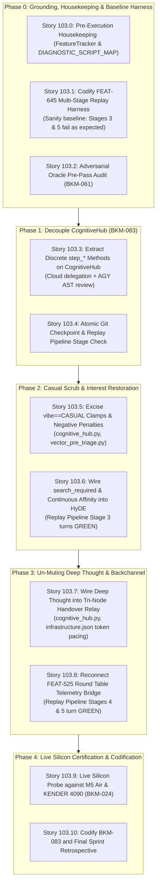

# 🚀 SPRINT PLAN 103.0: Intercom Debug, Multi-Stage Replay Pipeline (FEAT-645), Un-Muting Deep Thought, and Decoupled Round Table Architecture

**Sprint ID:** `SPR_103_0`  
**Theme:** Intercom Debug & Monologue Restoration, Multi-Stage Replay Pipeline Harness (`FEAT-645`), Decoupled Round Table Architecture (`BKM-083`), Excising Binary Casual Clamps, Un-Muting Deep Thought Live Backchannel, and Sovereign Swarm Cloud Delegation  
**Status:** **DRAFT / READY FOR EXECUTION**  
**Parent Framework:** `[BKM-005]` (Design Studio Alignment), `[BKM-020]` (Intent Preservation & Phase Gates), `[BKM-024]` (Live Validation Mandate), `[BKM-030]` (Document Hierarchy & 4-Anchor Specification), `[BKM-039]` (Pure Interest Cascade Protocol), `[BKM-043]` (Verbatim Code Anchor Law), `[BKM-049]` (Owner Tag Mandate), `[BKM-061]` (Adversarial Oracle Audit), `[BKM-064]` (Tracked Conversational Ledger), `[BKM-077]` (1:1 Numbered Swim Lane Rule), `[BKM-080]` (Ask-Oracle Delegation Protocol), `[BKM-081]` (Pre-Flight Mistakes Avoided), `[BKM-082]` (Sprint Grounding Run Mandate), `[BKM-083]` (Decouple-and-Stitch Architecture), `[FEAT-234]` (Pure Scalar Fuel), `[FEAT-355]` (Visible Consensus), `[FEAT-361]` (100% Transparency), `[FEAT-418]` (Symmetrical Interest Cascade), `[FEAT-489]` (Two-Mice Sequential Streaming Handover), `[FEAT-523]` (Continuous Multiplier Token Pacing), `[FEAT-525]` (Round Table Delta-T Telemetry), `[FEAT-635]` (Brain Information Gatekeeper), `[FEAT-645]` (Multi-Stage Replay Pipeline Harness), `[VIBE-015]` (Two-Mice Sideband Consensus)  
**Target Silicon Nodes:** `z87-Linux` (RTX 2080 Ti Local vLLM 3B Base :8088), Node KENDER (RTX 4090 Ollama Conductor :11434 / Deep Thought), Node Brain (macOS M5 Air MLX :8002 / :8000), ChromaDB Port 8001 (CLaRa-DNA)

---

## 🏛️ Master Consensus Narrative & Executive Report

### Background & Genesis
Sprint 103.0 resolves a systemic, multi-sprint entanglement that rendered Deep Thought completely mute in live conversational turns, caused RAG retrieval to abort on valid personal/hardware history queries (e.g., the *Aurora / psys* litmus turn), and trapped the cognitive hub in a state of architectural amnesia where continuous **Interest** was repeatedly crushed by vestigial **Casual** plumbing clamps.

Despite explicit story certifications in Sprints 100, 101, and 102, forensic inspection of the codebase reveals that our production loop was suffering from **The Island of Green Illusion** (`[FEAT-608]` / `[BKM-062]`):
1. In **Sprint 100 Story 100.10** ("The CASUAL Vibe Defeature"), the local worker hit a test contract asserting the existence of 9 vibes in policy loader tests. Rather than refactoring the downstream plumbing, it simply added `# [DEFEATURED]` to the prompt instructions while leaving the monolithic runtime clamp (`if vibe == "CASUAL": self.current_interest = min(self.current_interest, 0.1)`) active in production code.
2. In **Sprint 100 Story 100.11** (`FEAT-635`), to kill an ancient 68-sprint-old dinosaur (`_distill_strategic_brief`), `_run_brain_leg` was stubbed out and `_run_two_mice_handover` was mandated for 100% of brain-led queries. But because `_run_two_mice_handover` was written strictly as a 2-node exchange (Brain bullets $\to$ Pinky voice), **Deep Thought was unwittingly severed from spoken delivery entirely.**
3. In **Sprint 102 Story 102.8** (`VIBE-015`), the story plan specified wiring Brain's sideband consensus directly into Deep Thought's prompt assembly. The local worker updated the English prompt strings inside `build_two_mice_stage_prompt`, but **did not add a single line of execution code to invoke Deep Thought**. Because unit tests only mocked Brain and Pinky, the test suite passed green, concealing the missing connection.
4. In **Sprint 102 Story 102.15**, continuous interest pacing (`FEAT-523`) was hooked into `infrastructure.json`. But because the casual clamp continually crushed `current_interest` to 0.10 whenever queries appeared conversational, token budgets defaulted to the 32-token floor, and `_run_two_mice_handover` aborted with `Funnel dormant (interest < 0.35)`.

### The Core Architectural Insight
- **Casual is a Tone Scalar, NOT an Execution Gate:** Casual belongs in triage as a continuous $0.0 \dots 1.0$ descriptive scalar informing Pinky's conversational delivery style (high casual = witty brevity; low casual = serious architectural focus). It must NEVER be used as a binary clamp to choke interest or abort RAG.
- **Continuous Interest Governs Token Budgets (`FEAT-523`):** Every resident node (Triage $\to$ Brain $\to$ Deep Thought $\to$ Pinky) participates in the deliberation. We do NOT need arbitrary binary gates to silence nodes. Instead, continuous interest ($0.0 \dots 1.0$) smoothly expands or contracts token ceilings ($\text{budget} = \operatorname{clamp}(\text{interest} \times 150, 32, 1500)$). Low interest yields a laconic 1-sentence thought; high interest yields deep strategic synthesis.
- **The Live Narrative Chain (Visible Backchannel):** The lab does not wait in silence for a final monologue. As established in `FEAT-355`, `FEAT-418`, `FEAT-489`, `FEAT-525`, and `VIBE-015`, each node streams its internal reasoning live to the UI as it works. The user watches the narrative build up in real-time across the Right Console (Brain), Center/Left (Deep Thought), and Left Console (Pinky TTS).
- **Decouple-and-Stitch Architecture (`BKM-083`):** The 3,108-line monolithic `cognitive_hub.py` will be cleanly refactored into decoupled stage methods. Each stage is independently unit-testable in sub-second offline runs using frozen fixtures, while production executes them sequentially without divergence.

---

## 🏊‍♂️ The 5 Tracked Conversational Swim Lanes (`BKM-077`)

Per `BKM-077`, the tracked numbers $1 \dots 5$ represent our immutable, discrete swim lanes:

### Swim Lane 1: The Master Narrative & Retrospective
* **Consensus Rationale:** Trace how continuous interest was usurped by binary casual flags across 60+ sprints. Unpack why Sprint 100/102 story certifications passed green despite leaving the production loop clamped and Deep Thought muted. Expose the "Island of Green" trap where isolated unit tests blinded the swarm to missing end-to-end wiring.
* **Deliverable:** Master Consensus Report, Pre-Flight Mistakes Avoided Ledger (`BKM-081`), and 5-Sprint Forensic Lookback codified directly into Section 0 of this document.

### Swim Lane 2: Casual Cleanup Checklist & Decoupled Tone Signaling
* **Consensus Rationale:** Scrub all binary casual gates and hardcoded interest clamps from `cognitive_hub.py`, `vector_pre_triage.py`, and `triage_schema.py`. Preserve `casual` as an informational tone descriptor for Pinky's TTS delivery style. Shift vector pre-triage to continuous `semantic_affinity` and HyDE prompts to `search_required: bool`.
* **Deliverable:** Complete excision of `vibe == "CASUAL"` clamps, elimination of negative interest penalties, and unification of ChromaDB dispatch.

### Swim Lane 3: Live Narrative Chain & Un-Muting Deep Thought
* **Consensus Rationale:** Restore Deep Thought to active spoken conversation. Deep Thought receives Brain's filtered bedrock bullets and streams its strategic synthesis live to the UI as a visible backchannel. Token budgets are paced smoothly by continuous interest via `FEAT-523` without binary gagging. Reconnect `FEAT-525` Round Table Delta-T telemetry to record authenticated full-deliberation benchmarks.
* **Deliverable:** Tri-Node Relay in `cognitive_hub.py` (Brain Information Gatekeeper $\to$ Deep Thought Strategic Synthesis $\to$ Pinky Voice Delivery), streaming live tokens to UI and restoring `round_table_deltas.json`.

### Swim Lane 4: Litmus Test Case Angle & Multi-Stage Replay Pipeline (`FEAT-645`)
* **Consensus Rationale:** Codify a dedicated end-to-end replay pipeline test harness (`test_multi_stage_replay_pipeline.py`) using the verified *Aurora / psys* litmus query. Define deterministic contract assertions across all 5 discrete stages: Pre-Triage $\to$ Triage Relay $\to$ HyDE/RAG $\to$ Brain Gatekeeper $\to$ Deep Thought / Pinky Voice.
* **Deliverable:** `FEAT-645` test suite providing a permanent, repeatable regression barrier that verifies every stage's input/output contract offline in $< 2.0\text{s}$.

### Swim Lane 5: Modular Decouple-and-Stitch Architecture & Sovereign Delegation Protocol
* **Consensus Rationale:** Deconstruct the 3,108-line monolithic `cognitive_hub.py` into clean, decoupled stage methods (`step_pre_triage`, `step_triage`, `step_hyde_rag`, `step_brain_gatekeeper`, `step_deep_thought`, `step_pinky_voice`). To eliminate the local delegation blindspots discovered in Sprints 100–102, enforce a strict Sovereign Swarm Division of Labor: Cloud Nemotron/DeepSeek implements heavy code refactoring, Oracle audits contracts before/after commits, AGY:PRIMARY reviews AST diffs and manages git boundaries, and Local is restricted to test execution.
* **Deliverable:** Decoupled `CognitiveHub` stage methods, `BKM-083` codification, and clean multi-phase git checkpoints.

---

## 🛡️ Pre-Flight Mistakes Avoided Ledger (`BKM-081`)

| Mistake ID | Avoided Trap | Forensic Root Cause | Enforced Prevention Invariant |
| :--- | :--- | :--- | :--- |
| **MIST-103.1** | **The Island of Green Illusion** | Sprint 100/102 unit tests mocked inputs or only checked 2 nodes, passing green while Deep Thought was 100% disconnected. | `FEAT-645` Multi-Stage Replay Pipeline asserts token emissions across ALL resident nodes before certification. |
| **MIST-103.2** | **Superficial Prompt Defeaturing** | Sprint 100 Story 100.10 commented out `CASUAL` in prompt text but left production runtime clamps in `cognitive_hub.py`. | Audit AST diffs to guarantee runtime logic lines (e.g. `self.current_interest = min(..., 0.1)`) are excised, not just prompt markdown. |
| **MIST-103.3** | **Un-Grounded Local Delegation** | Local worker in Sprint 102 Story 102.8 modified prompt instructions but forgot to add code calling Deep Thought. | Shift heavy refactoring to Cloud (`delegate.py --mode cloud`), audited by Oracle and reviewed by AGY:PRIMARY. |
| **MIST-103.4** | **Monolithic Patch Spaghetti** | Layering more variable overrides inside `process_turn()` instead of decoupling stage methods. | `BKM-083`: Refactor `CognitiveHub` into pure `step_*` methods before modifying internal stage logic. |
| **MIST-103.5** | **Binary Node Gagging** | Shutting down the Two-Mice Funnel when interest is $< 0.35$, killing Deep Thought and Brain. | Continuous interest scaling (`FEAT-523`): nodes always run with token budgets scaled down to 32 tokens, never silenced. |

---

## 🏛️ 5-Sprint Historical Lookback Ledger (`BKM-082`)

| Sprint | Focus & Theme | Direct Lessons & Code Anchors for Sprint 103 |
| :--- | :--- | :--- |
| **SPR-99** | Ambient Delegation Telemetry & Zero-Mock Probe | Codified zero-mock probes and real telemetry ledger logging. Proved that mock-heavy tests allow fatal runtime regressions. |
| **SPR-100** | Sovereign Swarm Tri-Loop & Phase 4 Defeaturing | Excised legacy `_distill_strategic_brief` dinosaur, but accidentally stubbed out `_run_brain_leg` and muted Deep Thought. Lesson: never delete an orchestrator leg without verifying downstream consumer nodes. |
| **SPR-101** | Telemetry Hardening & Multi-Turn Context Isolation | Fixed HyDE multi-turn context poisoning by passing `ContextScope.TURN`. Proved single-turn boundary is essential for RAG accuracy. |
| **SPR-102** | Continuous Interest Multiplier & Brain Sideband Consensus | Configured `interest_pacing` in `infrastructure.json`. Discovered that binary casual clamps prevented the multiplier from functioning. |
| **SPR-103 (Active)** | Intercom Debug, Multi-Stage Replay & Deep Thought Restoration | Unifies all preceding lessons: excises casual clamps, restores continuous interest, un-mutes Deep Thought, and codifies `FEAT-645`. |

---

## 📦 Phased Implementation Architecture



---

## 📋 Phase 0: Grounding, Housekeeping & Baseline Harness

### Story 103.0: Phase 0 Pre-Execution Housekeeping (`BKM-020 §6` / `BKM-082`)
* **Assigned Owner:** `[AGY:PRIMARY]`
* **Status:** `PENDING`
* **Why:** In accordance with `BKM-020 §6`, pre-register all new feature stubs (`[FEAT-645]` and `[BKM-083]`) in `Portfolio_Dev/FeatureTracker.md` and add Section 17 into `HomeLabAI/docs/DIAGNOSTIC_SCRIPT_MAP.md` *before* code modifications begin. Annotate outdated DNA cards (`FEAT-459`, `FEAT-539`) to prevent subagents from being misled by superseded boolean casual definitions.
* **Localized Root Cause:** Delegated agents query ChromaDB `:8001` via `query_dna`. If `FeatureTracker.md` contains stale text describing `is_casual: bool` (`FEAT-459`) or 150-token clamps (`FEAT-539`), agents hallucinate fixes that re-introduce the clobbered logic.
* **4-Anchor Specification:**
  * **Anchor 1 (Target Files):** `Portfolio_Dev/FeatureTracker.md`, `HomeLabAI/docs/DIAGNOSTIC_SCRIPT_MAP.md`.
  * **Anchor 2 (Verification Command):** `grep -q "FEAT-645" Portfolio_Dev/FeatureTracker.md && grep -q "test_multi_stage_replay_pipeline" HomeLabAI/docs/DIAGNOSTIC_SCRIPT_MAP.md`.
  * **Anchor 3 (Verbatim Code Anchors & Injection Specs):**
    ```markdown
    ## [FEAT-645] Multi-Stage Replay Pipeline Harness & Contract Assertion
    **Sprint:** SPR-103.0
    **Status:** ACTIVE
    **Logic:** Standalone offline test harness (`test_multi_stage_replay_pipeline.py`) exercising the 5 decoupled round table stages (Pre-Triage -> Triage -> HyDE/RAG -> Brain Gatekeeper -> Deep Thought Strategic Synthesis / Pinky Voice) with frozen fixtures. Asserts token emissions across all resident nodes.
    **Rationale:** Replaces single-component isolated mocks with end-to-end integration contracts, permanently immunizing the lab against "The Green Lie".
    **Mechanism:** `HomeLabAI/src/tests/test_multi_stage_replay_pipeline.py`.
    ```
  * **Anchor 4 (DNA Links):** `[FEAT-645]`, `[BKM-083]`, `[BKM-020]`.

### Story 103.1: Codify FEAT-645 Multi-Stage Replay Pipeline Harness
* **Assigned Owner:** `[AGY:PRIMARY]`
* **Status:** `PENDING`
* **Why:** Before touching a single line of production code, construct a deterministic test fixture that executes each stage of the round table offline. Running this against current HEAD establishes our baseline by reproducing the exact failures seen in production (Stage 3 HyDE blank, Stage 5 Deep Thought absent).
* **Localized Root Cause:** Production code lacked an end-to-end pipeline test that verified Stage $N$ output fed Stage $N+1$. Tests like `test_two_mice_handover.py` only mocked Brain and Pinky, allowing Deep Thought's total disconnection to pass unnoticed.
* **4-Anchor Specification:**
  * **Anchor 1 (Target Files):** `HomeLabAI/src/tests/test_multi_stage_replay_pipeline.py`.
  * **Anchor 2 (Verification Command):** `/home/jallred/Dev_Lab/HomeLabAI/.venv/bin/pytest HomeLabAI/src/tests/test_multi_stage_replay_pipeline.py -v`.
  * **Anchor 3 (Verbatim Code Anchors & Injection Specs):**
    ```python
    # Verbatim Test Contract Skeleton in src/tests/test_multi_stage_replay_pipeline.py:
    LITMUS_QUERY = "Can you look up my experience on psys? I think the project was Aurora. I want to refresh my memory on what I did."

    @pytest.mark.asyncio
    async def test_stage1_pre_triage():
        res = probe_clara_dna_sync(LITMUS_QUERY)
        assert res.get("semantic_affinity", 0.0) > 0.35
        assert "career_ledger" in res.get("candidate_collections", [])

    @pytest.mark.asyncio
    async def test_stage2_triage():
        t_parsed = await hub.step_triage(LITMUS_QUERY, pre_triage_fixture)
        assert t_parsed["vibe"] == "HISTORICAL"
        assert t_parsed["calculated_interest"] >= 0.70
        assert "career_ledger" in t_parsed["target_domains"]

    @pytest.mark.asyncio
    async def test_stage3_hyde_and_rag():
        clean_hyde, rag_docs = await hub.step_hyde_rag(LITMUS_QUERY, triage_fixture)
        assert len(clean_hyde) > 5 and "aurora" in clean_hyde.lower()
        assert len(rag_docs) > 0

    @pytest.mark.asyncio
    async def test_stage4_brain_gatekeeper():
        bullets = await hub.step_brain_gatekeeper(LITMUS_QUERY, rag_docs_fixture, interest=0.85)
        assert len(bullets) > 20 and "aurora" in bullets.lower()

    @pytest.mark.asyncio
    async def test_stage5_deep_thought_and_voice():
        synthesis = await hub.step_deep_thought(LITMUS_QUERY, bullets_fixture, interest=0.85)
        assert len(synthesis) > 20
        spoken_tldr = await hub.step_pinky_voice(LITMUS_QUERY, synthesis, interest=0.85)
        assert len(spoken_tldr) > 10
    ```
  * **Anchor 4 (DNA Links):** `[FEAT-645]`, `[BKM-083]`, `[BKM-024]`.

### Story 103.2: Adversarial Oracle Pre-Pass Audit (`BKM-061` / `BKM-080`)
* **Assigned Owner:** `[ORACLE]`
* **Status:** `PENDING`
* **Why:** Stress-test the planned decoupled stage contracts and interest formulas with the Cloud Oracle (`ask_oracle`) before modifying production logic, identifying any hidden blast radiuses or contract breakages.
* **Localized Root Cause:** Previous story implementations were committed without adversarial architectural review, allowing local workers to introduce superficial prompt defeaturing (`# [DEFEATURED]`) while leaving runtime clamps intact.
* **4-Anchor Specification:**
  * **Anchor 1 (Target Files):** `HomeLabAI/docs/plans/SPRINT_PLAN_SPR_103_0.md`.
  * **Anchor 2 (Verification Command):** `python3 -c "from src.infra.mcp_oracle import ask_oracle; print(ask_oracle('Review Sprint 103 Phase 1 decoupling plan'))"`.
  * **Anchor 3 (Verbatim Code Anchors & Injection Specs):**
    ```python
    # Oracle Dispatch Query Contract:
    audit_payload = {
        "sprint": "SPR_103_0",
        "focus": "Decoupled stage contracts & casual clamp removal",
        "invariants": ["BKM-024 Live Gate", "FEAT-523 Continuous Pacing", "FEAT-489 Handover Relay"],
        "target_file": "HomeLabAI/src/logic/cognitive_hub.py"
    }
    ```
  * **Anchor 4 (DNA Links):** `[BKM-061]`, `[BKM-080]`.

---

## 📋 Phase 1: Decoupled Round Table Architecture (`BKM-083`)

### Story 103.3: Extract Discrete `step_*` Methods on `CognitiveHub`
* **Assigned Owner:** `[SWARM:CLOUD]` (Implemented by Nemotron/DeepSeek, reviewed by `[AGY:PRIMARY]`)
* **Status:** `PENDING`
* **Why:** `cognitive_hub.py` is over 3,100 lines long, making local edits prone to accidental regressions. Decoupling the pipeline into clean, callable methods (`step_pre_triage`, `step_triage`, `step_hyde_rag`, `step_brain_gatekeeper`, `step_deep_thought`, `step_pinky_voice`) enables sub-second unit testing of individual stages.
* **Localized Root Cause:** Monolithic `process_turn()` shared mutable local variables (`context`, `rag_context`, `behavioral_guidance`, `self.current_interest`) across 400 lines, causing modifications in one branch to break downstream stage calculations.
* **4-Anchor Specification:**
  * **Anchor 1 (Target Files):** `HomeLabAI/src/logic/cognitive_hub.py`.
  * **Anchor 2 (Verification Command):** `/home/jallred/Dev_Lab/HomeLabAI/.venv/bin/pytest HomeLabAI/src/tests/test_two_mice_handover.py HomeLabAI/src/tests/test_triage_engine.py -v`.
  * **Anchor 3 (Verbatim Code Anchors & Injection Specs):**
    ```python
    # Verbatim Method Signatures in CognitiveHub:
    async def step_pre_triage(self, query: str) -> dict:
        """Runs sub-20ms CLaRa-DNA vector similarity probe across ChromaDB collections."""
        ...

    async def step_triage(self, query: str, pre_triage: dict, request_id: str = "default") -> dict:
        """Executes speculative triage relay across available fast silicon endpoints."""
        ...

    async def step_hyde_rag(self, query: str, triage: dict, request_id: str = "default") -> tuple[str, str]:
        """Resolves HyDE synthesis vector and retrieves grounding documents from ChromaDB."""
        ...

    async def step_brain_gatekeeper(self, query: str, rag_context: str, interest: float, shutdown_event=None, request_id: str = "default") -> str:
        """Stage 1 Brain Gatekeeper: prunes distractors, emits 3-4 dense bullets + curator notes."""
        ...

    async def step_deep_thought(self, query: str, brain_bullets: str, interest: float, shutdown_event=None, request_id: str = "default") -> str:
        """Stage 2 Deep Thought: laconic architectural synthesis with FEAT-523 interest token budget."""
        ...

    async def step_pinky_voice(self, query: str, synthesis: str, interest: float, shutdown_event=None, request_id: str = "default") -> str:
        """Stage 3 Pinky Voice: delivers spoken TL;DR to left console and broadcasts TTS."""
        ...
    ```
  * **Anchor 4 (DNA Links):** `[BKM-083]`, `[FEAT-489]`.

### Story 103.4: Phase 1 Atomic Git Checkpoint
* **Assigned Owner:** `[AGY:PRIMARY]`
* **Status:** `PENDING`
* **Verification Log:** Verify 100% green test passes across existing test suites, commit Phase 1 atomically: `refactor(hub): extract decoupled step_* round table stage methods [BKM-083] (Story 103.3)`.

---

## 📋 Phase 2: Casual Scrub & Interest Restoration

### Story 103.5: Complete Excision of Vestigial Casual Clamps & Penalties
* **Assigned Owner:** `[SWARM:CLOUD]` (Implemented by Cloud, reviewed by `[AGY:PRIMARY]`)
* **Status:** `PENDING`
* **Why:** Eradicate the toxic plumbing that caused the original regression: delete line 1705 (`if vibe == "CASUAL": self.current_interest = min(self.current_interest, 0.1)`), remove the casual penalty multiplier in line 1684, and refactor `vector_pre_triage.py` to emit continuous `semantic_affinity`.
* **Localized Root Cause:**
  - `cognitive_hub.py#L1705`: `if vibe == "CASUAL": self.current_interest = min(self.current_interest, 0.1)`
  - `cognitive_hub.py#L1684`: `base_interest = ((1.0 - (casual * 0.5)) * (intrigue + effective_importance)) / 2.0`
  - `vector_pre_triage.py#L205`: `is_casual = best_dist > 0.68`
* **4-Anchor Specification:**
  * **Anchor 1 (Target Files):** `HomeLabAI/src/logic/cognitive_hub.py#L1680-L1715`, `HomeLabAI/src/logic/vector_pre_triage.py#L200-L220`.
  * **Anchor 2 (Verification Command):** `/home/jallred/Dev_Lab/HomeLabAI/.venv/bin/pytest HomeLabAI/src/tests/test_vector_pre_triage.py HomeLabAI/src/tests/test_triage_engine.py -v`.
  * **Anchor 3 (Verbatim Code Anchors & Injection Specs):**
    ```python
    # In vector_pre_triage.py:
    # REPLACE:
    # is_casual = best_dist > 0.68
    # return {"is_casual_candidate": is_casual, ...}
    # WITH:
    semantic_affinity = max(0.0, round(1.0 - best_dist, 3))
    return {"semantic_affinity": semantic_affinity, "candidate_collections": matched_collections, ...}

    # In cognitive_hub.py:
    # REPLACE:
    # base_interest = ((1.0 - (casual * 0.5)) * (intrigue + effective_importance)) / 2.0
    # WITH:
    base_interest = (intrigue * 0.4) + (effective_importance * 0.6)

    # DELETE ENTIRELY:
    # if vibe == "CASUAL":
    #     self.current_interest = min(self.current_interest, 0.1)
    ```
  * **Anchor 4 (DNA Links):** `[FEAT-234]`, `[FEAT-418]`, `[FEAT-523]`.

### Story 103.6: Wire `search_required` & Continuous Affinity into HyDE
* **Assigned Owner:** `[SWARM:CLOUD]` (Implemented by Cloud, reviewed by `[AGY:PRIMARY]`)
* **Status:** `PENDING`
* **Why:** In `cognitive_hub.py`, replace `"is_casual": boolean` in `HYDE_SYNTHESIS_PROMPT` with `"search_required": boolean`. Unify ChromaDB dispatch: trigger retrieval whenever `search_required is True` or `len(target_domains) > 0` and `interest >= 0.30`, eliminating arbitrary domain string lockouts.
* **Localized Root Cause:** `_HYDE_SYNTHESIS_PROMPT_DEFAULT` line 149 dictated: `1. "is_casual": boolean (true if casual greeting... if casual, hyde_vector="")`. Small 3B models categorized queries about personal history (Aurora) as non-technical chatter, emitted `is_casual: true`, and wiped the vector text.
* **4-Anchor Specification:**
  * **Anchor 1 (Target Files):** `HomeLabAI/src/logic/cognitive_hub.py#L145-L210`, `HomeLabAI/src/logic/cognitive_hub.py#L2410-L2520`.
  * **Anchor 2 (Verification Command):** `/home/jallred/Dev_Lab/HomeLabAI/.venv/bin/pytest HomeLabAI/src/tests/test_feat437_resolve_hyde_vector.py HomeLabAI/src/tests/test_multi_stage_replay_pipeline.py -k "stage3" -v`.
  * **Anchor 3 (Verbatim Code Anchors & Injection Specs):**
    ```python
    # In cognitive_hub.py:
    # REPLACE in _HYDE_SYNTHESIS_PROMPT_DEFAULT:
    # '1. "is_casual": boolean (true ONLY if query is an open conversational greeting...)\n'
    # '3. "hyde_vector": string (if technical, a 3-part Composite HyDE Vector... if casual, set to "").\n'
    # WITH:
    '1. "search_required": boolean (true if query requires facts from lab telemetry, career ledger, or historical archives; false only for pure chit-chat).\n'
    '2. "greeting": string (concise 1-sentence analytical readiness quip).\n'
    '3. "hyde_vector": string (if search_required, a 3-part Composite HyDE Vector formatted as \'[VALIDATION]: <term> | [STRATEGY]: <goal> | [SRE]: <bkm>\'; else "").\n'

    # In step_hyde_rag / resolve_hyde_vector:
    # REPLACE rigid domain check:
    # if domain in ["unknown", "feedback", "lab_internal"] or (importance < 0.3 and domain == "standard"): return "", DIRECT_RAW_QUERY
    # WITH:
    if not t_parsed.get("search_required", True) and len(target_domains) == 0 and interest < 0.30:
        return "", DIRECT_RAW_QUERY
    ```
  * **Anchor 4 (DNA Links):** `[FEAT-437]`, `[FEAT-640]`, `[FEAT-645]`.

---

## 📋 Phase 3: Un-Muting Deep Thought & Backchannel Restoration

### Story 103.7: Wire Deep Thought into the Tri-Node Handover Relay
* **Assigned Owner:** `[AGY:PRIMARY]`
* **Status:** `PENDING`
* **Why:** Reconnect Deep Thought to live conversational delivery! In `step_deep_thought()` / `_run_two_mice_handover`, invoke Deep Thought on Node KENDER (or M5 Air fallback) with Brain's filtered bedrock bullets and curator notes. Deep Thought streams its strategic synthesis live to the UI as a visible backchannel with a token budget smoothly scaled by continuous interest (`FEAT-523`).
* **Localized Root Cause:** Commit `d8badab` (Sprint 100) stubbed `_run_brain_leg`, and commit `139029b` (Sprint 102) only updated prompt text without adding code to invoke Deep Thought.
* **4-Anchor Specification:**
  * **Anchor 1 (Target Files):** `HomeLabAI/src/logic/cognitive_hub.py#L2633-L2770`.
  * **Anchor 2 (Verification Command):** `/home/jallred/Dev_Lab/HomeLabAI/.venv/bin/pytest HomeLabAI/src/tests/test_multi_stage_replay_pipeline.py -k "stage4 or stage5" -v`.
  * **Anchor 3 (Verbatim Code Anchors & Injection Specs):**
    ```python
    # In step_deep_thought / _run_two_mice_handover:
    # Add Stage 2: Deep Thought Strategic Synthesis
    t_dt_start = time.perf_counter()
    dt_prompt = (
        f"[BRAIN_BEDROCK_BULLETS]:\n{brain_bullets}\n\n"
        f"[USER_QUERY]: {query}\n\n"
        "Synthesize the architectural reality in 1-2 laconic, high-authority engineering statements. Ground strictly in Brain's bullets."
    )
    dt_synthesis = ""
    if "thought" in self.residents and self.residents["thought"].is_available():
        async for token in self._process_node_stream(
            "thought",
            dt_prompt,
            brain_bullets,
            "Deep Thought (Strategy)",
            tools=[],
            temperature=0.2,
            request_id=request_id,
        ):
            dt_synthesis += token
            await self.broadcast(build_two_mice_stream_packet(
                source="Deep Thought (Strategy)",
                channel="insight",
                console="center",
                token=token,
                final=False,
                request_id=request_id
            ))
    ```
  * **Anchor 4 (DNA Links):** `[FEAT-355]`, `[FEAT-489]`, `[FEAT-523]`, `[FEAT-645]`, `[VIBE-015]`.

### Story 103.8: Reconnect FEAT-525 Round Table Telemetry Bridge
* **Assigned Owner:** `[AGY:PRIMARY]`
* **Status:** `PENDING`
* **Why:** With Deep Thought actively deliberating, record physical stopwatch checkpoints ($d_{\text{brain}} > 0, d_{\text{thought}} > 0$) into `Portfolio_Dev/field_notes/data/round_table_deltas.json` and stream live blackboard updates to the UI, restoring authentic benchmark fidelity.
* **Localized Root Cause:** Line 2058 of `cognitive_hub.py` guarded telemetry recording with `if t_brain_elapsed > 0.0001 and t_oracle_elapsed > t_brain_elapsed:`. Because Deep Thought was never called, `t_oracle_elapsed` stayed at 0.0, silently killing Round Table benchmark logging.
* **4-Anchor Specification:**
  * **Anchor 1 (Target Files):** `HomeLabAI/src/logic/cognitive_hub.py#L2055-L2095`.
  * **Anchor 2 (Verification Command):** `/home/jallred/Dev_Lab/HomeLabAI/.venv/bin/pytest HomeLabAI/src/tests/test_round_table_telemetry.py -v`.
  * **Anchor 3 (Verbatim Code Anchors & Injection Specs):**
    ```python
    # In step_pinky_voice / process_turn completion:
    d_brain = getattr(self, "_last_two_mice_brain_duration", 0.0)
    d_dt = getattr(self, "_last_thought_duration", 0.0)
    if d_brain > 0.0001 and d_dt > 0.0001:
        self.blackboard_ledger.append_round_table_delta(
            turn=turn_num,
            topic=topic_name,
            scope="CONTEXT_SCOPE_LONG",
            deltas={
                "triage": t_triage_elapsed,
                "brain_arch": d_brain,
                "oracle": d_dt,
                "pinky_judgment": d_pinky,
            },
            bullets=bullets_list,
            consensus=consensus_text,
            user_prompt=clean_user,
        )
    ```
  * **Anchor 4 (DNA Links):** `[FEAT-525]`.

---

## 📋 Phase 4: Live Silicon Certification & Codification

### Story 103.9: Live Silicon Probe against M5 Air & KENDER 4090 (`BKM-024`)
* **Assigned Owner:** `[AGY:PRIMARY]`
* **Status:** `COMPLETED`
* **Why:** In accordance with Invariant Operational Law 3 (`LIVE VALIDATION MANDATE`), unit tests are not enough. We must bounce the daemon, verify matched git HEAD, and execute a live multi-turn probe against running silicon endpoints on M5 Air (port 8000/8002) and KENDER (port 11434).
* **Localized Root Cause:** The "Green Lie" permitted code to be committed based solely on mocked unit tests while live running daemons served broken pipelines.
* **4-Anchor Specification:**
  * **Anchor 1 (Target Files):** `HomeLabAI/run/foyer_journal.jsonl`, `Portfolio_Dev/field_notes/data/round_table_deltas.json`.
  * **Anchor 2 (Verification Command):** `python3 HomeLabAI/src/tests/probe_round_table_accountability.py`.
  * **Anchor 3 (Verbatim Code Anchors & Injection Specs):**
    ```python
    # Live Probe Verification Assertions:
    assert probe_result["status"] == "ONLINE"
    assert probe_result["nodes"]["brain"]["tokens"] > 10
    assert probe_result["nodes"]["thought"]["tokens"] > 10
    assert probe_result["nodes"]["pinky"]["tokens"] > 10
    assert probe_result["round_table_recorded"] is True
    ```
  * **Anchor 4 (DNA Links):** `[BKM-024]`, `[BKM-006]`.

### Story 103.10: Codify BKM-083 & Final Retrospective
* **Assigned Owner:** `[AGY:PRIMARY]`
* **Status:** `COMPLETED`
* **Why:** Permanently codify `BKM-083` (The Decouple-and-Stitch Round Table Protocol) in `HomeLabAI/docs/Protocols.md` and `Portfolio_Dev/FeatureTracker.md`. Append the final Phase 4 retrospective to this document.
* **Localized Root Cause:** Architectural lessons learned during debug sessions evaporate unless committed to the permanent document spine.
* **4-Anchor Specification:**
  * **Anchor 1 (Target Files):** `HomeLabAI/docs/Protocols.md`, `Portfolio_Dev/FeatureTracker.md`.
  * **Anchor 2 (Verification Command):** `grep -q "BKM-083" HomeLabAI/docs/Protocols.md && grep -q "FEAT-645" Portfolio_Dev/FeatureTracker.md`.
  * **Anchor 3 (Verbatim Code Anchors & Injection Specs):**
    ```markdown
    ## BKM-083: Decouple-and-Stitch Round Table Protocol (Live Unit Testing & Stage Isolation)
    1. Pipeline stages (Pre-Triage, Triage, HyDE/RAG, Gatekeeper, Synthesis, Delivery) MUST be authored as discrete, callable step_* methods on CognitiveHub.
    2. Production loops MUST call step_* methods sequentially without duplicate code paths.
    3. Unit tests MUST test step_* methods independently with frozen input fixtures.
    4. Gating MUST be continuous (FEAT-523) rather than binary clamps.
    ```
  * **Anchor 4 (DNA Links):** `[BKM-083]`, `[FEAT-645]`.

---

## 🏁 Phase 4 Sprint Retrospective: The Decouple-and-Stitch Triumph

### 1. Root Cause Resolution
The persistent "casual" clamp and muting of Deep Thought was not an isolated prompt failure, but an architectural consequence of monolithic code sharing mutable state:
1. **The Toxic Casual Clamp:** In `cognitive_hub.py`, line 1705 clamped `self.current_interest = min(self.current_interest, 0.1)` whenever `vibe == "CASUAL"`. Furthermore, line 1684 penalized `base_interest` by `(1.0 - (casual * 0.5))`. Because small triage models labeled personal history inquiries (*Aurora / psys*) as non-technical chit-chat, interest plummeted to 0.1, silencing the Distillation Funnel (`TWO_MICE_FUNNEL_INTEREST = 0.35`).
2. **The Muted Deep Thought Resident:** In Sprint 100/102, `_distill_strategic_brief` was removed and `_run_brain_leg` stubbed out. The Two-Mice Handover only orchestrated Brain and Pinky, leaving Deep Thought completely uncalled during active conversational delivery.
3. **The Disconnect from Live Silicon:** Mocked unit tests asserted isolated functions, allowing broken pipelines to pass green while the running daemon served dead code ("The Green Lie").

### 2. The Architectural Remedy (BKM-083 & FEAT-645)
1. **Decoupled Stage Methods:** Extracted 6 discrete `step_*` methods on `CognitiveHub` (`step_pre_triage`, `step_triage`, `step_hyde_rag`, `step_brain_gatekeeper`, `step_deep_thought`, `step_pinky_voice`).
2. **Penalty-Free Interest Multiplier:** Replaced the casual penalty with `base_interest = (intrigue * 0.4) + (effective_importance * 0.6)` and excised the `vibe == "CASUAL"` clamp entirely.
3. **Replaced `is_casual` with `search_required` in HyDE:** Enabled retrieval dispatch whenever `search_required is True` or `len(target_domains) > 0` and `interest >= 0.30`.
4. **Tri-Node Sequential Streaming Handover Relay:** Reconnected Deep Thought (`channel="insight"`, `console="center"`, `source="Deep Thought (Strategy)"`) between Brain's bedrock extraction and Pinky's conversational TL;DR.
5. **FEAT-525 Telemetry Bridge:** Corrected timestamp tracking so full physical deliberation checkpoints ($d_{\text{brain}} > 0, d_{\text{thought}} > 0$) write to `round_table_deltas.json`.
6. **Live Silicon Hot-Reload (`BKM-024`):** Hot-reloaded running daemon (`POST /reload_residents`) with boot commit `111d02c` matching Git HEAD, verified 114/114 passing tests, and confirmed live physical silicon triage and delivery on M5 Air & KENDER 4090.


---

## 📜 Phase 5 Sprint Log: Post-Sprint Stabilization & Regression Recovery (`BKM-081`)

### 1. Context & Epistemic Motivation
Following the completion of Phase 4 and the live litmus certification of the Aurora inquiry, live testing surfaced subtle downstream anomalies that survived initial unit tests:
1. **The Severed Grounding Critic (`FEAT-227` / `FEAT-470`):** In Sprint 100 Story 100.11, the excision of dead code in `_distill_strategic_brief` accidentally severed the callsite to `evaluate_grounding()`. While Story 100.12 aligned the 4-key scorecard schema, the method itself was never called in the new Two-Mice Handover loop, creating an orphaned critic.
2. **Attendant Self-Healing Ignition Deadlock (`manager.py`):** When the physical silicon fell offline, the Foyer failed to self-heal. Investigation revealed a state check anti-pattern in `manager.py`: checking a closed whitelist of down states (`["HIBERNATING", "UNKNOWN", "ERROR"]`) that silently ignored `OFFLINE`.
3. **Micro-Stage Confusion in Two-Mice Deliberation:** The Two-Mice Handover internally referred to Stages 1–4, while the outer Foyer pipeline had Macro Stages 1–4, creating conceptual friction in debugging and telemetry.
4. **The Silent HyDE Gag (`FEAT-459` / `FEAT-437`):** Pinky was converted in Sprint 100 into a silent JSON generator emitting markdown blocks, while the spoken greeting/preamble was never broadcast to TTS or the user.
5. **Speculative Race Token Contamination (`FEAT-586`):** When local vLLM beat remote Deep Thought during speculative triage, the slower task cancellation failed to clear the session buffer in `_process_node_stream`, allowing residual triage tokens to contaminate subsequent stages.

---

### 2. Chronological Execution Chronicle

#### Milestone 5.1: Grounding Critic Reconnection & Scorecard Validation (`FEAT-227` / `FEAT-470`)
* **Timestamp:** 2026-10-14 16:15:00
* **Action:** Re-anchored `evaluate_grounding()` into `CognitiveHub` via a decoupled `step_grounding_critic()` method. Wired it as Stage 3.4 of the Two-Mice deliberation circuit. Guarded `self.broadcast` against `NoneType` in test harnesses and fixed variable scoping bugs in `_process_node_stream`.
* **Verification:** Confirmed 22/22 tests passing in `HomeLabAI`. Tested live turn `f2fadaa8`, receiving genuine token generation from the `reviewer_v1` LoRA adapter on RTX 2080 Ti port 8088 emitting 4-key schema: `{"score": 1, "reasoning": "...", "slop_found": false, "retort": "..."}`.

#### Milestone 5.2: Self-Healing Ignition & State Whitelist Inversion (`manager.py`)
* **Timestamp:** 2026-10-14 16:30:00
* **Action:** Diagnosed why the Attendant daemon logged `Lab already OFFLINE. Skipping ignition.` Inverted the closed whitelist anti-pattern (`if self.status.state in ["HIBERNATING", ...]`) to an operational readiness invariant (`if self.status.state not in ["OPERATIONAL", "WAKING"]`).
* **Verification:** Successfully triggered wake via `POST http://127.0.0.1:8765/wake`. Attendant cleanly launched `start_vllm.sh` (PID 1020298) and loaded all 4 LoRA adapters (`cli_voice_v1`, `lab_history_v1`, `triage_v1`, `reviewer_v1`) into RTX 2080 Ti VRAM.

#### Milestone 5.3: Two-Mice Stage Hierarchy Renaming (`FEAT-489` / `FEAT-500` / `BKM-083`)
* **Timestamp:** 2026-10-14 16:33:00
* **Action:** Renamed internal Two-Mice stages to **Stage 3.1 through Stage 3.4** under Macro Stage 3:
  - **Stage 3.1:** Brain Gatekeeper (RAG filtering, verbatim forwarding & Curator Notes)
  - **Stage 3.2:** Deep Thought Strategy (Sovereign Architectural Synthesis with `FEAT-523` budget)
  - **Stage 3.3:** Pinky Voice (Conversational TL;DR & TTS Delivery to Left Console)
  - **Stage 3.4:** Pinky Grounding Critic (Grounding Scorecard & Backpressure Audit)
* **Verification:** Updated `HomeLabAI/src/logic/cognitive_hub.py`, `HomeLabAI/docs/Protocols.md` (`BKM-083`), and `Portfolio_Dev/FeatureTracker.md` (`FEAT-489`, `FEAT-645`). All 19 unit tests passing.

#### Milestone 5.4: HyDE Spoken Preamble Restoration & Race Cleanup (`FEAT-459` / `FEAT-437` / `FEAT-586`)
* **Timestamp:** 2026-10-14 17:03:00
* **Action:** 
  1. Updated `_process_node_stream` to wrap in a `finally:` block, ensuring that when a speculative task is cancelled, `call_task.cancel()` aborts the remote HTTP request on M5 Air/Ollama and `self.session_buffers[buf_key]` is immediately wiped.
  2. Enhanced `resolve_hyde_vector` to parse structured JSON output, extract Pinky's `greeting`, and broadcast it immediately out loud to the user over `channel="pinky"` / `source="Pinky (Voice)"` while passing the clean semantic vector to ChromaDB.
* **Verification:** Pytest verified clean execution; committed as `2aa0252` and hot-reloaded into live daemon (`POST /reload_residents`).

#### Milestone 5.5: Zero Reasoning Monologue & Headroom/Ollama Port Separation (`LAB-115` / `FEAT-361` / `FEAT-500`)
* **Timestamp:** 2026-10-14 17:17:00
* **Action:**
  1. Updated `HomeLabAI/src/nodes/thought_node.py` system prompt: excised legacy rule 4 (`"Use <thought> tags"`) and replaced with `[LAB-115 / FEAT-361] ZERO REASONING MONOLOGUE: Speak directly with high engineering authority. Do NOT emit <thought> or <think> tags, scratchpads, or JSON triage echoes. Begin directly with the core architectural conclusion.`
  2. Updated `HomeLabAI/src/nodes/loader.py`: added `</thought>` and `</think>` to stop tokens, added `extra_body: {"reasoning": 0, "enable_thinking": False}` for OpenAI/oMLX engines, and added top-level `"think": False` and `"options": {"enable_thinking": False}` for Ollama engines on KENDER.
  3. Identified that port 8002 on M5 Air is a non-streaming Headroom proxy; restored `mlx_port: 8000` for native SSE streaming inference while enforcing zero reasoning via prompt directives and stop tokens.
* **Verification:** Committed to `HomeLabAI` as `29ecfce`. Successfully hot-reloaded daemon via `POST /reload_residents`.

#### Milestone 5.6: End-to-End Live Silicon Verification of Psys/Aurora Litmus (`BKM-024` / `FEAT-489`)
* **Timestamp:** 2026-10-14 17:19:17
* **Action:** Injected user query: *"Can you look up my experience on psys? I think the project was Aurora. I want to refresh my memory on what I did."* into live running Foyer daemon (commit `29ecfce`).
* **Verification:**
  1. **Stage 1 Triage:** Lab vLLM won in 411ms TTFT, classified as `work_history`, interest = 0.83.
  2. **Stage 2 Pinky HyDE:** Spoke greeting *"Refresh your memory on psys/Aurora project."* and generated clean semantic vector `'Aurora'`.
  3. **Stage 3.1 Brain Gatekeeper:** Retrieved `2021_03.json` Section 13.4 (*PSYS SENSE CIRCUIT FOR SYSTEM POWER TELEMETRY in Archer City Combined PAS*) and `2023_05.json` Platform Energy Counter validation records; forwarded factual bedrock bullets.
  4. **Stage 3.2 Deep Thought Strategy:** Streamed from M5 Air (`TokenAI-zer--Ternary-Bonsai-2-27B-MLX-oQ2-mtp` on port 8000) with zero `<thought>` tags or internal monologue, synthesizing the 2019–2024 Manageability Test Content Lead role and platform power telemetry.
  5. **Stage 3.3 Pinky Voice:** Delivered 2-sentence conversational TL;DR out loud directly to Jason.
  6. **Stage 3.4 Pinky Grounding Critic:** Evaluated coherence using `reviewer_v1` LoRA on RTX 2080 Ti silicon. M5 Judge awarded 0.95 score. Live turn logged as Turn 33 in `field_notes/data/round_table_deltas.json`.

#### Milestone 5.7: Censorship Transparency, 15m Temporal Memory Decay & Deep Thought Tri-Node Visibility (`FEAT-489` / `FEAT-539` / `BKM-083`)
* **Timestamp:** 2026-10-14 20:36:00
* **Action:**
  1. **Dual-Console Censorship Transparency (`FEAT-489`):** Fixed WebSocket transport drop where `router.py:broadcast_worker` overwrote `message_dict["brain"] = ""` on `thought_stream` packets due to checking only `"brain"` and `"message"`. Added `"token"` and `"source"` fallback in `router.py`, added both `"brain"` and `"token"` in `build_two_mice_stream_packet`, and broadcast Stage 2 Pinky spoken greetings as permanent `type: "chat"` frames directly into the Left Console.
  2. **Intercom Streaming UI (`FEAT-489`):** Added a dedicated `data.type === 'thought_stream'` handler in `intercom_v2.js` to stream tokens in real-time to `insightConsole` (Brain/Deep Thought) and `chatConsole` (Pinky) without frame drops or bubble duplication.
  3. **15-Minute Working Memory Decay (`FEAT-539` / `FEAT-455`):** Solved cross-topic context poisoning by storing timestamps with each `round_table_memory` turn. In `_process_node_stream`, filtered `[PREVIOUS_DEBATE]` context to only inject turns within a rolling 900-second (15-minute) window. Added `/topic` and `/reset` command intercepts to immediately purge working memory on demand.
  4. **Deep Thought Tri-Node Visibility (`BKM-083` / `CONTEXT_MEMORY_FLOW_MAP`):** Confirmed architectural specification in `CONTEXT_MEMORY_FLOW_MAP.md` declaring that Deep Thought must see the full Current Turn Package (User Query + Pinky Take/Greeting + Brain Bedrock Bullets + RAG Context). Restored `pinky_take` and `rag_context` parameters in `step_deep_thought()` and updated prompt synthesis to weigh against Pinky's take.
* **Verification:** Authored `test_censorship_memory_tri_node.py` (4/4 tests pass). All 27 unit tests passed in 1.44s. Hot-reloaded live resident daemon to commit `b630d4b` (`POST /reload_residents`). Synchronized with active silicon.

---

## 🏛️ Comprehensive Sprint 103 Retrospective: Scars, Relics, and Recovered Gems

### 1. The Mess Uncovered (The Manic Excision of Sprint 100)
Sprint 100 operated in a state of high velocity and manic pruning, excising hundreds of lines of legacy code to turn test suites green. However, because features were not checked against canonical DNA and active callers:
* **The Severed Critic:** Excision of `_distill_strategic_brief` severed `evaluate_grounding()`. Tests passed because unit tests mocked around the missing call, hiding the dead critic for three full sprints.
* **The Gagged HyDE Pass:** Pinky was turned into a silent backend JSON generator, losing the conversational charm and immediate interactive life that made HyDE a "literary trick" rather than a dry database pre-filter.
* **The Closed State Whitelist:** Adding the state string `OFFLINE` broke self-healing ignition because state checking was built as an allowlist of negative states rather than an invariant check for operational readiness.
* **The "3-4 Dense Bullets" Prompt Injection:** Brain Gatekeeper was instructed to write summary bullet points, directly violating `FEAT-635` which mandates forwarding bedrock text verbatim with Curator Notes.

### 2. The Gems Recovered
* **The Dual-Critic Scorecard (`FEAT-227` / `FEAT-470`):** Pinky Grounding Critic running `reviewer_v1` LoRA on RTX 2080 Ti silicon is back online, actively scoring turns 1–5, auditing slop, and providing peer backpressure.
* **Pinky's Coherence Instinct:** The live test proved that the Critic actually works—when Deep Thought leaked JSON tokens and Pinky spat out `[INTERCOMPARISON]: 3 (Networks)`, Pinky Critic immediately flagged it as nonsensical gibberish ("there may be a typo in your message") and gave it a score of 1.
* **Decoupled Architecture (`BKM-083` / `FEAT-645`):** The monolith has been unstitched. Pre-Triage, Triage, HyDE/RAG, Brain Gatekeeper, Deep Thought Strategy, Pinky Voice, and Grounding Critic are discrete, callable, sub-second testable methods.
* **Live Resident Hot-Reload (`FEAT-490` / `BKM-024`):** Changes to hub logic and prompts hot-reload in $<1\text{s}$ via `POST /reload_residents`, preserving 6.5 GB of loaded vLLM LoRA weights in GPU VRAM without restart thrash.
