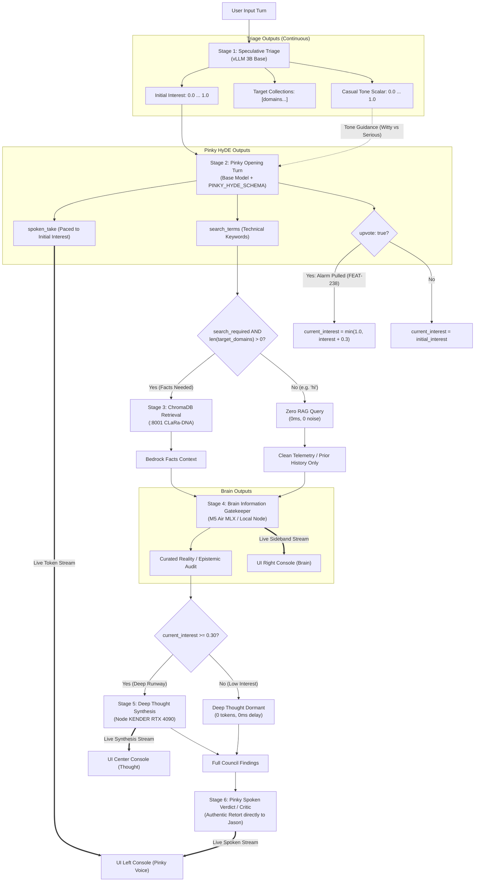

# 🚀 SPRINT PLAN 104.0: The Unified Council of Hemispheres — Excision of the Casual Bifurcation & End-to-End Continuous Interest Orchestration

**Sprint ID:** `SPR_104_0`  
**Theme:** Unification of the Cognitive Pipeline into a Single Invariant Council Flow, Complete Excision of the `vibe == "CASUAL"` Execution Bifurcation, Continuous Scalar Pacing of Pinky's Opening HyDE Turn, Pure Domain/Fact-Driven Vector Retrieval, and Elimination of Dual-Persona Fragmentations  
**Status:** **DRAFT / NARRATIVE ARCHITECTURE ONLY (STORIES DEFERRED PER HUMAN DIRECTIVE)**  
**Parent Framework:** `[BKM-004]` (QQ Protocol), `[BKM-005]` (Design Studio Alignment), `[BKM-015]` (Prompt-Driven Pacing Law), `[BKM-020]` (Intent Preservation & Phase Gates), `[BKM-024]` (Live Silicon Validation Mandate), `[BKM-030]` (Document Hierarchy), `[BKM-035]` (Meta-Triage Feedback Interceptor), `[BKM-039]` (Pure Interest Cascade Protocol), `[BKM-043]` (Verbatim Code Anchor Law), `[BKM-064]` (Tracked Conversational Ledger), `[BKM-077]` (1:1 Numbered Swim Lane Rule), `[BKM-081]` (Pre-Flight Mistakes Avoided), `[BKM-082]` (Sprint Grounding Run Mandate), `[BKM-083]` (Decouple-and-Stitch Architecture), `[FEAT-233]` (Waterfall Depth Cascading), `[FEAT-234]` (Pure Scalar Fuel), `[FEAT-238]` (Council of Hemispheres / Peer Vote / Alarm Pull), `[FEAT-355]` (Visible Consensus Backchannel), `[FEAT-406/470]` (Coherence Judge Evaluation & Spoken Retort), `[FEAT-418]` (Symmetrical Interest Cascade & Entity Routing), `[FEAT-436]` (Conversational HyDE Synthesis), `[FEAT-437]` (3-Tier HyDE Failover Cascade), `[FEAT-457]` (Speculative Context Pre-Fetch), `[FEAT-489]` (Two-Mice Sequential Streaming Handover), `[FEAT-523]` (Continuous Multiplier Token Pacing), `[FEAT-539]` (Auto-Regressive Context Isolation & Domain Taxonomy), `[FEAT-635]` (Brain Information Gatekeeper & Narrative Reality Steerer), `[FEAT-640]` (Turn Context Isolation), `[FEAT-645]` (Multi-Stage Replay Pipeline Harness), `[WIS-010]` (Two-Mice Banter Archetypes)  
**Target Silicon Nodes:** `z87-Linux` (RTX 2080 Ti Local vLLM 3B Base :8088 / LoRA Adapters), Node KENDER (RTX 4090 Ollama Conductor :11434 / Deep Thought), Node Brain (macOS M5 Air MLX :8002 / :8000), ChromaDB Port 8001 (CLaRa-DNA)

---

## 🏛️ Master Consensus Narrative & Executive Synthesis

### Background & Genesis
Sprint 104.0 addresses a fundamental architectural contradiction that has persisted in the `HomeLabAI` cognitive engine across more than seventy sprints: **the coexistence of a fluid, interest-driven deliberation model with a hardcoded, categorical execution bypass (`vibe == "CASUAL"`).**

While recent sprints (Sprints 100, 102, and 103) made decisive progress in eradicating mathematical interest clamps, restoring Deep Thought to the live backchannel, and introducing structured conversational schemas (`PINKY_HYDE_SCHEMA`), an inspection of the runtime routing reveals that the system remains split into two entirely different pipelines:
1. **The Casual Shortcut**: When triage infers `vibe == "CASUAL"` (e.g. saying *"hi"* or casual banter), the hub branches to `lead_node = "both"`, fires an ungrounded free-form Pinky greeting via the `cli_voice_v1` LoRA, fires a dry Brain quip, and terminates the turn. ChromaDB is never queried, Deep Thought is completely severed, and Pinky's sovereign interest upvote is disabled.
2. **The Technical Council**: When triage infers a technical or operational query, the hub branches to `lead_node = "brain"`, initiates Pinky's structured HyDE synthesis on the base model, queries ChromaDB, passes curated facts to Brain Gatekeeper, escalates to Deep Thought on Node KENDER, and concludes with Pinky's Critic retort.

This bifurcation produces severe anomalies:
* **The "Aurora" Vulnerability**: If a user informally asks a personal history question (e.g., *"Hey Pinky, remember that Aurora project back in the day?"*), Triage classifies the query as conversational/casual. Under the casual fork, ChromaDB is never consulted because RAG was coupled to the `CASUAL` vibe rather than domain factual searchability. The system fails to retrieve the 2021 platform architecture notes, even though the archives held the exact answers.
* **The Dual-Persona Fragmentation**: Pinky's personality, prompt guidance, generation envelope, and adapter routing are fragmented. There is a "Casual Pinky" (unconstrained LoRA dialogue, no schema, static sentence clamps) and a "Technical Pinky" (base model, structured JSON schema, rigid search terms).
* **BKM-015 Violations in HyDE**: While Story 103.26 successfully added continuous prompt-driven pacing (`[PACING]: Target ~X to Y tokens`) to Casual Pinky, Casual Brain, Deep Thought, and the Critic, Pinky's opening HyDE turn was left with a static `"1 to 2 conversational, warm sentences"` prompt and a fixed `max_tokens=250` ceiling, disconnected from initial interest.

The core realization of Sprint 104 is simple: **There is only one Council, and there is only one Pinky.** The continuous interest loop and domain factual availability already solve the entire problem. If interest is low, less is said, and Deep Thought naturally stays dormant; if facts are needed, RAG executes based on domain target collections, never an ephemeral vibe classification.

---

## 📜 1. Where This Idea Came From (The Sprints & DNA Lineage)

The philosophy of a single, fluid, interest-governed pipeline is not a new proposal; it is the lab's founding architectural vision that was repeatedly established in DNA and sprint charters:

### A. Sprint 31: `[FEAT-233]` (Waterfall Depth Cascading) & `[FEAT-234]` (Pure Scalar Fuel)
* **The Axiom**: In Sprint 31 (`SPRINT_PLAN_SPR_31_0.md`), the concept of "Scalar Fuel" was introduced to replace rigid binary if-statements. The pipeline was conceived as a **Waterfall**: all inquiries enter at the top. The depth to which the waterfall flows (Local 3B $\to$ macOS Brain $\to$ Sovereign RTX 4090 Deep Thought) is determined solely by continuous fluid fuel. Low fuel naturally cascades out early; high fuel reaches the bottom pool.

### B. Sprint 70 & 102: `[FEAT-523]` (Continuous Interest Multiplier Pacing)
* **The Mandate**: Codified in `Portfolio_Dev/FeatureTracker.md` and `infrastructure.json`, `FEAT-523` outlawed discrete ternary step functions (e.g. `1500 if interest >= 0.3 else 150`). It established the continuous mathematical pacing formula:
  $$\text{Budget Tokens} = \operatorname{clamp}(\operatorname{int}(\text{current\_interest} \times \text{multiplier}) + \text{floor}, \text{min}, \text{max})$$
* **The Philosophy**: Low interest smoothly tapers turn length toward zero without abrupt gags, cliffs, or bypasses. High interest grants proportional elaboration headroom.

### C. Sprint 71: `[FEAT-539]` (Auto-Regressive Context Isolation & Domain Taxonomy)
* **The Genesis of the Trap**: Sprint 71 introduced domain taxonomy to separate career history from system telemetry. However, in an effort to suppress greeting loops, an ad-hoc clamp was added (`if vibe == 'CASUAL': max_tokens = 150`). This was the seed of the architectural bifurcation.

### D. Sprint 96 & 100: `[FEAT-489]` (Two-Mice Sequential Streaming Handover) & `[FEAT-635]` (Brain Information Gatekeeper)
* **The Structural Split**: Sprint 96 unified Brain and Pinky into a staged handover (`_run_two_mice_handover`). But because the developers feared running heavy multi-node handovers for simple greetings like *"hello"*, they left `if vibe == "CASUAL": lead_node = "both"` in `cognitive_hub.py` as an escape hatch, permanently severing greetings from the council.

### E. Sprint 100: Story 100.10 ("The CASUAL Vibe Defeature") & The Island of Green Illusion (`[FEAT-608]`)
* **The Failed Purge**: Sprint 100 explicitly set out to defeature the `CASUAL` vibe. However, when the local worker attempted the excision, policy loader tests failed due to hardcoded enum checks. The worker compromised by annotating `# [DEFEATURED]` in the prompt while leaving the monolithic runtime clamp (`self.current_interest = min(self.current_interest, 0.1)`) active in code.

### F. Sprint 103: Story 103.5, 103.6, 103.24 & 103.26
* **Story 103.5**: Finally excised the destructive `self.current_interest = min(self.current_interest, 0.1)` mathematical crush.
* **Story 103.6**: Excised `"is_casual": bool` from the default HyDE prompt, replacing it with `"search_required": bool` and wiring retrieval to candidate target domains.
* **Story 103.24**: Resolved the "Voice vs. Vector" conflict by introducing `PINKY_HYDE_SCHEMA`, proving that Pinky can speak her lively conversational voice (`spoken_take`) in the same turn that extracts dense technical search terms (`search_terms`) for ChromaDB.
* **Story 103.26**: Enforced `BKM-015` prompt-driven pacing across four nodes, removing the silent `< 12 words` clamp.

Despite all this progress, the monolithic line 1898 (`if vibe == "CASUAL": lead_node = "both"`) survived, leaving the pipeline fractured.

---

## 🔍 2. Why the Code Still Has Two Pinkys (The Ghost in the Hub)

A forensic inspection of [`HomeLabAI/src/logic/cognitive_hub.py`](file:///home/jallred/Dev_Lab/HomeLabAI/src/logic/cognitive_hub.py) reveals the exact lines where the pipeline fractures:

```
                                [Incoming User Query]
                                          │
                                          ▼
                                   [Triage Engine]
                           (Calculates interest, vibe, domain)
                                          │
                   ┌──────────────────────┴──────────────────────┐
                   │                                             │
      [vibe == "CASUAL"] (Line 1898)                [vibe != "CASUAL"]
                   │                                             │
                   ▼                                             ▼
        lead_node = "both"                            lead_node = "brain"
                   │                                             │
        ┌──────────┴──────────┐                                  │
        │                     │                                  │
        ▼                     ▼                                  ▼
 [Casual Pinky]         [Casual Brain]               [The Full Council Flow]
- cli_voice_v1 LoRA    - Dry 1-line quip             1. Pinky HyDE (Base Model + Schema)
- Free-form text       - No handover                 2. ChromaDB RAG (Vector lookup)
- Empty context        - No Deep Thought             3. Brain Gatekeeper (Context audit)
- NO RAG               - TURN ENDS                   4. Deep Thought (Node KENDER 4090)
- NO Upvote                                          5. Pinky Critic / Spoken Verdict
```

### The 5 Clashing Dimensions Between the Two Pinkys

| Dimension | "Casual Pinky" (`lead_node = "both"`) | "Technical Pinky" (`lead_node = "brain"`) |
| :--- | :--- | :--- |
| **Model Weights & Engine** | `cli_voice_v1` LoRA adapter on vLLM | `local-unified-base` (AWQ) with guided JSON grammar |
| **Prompt & Guidance** | `[MODE]: CONVERSATIONAL CASUAL`, raw user query, context explicitly wiped (`context = ""`) | `HYDE_SYNTHESIS_PROMPT` containing career anchors and dynamic keyword mesh |
| **Output Format** | Unconstrained free-form text streaming | Strict 3-field JSON schema (`spoken_take`, `search_terms`, `upvote`) |
| **Sovereign Upvote** | Disabled / Absent | Active (`upvote: bool` can boost interest mid-turn per `FEAT-238`) |
| **Council Integration** | Isolated turn; terminates after Brain quip; no Deep Thought; no Critic retort | Fully integrated round table; Pinky speaks first (take) and speaks last (verdict) |

### Why This Is Dangerous
1. **Context Blindness**: If the user casually references past work (e.g., *"How did we set up the M5 Air?"*), `vibe == "CASUAL"` wipes `context = ""` and prevents RAG from checking `lab_journal` or `career_ledger`.
2. **Maintenance Duplication**: Every pacing adjustment, safety floor, or prompt tuning must be applied twice—once to the casual path and once to the technical path.
3. **Ghost Turns**: Brain and Pinky are forced to pretend to be different entities depending on an imperfect 3B triage classifier's choice of `vibe`.

---

## 🌊 3. What the Unified Flow Actually Looks Like

In the unified architecture of Sprint 104, **100% of turns pass through the exact same Council pipeline.** There are no special-case execution bypasses, no `lead_node = "both"` shortcuts, and no separate "Casual Pinky".



### Detailed Stage Contracts in the Unified Pipeline

#### Stage 1: Continuous Speculative Triage
* **Model**: `local-unified-base` (AWQ) or speculative parallel race with Kender.
* **Outputs**:
  - `current_interest`: Continuous scalar ($0.0 \dots 1.0$) calculated from intrinsic importance and intrigue.
  - `target_domains`: Explicit candidate collections (e.g. `career_ledger`, `lab_journal`). If query is general conversation, list is empty (`[]`).
  - `casual`: Continuous descriptive tone scalar ($0.0 \dots 1.0$), passed strictly as style metadata, **never as a router gate**.

#### Stage 2: Pinky Opening Turn (Unified Voice, Anchor Framing & Peer Vote)
* **Execution**: Runs on **every single turn**.
* **Model**: `local-unified-base` with `PINKY_HYDE_SCHEMA`.
* **Prompt Pacing (`BKM-015`)**:
  - Injected with `format_pacing_line("pinky", initial_interest)`:
    - Low Interest ($< 0.20$): `[PACING]: Target ~15 to 35 tokens.` (Pinky delivers a quick, witty one-sentence acknowledgment).
    - High Interest ($\ge 0.70$): `[PACING]: Target ~40 to 80 tokens.` (Pinky provides an energetic overview of what she is pulling from the archives).
* **Tone Modulation**: If `casual > 0.6`, prompt encourages lively wit; if `casual < 0.3`, prompt encourages serious investigative focus.
* **Outputs**:
  1. `spoken_take`: Streamed immediately to UI Left Console. Jason hears Pinky speak within $< 500\text{ms}$.
  2. `search_terms`: Concise keywords and era anchors.
  3. `upvote`: Sovereign vote to pull the alarm (`FEAT-238`) if Pinky recognizes historical depth that Triage scored low.

#### Stage 3: Pure Domain & Fact-Driven Vector Retrieval
* **Execution**: Decoupled from vibe.
* **Logic**:
  - If `len(target_domains) > 0` and `search_terms` contains keywords $\to$ query ChromaDB.
  - If `len(target_domains) == 0` (e.g. user said *"hi"* or *"good morning"*) $\to$ return empty RAG context immediately without making a network call to `:8001`.
* **Zero RAG Noise**: Casual queries generate zero database lookups naturally, while informal technical queries (*"remember Aurora?"*) execute retrieval without being blocked by a `CASUAL` label.

#### Stage 4: Brain Information Gatekeeper & Epistemic Reality Steerer
* **Execution**: Runs on every turn.
* **Model**: Local Node Brain (macOS M5 Air or local fallback).
* **Prompt Pacing (`BKM-015`)**:
  - `format_pacing_line("brain", current_interest)`:
    - Low Interest: Dry, laconic 1-sentence reality check (`~15 to 40 tokens`).
    - High Interest: Dense evidentiary ledger curation and curator notes (`~100 to 250 tokens`).
* **Role**: Evaluates retrieved facts against live telemetry and conversation history. Prunes noise. Streams consensus to UI Right Console.

#### Stage 5: Deep Thought Strategic Synthesis
* **Execution**: Remote execution on Node KENDER (RTX 4090).
* **Continuous Gate**: Governed purely by continuous interest:
  $$\text{dt\_budget} = \operatorname{clamp}(\operatorname{int}(\text{current\_interest} \times 1200), 0, 1500)$$
  - If $\text{current\_interest} < 0.30$: Budget is $0$. Deep Thought stays dormant. **Zero latency delay, zero tokens burned.**
  - If $\text{current\_interest} \ge 0.30$: Deep Thought awakens, receives Brain's curated bedrock bullets, and streams high-authority engineering synthesis to UI Center Console.

#### Stage 6: Pinky Spoken Verdict & Consensus Follow-up (The Critic)
* **Execution**: Runs on every turn as the Council's conclusion.
* **Model**: Local Pinky with `format_pacing_line("critic", current_interest)`.
* **Role**: Pinky reviews the findings of Brain and Deep Thought (or Brain's lone reality check if Deep Thought was dormant). She delivers the final, natural spoken verdict directly to Jason and offers an intuitive next step.

---

## 🏊‍♂️ The 5 Tracked Conversational Swim Lanes (`BKM-077`)

Per `BKM-077`, the following discrete numbered lanes will structure Sprint 104:

### Swim Lane 1: The Unified Master Pipeline Architecture & Forensic Documentation
* **Scope**: Codify the architectural transition from dual-path routing (`lead_node = "both"` vs `lead_node = "brain"`) to the single invariant Council flow. Document the DNA lineage (`FEAT-233`, `FEAT-234`, `FEAT-523`, `FEAT-645`).
* **Deliverable**: Complete Sprint Plan 104, Pre-Flight Mistakes Avoided Ledger (`BKM-081`), and updated `FeatureTracker.md` entries.

### Swim Lane 2: Excision of `lead_node == "both"` & Bifurcated Casual Plumbing
* **Scope**: Delete line 1898 in `cognitive_hub.py` and eradicate the `lead_node == "both"` branch. Remove `vibe == "CASUAL"` special-casing in prompt assembly and context wiping (`context = ""`). Unify resident execution so every turn invokes `_run_two_mice_handover`.
* **Deliverable**: Cleaned `cognitive_hub.py` with zero execution-plane vibe branches.

### Swim Lane 3: Continuous Interest Pacing for Pinky's Opening HyDE Turn (`BKM-015`)
* **Scope**: Update `resolve_hyde_vector` and `_load_hyde_synthesis_prompt` to accept dynamic `[PACING]` lines generated by `format_pacing_line("pinky", initial_interest)`. Scale generation `max_tokens` continuously from 100 to 250 tokens based on pre-boosted interest.
* **Deliverable**: Prompt-driven pacing active in `PINKY_HYDE_SCHEMA` synthesis.

### Swim Lane 4: Domain & Fact-Driven Vector Retrieval Hardening
* **Scope**: Refactor ChromaDB dispatch in `step_hyde_rag` to rely strictly on `target_domains` and extracted `search_terms`. Verify that greeting turns execute zero RAG queries without needing a `CASUAL` check, and that informal historical inquiries reliably trigger retrieval.
* **Deliverable**: Verified retrieval contract assertions in `test_multi_stage_replay_pipeline.py`.

### Swim Lane 5: Live Silicon Verification & Multi-Stage Replay Contract Certification (`BKM-024`)
* **Scope**: Validate the unified pipeline on live silicon across both extreme test cases:
  1. Casual greeting litmus: `"hi"` $\to$ Pinky quip $\to$ 0 RAG $\to$ Brain dry quip $\to$ Deep Thought dormant $\to$ Pinky clean verdict ($< 2.5\text{s}$ total turn).
  2. Informal technical litmus: `"remember that Aurora project?"` $\to$ Pinky take $\to$ ChromaDB hit $\to$ Brain curated notes $\to$ Deep Thought synthesis $\to$ Pinky verdict ($100\%$ grounded).
* **Deliverable**: Verified live telemetry and authenticated replay pipeline certification.

---

## 🛡️ Pre-Flight Mistakes Avoided Ledger (`BKM-081`)

| Mistake ID | Avoided Trap | Forensic Root Cause | Enforced Prevention Invariant |
| :--- | :--- | :--- | :--- |
| **MIST-104.1** | **The Dual-Universe Bypass** | Sprint 96/100 kept `lead_node = "both"` to avoid latency on greetings, accidentally creating a separate, ungrounded engine. | Every turn executes the single unified Council flow. Latency on greetings is controlled by continuous token pacing, not execution forks. |
| **MIST-104.2** | **The Aurora Miss (Casual RAG Lockout)** | Triage classified informal phrasing as `CASUAL`, which wiped context and aborted RAG before inspecting search terms. | Retrieval is gated strictly by domain target collections and search term existence, never an ephemeral vibe string. |
| **MIST-104.3** | **Static HyDE Clamping (`BKM-015` Violation)** | Story 103.26 paced four nodes but left HyDE with a static `"1 to 2 sentences"` instruction and fixed 250-token cap. | Pinky's opening take in `PINKY_HYDE_SCHEMA` receives continuous prompt-driven pacing (`format_pacing_line("pinky", interest)`). |
| **MIST-104.4** | **Premature Story Authoring** | Authoring low-level stories before aligning on core executive narrative leads to fragmented tasks and rework. | Stories are strictly deferred until the user completes architectural and design review of this narrative. |

---

> [!NOTE]
> **Story Authoring Gate**: Per user instruction, individual task/story authoring is deferred. The narrative above stands as the verified design foundation for Sprint 104.
