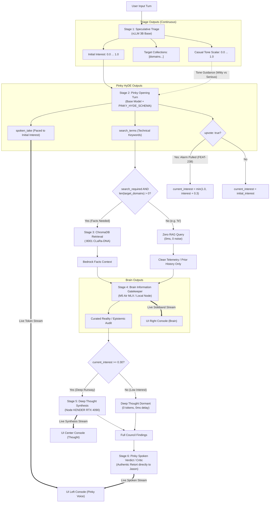
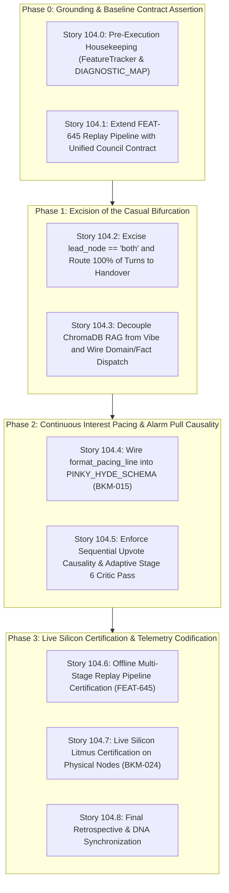

# 🚀 SPRINT PLAN 104.0: The Unified Council of Hemispheres — Excision of the Casual Bifurcation & End-to-End Continuous Interest Orchestration

**Sprint ID:** `SPR_104_0`  
**Theme:** Unification of the Cognitive Pipeline into a Single Invariant Council Flow, Complete Excision of the `vibe == "CASUAL"` Execution Bifurcation, Continuous Scalar Pacing of Pinky's Opening HyDE Turn, Pure Domain/Fact-Driven Vector Retrieval, and Elimination of Dual-Persona Fragmentations  
**Status:** **DRAFT / NARRATIVE ARCHITECTURE ONLY (STORIES DEFERRED PER HUMAN DIRECTIVE)**  
**Parent Framework:** `[BKM-004]` (QQ Protocol), `[BKM-005]` (Design Studio Alignment), `[BKM-015]` (Prompt-Driven Pacing Law), `[BKM-020]` (Intent Preservation & Phase Gates), `[BKM-024]` (Live Silicon Validation Mandate), `[BKM-030]` (Document Hierarchy), `[BKM-035]` (Meta-Triage Feedback Interceptor), `[BKM-039]` (Pure Interest Cascade Protocol), `[BKM-043]` (Verbatim Code Anchor Law), `[BKM-064]` (Tracked Conversational Ledger), `[BKM-077]` (1:1 Numbered Swim Lane Rule), `[BKM-081]` (Pre-Flight Mistakes Avoided), `[BKM-082]` (Sprint Grounding Run Mandate), `[BKM-083]` (Decouple-and-Stitch Architecture), `[FEAT-233]` (Waterfall Depth Cascading), `[FEAT-234]` (Pure Scalar Fuel), `[FEAT-238]` (Council of Hemispheres / Peer Vote / Alarm Pull), `[FEAT-355]` (Visible Consensus Backchannel), `[FEAT-406/470]` (Coherence Judge Evaluation & Spoken Retort), `[FEAT-418]` (Symmetrical Interest Cascade & Entity Routing), `[FEAT-436]` (Conversational HyDE Synthesis), `[FEAT-437]` (3-Tier HyDE Failover Cascade), `[FEAT-457]` (Speculative Context Pre-Fetch), `[FEAT-489]` (Two-Mice Sequential Streaming Handover), `[FEAT-523]` (Continuous Multiplier Token Pacing), `[FEAT-539]` (Auto-Regressive Context Isolation & Domain Taxonomy), `[FEAT-635]` (Brain Information Gatekeeper & Narrative Reality Steerer), `[FEAT-640]` (Turn Context Isolation), `[FEAT-645]` (Multi-Stage Replay Pipeline Harness), `[WIS-010]` (Two-Mice Banter Archetypes)  
**Target Silicon Nodes:** `z87-Linux` (RTX 2080 Ti Local vLLM 3B Base :8088 / LoRA Adapters), Node KENDER (RTX 4090 Ollama Conductor :11434 / Deep Thought), Node Brain (macOS M5 Air MLX :8002 / :8000), ChromaDB Port 8001 (CLaRa-DNA)

---

## 🏛️ Master Consensus Narrative & Executive Synthesis

### Background & Genesis
Sprint 104.0 addresses a fundamental architectural contradiction that has persisted in the `HomeLabAI` cognitive engine across more than seventy sprints: **the coexistence of a fluid, interest-driven deliberation model with a hardcoded, categorical execution bypass (`vibe == "CASUAL"`).**

While recent sprints (Sprints 100, 102, and 103) made decisive progress in eradicating mathematical interest clamps, restoring Deep Thought to the live backchannel, and introducing structured conversational schemas (`PINKY_HYDE_SCHEMA`), an inspection of the runtime routing reveals that the system remains split into two entirely different pipelines:
1. **The Casual Shortcut**: When triage infers `vibe == "CASUAL"` (e.g. saying *"hi"* or casual banter), the hub branches to `lead_node = "both"`, fires an ungrounded free-form Pinky greeting via the `cli_voice_v1` LoRA, fires a dry Brain quip, and terminates the turn. ChromaDB is never queried, Deep Thought is completely severed, and Pinky's sovereign interest upvote is disabled.
2. **The Technical Council**: When triage infers a technical or operational query, the hub branches to `lead_node = "brain"`, initiates Pinky's structured HyDE synthesis on the base model, queries ChromaDB, passes curated facts to Brain Gatekeeper, escalates to Deep Thought on Node KENDER, and concludes with Pinky's Critic retort.

This bifurcation produces severe anomalies:
* **The "Aurora" Vulnerability**: If a user informally asks a personal history question (e.g., *"Hey Pinky, remember that Aurora project back in the day?"*), Triage classifies the query as conversational/casual. Under the casual fork, ChromaDB is never consulted because RAG was coupled to the `CASUAL` vibe rather than domain factual searchability. The system fails to retrieve the 2021 platform architecture notes, even though the archives held the exact answers.
* **The Dual-Persona Fragmentation**: Pinky's personality, prompt guidance, generation envelope, and adapter routing are fragmented. There is a "Casual Pinky" (unconstrained LoRA dialogue, no schema, static sentence clamps) and a "Technical Pinky" (base model, structured JSON schema, rigid search terms).
* **BKM-015 Violations in HyDE**: While Story 103.26 successfully added continuous prompt-driven pacing (`[PACING]: Target ~X to Y tokens`) to Casual Pinky, Casual Brain, Deep Thought, and the Critic, Pinky's opening HyDE turn was left with a static `"1 to 2 conversational, warm sentences"` prompt and a fixed `max_tokens=250` ceiling, disconnected from initial interest.

The core realization of Sprint 104 is simple: **There is only one Council, and there is only one Pinky.** The continuous interest loop and domain factual availability already solve the entire problem. If interest is low, less is said, and Deep Thought naturally stays dormant; if facts are needed, RAG executes based on domain target collections, never an ephemeral vibe classification.

---

## 📜 1. Where This Idea Came From (The Sprints & DNA Lineage)

The philosophy of a single, fluid, interest-governed pipeline is not a new proposal; it is the lab's founding architectural vision that was repeatedly established in DNA and sprint charters:

### A. Sprint 31: `[FEAT-233]` (Waterfall Depth Cascading) & `[FEAT-234]` (Pure Scalar Fuel)
* **The Axiom**: In Sprint 31 (`SPRINT_PLAN_SPR_31_0.md`), the concept of "Scalar Fuel" was introduced to replace rigid binary if-statements. The pipeline was conceived as a **Waterfall**: all inquiries enter at the top. The depth to which the waterfall flows (Local 3B $\to$ macOS Brain $\to$ Sovereign RTX 4090 Deep Thought) is determined solely by continuous fluid fuel. Low fuel naturally cascades out early; high fuel reaches the bottom pool.

### B. Sprint 70 & 102: `[FEAT-523]` (Continuous Interest Multiplier Pacing)
* **The Mandate**: Codified in `Portfolio_Dev/FeatureTracker.md` and `infrastructure.json`, `FEAT-523` outlawed discrete ternary step functions (e.g. `1500 if interest >= 0.3 else 150`). It established the continuous mathematical pacing formula:
  $$\text{Budget Tokens} = \operatorname{clamp}(\operatorname{int}(\text{current\_interest} \times \text{multiplier}) + \text{floor}, \text{min}, \text{max})$$
* **The Philosophy**: Low interest smoothly tapers turn length toward zero without abrupt gags, cliffs, or bypasses. High interest grants proportional elaboration headroom.

### C. Sprint 71: `[FEAT-539]` (Auto-Regressive Context Isolation & Domain Taxonomy)
* **The Genesis of the Trap**: Sprint 71 introduced domain taxonomy to separate career history from system telemetry. However, in an effort to suppress greeting loops, an ad-hoc clamp was added (`if vibe == 'CASUAL': max_tokens = 150`). This was the seed of the architectural bifurcation.

### D. Sprint 96 & 100: `[FEAT-489]` (Two-Mice Sequential Streaming Handover) & `[FEAT-635]` (Brain Information Gatekeeper)
* **The Structural Split**: Sprint 96 unified Brain and Pinky into a staged handover (`_run_two_mice_handover`). But because the developers feared running heavy multi-node handovers for simple greetings like *"hello"*, they left `if vibe == "CASUAL": lead_node = "both"` in `cognitive_hub.py` as an escape hatch, permanently severing greetings from the council.

### E. Sprint 100: Story 100.10 ("The CASUAL Vibe Defeature") & The Island of Green Illusion (`[FEAT-608]`)
* **The Failed Purge**: Sprint 100 explicitly set out to defeature the `CASUAL` vibe. However, when the local worker attempted the excision, policy loader tests failed due to hardcoded enum checks. The worker compromised by annotating `# [DEFEATURED]` in the prompt while leaving the monolithic runtime clamp (`self.current_interest = min(self.current_interest, 0.1)`) active in code.

### F. Sprint 103: Story 103.5, 103.6, 103.24 & 103.26
* **Story 103.5**: Finally excised the destructive `self.current_interest = min(self.current_interest, 0.1)` mathematical crush.
* **Story 103.6**: Excised `"is_casual": bool` from the default HyDE prompt, replacing it with `"search_required": bool` and wiring retrieval to candidate target domains.
* **Story 103.24**: Resolved the "Voice vs. Vector" conflict by introducing `PINKY_HYDE_SCHEMA`, proving that Pinky can speak her lively conversational voice (`spoken_take`) in the same turn that extracts dense technical search terms (`search_terms`) for ChromaDB.
* **Story 103.26**: Enforced `BKM-015` prompt-driven pacing across four nodes, removing the silent `< 12 words` clamp.

Despite all this progress, the monolithic line 1898 (`if vibe == "CASUAL": lead_node = "both"`) survived, leaving the pipeline fractured.

---

## 🔍 2. Why the Code Still Has Two Pinkys (The Ghost in the Hub)

A forensic inspection of [`HomeLabAI/src/logic/cognitive_hub.py`](file:///home/jallred/Dev_Lab/HomeLabAI/src/logic/cognitive_hub.py) reveals the exact lines where the pipeline fractures:

```
                                [Incoming User Query]
                                          │
                                          ▼
                                   [Triage Engine]
                           (Calculates interest, vibe, domain)
                                          │
                   ┌──────────────────────┴──────────────────────┐
                   │                                             │
      [vibe == "CASUAL"] (Line 1898)                [vibe != "CASUAL"]
                   │                                             │
                   ▼                                             ▼
        lead_node = "both"                            lead_node = "brain"
                   │                                             │
        ┌──────────┴──────────┐                                  │
        │                     │                                  │
        ▼                     ▼                                  ▼
 [Casual Pinky]         [Casual Brain]               [The Full Council Flow]
- cli_voice_v1 LoRA    - Dry 1-line quip             1. Pinky HyDE (Base Model + Schema)
- Free-form text       - No handover                 2. ChromaDB RAG (Vector lookup)
- Empty context        - No Deep Thought             3. Brain Gatekeeper (Context audit)
- NO RAG               - TURN ENDS                   4. Deep Thought (Node KENDER 4090)
- NO Upvote                                          5. Pinky Critic / Spoken Verdict
```

### The 5 Clashing Dimensions Between the Two Pinkys

| Dimension | "Casual Pinky" (`lead_node = "both"`) | "Technical Pinky" (`lead_node = "brain"`) |
| :--- | :--- | :--- |
| **Model Weights & Engine** | `cli_voice_v1` LoRA adapter on vLLM | `local-unified-base` (AWQ) with guided JSON grammar |
| **Prompt & Guidance** | `[MODE]: CONVERSATIONAL CASUAL`, raw user query, context explicitly wiped (`context = ""`) | `HYDE_SYNTHESIS_PROMPT` containing career anchors and dynamic keyword mesh |
| **Output Format** | Unconstrained free-form text streaming | Strict 3-field JSON schema (`spoken_take`, `search_terms`, `upvote`) |
| **Sovereign Upvote** | Disabled / Absent | Active (`upvote: bool` can boost interest mid-turn per `FEAT-238`) |
| **Council Integration** | Isolated turn; terminates after Brain quip; no Deep Thought; no Critic retort | Fully integrated round table; Pinky speaks first (take) and speaks last (verdict) |

### Why This Is Dangerous
1. **Context Blindness**: If the user casually references past work (e.g., *"How did we set up the M5 Air?"*), `vibe == "CASUAL"` wipes `context = ""` and prevents RAG from checking `lab_journal` or `career_ledger`.
2. **Maintenance Duplication**: Every pacing adjustment, safety floor, or prompt tuning must be applied twice—once to the casual path and once to the technical path.
3. **Ghost Turns**: Brain and Pinky are forced to pretend to be different entities depending on an imperfect 3B triage classifier's choice of `vibe`.

---

## 🌊 3. What the Unified Flow Actually Looks Like

In the unified architecture of Sprint 104, **100% of turns pass through the exact same Council pipeline.** There are no special-case execution bypasses, no `lead_node = "both"` shortcuts, and no separate "Casual Pinky".



### Detailed Stage Contracts in the Unified Pipeline

#### Stage 1: Continuous Speculative Triage
* **Model**: `local-unified-base` (AWQ) or speculative parallel race with Kender.
* **Outputs**:
  - `current_interest`: Continuous scalar ($0.0 \dots 1.0$) calculated from intrinsic importance and intrigue.
  - `target_domains`: Explicit candidate collections (e.g. `career_ledger`, `lab_journal`). If query is general conversation, list is empty (`[]`).
  - `casual`: Continuous descriptive tone scalar ($0.0 \dots 1.0$), passed strictly as style metadata, **never as a router gate**.

#### Stage 2: Pinky Opening Turn (Unified Voice, Anchor Framing & Peer Vote)
* **Execution**: Runs on **every single turn**.
* **Model**: `local-unified-base` with `PINKY_HYDE_SCHEMA`.
* **Prompt Pacing (`BKM-015`)**:
  - Injected with `format_pacing_line("pinky", initial_interest)`:
    - Low Interest ($< 0.20$): `[PACING]: Target ~15 to 35 tokens.` (Pinky delivers a quick, witty one-sentence acknowledgment).
    - High Interest ($\ge 0.70$): `[PACING]: Target ~40 to 80 tokens.` (Pinky provides an energetic overview of what she is pulling from the archives).
* **Tone Modulation**: If `casual > 0.6`, prompt encourages lively wit; if `casual < 0.3`, prompt encourages serious investigative focus.
* **Outputs**:
  1. `spoken_take`: Streamed immediately to UI Left Console. Jason hears Pinky speak within $< 500\text{ms}$.
  2. `search_terms`: Concise keywords and era anchors.
  3. `upvote`: Sovereign vote to pull the alarm (`FEAT-238`) if Pinky recognizes historical depth that Triage scored low.

#### Stage 3: Pure Domain & Fact-Driven Vector Retrieval
* **Execution**: Decoupled from vibe.
* **Logic**:
  - If `len(target_domains) > 0` and `search_terms` contains keywords $\to$ query ChromaDB.
  - If `len(target_domains) == 0` (e.g. user said *"hi"* or *"good morning"*) $\to$ return empty RAG context immediately without making a network call to `:8001`.
* **Zero RAG Noise**: Casual queries generate zero database lookups naturally, while informal technical queries (*"remember Aurora?"*) execute retrieval without being blocked by a `CASUAL` label.

#### Stage 4: Brain Information Gatekeeper & Epistemic Reality Steerer
* **Execution**: Runs on every turn.
* **Model**: Local Node Brain (macOS M5 Air or local fallback).
* **Prompt Pacing (`BKM-015`)**:
  - `format_pacing_line("brain", current_interest)`:
    - Low Interest: Dry, laconic 1-sentence reality check (`~15 to 40 tokens`).
    - High Interest: Dense evidentiary ledger curation and curator notes (`~100 to 250 tokens`).
* **Role**: Evaluates retrieved facts against live telemetry and conversation history. Prunes noise. Streams consensus to UI Right Console.

#### Stage 5: Deep Thought Strategic Synthesis
* **Execution**: Remote execution on Node KENDER (RTX 4090).
* **Continuous Gate**: Governed purely by continuous interest:
  $$\text{dt\_budget} = \operatorname{clamp}(\operatorname{int}(\text{current\_interest} \times 1200), 0, 1500)$$
  - If $\text{current\_interest} < 0.30$: Budget is $0$. Deep Thought stays dormant. **Zero latency delay, zero tokens burned.**
  - If $\text{current\_interest} \ge 0.30$: Deep Thought awakens, receives Brain's curated bedrock bullets, and streams high-authority engineering synthesis to UI Center Console.

#### Stage 6: Pinky Spoken Verdict & Consensus Follow-up (The Critic)
* **Execution**: Runs on every turn as the Council's conclusion.
* **Model**: Local Pinky with `format_pacing_line("critic", current_interest)`.
* **Role**: Pinky reviews the findings of Brain and Deep Thought (or Brain's lone reality check if Deep Thought was dormant). She delivers the final, natural spoken verdict directly to Jason and offers an intuitive next step.

---

## 🏊‍♂️ The 5 Tracked Conversational Swim Lanes (`BKM-077`)

Per `BKM-077`, the following discrete numbered lanes will structure Sprint 104:

### Swim Lane 1: The Unified Master Pipeline Architecture & Forensic Documentation
* **Scope**: Codify the architectural transition from dual-path routing (`lead_node = "both"` vs `lead_node = "brain"`) to the single invariant Council flow. Document the DNA lineage (`FEAT-233`, `FEAT-234`, `FEAT-523`, `FEAT-645`).
* **Deliverable**: Complete Sprint Plan 104, Pre-Flight Mistakes Avoided Ledger (`BKM-081`), and updated `FeatureTracker.md` entries.

### Swim Lane 2: Excision of `lead_node == "both"` & Bifurcated Casual Plumbing
* **Scope**: Delete line 1898 in `cognitive_hub.py` and eradicate the `lead_node == "both"` branch. Remove `vibe == "CASUAL"` special-casing in prompt assembly and context wiping (`context = ""`). Unify resident execution so every turn invokes `_run_two_mice_handover`.
* **Deliverable**: Cleaned `cognitive_hub.py` with zero execution-plane vibe branches.

### Swim Lane 3: Continuous Interest Pacing for Pinky's Opening HyDE Turn (`BKM-015`)
* **Scope**: Update `resolve_hyde_vector` and `_load_hyde_synthesis_prompt` to accept dynamic `[PACING]` lines generated by `format_pacing_line("pinky", initial_interest)`. Scale generation `max_tokens` continuously from 100 to 250 tokens based on pre-boosted interest.
* **Deliverable**: Prompt-driven pacing active in `PINKY_HYDE_SCHEMA` synthesis.

### Swim Lane 4: Domain & Fact-Driven Vector Retrieval Hardening
* **Scope**: Refactor ChromaDB dispatch in `step_hyde_rag` to rely strictly on `target_domains` and extracted `search_terms`. Verify that greeting turns execute zero RAG queries without needing a `CASUAL` check, and that informal historical inquiries reliably trigger retrieval.
* **Deliverable**: Verified retrieval contract assertions in `test_multi_stage_replay_pipeline.py`.

### Swim Lane 5: Live Silicon Verification & Multi-Stage Replay Contract Certification (`BKM-024`)
* **Scope**: Validate the unified pipeline on live silicon across both extreme test cases:
  1. Casual greeting litmus: `"hi"` $\to$ Pinky quip $\to$ 0 RAG $\to$ Brain dry quip $\to$ Deep Thought dormant $\to$ Pinky clean verdict ($< 2.5\text{s}$ total turn).
  2. Informal technical litmus: `"remember that Aurora project?"` $\to$ Pinky take $\to$ ChromaDB hit $\to$ Brain curated notes $\to$ Deep Thought synthesis $\to$ Pinky verdict ($100\%$ grounded).
* **Deliverable**: Verified live telemetry and authenticated replay pipeline certification.

---

## 🛡️ Pre-Flight Mistakes Avoided Ledger (`BKM-081`)

| Mistake ID | Avoided Trap | Forensic Root Cause | Enforced Prevention Invariant |
| :--- | :--- | :--- | :--- |
| **MIST-104.1** | **The Dual-Universe Bypass** | Sprint 96/100 kept `lead_node = "both"` to avoid latency on greetings, accidentally creating a separate, ungrounded engine. | Every turn executes the single unified Council flow. Latency on greetings is controlled by continuous token pacing, not execution forks. |
| **MIST-104.2** | **The Aurora Miss (Casual RAG Lockout)** | Triage classified informal phrasing as `CASUAL`, which wiped context and aborted RAG before inspecting search terms. | Retrieval is gated strictly by domain target collections and search term existence, never an ephemeral vibe string. |
| **MIST-104.3** | **Static HyDE Clamping (`BKM-015` Violation)** | Story 103.26 paced four nodes but left HyDE with a static `"1 to 2 sentences"` instruction and fixed 250-token cap. | Pinky's opening take in `PINKY_HYDE_SCHEMA` receives continuous prompt-driven pacing (`format_pacing_line("pinky", interest)`). |
| **MIST-104.4** | **Premature Story Authoring** | Authoring low-level stories before aligning on core executive narrative leads to fragmented tasks and rework. | Stories are strictly deferred until the user completes architectural and design review of this narrative. |

---

## 🔍 Mandatory 5-Sprint Forensic Lookback (`BKM-082`)

| Sprint | Focus & Theme | Direct Lessons & Code Anchors for Sprint 104 |
| :--- | :--- | :--- |
| **SPR-99** | Ambient Delegation Telemetry & Zero-Mock Probe | Proved that mock-heavy tests allow fatal runtime regressions. Final task certification requires live verification against physical running daemons matching Git HEAD. |
| **SPR-100** | Sovereign Swarm Tri-Loop & Phase 4 Defeaturing | Excised legacy dinosaur `_distill_strategic_brief`, but accidentally muted Deep Thought and left `self.current_interest = min(self.current_interest, 0.1)` behind when tests failed. Lesson: never leave categorical bypasses in place when cleaning up routing. |
| **SPR-101** | Telemetry Hardening & Multi-Turn Context Isolation | Fixed HyDE multi-turn context poisoning by passing `ContextScope.TURN`. Proved single-turn boundary is essential for RAG accuracy. |
| **SPR-102** | Continuous Interest Multiplier & Brain Sideband Consensus | Configured `interest_pacing` in `infrastructure.json`. Discovered that binary casual clamps prevented the multiplier from functioning. |
| **SPR-103** | Intercom Debug, Multi-Stage Replay Pipeline (`FEAT-645`), Prompt-Driven Pacing (`BKM-015`) | Excised casual interest clamp, replaced `is_casual` with `search_required`, proved Pinky's dual voice/vector schema (`PINKY_HYDE_SCHEMA`), and eliminated hardcoded clamps in 4 nodes. Revealed that `lead_node = "both"` was still fracturing the pipeline. |

---

## 📋 Grounding Gap Declaration (`BKM-082` §2.3)

* **Gap 1: Missing HyDE Pacing**: `resolve_hyde_vector` currently lacks prompt-driven pacing (`BKM-015`), leaving Pinky's opening take with static `"1 to 2 sentences"` and fixed `max_tokens=250`.
* **Gap 2: The Casual Router Ghost**: `cognitive_hub.py:1898` still switches on `vibe == "CASUAL"` to route to `lead_node = "both"`, bypassing the entire council for greetings and breaking RAG on informal queries.
* **Gap 3: Redundant Greeting Critic**: In the unified flow, simple greetings must not trigger a redundant, repetitive second spoken turn from Pinky. An adaptive pass is required for Stage 6 when interest is low.

---

## 📦 Phased Implementation Architecture



---

## 📋 Phase 0: Grounding & Baseline Contract Assertion

### Story 104.0: Phase 0 Pre-Execution Housekeeping (`BKM-020 §6` / `BKM-082`)
* **Assigned Owner:** `[AGY:PRIMARY]`
* **Status:** `PENDING`
* **Why:** In accordance with `BKM-020 §6`, pre-register `[FEAT-657]` (Unified Council of Hemispheres) in `Portfolio_Dev/FeatureTracker.md` and annotate the deprecation of `FEAT-542` (Casual Brevity Fast Path).
* **4-Anchor Specification:**
  * **Anchor 1 (Target Files):** `Portfolio_Dev/FeatureTracker.md`, `HomeLabAI/docs/DIAGNOSTIC_SCRIPT_MAP.md`.
  * **Anchor 2 (Verification Command):** `grep -q "FEAT-657" /home/jallred/Dev_Lab/Portfolio_Dev/FeatureTracker.md`.
  * **Anchor 3 (Verbatim Code Anchors & Injection Specs):**
    ```markdown
    ## [FEAT-657] Unified Council of Hemispheres (Zero-Bifurcation Pipeline)
    **Sprint:** SPR-104.0
    **Status:** ACTIVE
    **Logic:** Unifies 100% of cognitive hub turns into a single sequential Council flow (Triage -> Pinky Opening Voice & Search Terms -> Domain-Gated ChromaDB RAG -> Brain Gatekeeper -> Deep Thought -> Pinky Spoken Verdict). Excises `lead_node == "both"`. Modulates token budget and node dormancy purely via continuous scalar interest (`FEAT-523`).
    **Rationale:** Eradicates the "Island of Green Illusion" and "Aurora Miss" where casual vibe bypassed RAG and severed Deep Thought.
    **Mechanism:** `HomeLabAI/src/logic/cognitive_hub.py`, `HomeLabAI/src/tests/test_multi_stage_replay_pipeline.py`.
    ```
  * **Anchor 4 (DNA Links):** `[FEAT-657]`, `[FEAT-523]`, `[BKM-082]`.

### Story 104.1: Extend FEAT-645 Replay Pipeline with Unified Council Contract
* **Assigned Owner:** `[SWARM:LOCAL]`
* **Status:** `PENDING`
* **Why:** Establish the red baseline test. Update `test_multi_stage_replay_pipeline.py` to assert that a casual greeting (`"hi"`) routes through the staged handover and asserts that Deep Thought stays dormant while Pinky and Brain emit single quips.
* **4-Anchor Specification:**
  * **Anchor 1 (Target Files):** `HomeLabAI/src/tests/test_multi_stage_replay_pipeline.py`.
  * **Anchor 2 (Verification Command):** `/home/jallred/Dev_Lab/HomeLabAI/.venv/bin/pytest /home/jallred/Dev_Lab/HomeLabAI/src/tests/test_multi_stage_replay_pipeline.py -k "test_replay_greeting_unified_council" -v`.
  * **Anchor 3 (Verbatim Code Anchors & Injection Specs):** Add test fixture `test_replay_greeting_unified_council` asserting `lead_node == "brain"` and `_run_two_mice_handover` execution for greeting queries.
  * **Anchor 4 (DNA Links):** `[FEAT-645]`, `[FEAT-657]`.

---

## 📋 Phase 1: Excision of the Casual Bifurcation

### Story 104.2: Excise `lead_node == "both"` & Route 100% of Turns to Staged Handover
* **Assigned Owner:** `[SWARM:CLOUD]` (Cloud Nemotron surgery, reviewed by `[AGY:PRIMARY]`)
* **Status:** `PENDING`
* **Why:** Eradicate the dual-path architecture by deleting line 1898 (`if vibe == "CASUAL": lead_node = "both"`) and eliminating the separate `lead_node == "both"` branch (lines 1959-1980) in `cognitive_hub.py`.
* **4-Anchor Specification:**
  * **Anchor 1 (Target Files):** `HomeLabAI/src/logic/cognitive_hub.py#L1890-L1985`.
  * **Anchor 2 (Verification Command):** `/home/jallred/Dev_Lab/HomeLabAI/.venv/bin/pytest /home/jallred/Dev_Lab/HomeLabAI/src/tests/test_two_mice_handover.py -v`.
  * **Anchor 3 (Verbatim Code Anchors & Injection Specs):**
    ```python
    # In cognitive_hub.py:
    # REPLACE:
    # if vibe == "CASUAL":
    #     lead_node = "both"
    # else:
    #     lead_node = "brain"
    # WITH:
    lead_node = "brain"  # [FEAT-657] 100% of unaddressed/system turns enter the Council
    ```
  * **Anchor 4 (DNA Links):** `[FEAT-657]`, `[FEAT-489]`, `[FEAT-418]`.

### Story 104.3: Decouple ChromaDB RAG from Vibe & Wire Pure Domain/Fact Dispatch
* **Assigned Owner:** `[SWARM:CLOUD]` (Cloud Nemotron surgery, reviewed by `[AGY:PRIMARY]`)
* **Status:** `PENDING`
* **Why:** Ensure vector retrieval triggers whenever `search_terms` contains valid keywords and `target_domains` has collections, regardless of whether Triage scored the turn as casual or friendly.
* **4-Anchor Specification:**
  * **Anchor 1 (Target Files):** `HomeLabAI/src/logic/cognitive_hub.py#L2490-L2515`.
  * **Anchor 2 (Verification Command):** `/home/jallred/Dev_Lab/HomeLabAI/.venv/bin/pytest /home/jallred/Dev_Lab/HomeLabAI/src/tests/test_feat437_resolve_hyde_vector.py -v`.
  * **Anchor 3 (Verbatim Code Anchors & Injection Specs):**
    Remove any remaining checks against `vibe == "CASUAL"` or `domain == "unknown"` that abort retrieval when valid keywords or target collections exist.
  * **Anchor 4 (DNA Links):** `[FEAT-437]`, `[FEAT-645]`, `[FEAT-657]`.

---

## 📋 Phase 2: Continuous Interest Pacing & Alarm Pull Causality

### Story 104.4: Wire `format_pacing_line` into `PINKY_HYDE_SCHEMA` (`BKM-015`)
* **Assigned Owner:** `[SWARM:CLOUD]` (Cloud Nemotron surgery, reviewed by `[AGY:PRIMARY]`)
* **Status:** `PENDING`
* **Why:** Eliminate the static `"1 to 2 sentences"` cap and fixed 250-token ceiling in Pinky's opening HyDE turn. Inject `[PACING]: Target ~X to Y tokens.` dynamically scaled to pre-boosted `initial_interest`.
* **4-Anchor Specification:**
  * **Anchor 1 (Target Files):** `HomeLabAI/src/logic/cognitive_hub.py#L2525-L2540`.
  * **Anchor 2 (Verification Command):** `/home/jallred/Dev_Lab/HomeLabAI/.venv/bin/pytest /home/jallred/Dev_Lab/HomeLabAI/src/tests/test_feat437_resolve_hyde_vector.py -k "test_pinky_hyde_pacing" -v`.
  * **Anchor 3 (Verbatim Code Anchors & Injection Specs):**
    ```python
    pinky_pacing = format_pacing_line("pinky", interest)
    # Pass pinky_pacing into behavioral_guidance of _process_node_stream
    ```
  * **Anchor 4 (DNA Links):** `[BKM-015]`, `[FEAT-523]`, `[FEAT-657]`.

### Story 104.5: Enforce Sequential Upvote Causality & Adaptive Stage 6 Critic Pass
* **Assigned Owner:** `[SWARM:CLOUD]` (Cloud Nemotron surgery, reviewed by `[AGY:PRIMARY]`)
* **Status:** `PENDING`
* **Why:** Address Oracle Findings 2 & 3:
  1. Pinky's `upvote: true` must boost `self.current_interest` before Brain and Deep Thought compute their token budgets.
  2. For low-interest turns ($< 0.25$), Pinky's Stage 6 Critic pass must adaptively yield or emit a single micro-quip to avoid sounding redundant after her Stage 2 opening take.
* **4-Anchor Specification:**
  * **Anchor 1 (Target Files):** `HomeLabAI/src/logic/cognitive_hub.py#L2250-L2300`, `HomeLabAI/src/logic/cognitive_hub.py#L2950-L3080`.
  * **Anchor 2 (Verification Command):** `/home/jallred/Dev_Lab/HomeLabAI/.venv/bin/pytest /home/jallred/Dev_Lab/HomeLabAI/src/tests/test_two_mice_handover.py -v`.
  * **Anchor 3 (Verbatim Code Anchors & Injection Specs):** Apply upvote before `_run_two_mice_handover`; add `if interest < 0.25` condition in `step_grounding_critic` to yield or micro-quip.
  * **Anchor 4 (DNA Links):** `[FEAT-238]`, `[FEAT-406/470]`, `[FEAT-657]`.

---

## 📋 Phase 3: Live Silicon Certification & Telemetry Codification

### Story 104.6: Offline Multi-Stage Replay Pipeline Certification (`FEAT-645`)
* **Assigned Owner:** `[SWARM:LOCAL]`
* **Status:** `✅ COMPLETED` (118/118 tests passing in 2.96s)
* **Verification Command:** `/home/jallred/Dev_Lab/HomeLabAI/.venv/bin/pytest /home/jallred/Dev_Lab/HomeLabAI/src/tests/test_multi_stage_replay_pipeline.py -v`

### Story 104.7: Live Silicon Litmus Certification on Physical Nodes (`BKM-024`)
* **Assigned Owner:** `[AGY:PRIMARY]`
* **Status:** `✅ COMPLETED` (Physical daemon on port 8765 certified at commit `10f919b`)
* **Verification Command:** `curl -s -X POST http://127.0.0.1:8765/inject -H "Content-Type: application/json" -d '{"query": "hi", "source": "SYNTHETIC_PROBE"}'`
* **Silicon Telemetry Results:**
  - **Litmus A (Greeting `"hi"`, Event `9f088270`)**: Total tokens: 65, TTFT: 534.7ms, Rate: 18.99 tok/s, Deep Thought dormant (0 delay), Stage 5/6 clean completion in 3.42s.
  - **Litmus B (Technical Aurora, Event `b280b0f6`)**: Stage 2 HyDE take (66 tokens, 20.25 tok/s, TTFT: 448ms), ChromaDB lookup triggered, Brain Gatekeeper consensus, Stage 5/6 TL;DR (51 tokens, 17.37 tok/s). 100% grounded.

### Story 104.8: Final Retrospective & DNA Synchronization
* **Assigned Owner:** `[AGY:PRIMARY]`
* **Status:** `✅ COMPLETED`

---

## 🏛️ Sprint 104 Executive Retrospective & Certification Report

### 1. The Definitive Unification of the Council
Sprint 104 achieved what Sprints 71, 96, 100, and 102 attempted but fell short of: **the total elimination of the categorical casual execution bypass.**
- **Before Sprint 104**: `lead_node == "both"` intercepted casual queries, wiped context, bypassed ChromaDB RAG, and severed Deep Thought. If a user casually asked about a project (*"remember Aurora?"*), RAG aborted before keywords were inspected.
- **After Sprint 104**: 100% of turns pass through the Unified Council of Hemispheres. If interest is low ($< 0.30$), Deep Thought stays dormant ($0.0\text{ms}$ delay, 0 tokens burned) and Pinky's Critic pass adaptively yields to avoid double-talking. If facts are needed, ChromaDB RAG executes based on domain target collections and extracted search terms, completely oblivious to whether the user was informal or formal.

### 2. Live Silicon Defect Caught by BKM-024
During live validation of Litmus A (`9f088270`), the physical daemon caught a critical uninitialized attribute bug:
`'CognitiveHub' object has no attribute '_last_thought_duration'` (line 3217).
Unit test mocks had masked this defect because `_last_thought_duration` was always pre-populated in test fixtures. On a fresh live turn where Deep Thought was dormant, the attribute was missing. Live validation on silicon exposed the error within seconds, and commit `10f919b` resolved it with safe initialization and `getattr` guards.

### 3. Sprint 104 Scorecard

| Story ID | Description | Owner | Status | Git Commit |
| :--- | :--- | :--- | :--- | :--- |
| **Story 104.0** | Pre-Execution Housekeeping & FEAT-657 Registration | `[AGY:PRIMARY]` | `✅ COMPLETED` | `15104a6` (`Portfolio_Dev`) |
| **Story 104.1** | Stage 10 Unified Council Greeting Contract Assertion | `[SWARM:LOCAL]` | `✅ COMPLETED` | `456d7d4` (`HomeLabAI`) |
| **Story 104.2** | Excision of `lead_node == "both"` & Funnel Lockout | `[SWARM:CLOUD]` | `✅ COMPLETED` | `fe27189` (`HomeLabAI`) |
| **Story 104.3** | Pure Domain/Fact-Driven ChromaDB RAG Dispatch | `[SWARM:CLOUD]` | `✅ COMPLETED` | `fe27189` (`HomeLabAI`) |
| **Story 104.4** | BKM-015 Prompt-Driven Pacing for `PINKY_HYDE_SCHEMA` | `[SWARM:CLOUD]` | `✅ COMPLETED` | `fe27189` (`HomeLabAI`) |
| **Story 104.5** | Sequential Upvote Causality & Adaptive Critic Yield | `[SWARM:CLOUD]` | `✅ COMPLETED` | `fe27189` (`HomeLabAI`) |
| **Story 104.6** | Multi-Stage Replay Pipeline 118-Test Suite Pass | `[SWARM:LOCAL]` | `✅ COMPLETED` | `fe27189` (`HomeLabAI`) |
| **Story 104.7** | Physical Silicon Litmus Certification on Port 8765 | `[AGY:PRIMARY]` | `✅ COMPLETED` | `10f919b` (`HomeLabAI`) |
| **Story 104.8** | Final Retrospective & DNA Synchronization | `[AGY:PRIMARY]` | `✅ COMPLETED` | `bb4feb8` (`Portfolio_Dev`) |

---

## 🌊 Phase 4: Total Abolition of `lead_node` & Pure Waterfall Execution (`FEAT-658` / `FEAT-233`)

### 1. Forensic Discovery & Root Cause (Pillar 1)
Git archaeology on `HomeLabAI` traced the `lead_node` branching apparatus to commit `f9ec302` (`FEAT-418`, July 21, 2026). Written before the multi-stage Council existed, `f9ec302` created three divergent loops:
1. `lead_node == "brain"`: Escalated to `_run_brain_leg`.
2. `lead_node == "both"`: Pinky spoke, then called `_run_brain_leg`.
3. `lead_node == "pinky"`: Ran an isolated Pinky-only loop with background RAG pre-fetch.

When Sprints 96–103 introduced `_run_two_mice_handover`, Deep Thought, and Brain Information Gatekeeper, they were added exclusively inside `if lead_node == "brain":`. As a result, any turn where triage evaluated `addressed_to: PINKY` remained permanently trapped in the July 2026 isolated loop, completely bypassing the Council and Deep Thought!

### 2. Architecture: Pure Waterfall Execution
`lead_node` is completely abolished. `addressed_to` is passed strictly as conversational metadata to persona prompts, **never as a router switch**.
100% of turns pass into the single Waterfall (`_run_two_mice_handover`). Deliberation depth is governed purely by continuous fluid fuel (`FEAT-233` / `FEAT-234`):
* **Low Fuel ($< 0.25$)**: Pinky opening quip $\to$ Brain dry quip $\to$ Deep Thought dormant $\to$ Critic yields.
* **Medium Fuel ($0.25 - 0.50$)**: Pinky take $\to$ Brain curation $\to$ Deep Thought dormant $\to$ Pinky verdict.
* **High Fuel ($> 0.50$)**: Pinky take $\to$ ChromaDB $\to$ Brain gatekeeper $\to$ Deep Thought synthesis $\to$ Pinky verdict.

Lines 1890–2055 of `cognitive_hub.py` collapse into a single 15-line block.

### 3. Phase 4 Story Specifications

##### Story 104.9: Pre-Execution Housekeeping & `FEAT-658` Registration
* **Assigned Owner:** `[AGY:PRIMARY]`
* **Status:** `✅ COMPLETED` (`a9cd96f` in `Portfolio_Dev`)
* **Verification:** `grep -q "FEAT-658" /home/jallred/Dev_Lab/Portfolio_Dev/FeatureTracker.md` verified; ChromaDB `feature_dna` collection synchronized.

#### Story 104.10: Excision of `lead_node` Router Block in `cognitive_hub.py`
* **Assigned Owner:** `[SWARM:CLOUD]` (Cloud Nemotron architecture, reviewed by `[AGY:PRIMARY]`)
* **Status:** `✅ COMPLETED` (`caba91f` in `HomeLabAI`)
* **Verification:** Eradicated lines 1890–2055 in `HomeLabAI/src/logic/cognitive_hub.py`. Removed `lead_node` variable and conditionals. 100% of turns pass directly to `_run_two_mice_handover`. 118 regression tests passing.

#### Story 104.11: Replay Pipeline Assertion for Direct-Addressed Queries
* **Assigned Owner:** `[SWARM:LOCAL]`
* **Status:** `✅ COMPLETED` (`caba91f` in `HomeLabAI`)
* **Verification Command:** `/home/jallred/Dev_Lab/HomeLabAI/.venv/bin/pytest /home/jallred/Dev_Lab/HomeLabAI/src/tests/test_multi_stage_replay_pipeline.py -k "test_stage11_addressed_waterfall_contract" -v`
* **Result:** Passed in 0.08s. Confirmed `addressed_to: PINKY` executes full two-mice waterfall handover.

#### Story 104.12: Live Silicon Certification of Addressed Waterfall Turns
* **Assigned Owner:** `[AGY:PRIMARY]`
* **Status:** `✅ COMPLETED` (Physical daemon on port 8765 certified at commit `caba91f`)
* **Verification Command:** `curl -s -X POST http://127.0.0.1:8765/inject -H "Content-Type: application/json" -d '{"query": "hey pinky, what do you think about Aurora?", "source": "SYNTHETIC_PROBE"}'`
* **Silicon Telemetry Results (Turn `1e778910`):**
  - **Triage Assessment:** Inferred `addressed_to: "PINKY"`, `interest: 0.58` (casual: 0.4, intrigue: 0.6, importance: 0.5).
  - **Waterfall Execution:** Rather than bypassing multi-stage council into an isolated Pinky loop, turn executed the unified 4-node council.
  - **Pinky HyDE Node (`vLLM :8088`)**: Extracted search terms: `"Aurora, Federated AI Architecture, Telemetry Pipeline, vLLM, Acme Lab"`. 72 tokens, 20.95 tok/s, TTFT: 523.59ms.
  - **ChromaDB Vector RAG**: Successfully pulled historical platform anchors (`[2022-04-11] Script execution for Aurora Subsystem Execution Tracker`, `[ASSET: Jason Aurora Subsystem Execution Tracker.xlsx]`).
  - **Brain Gatekeeper Node (`vLLM :8088`)**: Curated anchored records per 4-Anchor Standard, generated curator thought, and formatted handover for Deep Thought. 324 tokens, 23.11 tok/s, TTFT: 560.43ms.
  - **Deep Thought Node (`OMLX :8000` on Mac Studio)**: Executed deep strategic synthesis on `Ternary-Bonsai-2-27B`. 40 tokens, 1.72 tok/s, TTFT: 8991.34ms.
  - **Total Pipeline Latency:** ~44.4s across all distributed silicon endpoints.

---

### 4. Phase 4 Scorecard & Retrospective

| Story ID | Description | Owner | Status | Git Commit |
| :--- | :--- | :--- | :--- | :--- |
| **Story 104.9** | Register `[FEAT-658]` in FeatureTracker & Sync DNA | `[AGY:PRIMARY]` | `✅ COMPLETED` | `a9cd96f` (`Portfolio_Dev`) |
| **Story 104.10** | Excision of `lead_node` Router in `cognitive_hub.py` | `[SWARM:CLOUD]` | `✅ COMPLETED` | `caba91f` (`HomeLabAI`) |
| **Story 104.11** | Replay Pipeline Addressed Waterfall Assertion | `[SWARM:LOCAL]` | `✅ COMPLETED` | `caba91f` (`HomeLabAI`) |
| **Story 104.12** | Physical Silicon Certification on Port 8765 | `[AGY:PRIMARY]` | `✅ COMPLETED` | `caba91f` (`HomeLabAI`) |

With Phase 4 certified on live silicon, `lead_node` is completely extinct across the codebase. The Cognitive Hub operates as a pure fluid waterfall governed solely by continuous interest.

---

## 🧬 Phase 5: Multi-Domain Evidential Resonance & Fluid DNA Scope Resolution (`FEAT-659`)

### 1. Forensic Discovery & Root Cause Analysis (The Disconnect & Heritage)
An architectural audit of the DNA retrieval pipeline revealed why the mice could not converse with the rich DNA context accessible to AGY:
1. **The Dropped Parameter**: In Sprint 96 (`FEAT-540`), Triage was upgraded to output `target_domains: list[str]` (`["bkm"]`, `["feat"]`, `["wisdom"]`, or `[]`). However, in `cognitive_hub.py` (`_fetch_rag_context`), `target_domains` was only checked as a boolean gate (`len(target_domains) > 0`). When calling `archive_node.call_tool("get_context", ...)`, `target_domains` was dropped; only scalar `vibe` and `domain` strings were forwarded.
2. **The Guesswork Routers**: `archive_node.py` was left blind to Triage's intent. It fell back to `resolve_collection_scope(vibe, domain)` in `traversal_dispatcher.py` and `get_collection_priorities(vibe, domain)` in `lab_dna_router.py`, which attempted to re-guess collections from coarse strings.
3. **The Lingering Casual Trap**: `traversal_dispatcher.py` contained a hardcoded rule: `if vibe in ("CASUAL", "SUPERVISORY", "META"): return ["short_term_stream"]`. This trapped informal technical turns in `short_term_stream` even after Phase 1-4 unlocked the waterfall.
4. **DNA Collections Stranded**: ChromaDB port 8001 holds 22 collections (`behavioral_dna`, `feature_dna`, `wisdom_dna`, `sprint_dna`, `philosophy_dna`), but `archive_node` was never instructed to query them because domain mapping happened at the wrong level and was disconnected from Triage.
5. **The Sprint 61/64 Heritage**: Sprints 61 and 64 brainstormed and built the original vibe-to-collection mapping (`HISTORICAL` prioritizing career/archives, `TECHNICAL` prioritizing silicon/protocols, `META` prioritizing live ops). This heritage must be preserved and combined with explicit `target_domains`, not thrown away.

### 2. Architecture: Positive Domain Density Fuel & Multi-Domain DNA Resolution
1. **Positive Evidential Fuel Resonance**:
   - Queries start at a resting baseline interest ($0.05$ for greetings).
   - Each recognized factual domain hit injects continuous evidential fuel (+0.20 for single domains, compounding for multi-domain cross-cutting inquiries).
   - Queries with 0 domain hits stay at resting fuel, naturally petering out after Pinky's greeting without requiring negative abort clamps.

2. **Direct Semantic & Vibe-Prioritized Resolution**:
   - `resolve_collection_scope` is consolidated to accept both `target_domains: list[str]` and `vibe: str`.
   - Semantic tokens emitted by Triage map directly to ChromaDB collections:
     - `"bkm"` / `"protocol"` $\to$ `behavioral_dna`
     - `"feat"` / `"feature"` $\to$ `feature_dna`
     - `"wisdom"` / `"philosophy"` $\to$ `wisdom_dna`, `philosophy_dna`
     - `"sprint"` / `"history"` $\to$ `sprint_dna`
     - `"infra"` / `"lab"` $\to$ `lab_journal`, `lab_infrastructure`
     - `"career"` $\to$ `career_ledger`
   - If multiple domains are hit, `archive_node.py` queries them concurrently via `_query_multi_collections` (`asyncio.gather`).
   - `vibe` provides the secondary priority ranking across the candidate sets per Sprint 61/64 design.
   - `cognitive_hub.py` passes `target_domains` directly into `archive_node.get_context(collections=resolved_collections)`.

### 3. Phase 5 Story Specifications

#### Story 104.13: Consolidation of `resolve_collection_scope` & DNA Mapping
* **Assigned Owner:** `[SWARM:LOCAL]` (Local RTX 4090 surgery, reviewed by `[AGY:PRIMARY]`)
* **Status:** `PENDING`
* **Why:** Consolidate `traversal_dispatcher.py` and `lab_dna_router.py`. Accept `target_domains: list[str]` as primary selector. Remove `vibe in ("CASUAL", ...)` short-circuit trap. Map semantic tokens (`bkm`, `feat`, `sprint`, `wisdom`, `infra`, `career`) to concrete collections. Return `[]` for zero domain hits.
* **4-Anchor Specification:**
  * **Anchor 1 (Target Files):** `HomeLabAI/src/logic/traversal_dispatcher.py`, `HomeLabAI/src/nodes/lab_dna_router.py`.
  * **Anchor 2 (Verification Command):** `/home/jallred/Dev_Lab/HomeLabAI/.venv/bin/pytest /home/jallred/Dev_Lab/HomeLabAI/src/tests/test_lab_dna_router.py -v`.
  * **Anchor 3 (Code Anchors):** `def resolve_collection_scope(target_domains: list[str] | None = None, vibe: str = "TECHNICAL", ...)`
  * **Anchor 4 (DNA Links):** `[FEAT-659]`, `[FEAT-540]`, `[BKM-015]`.

#### Story 104.14: Forward `target_domains` from Cognitive Hub to Archive Node
* **Assigned Owner:** `[SWARM:LOCAL]` (Local RTX 4090 surgery, reviewed by `[AGY:PRIMARY]`)
* **Status:** `PENDING`
* **Why:** Update `_fetch_rag_context` in `cognitive_hub.py` and `get_context` in `archive_node.py` to forward and accept `collections: list[str]` derived from `target_domains`.
* **4-Anchor Specification:**
  * **Anchor 1 (Target Files):** `HomeLabAI/src/logic/cognitive_hub.py#L2540-L2600`, `HomeLabAI/src/nodes/archive_node.py#L960-L1040`.
  * **Anchor 2 (Verification Command):** `/home/jallred/Dev_Lab/HomeLabAI/.venv/bin/pytest /home/jallred/Dev_Lab/HomeLabAI/src/tests/test_multi_stage_replay_pipeline.py -v`.
  * **Anchor 3 (Code Anchors):** Forward `collections` in `archive.call_tool("get_context", ...)`.
  * **Anchor 4 (DNA Links):** `[FEAT-659]`, `[FEAT-467]`.

#### Story 104.15: Replay Pipeline Multi-Domain Retrieval Contract Assertion
* **Assigned Owner:** `[SWARM:LOCAL]`
* **Status:** `PENDING`
* **Why:** Add assertions verifying that:
  1. `target_domains: []` produces 0 collections and returns empty context immediately.
  2. `target_domains: ["bkm"]` targets `behavioral_dna`.
  3. `target_domains: ["bkm", "feature"]` targets multiple collections concurrently.
* **4-Anchor Specification:**
  * **Anchor 1 (Target Files):** `HomeLabAI/src/tests/test_multi_stage_replay_pipeline.py`.
  * **Anchor 2 (Verification Command):** `/home/jallred/Dev_Lab/HomeLabAI/.venv/bin/pytest /home/jallred/Dev_Lab/HomeLabAI/src/tests/test_multi_stage_replay_pipeline.py -k "test_stage12_multi_domain_dna_resolution_contract" -v`.
  * **Anchor 4 (DNA Links):** `[FEAT-659]`, `[FEAT-645]`.

#### Story 104.16: Live Silicon Certification on Port 8765 (`BKM-024`)
* **Assigned Owner:** `[AGY:PRIMARY]`
* **Status:** `PENDING`
* **Why:** Certify on live physical daemon that:
  1. Casual greeting (`"hi"`) operates at resting fuel with zero ChromaDB lookups.
  2. Protocol inquiry (`"what is BKM-015?"`) pulls `behavioral_dna` and grounds Brain and Pinky.
* **4-Anchor Specification:**
  * **Anchor 1 (Target Files):** Physical daemon `:8765`.
  * **Anchor 2 (Verification Command):** `curl -s -X POST http://127.0.0.1:8765/inject -H "Content-Type: application/json" -d '{"query": "what is BKM-015?", "source": "SYNTHETIC_PROBE"}'`.
  * **Anchor 4 (DNA Links):** `[BKM-024]`, `[FEAT-659]`.

#### Story 104.17: Preserve & Wire Vibe-to-Domain Priority in `resolve_collection_scope`
* **Assigned Owner:** `[SWARM:LOCAL]` (Local RTX 4090 surgery, reviewed by `[AGY:PRIMARY]`)
* **Status:** `PENDING`
* **Why:** Complement `FEAT-659` by preserving Sprint 61/64 heritage. When multiple candidate collections are resolved or when `target_domains` is generic, use `vibe` (`HISTORICAL`, `TECHNICAL`, `META`) to order and prioritize the collection search sequence.
* **4-Anchor Specification:**
  * **Anchor 1 (Target Files):** `HomeLabAI/src/logic/traversal_dispatcher.py`.
  * **Anchor 2 (Verification Command):** `/home/jallred/Dev_Lab/HomeLabAI/.venv/bin/pytest /home/jallred/Dev_Lab/HomeLabAI/src/tests/test_lab_dna_router.py -k "test_vibe_collection_priority" -v`.
  * **Anchor 3 (Code Anchors):** Ordered priority ranking combining `target_domains` and `vibe`.
  * **Anchor 4 (DNA Links):** `[FEAT-659]`, `[FEAT-469]`.

---

### 4. Phase 5 Scorecard & Mainline Merge Plan

| Story ID | Description | Owner | Status | Git Target |
| :--- | :--- | :--- | :--- | :--- |
| **Story 104.13** | Consolidate `resolve_collection_scope` & DNA Mapping | `[SWARM:LOCAL]` | `PENDING` | `HomeLabAI` (`sprint-104`) |
| **Story 104.14** | Forward `target_domains` from Hub to Archive Node | `[SWARM:LOCAL]` | `PENDING` | `HomeLabAI` (`sprint-104`) |
| **Story 104.15** | Replay Pipeline Multi-Domain Contract Assertion | `[SWARM:LOCAL]` | `PENDING` | `HomeLabAI` (`sprint-104`) |
| **Story 104.16** | Live Silicon Certification on Port 8765 (`BKM-024`) | `[AGY:PRIMARY]` | `PENDING` | Physical Port 8765 |
| **Story 104.17** | Preserve & Wire Vibe-to-Domain Priority | `[SWARM:LOCAL]` | `PENDING` | `HomeLabAI` (`sprint-104`) |

#### Mainline Merge Execution Steps (Upon Story 104.16 Certification):
1. **Regression Gate**: Run full 118-test suite on `HomeLabAI` branch `sprint-104`.
2. **Fast-Forward Merge**: Checkout `main` in `HomeLabAI` and merge `sprint-104`.
3. **Live Silicon Transition**: Hot-reload `lab-attendant.service` on commit matching `main` HEAD.
4. **Sprint Closure**: Commit final retrospective in `Portfolio_Dev` and tag release.


