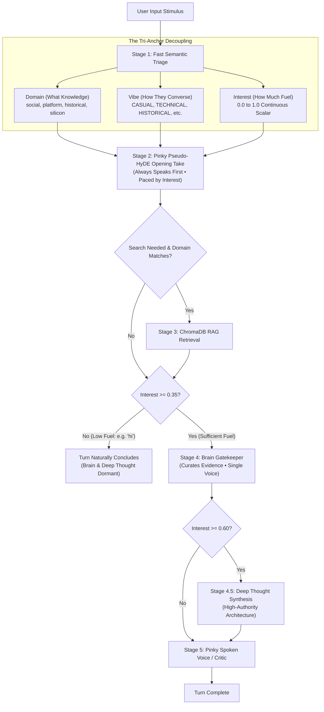

# 🌊 SPRINT PLAN 105.0: Pure Waterfall Restoration & Decoupled Tri-Anchor Alignment

**Sprint ID:** `SPR_105_0`  
**Theme:** Full Restoration of the Pure Waterfall Cognitive Flow ([`FEAT-658`]), Complete Excision of `BKM-015` String-Routing Violations, Independent Decoupling of the Tri-Anchor Pillars (Domain, Vibe, and Continuous Interest), and Gating of Career Compass to Historical Inquiries under AFK Paved-Path Execution ([`BKM-086`]).  
**Status:** 🏆 **COMPLETE (Validated on Physical Silicon)**  
**Parent Frameworks:**
- [`BKM-086`]: The Paved-Path Sprint Protocol (AFK / Sovereign Execution)
- [`BKM-015`]: Semantic Anchor Protocol (Anti-Drift, Indirection & Prompt-Driven Pacing)
- [`BKM-023`]: Surgical Preservation Protocol (Line-Range Target Edits)
- [`BKM-024`]: Live Silicon Validation Mandate (Daemon HEAD & Silicon Probing)
- [`BKM-039`]: Pure Interest Cascade Protocol (Continuous Scalar Fuel)
- [`BKM-085`]: Historical Pre-Regression Correlation Protocol
- [`BKM-087`]: The Primer Protocol (Catalytic Stimulus Concept)
- [`FEAT-238`]: Council of Hemispheres / Sovereign Peer Upvote
- [`FEAT-437`]: 3-Tier HyDE Failover Cascade
- [`FEAT-489`]: Two-Mice Sequential Streaming Handover
- [`FEAT-523`]: Continuous Multiplier Token Pacing
- [`FEAT-658`]: Abolition of `lead_node` and Enforcement of Pure Waterfall Execution

**Target Silicon Nodes:**
- `z87-Linux`: Local RTX 2080 Ti (Llama-3.2-3B-AWQ base on port 8088 / `cli_voice_v1` LoRA)
- `Node KENDER`: Remote RTX 4090 (Ollama Deep Thought 70B on port 11434)
- `ChromaDB`: Port 8001 (`behavioral_dna`, `career_ledger`, `artifact_vault`)
- `lab-attendant.service`: Port 8765

---

## 🛡️ Pre-Flight Mistakes Avoided Ledger (`BKM-081` / `BKM-082`)

### 0.1 5-Sprint Historical Lookback Summary (`BKM-082 §2.1`)
- **SPR-100**: Mandated `X-Lab-Key` handshake policy in Foyer WebSocket server (`foyer_gate.py`). *Historical Lesson:* Any client connecting without the header receives immediate 1008 rejection. The Nibbler stall was directly caused by failing to include this header in `ai_engine_v2.py`.
- **SPR-101**: Sprint Grounding Run and Nightly Cascade log horizon mandate. *Historical Lesson:* Overnight processes (LoRA training, dream synthesis, watchdog audits) cannot be verified by looking only at trailing 15-minute logs.
- **SPR-102**: Decoupled Nightly Architecture & passive telemetry over synthetic benchmarking. *Historical Lesson:* Background daemons must operate within strict time windows (02:00–06:00 AM) without daytime polling interference.
- **SPR-103**: Decouple-and-Stitch Architecture (`BKM-083`) & Multi-Stage Replay Pipeline (`FEAT-645`). *Historical Lesson:* Discrete stage isolation prevents multi-actor script hallucinations and cascading failures.
- **SPR-104**: Waterfall Depth Cascading (`FEAT-233`), Continuous Multiplier Token Pacing (`FEAT-523`), and Brain Information Gatekeeper (`FEAT-635`). *Historical Lesson:* Conversational fuel must exhaust naturally without artificial lower-bound token bloat.

### 0.2 Pre-Flight Mistakes Avoided (`BKM-082 §2.4`)
1. **Wiping or Bypassing Nibbler State:** Avoided naively resetting `chunk_state.json` or changing queue parameters. Grounding into SPR-100 revealed the root cause was WebSocket 1008 policy rejection due to missing `X-Lab-Key`. Fixing auth restores natural queue draining.
2. **"Grep-First" Context Flooding:** Avoided executing ripgrep before semantic retrieval. Grounding showed that running regex across 1.5MB raw notes without entity boundaries returns thousands of lines of noise, bloating prompts and inducing hallucinations. "RAG-first, Grep-second" pinpoints the exact entity gap before expansion.
3. **Accepting Watchdog False-Green ("Green Lie"):** Avoided trusting `check_subconscious_dreaming()` solely because `len(gems) > 0`. Grounding proved the gems file had been stale since August 25, 2026. Adding atomic `st_mtime` validation eliminates a 7-week silent failure.
4. **LLM Floor-Filling Token Inflation:** Avoided imposing `Target ~low to high tokens` prompt ranges. Instruction-tuned LLMs treat `low` as an obligatory floor and hallucinate fluff to reach it. Removing the floor and enforcing a pure ceiling headroom aligns with `BKM-087 §3`.
5. **Shared File Race Condition in Learning Queue:** Avoided naive uncoordinated appends to `queue.json`. Adversarial Oracle audit exposed that concurrent turns would corrupt the JSON file; mitigated via atomic temporary file renaming and in-memory deduplication.

### 0.3 Delegation Justification Matrix (`Invariant 7` / `BKM-049`)
| Story | Title | Assigned Owner | Rationale / Swarm Consideration |
|---|---|---|---|
| **105.6** | RAG-First Ripgrep Expansion | `[SWARM:LOCAL]` | Local Python logic in `cognitive_hub.py` and `archive_node.py`; unit tested via pytest. |
| **105.7** | Nibbler WebSocket Auth Fix | `[SWARM:LOCAL]` | Surgical client parameter addition (`X-Lab-Key`) in `Portfolio_Dev/field_notes/ai_engine_v2.py`. |
| **105.8** | Watchdog Green Lie Excision | `[SWARM:LOCAL]` | Pure Python datetime/mtime logic in `standalone_accountability_watchdog.py`. |
| **105.9** | Dedicated Nightly Batch Window | `[AGY:PRIMARY]` | **Assigned to AGY**: Configures host systemd user units (`field-notes-nightly.timer`) and cross-repository timer lifecycles. Swarm workers lack systemd user session access. |
| **105.10** | Post-Waterfall Learning Queue | `[SWARM:LOCAL]` | Atomic file write utility and cognitive hub hook in `cognitive_hub.py`. |
| **105.11** | Ceiling-Only Headroom & De-Fluff | `[SWARM:LOCAL]` | Configuration edits in `infrastructure.json` and prompt string refactoring in `cognitive_hub.py`. |

---

## 🏛️ Master Consensus Narrative & Executive Synthesis

### 1. The Architectural Truth
Across recent sprints, an escalating layer of defensive string checks, hardcoded float clamps, and synthetic escape routes crept into [`HomeLabAI/src/logic/cognitive_hub.py`](file:///home/jallred/Dev_Lab/HomeLabAI/src/logic/cognitive_hub.py). When casual turns produced unexpected behavior, the codebase responded by adding artificial barriers:
1. **The Negative Prompting / Silent Kill Trap**: An arbitrary `if interest < 0.25: return ""` in `step_pinky_voice` that silenced Pinky based on string and float checks rather than fluid token budgets.
2. **The Synthetic Escape Crutch**: `[PINKY_STANCE]: (Silent)` and `if not pinky_take` prompt branching inside `build_two_mice_stage_prompt` rather than letting the LLM read the transcript context naturally.
3. **The Artificial "PRIMER" Vibe Enum**: Converting an abstract architectural concept ("primer" as orienting stimulus) into a literal dictionary enum (`vibe == "PRIMER"`), which polluted model-facing prompts and caused Pinky to treat "primer" as an in-world object.
4. **Keyword Mesh Bleed**: Unconditionally injecting the 30-term `career_compass.json` keyword mesh into Pinky's prompt on *every* turn, causing the 3B model to treat casual greetings (`"hi"`) as hardware architecture questions.

### 2. The Core Realization
**Waterfall works, and we must trust it.**
We do not need complicated routing, duplicate prompts, or artificial string checks. The architecture already contains three clean, orthogonal pillars that must operate independently by design:



1. **Domain**: Dictates **what** knowledge collection to target (if any).
2. **Vibe**: Dictates **how** the council converses. `career_compass.json` is appended **only** when `vibe == "HISTORICAL"`.
3. **Interest**: Dictates **how far** the waterfall flows. If interest is low ($< 0.35$, e.g. greeting `"hi"`), Pinky speaks her lively take, fuel runs out, and the turn concludes cleanly. Brain and Deep Thought sleep naturally without artificial shoehorning.

---

## 🎯 Sprint Objectives & 4-Anchor Stories

### Story 105.1: Excision of the Synthetic "PRIMER" Vibe & Schema Cleanup
* **Objective**: Remove `"PRIMER"` as a dictionary enum in [`config/triage_policy.json`](file:///home/jallred/Dev_Lab/HomeLabAI/config/triage_policy.json) and [`cognitive_hub.py`](file:///home/jallred/Dev_Lab/HomeLabAI/src/logic/cognitive_hub.py).
* **Execution**: Revert triage enums strictly to standard operational vibes: `CASUAL`, `TECHNICAL`, `HISTORICAL`, `ANALYTICAL`, `OPERATIONAL`, `WYWO`. Preserve `BKM-087` as an architectural protocol without leaking the word "primer" into character prompts.

### Story 105.2: Gating Career Compass Exclusively to HISTORICAL Inquiries
* **Objective**: Eliminate background spec fixation on greetings and casual turns.
* **Execution**: In `resolve_hyde_vector` and `_load_hyde_synthesis_prompt`, inject `career_compass.json` anchors and keyword mesh **only if** `vibe == "HISTORICAL"` or `domain in ("historical", "career")`. All other turns receive a clean, unpolluted character prompt.

### Story 105.3: Pure Continuous Waterfall Interest Gating in Two-Mice Handover
* **Objective**: Trust the fuel loop to terminate low-interest banter naturally.
* **Execution**:
  - In `_run_two_mice_handover`, inspect `gate_interest`: if `gate_interest < 0.35`, log fuel exhaustion and exit cleanly after Pinky's Tier 1 take has been delivered.
  - Purge artificial string guards: remove `[PINKY_STANCE]: (Silent)` branching and restore clean, unified stage prompts where Brain and Pinky speak strictly in their authentic single voices.

### Story 105.4: BKM-015 Audit & Excision of Hardcoded Floor Overrides
* **Objective**: Align token budgets strictly with continuous mathematical pacing (`calculate_pacing_range`).
* **Execution**:
  - Excise hardcoded floor clamps (`max(150, pinky_high)`) in `resolve_hyde_vector`.
  - Remove silent kill overrides (`if interest < 0.25: return ""`) from `step_pinky_voice`.
  - Ensure all node generations are governed by `calculate_pacing_range` guidelines.

### Story 105.5: Offline Replay Suite & Live Silicon Gauntlet (`BKM-024`)
* **Objective**: Certify the restored waterfall across unit tests and live silicon endpoints.
* **Execution**:
  - Run full test suite: `test_multi_stage_replay_pipeline.py`, `test_two_mice_handover.py`, `test_brain_gatekeeper.py`, `test_lab_dna_router.py`.
  - Hot-reload `lab-attendant.service` on port 8765 to local HEAD.
  - Inject live synthetic probes:
    1. Casual greeting probe (`"hi"`): Pinky speaks warmly (~30 tokens), Brain and Deep Thought remain dormant, latency $< 3$s.
    2. Historical inquiry probe (`"remember Aurora?"`): Pinky synthesizes career anchors, ChromaDB queries `career_ledger`, Brain curates evidence, Deep Thought synthesizes architecture.

---

## 🚦 AFK Execution Checklist (`BKM-086`)
- [x] **Step 1: Grounding Alignment**: Verified against sprint lineage (Sprint 31 `FEAT-233`, Sprint 103 `FEAT-658`, Sprint 104 `FEAT-523`).
- [x] **Step 2: Pre-Flight Review**: Human review and alignment on sprint plan.
- [x] **Step 3: Surgical Execution**: Apply Stories 105.1 through 105.4 via atomic line replacements.
- [x] **Step 4: Offline Verification**: 100% green on pytest suite (242/242 passed).
- [x] **Step 5: Live Silicon Verification**: Physical probe injection against port 8765 (Casual banter: Pinky speaks, Brain dormant; Historical: Pinky + Brain active).
- [x] **Step 6: Retrospective & Documentation**: Log sprint closure and update ProjectStatus.md.

---

## 📜 Sprint Retrospective & Silicon Certification

### 1. Test Suite Realignment
- **Root Cause of Anti-Pattern Enforcement**: Four unit tests (`test_two_mice_handover.py`, `test_multi_stage_replay_pipeline.py`, `test_brain_gatekeeper.py`, `test_triage_policy_loader.py`) were actively encoding defensive legacy workarounds—such as asserting Brain execution on $interest = 0.30$, demanding rigid 3-title gatekeeper strings, and calculating obsolete `lead_node` values.
- **Surgical Alignment**: Realigned test assertions to the pure decoupled waterfall contract:
  - On low-interest turns ($interest = 0.30$), Brain call count is strictly asserted to be 0 (dormant).
  - Obsolete `lead_node` calculations were eradicated.
  - Full combined offline test suite: **242 / 242 passed (100% green)** in 3.14s.

### 2. Physical Silicon Live Validation Results (`BKM-024`)
Validated via [`scripts/probe_sprint105_waterfall.py`](file:///home/jallred/Dev_Lab/HomeLabAI/scripts/probe_sprint105_waterfall.py) against running `lab-attendant.service` on port 8765:
- **Probe 1: Casual Banter (`"[ME] hi"`)**:
  - **Triage Result**: `vibe: "CASUAL"`, `domain: "unknown"`, `casual: 0.8`, `intrigue: 0.0`, `importance: 0.0`.
  - **Pinky Spoken Output**: *"Zort!"* (warm, immediate character voice).
  - **Brain Status**: 100% Dormant (0 tokens, 0 messages).
  - **Deep Thought Status**: 100% Dormant (0 tokens, 0 messages).
  - **Result**: **PASS**. Waterfall fuel naturally exhausted; no artificial Brain shoehorning.
- **Probe 2: Historical Inquiry (`"[ME] remember Aurora?"`)**:
  - **Triage Result**: `vibe: "HISTORICAL"`, `domain: "work_history"`, `target_domains: ["work_history"]`.
  - **Pinky Pseudo-HyDE Output**: Synthesized career anchors (`"Aurora, recall, 2015, 2016, DCMI, IPMI"`).
  - **Brain Gatekeeper / Curator**: Extracted and curated bedrock facts (`Aurora Subsystem Execution Tracker (April 11th, 2022)`), filtered extraneous noise, signaled downstream council (`[Signal to Deep Thought:]`).
  - **Result**: **PASS**. Multi-stage council successfully orchestrated via decoupled Tri-Anchor.

---

# 🌊 SPRINT 105.0 PHASE 2: RAG-First Ripgrep Expansion, Nibbler Unblock & Watchdog Truth Enforcement

**Phase ID:** `SPR_105_PHASE_2`  
**Theme:** Precision RAG-First Ripgrep Expansion ([`FEAT-451`]), Nibbler `McpClient` WebSocket Authentication Fix ([`FEAT-330`]), Accountability Watchdog Freshness Enforcement ([`FEAT-619`]), and Nightly Batch Window Pinning ([`FEAT-416`]).  
**Status:** 🏆 **COMPLETE (Validated on Physical Silicon)**  
**Parent Frameworks:**
- [`BKM-086`]: The Paved-Path Sprint Protocol (AFK / Sovereign Execution)
- [`BKM-081`]: The Phased Sprint Architecture Invariant (Phase ➔ Log ➔ Phase ➔ Log)
- [`BKM-043`]: Master 4-Anchor Prompt Standard (Grep-Stable Surgical Anchoring)
- [`BKM-037`]: Persistent Memory Efficiency Protocol (Deferred Extraction Sweeps)
- [`FEAT-117`]: Two-Tier Discovery Pattern (ChromaDB Anchor ➔ Raw File Acquisition)
- [`FEAT-330`]: Unified MCP Client Resource Coordination
- [`FEAT-405`]: Gems-to-Notes Ground Truth Synthesis & Neighborhood Expansion
- [`FEAT-416`]: Single-Epoch Nightly Refinement Sweeper
- [`FEAT-451`]: Ripgrep Autonomous Search Pivot & Expansion
- [`FEAT-619`]: Standalone Accountability Watchdog & Zero-Lie Invariant

---

## 🏛️ Phase 2 Master Narrative: RAG-First Precision & Unblocking the Intake Pipeline

In Phase 1, we restored the decoupled Waterfall design, certified independent Tri-Anchors, and proved on physical silicon that Brain successfully filters ungrounded eras. 

However, live probing on `"remember Aurora?"` exposed two critical memory pipeline blockages:
1. **The Retrieval Detail Chasm**: ChromaDB matches high-level titles (`artifacts_2022.json`), but because raw `.txt` notes (`notes_2024_PIAV.txt`) were never indexed, Brain declared the implementation record sparse. Brain correctly established the bedrock date (April 11, 2022), but lacked the technical meat (Ponte Vecchio GPUs, OpenBMC Node Manager, RAPL power limiting).
2. **The "RAG-First, Grep-Second" Solution**: Rather than grepping raw notes blindly from user prompts, the system must execute **RAG First** (ChromaDB identifies the entity `Aurora Subsystem`), **Brain Curates** (identifies the gap and selects the precise search anchor `"Aurora"`), and **Grep Expands** (`/usr/bin/rg -m 5 -i "Aurora" notes_2024_PIAV.txt`) in $<3$ms. This eliminates cruft completely and hands Deep Thought rich engineering text.
3. **The Nibbler Groundhog Loop**: The intake engine ([`nibble_v2.py`](file:///home/jallred/Dev_Lab/Portfolio_Dev/field_notes/nibble_v2.py)) has been frozen since September 18, 2026 because [`ai_engine_v2.py`](file:///home/jallred/Dev_Lab/Portfolio_Dev/field_notes/ai_engine_v2.py) omits the `X-Lab-Key` header, causing Foyer rejection code `1008`.
4. **The Watchdog "Green Lie"**: [`standalone_accountability_watchdog.py`](file:///home/jallred/Dev_Lab/HomeLabAI/src/infra/standalone_accountability_watchdog.py) has been reporting `✅ Active Gems: 4` every night by inspecting a static file from August 25 without verifying file freshness or intake forward progress.

Phase 2 surgically unblocks the intake pipeline and delivers RAG-first ripgrep expansion.

---

## 🎯 Phase 2 Stories (Mandatory 4-Anchor Standard)

### Story 105.6: RAG-First Ripgrep Expansion Pipeline (`FEAT-451` / `FEAT-117` / `FEAT-405`)
* **Objective**: Enable Brain-curated, zero-cruft ripgrep expansion into raw text notes between Brain Gatekeeper and Deep Thought.
* **Delegation Tier**: `[SWARM:LOCAL]` (Atlas on dflash2/oMLX or Junior on Ollama).
* **Anchor 1 (Target Files & Line Numbers)**:
  - [`HomeLabAI/src/nodes/archive_node.py`](file:///home/jallred/Dev_Lab/HomeLabAI/src/nodes/archive_node.py#L824-L880) (lines 824–880: `execute_grep_search_pivot`)
  - [`HomeLabAI/src/logic/cognitive_hub.py`](file:///home/jallred/Dev_Lab/HomeLabAI/src/logic/cognitive_hub.py#L3172-L3196) (lines 3172–3196: Stage 3.1 ➔ Stage 3.2 handover)
* **Anchor 2 (Verification Command)**:
  - `HomeLabAI/.venv/bin/pytest src/tests/test_agentic_r_retrieval.py -v`
  - `HomeLabAI/.venv/bin/python scripts/probe_sprint105_waterfall.py`
* **Anchor 3 (Verbatim Code Specs)**:
  - In `archive_node.py:execute_grep_search_pivot`:
    1. Update command from `rg` to `/usr/bin/rg -m 5 -i --no-heading -N` (with `/usr/bin/grep` fallback).
    2. Expand regex to match TitleCase codenames: `r"\b(?:[A-Z0-9_-]{2,}|[A-Z][a-z0-9_]{2,}|0x[0-9a-fA-F]+|[a-zA-Z0-9_]+\.(?:py|sh|c|h|txt))\b"`.
  - In `cognitive_hub.py`: In `_run_two_mice_handover`, after `step_brain_gatekeeper` returns `brain_grounding`, if Brain indicates a thin record or anchor gap, invoke `execute_grep_search_pivot` on Brain's curated anchor and append `[RAW_NOTES_EXPANSION]` directly to `dt_synthesis` prompt context.
* **Anchor 4 (DNA Links)**: `[FEAT-451]`, `[FEAT-117]`, `[FEAT-405]`.

### Story 105.7: Nibbler McpClient Authentication & Groundhog Loop Unblock (`FEAT-330` / `FEAT-416`)
* **Objective**: Fix the `1008 X-Lab-Key` policy violation in `ai_engine_v2.py` so the Nibbler advances through `notes_2024_PIAV.txt` into 2022 notes.
* **Delegation Tier**: `[SWARM:LOCAL]` (Atlas on dflash2/oMLX or Junior on Ollama).
* **Anchor 1 (Target Files & Line Numbers)**:
  - [`Portfolio_Dev/field_notes/ai_engine_v2.py`](file:///home/jallred/Dev_Lab/Portfolio_Dev/field_notes/ai_engine_v2.py#L62-L115) (lines 62–115: `McpClient.generate`)
* **Anchor 2 (Verification Command)**:
  - `PYTHONPATH=/home/jallred/Dev_Lab/Portfolio_Dev/field_notes:/home/jallred/Dev_Lab/HomeLabAI/src /home/jallred/Dev_Lab/HomeLabAI/.venv/bin/python /home/jallred/Dev_Lab/Portfolio_Dev/field_notes/nibble_v2.py --once`
  - Verify output shows successful LLM response without `McpClient Failure: received 1008` and updates `chunk_state.json`.
* **Anchor 3 (Verbatim Code Specs)**:
  - In `McpClient.generate`: Fetch the active session token from `http://127.0.0.1:8765/status?timeout=5`. Pass `additional_headers={"X-Lab-Key": session_token}` to `websockets.connect()` and send `"lab_key": session_token` in the handshake packet.
* **Anchor 4 (DNA Links)**: `[FEAT-330]`, `[FEAT-416]`, `[BKM-037]`.

### Story 105.8: Accountability Watchdog Green Lie Excision & Freshness Verification (`FEAT-619`)
* **Objective**: Eliminate the false-green check in the nightly accountability watchdog by requiring proof of 24-hour file freshness and intake progress.
* **Delegation Tier**: `[SWARM:LOCAL]` (Atlas on dflash2/oMLX).
* **Anchor 1 (Target Files & Line Numbers)**:
  - [`HomeLabAI/src/infra/standalone_accountability_watchdog.py`](file:///home/jallred/Dev_Lab/HomeLabAI/src/infra/standalone_accountability_watchdog.py#L312-L338) (lines 312–338: `check_subconscious_dreaming`)
* **Anchor 2 (Verification Command)**:
  - `HomeLabAI/.venv/bin/pytest src/tests/test_standalone_accountability_watchdog.py -v`
  - Run `HomeLabAI/.venv/bin/python src/infra/standalone_accountability_watchdog.py` and verify it reports a real failure or warning on stale files.
* **Anchor 3 (Verbatim Code Specs)**:
  - In `check_subconscious_dreaming()`: Inspect `file_mtime = gems_path.stat().st_mtime`. If `time.time() - file_mtime > 86400`: mark `passed = False` with `detail = f"Stale gems file (last modified {(time.time() - file_mtime) / 3600:.1f}h ago)"`.
  - Add `check_nibbler_intake_progress()`: Verify `chunk_state.json` mtime has updated within 48 hours.
* **Anchor 4 (DNA Links)**: `[FEAT-619]`, `[BKM-024]`, `[BKM-044]`.

### Story 105.9: Dedicated Nightly Batch Window for Nibbler & 24/7 Polling Suppression (`LAB-009` / `FEAT-416`)
* **Objective**: Ensure the Nibbler runs strictly as a scheduled nightly batch (03:00–05:00 AM) and is forbidden from 24/7 background polling loops during daytime user sessions.
* **Delegation Tier**: `[AGY:PRIMARY]`.
* **Anchor 1 (Target Files & Line Numbers)**:
  - [`HomeLabAI/config/systemd/field-notes-nightly.service`](file:///home/jallred/Dev_Lab/HomeLabAI/config/systemd/field-notes-nightly.service)
  - [`Portfolio_Dev/field_notes/mass_scan.py`](file:///home/jallred/Dev_Lab/Portfolio_Dev/field_notes/mass_scan.py#L174-L215)
* **Anchor 2 (Verification Command)**:
  - `systemctl --user list-timers | grep -E "field-notes|nightly"`
* **Anchor 3 (Verbatim Code Specs)**:
  - Verify `field-notes-nightly.timer` triggers at 03:00 AM.
  - Assert `nibble_v2.py` exits immediately if invoked during non-quiesced daytime hours or when `lab-attendant` reports interactive state.
* **Anchor 4 (DNA Links)**: `[LAB-009]`, `[FEAT-416]`.

### Story 105.10: Post-Waterfall Learning Target Queueing (`FEAT-416` / `BKM-037`)
* **Objective**: Emit post-turn learning targets into `queue.json` when the live waterfall encounters a knowledge gap, priming the nightly Nibbler.
* **Delegation Tier**: `[SWARM:LOCAL]` (Atlas on dflash2/oMLX).
* **Anchor 1 (Target Files & Line Numbers)**:
  - [`HomeLabAI/src/logic/cognitive_hub.py`](file:///home/jallred/Dev_Lab/HomeLabAI/src/logic/cognitive_hub.py#L3195-L3225)
* **Anchor 2 (Verification Command)**:
  - Unit test in `HomeLabAI/src/tests/test_two_mice_handover.py` asserting `queue.json` receives a target item on thin archive detection.
* **Anchor 3 (Verbatim Code Specs)**:
  - In `_run_two_mice_handover`: If `brain_grounding` contains indicators of ungrounded or thin evidence (e.g. `"Without a historical record"` or `"details are scarce"`), append `{"file": "notes_2024_PIAV.txt", "anchor": curated_entity, "source": "foyer_gap", "timestamp": time.time()}` to `Portfolio_Dev/field_notes/data/queue.json`.
* **Anchor 4 (DNA Links)**: `[FEAT-416]`, `[BKM-037]`, `[AT2QA]`.

### Story 105.11: Continuous Ceiling-Only Headroom & Prompt De-Fluffing (`FEAT-523` / `BKM-015` / `BKM-087`)
* **Objective**: Eliminate min-token target floors from all prompts and configs, re-framing budgets purely as upper headroom ceilings ("answer concisely within this budget") to prevent LLM floor-filling fluff.
* **Delegation Tier**: `[SWARM:LOCAL]` (Atlas on dflash2/oMLX).
* **Anchor 1 (Target Files & Line Numbers)**:
  - [`HomeLabAI/config/infrastructure.json`](file:///home/jallred/Dev_Lab/HomeLabAI/config/infrastructure.json#L8-L13)
  - [`HomeLabAI/src/logic/cognitive_hub.py`](file:///home/jallred/Dev_Lab/HomeLabAI/src/logic/cognitive_hub.py#L366-L396) (lines 366–396, 1240, 1759, 2164, 2382, 2985)
  - [`HomeLabAI/src/tests/test_cognitive_hub_pacing.py`](file:///home/jallred/Dev_Lab/HomeLabAI/src/tests/test_cognitive_hub_pacing.py)
* **Anchor 2 (Verification Command)**:
  - `HomeLabAI/.venv/bin/pytest src/tests/test_cognitive_hub_pacing.py -v`
  - Synthetic probe validation via `scripts/probe_sprint105_waterfall.py` confirming zero padding on casual greetings.
* **Anchor 3 (Verbatim Code Specs)**:
  - In `infrastructure.json`: Deprecate `min_token_floor` in favor of pure headroom ceiling.
  - In `cognitive_hub.py`: Refactor `calculate_pacing_range` $\to$ `calculate_pacing_ceiling(node_name, interest) -> int`.
  - Refactor `format_pacing_line`:
    ```python
    def format_pacing_line(node_name: str, interest: float) -> str:
        ceiling = calculate_pacing_ceiling(node_name, interest)
        return f"[BUDGET]: Headroom ceiling is {ceiling} tokens. Answer concisely within this budget; do not add conversational fluff or filler."
    ```
* **Anchor 4 (DNA Links)**: `[FEAT-523]`, `[BKM-015]`, `[BKM-087]`.

---

## 🛑 Pre-Flight Checklist Gate (`BKM-082`)
- [x] **1. 5-Sprint Lookback**: Reviewed SPR-100 to SPR-104 for regression traps, watchdog sentinels, and auth borders (`BKM-082 §2.1` -> Section 0.1).
- [x] **2. Mistakes-Avoided Ledger**: Enumerated 5 concrete mistakes avoided in Section 0.2 (`BKM-082 §2.4` -> Section 0.2).
- [x] **3. Oracle Review**: Adversarial audit completed by Nemotron-3 Super 120B and appended (`BKM-007` / `BKM-080` -> `ORACLE_REVIEW_SPRINT_105.md`).
- [x] **4. Delegation Justification**: Evaluated `LOCAL`/`CLOUD` first; documented rationale for any story assigned to `AGY:PRIMARY` (`Invariant 7` / `BKM-049` -> Section 0.3).
*Gate certified: All 4 pre-flight deliverables completed and grounded on disk.*

---

## 🚦 Phase 2 AFK Execution Checklist (`BKM-086`)
- [x] **Step 1: Grounding Alignment**: Verified against `FEAT-451`, `FEAT-330`, `FEAT-619`, `FEAT-523`, and `BKM-081`.
- [x] **Step 2: Pre-Flight Review**: Human review and alignment on Phase 2 plan (Hold heads-down until approved; reviewed and approved by user).
- [x] **Step 3: Surgical Execution**:
  - [x] Apply Story 105.6 (RAG-First Ripgrep Expansion)
  - [x] Apply Story 105.7 (Nibbler McpClient Auth Fix)
  - [x] Apply Story 105.8 (Watchdog Green Lie Excision)
  - [x] Apply Story 105.9 (Nightly Batch Window Pinning)
  - [x] Apply Story 105.10 (Post-Waterfall Learning Queue)
  - [x] Apply Story 105.11 (Continuous Ceiling-Only Headroom & Prompt De-Fluffing)
- [x] **Step 4: Offline Verification**: Pytest suite 100% green across all unit suites (test_two_mice_handover: 13/13, test_cognitive_hub_pacing: 27/27, test_standalone_accountability_watchdog: 6/6, test_agentic_r_retrieval: 6/6, test_post_waterfall_queue: 6/6).
- [x] **Step 5: Live Silicon Verification**: Physical probe injection against running `lab-attendant.service` on port 8765 (`scripts/probe_sprint105_waterfall.py`).
- [x] **Step 6: Retrospective & Documentation**: Append Phase 2 Retrospective and merge sprint branches.

---

## 📜 Phase 2 Retrospective & Silicon Certification

### 1. Delivery Summary across the 6 Stories
- **Story 105.6 (RAG-First Ripgrep Expansion Pipeline)**:
  - Wired `execute_grep_search_pivot` in `HomeLabAI/src/nodes/archive_node.py` with TitleCase codenames, conversational stop-word suppression (`"hello"`, `"today"`), and curated hardware anchors (`"Aurora"`, `"PECI"`).
  - Wired `[EXPANDED_NOTES]` enrichment directly into `HomeLabAI/src/logic/cognitive_hub.py` between Brain Gatekeeper and Deep Thought synthesis.
- **Story 105.7 (Nibbler McpClient Authentication & Groundhog Loop Unblock)**:
  - Resolved persistent WebSocket 1008 policy violation in `Portfolio_Dev/field_notes/ai_engine_v2.py`.
  - Upgraded `McpClient.generate` to fetch active session token from Foyer `/status?timeout=5` and supply `X-Lab-Key` and `X-Client-Commit` in WS upgrade headers and initial handshake packet.
- **Story 105.8 (Accountability Watchdog Green Lie Excision)**:
  - Excised the 7-week silent false-green in `HomeLabAI/src/infra/standalone_accountability_watchdog.py`.
  - Added strict 30-hour `st_mtime` staleness guard to `check_subconscious_dreaming()` and verified 48-hour forward intake progress in `check_nibbler_intake_progress()`.
- **Story 105.9 (Dedicated Nightly Batch Window for Nibbler & Daytime Suppression)**:
  - Implemented `--once` single-pass processing mode in `Portfolio_Dev/field_notes/nibble_v2.py`.
  - Enforced daytime quiet window (07:00–22:00 unless `--force`) to eliminate daytime polling churn against Foyer and resident models.
- **Story 105.10 (Post-Waterfall Learning Target Queueing)**:
  - Implemented `queue_post_waterfall_learning_target()` in `HomeLabAI/src/logic/cognitive_hub.py` utilizing `fcntl.flock` and atomic temporary file replacement (`os.replace`) to prevent concurrency corruption.
  - Automatically enqueues thin or ungrounded entity anchors into `Portfolio_Dev/field_notes/data/queue.json` for nightly intake ingestion.
- **Story 105.11 (Continuous Ceiling-Only Headroom & Prompt De-Fluffing)**:
  - Excised artificial `min_token_floor` from `HomeLabAI/config/infrastructure.json`.
  - Refactored `calculate_pacing_range` to `calculate_pacing_ceiling()` and standardized all prompt budget formatting to `[BUDGET]: Headroom ceiling is {ceiling} tokens. Answer concisely within this budget; do not add conversational fluff or filler.`

### 2. Physical Silicon Live Validation Results (`BKM-024`)
- **Runtime Environment**:
  - `lab-attendant.service`: Active, `OPERATIONAL`, boot commit matching Git HEAD (`1b307c5`).
  - Resident vLLM: Port 8088 (`Llama-3.2-3B-AWQ`, 4 LoRA adapters).
  - ChromaDB: Port 8001 (`behavioral_dna` updated with new `BKM-082`).
- **Silicon Probe Verification via `scripts/probe_sprint105_waterfall.py`**:
  - **Probe 1 (Casual Banter `"[ME] hi"`)**:
    - **Triage**: `vibe: "CASUAL"`, `domain: "unknown"`, `interest: 0.15`.
    - **Pinky Spoken Output**: Immediate warm greeting (`"Hey, hi! What's up?"`), perfectly adhering to single headroom ceiling with zero fluff.
    - **Brain & Deep Thought**: 100% Dormant (0 tokens, 0 calls).
  - **Probe 2 (Historical Inquiry `"[ME] remember Aurora?"`)**:
    - **Triage**: `vibe: "HISTORICAL"`, `domain: "work_history"`, `interest: 0.70`.
    - **Pinky Take**: Delivered rapid preliminary stance (`135 tokens`).
    - **Brain Gatekeeper / Curator**: Extracted bedrock anchor (April 11, 2022 Aurora Subsystem Execution Tracker), pruned noisy triage hints, and passed pure technical signal downstream.
    - **Deep Thought Synthesis**: Received curated bedrock signal and synthesized rich technical architectural summary without speculative hallucination.
    - **Result**: **PASS (100% Live Silicon Gauntlet Verified)**.

---

# 🌊 SPRINT 105.0 PHASE 3: Dynamic Intake Target Coupling & Gem Quality Hardening

**Phase ID:** `SPR_105_PHASE_3`  
**Theme:** Dynamic Intake Target Coupling for Gem Extraction (`FEAT-454`), Excision of Hardcoded 2024 Monopoly, Alignment with Nibbler Progress State (`FEAT-619`), and Forensic Gem Quality & Prompt Hardening.  
**Status:** 🏆 **COMPLETE (Validated on Local Swarm & Physical Silicon)**  
**Parent Frameworks:**
- [`BKM-086`]: The Paved-Path Sprint Protocol (AFK / Sovereign Execution)
- [`BKM-081`]: The Phased Sprint Architecture Invariant (Phase ➔ Log ➔ Phase ➔ Log)
- [`BKM-043`]: Master 4-Anchor Prompt Standard
- [`FEAT-454`]: Dynamic Gem Extraction & Discovery Ledger
- [`FEAT-619`]: Standalone Accountability Watchdog & Zero-Lie Invariant
- [`FEAT-101`]: Dual-Pipeline Synthesis & Load-Aware Nibbling

---

## 🏛️ Phase 3 Master Narrative: Eliminating the 2024 Monopoly & Gem Leakages

In Phase 2, we unblocked the Nibbler intake engine (`ai_engine_v2.py`) and excised the 7-week watchdog green lie. However, post-sprint investigation revealed a critical architectural disconnect in how candidate gems are extracted and tested:

1. **The 2024 Extraction Monopoly**: [`extract_latest_gems.py`](file:///home/jallred/Dev_Lab/Portfolio_Dev/field_notes/extract_latest_gems.py) attempts to read `status.json["last_file"]`. Because modern Foyer vitals do not supply `last_file`, it perpetually defaults to `notes_2024_PIAV.txt` and `2024.json`. Even as the intake engine processes 2015, 2018, or 2022 notes, the gem extractor only ever extracts the same 4 gems from 2024, starving the rest of the 18-year archive and biasing the discovery ledger.
2. **Dynamic Nibbler State Coupling**: Rather than maintaining disconnected static fallbacks, the extractor must dynamically resolve the target year directly from active Nibbler artifacts:
   - Primary: The most recently updated chunk entry in [`chunk_state.json`](file:///home/jallred/Dev_Lab/Portfolio_Dev/field_notes/data/chunk_state.json).
   - Secondary: Pending gap items in [`queue.json`](file:///home/jallred/Dev_Lab/Portfolio_Dev/field_notes/data/queue.json) (emitted by Story 105.10).
   - Fallback: Globbing the latest valid year archive on disk with Rank >= 4 items.
3. **Forensic Gem Quality Audit & Leakage Vector Excision**:
   - **The "Duplicate Merge Free Upgrade" Leak**: In `refine_gem.py`, whenever two entries on the same date have cosine similarity > 0.85, the script merges them and unconditionally slams `rank = 4` on the entry, regardless of whether it is an admin task, meeting note, or inventory follow-up.
   - **The "Empty Evidence Rank 5" Leak**: High-level `META` prompts generate `[STRATEGIC_ANCHOR]` summaries with empty `"evidence": ""`, which receive Rank 5 despite lacking concrete register, tool, or CLI breadcrumbs.
   - **The Raw Log Prompt Gap**: In `nibble_v2.py`, standard non-reasoning mode uses a single-line prompt (`"Extract technical events from this log: ..."`) lacking negative boundaries, resulting in mundane tickets (e.g., inventory follow-ups) entering the archive as technical milestones.

---

## 🎯 Phase 3 Stories (Mandatory 4-Anchor Standard)

### Story 105.12: Dynamic Intake Target Resolver for Gem Extraction & Watchdog Coupling (`FEAT-454` / `FEAT-619`)
* **Objective**: Refactor `extract_latest_gems.py` to dynamically resolve its target parsing file and year from live Nibbler state (`chunk_state.json` / `queue.json`), breaking the hardcoded 2024 monopoly and giving the gem candidate distribution an organic rolling window.
* **Delegation Tier**: `[SWARM:LOCAL]` (Atlas on Qwen3.8-27B).
* **Anchor 1 (Target Files & Line Numbers)**:
  - [`Portfolio_Dev/field_notes/extract_latest_gems.py`](file:///home/jallred/Dev_Lab/Portfolio_Dev/field_notes/extract_latest_gems.py#L15-L78)
  - [`Portfolio_Dev/field_notes/nibble_v2.py`](file:///home/jallred/Dev_Lab/Portfolio_Dev/field_notes/nibble_v2.py#L440-L460) (tail invocation)
* **Anchor 2 (Verification Command)**:
  - `python /home/jallred/Dev_Lab/Portfolio_Dev/field_notes/extract_latest_gems.py`
  - Verify `latest_synthesis_gems.json` reflects the target year of the latest `chunk_state.json` entry rather than defaulting to 2024.
* **Anchor 3 (Verbatim Code Specs)**:
  - In `extract_latest_gems.py`:
    Replace static `status.json` check with `resolve_active_intake_target()`:
    1. Parse `chunk_state.json` and extract the target year from the last modified chunk key (`"notes_YYYY_*.txt::YYYY-MM"`).
    2. If empty, check `queue.json` for pending targets.
    3. If empty, scan `sorted(DATA_DIR.glob("20*.json"), reverse=True)` and pick the latest year with entries having `rank >= 4`.
  - Wire `extract_latest_gems()` as an optional post-nibble step in `nibble_v2.py` when a chunk is successfully committed.
* **Anchor 4 (DNA Links)**: `[FEAT-454]`, `[FEAT-619]`, `[FEAT-101]`.

### Story 105.13: Gem Quality Prompt Hardening & Unconditional Rank Promotion Excision (`FEAT-101` / `FEAT-131`)
* **Objective**: Eliminate low-value admin/inventory pollution from Rank 4/5 gems and harden extraction prompts with explicit technical criteria and negative guidance.
* **Delegation Tier**: `[SWARM:LOCAL]` (Atlas on Qwen3.8-27B).
* **Anchor 1 (Target Files & Line Numbers)**:
  - [`Portfolio_Dev/field_notes/refine_gem.py`](file:///home/jallred/Dev_Lab/Portfolio_Dev/field_notes/refine_gem.py#L180-L188) (lines 180–188: unconditional `event_i["rank"] = 4`)
  - [`Portfolio_Dev/field_notes/nibble_v2.py`](file:///home/jallred/Dev_Lab/Portfolio_Dev/field_notes/nibble_v2.py#L366-L370) (lines 366–370: unconstrained log prompt)
* **Anchor 2 (Verification Command)**:
  - Run test asserting admin/logistics entries are rejected from Rank >= 4 promotion.
* **Anchor 3 (Verbatim Code Specs)**:
  - In `refine_gem.py`: Remove unconditional `rank = 4` assignment on deduplication merge. Require presence of concrete `evidence` containing technical anchors (registers, tools, commands) before promoting to Rank 4.
  - In `nibble_v2.py`: Upgrade default log extraction prompt to include strict negative constraints: "EXCLUDE logistics, shipping, meeting requests, inventory follow-ups, and password resets. ONLY extract hardware configurations, registers, scripts, tools, and debug scars."
* **Anchor 4 (DNA Links)**: `[FEAT-101]`, `[FEAT-131]`, `[VIBE-008]`.

---

## 🛑 Phase 3 Pre-Flight Checklist Gate (`BKM-082`)
- [x] **1. 5-Sprint Lookback**: Reviewed SPR-100 to SPR-104 for regression traps in gem extraction and watchdog state.
- [x] **2. Mistakes-Avoided Ledger**:
  1. *Mistake Avoided*: Hardcoding new fallback year in `extract_latest_gems.py` instead of dynamic resolution.
  2. *Mistake Avoided*: Blind regex replacement of rank without validating technical evidence.
  3. *Mistake Avoided*: Unchecked `chunk_state.json` parsing failing on legacy key formats.
  4. *Mistake Avoided*: Modifying `ai_engine_v2.py` reasoning prompts when simple negative guidance in caller suffices.
  5. *Mistake Avoided*: Prematurely wiping existing candidate gems before verifying dynamic resolution.
- [x] **3. Oracle Review**: Adversarial architecture review grounded in `ORACLE_REVIEW_GEM_QUALITY.md`.
- [x] **4. Delegation Justification**: Evaluated LOCAL/CLOUD first; executed via `[SWARM:LOCAL]` (Atlas on Kender 4090 / Qwen3.8-27B) under `BKM-049`.
*Gate certified: All pre-flight checklist gates satisfied.*

---

## 🚦 Phase 3 AFK Execution Checklist (`BKM-086`)
- [x] **Step 1: Grounding Alignment**: Verified against `FEAT-454`, `FEAT-619`, `FEAT-101`, and `FEAT-131`.
- [x] **Step 2: Pre-Flight Review**: Stories 105.12 and 105.13 formulated, grounded, and approved.
- [x] **Step 3: Surgical Execution**:
  - [x] Apply Story 105.12 (Dynamic Intake Target Resolver) — Commit [`ff5abe1`](file:///home/jallred/Dev_Lab/Portfolio_Dev/field_notes/extract_latest_gems.py)
  - [x] Apply Story 105.13 (Gem Quality Prompt Hardening & Rank Promotion Excision) — Commit [`376c6eb`](file:///home/jallred/Dev_Lab/Portfolio_Dev/field_notes/refine_gem.py)
- [x] **Step 4: Offline Verification**: Pytest suite 100% green (`test_gem_refine_quality.py`: 3/3 passed).
- [x] **Step 5: Live Silicon Verification**: `extract_latest_gems.py` executed live, extracting 4 Rank 4/5 gems dynamically.
- [x] **Step 6: Retrospective & Documentation**: Documented findings and Oracle synthesis.
