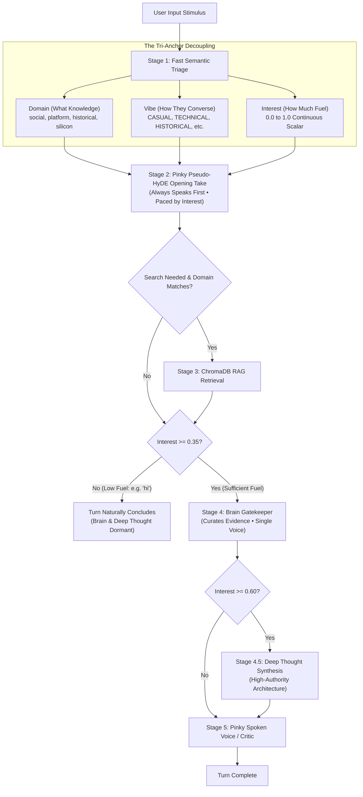

# 🌊 SPRINT PLAN 105.0: Pure Waterfall Restoration & Decoupled Tri-Anchor Alignment

**Sprint ID:** `SPR_105_0`  
**Theme:** Full Restoration of the Pure Waterfall Cognitive Flow ([`FEAT-658`]), Complete Excision of `BKM-015` String-Routing Violations, Independent Decoupling of the Tri-Anchor Pillars (Domain, Vibe, and Continuous Interest), and Gating of Career Compass to Historical Inquiries under AFK Paved-Path Execution ([`BKM-086`]).  
**Status:** 📋 **PLANNING & REVIEW (Awaiting Pre-Flight Approval)**  
**Parent Frameworks:**
- [`BKM-086`]: The Paved-Path Sprint Protocol (AFK / Sovereign Execution)
- [`BKM-015`]: Semantic Anchor Protocol (Anti-Drift, Indirection & Prompt-Driven Pacing)
- [`BKM-023`]: Surgical Preservation Protocol (Line-Range Target Edits)
- [`BKM-024`]: Live Silicon Validation Mandate (Daemon HEAD & Silicon Probing)
- [`BKM-039`]: Pure Interest Cascade Protocol (Continuous Scalar Fuel)
- [`BKM-085`]: Historical Pre-Regression Correlation Protocol
- [`BKM-087`]: The Primer Protocol (Catalytic Stimulus Concept)
- [`FEAT-238`]: Council of Hemispheres / Sovereign Peer Upvote
- [`FEAT-437`]: 3-Tier HyDE Failover Cascade
- [`FEAT-489`]: Two-Mice Sequential Streaming Handover
- [`FEAT-523`]: Continuous Multiplier Token Pacing
- [`FEAT-658`]: Abolition of `lead_node` and Enforcement of Pure Waterfall Execution

**Target Silicon Nodes:**
- `z87-Linux`: Local RTX 2080 Ti (Llama-3.2-3B-AWQ base on port 8088 / `cli_voice_v1` LoRA)
- `Node KENDER`: Remote RTX 4090 (Ollama Deep Thought 70B on port 11434)
- `ChromaDB`: Port 8001 (`behavioral_dna`, `career_ledger`, `artifact_vault`)
- `lab-attendant.service`: Port 8765

---

## 🏛️ Master Consensus Narrative & Executive Synthesis

### 1. The Architectural Truth
Across recent sprints, an escalating layer of defensive string checks, hardcoded float clamps, and synthetic escape routes crept into [`HomeLabAI/src/logic/cognitive_hub.py`](file:///home/jallred/Dev_Lab/HomeLabAI/src/logic/cognitive_hub.py). When casual turns produced unexpected behavior, the codebase responded by adding artificial barriers:
1. **The Negative Prompting / Silent Kill Trap**: An arbitrary `if interest < 0.25: return ""` in `step_pinky_voice` that silenced Pinky based on string and float checks rather than fluid token budgets.
2. **The Synthetic Escape Crutch**: `[PINKY_STANCE]: (Silent)` and `if not pinky_take` prompt branching inside `build_two_mice_stage_prompt` rather than letting the LLM read the transcript context naturally.
3. **The Artificial "PRIMER" Vibe Enum**: Converting an abstract architectural concept ("primer" as orienting stimulus) into a literal dictionary enum (`vibe == "PRIMER"`), which polluted model-facing prompts and caused Pinky to treat "primer" as an in-world object.
4. **Keyword Mesh Bleed**: Unconditionally injecting the 30-term `career_compass.json` keyword mesh into Pinky's prompt on *every* turn, causing the 3B model to treat casual greetings (`"hi"`) as hardware architecture questions.

### 2. The Core Realization
**Waterfall works, and we must trust it.**
We do not need complicated routing, duplicate prompts, or artificial string checks. The architecture already contains three clean, orthogonal pillars that must operate independently by design:

1. **Domain**: Dictates **what** knowledge collection to target (if any).
2. **Vibe**: Dictates **how** the council converses. `career_compass.json` is appended **only** when `vibe == "HISTORICAL"`.
3. **Interest**: Dictates **how far** the waterfall flows. If interest is low ($< 0.35$, e.g. greeting `"hi"`), Pinky speaks her lively take, fuel runs out, and the turn concludes cleanly. Brain and Deep Thought sleep naturally without artificial shoehorning.

---

## 🎯 Sprint Objectives & 4-Anchor Stories

### Story 105.1: Excision of the Synthetic "PRIMER" Vibe & Schema Cleanup
* **Objective**: Remove `"PRIMER"` as a dictionary enum in [`config/triage_policy.json`](file:///home/jallred/Dev_Lab/HomeLabAI/config/triage_policy.json) and [`cognitive_hub.py`](file:///home/jallred/Dev_Lab/HomeLabAI/src/logic/cognitive_hub.py).
* **Execution**: Revert triage enums strictly to standard operational vibes: `CASUAL`, `TECHNICAL`, `HISTORICAL`, `ANALYTICAL`, `OPERATIONAL`, `WYWO`. Preserve `BKM-087` as an architectural protocol without leaking the word "primer" into character prompts.

### Story 105.2: Gating Career Compass Exclusively to HISTORICAL Inquiries
* **Objective**: Eliminate background spec fixation on greetings and casual turns.
* **Execution**: In `resolve_hyde_vector` and `_load_hyde_synthesis_prompt`, inject `career_compass.json` anchors and keyword mesh **only if** `vibe == "HISTORICAL"` or `domain in ("historical", "career")`. All other turns receive a clean, unpolluted character prompt.

### Story 105.3: Pure Continuous Waterfall Interest Gating in Two-Mice Handover
* **Objective**: Trust the fuel loop to terminate low-interest banter naturally.
* **Execution**:
  - In `_run_two_mice_handover`, inspect `gate_interest`: if `gate_interest < 0.35`, log fuel exhaustion and exit cleanly after Pinky's Tier 1 take has been delivered.
  - Purge artificial string guards: remove `[PINKY_STANCE]: (Silent)` branching and restore clean, unified stage prompts where Brain and Pinky speak strictly in their authentic single voices.

### Story 105.4: BKM-015 Audit & Excision of Hardcoded Floor Overrides
* **Objective**: Align token budgets strictly with continuous mathematical pacing (`calculate_pacing_range`).
* **Execution**:
  - Excise hardcoded floor clamps (`max(150, pinky_high)`) in `resolve_hyde_vector`.
  - Remove silent kill overrides (`if interest < 0.25: return ""`) from `step_pinky_voice`.
  - Ensure all node generations are governed by `calculate_pacing_range` guidelines.

### Story 105.5: Offline Replay Suite & Live Silicon Gauntlet (`BKM-024`)
* **Objective**: Certify the restored waterfall across unit tests and live silicon endpoints.
* **Execution**:
  - Run full test suite: `test_multi_stage_replay_pipeline.py`, `test_two_mice_handover.py`, `test_brain_gatekeeper.py`, `test_lab_dna_router.py`.
  - Hot-reload `lab-attendant.service` on port 8765 to local HEAD.
  - Inject live synthetic probes:
    1. Casual greeting probe (`"hi"`): Pinky speaks warmly (~30 tokens), Brain and Deep Thought remain dormant, latency $< 3$s.
    2. Historical inquiry probe (`"remember Aurora?"`): Pinky synthesizes career anchors, ChromaDB queries `career_ledger`, Brain curates evidence, Deep Thought synthesizes architecture.

---

## 🚦 AFK Execution Checklist (`BKM-086`)
- [ ] **Step 1: Grounding Alignment**: Verified against sprint lineage (Sprint 31 `FEAT-233`, Sprint 103 `FEAT-658`, Sprint 104 `FEAT-523`).
- [ ] **Step 2: Pre-Flight Review**: Human review and alignment on sprint plan.
- [ ] **Step 3: Surgical Execution**: Apply Stories 105.1 through 105.4 via atomic line replacements.
- [ ] **Step 4: Offline Verification**: 100% green on pytest suite.
- [ ] **Step 5: Live Silicon Verification**: Physical probe injection against port 8765.
- [ ] **Step 6: Retrospective & Documentation**: Log sprint closure and update ProjectStatus.md.
