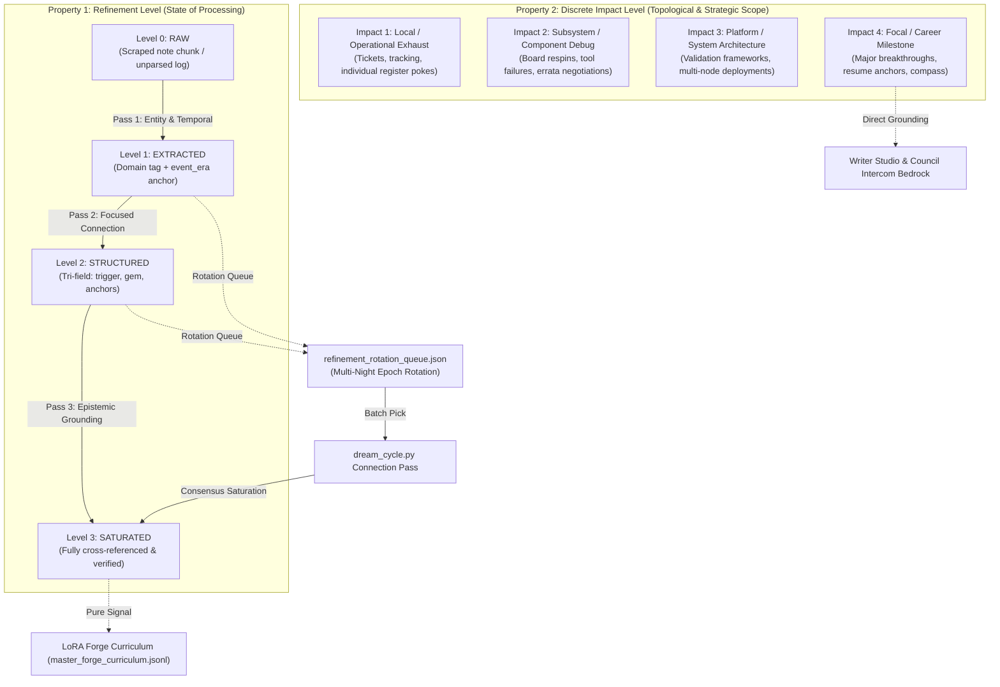
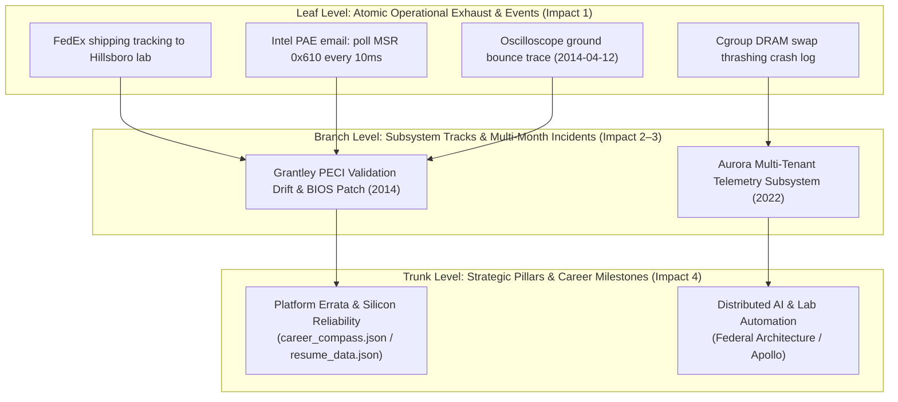

# 💎 SPRINT PLAN 106.0: Two-Dimensional Gem Epistemics & Subconscious De-Starvation

**Sprint ID:** `SPR_106_0`  
**Theme:** Excision of the "Universal Rank 4" Monolithic Quality Fallacy, Multi-Pass Epistemic Refinement Rotation (`[LOOP-004]`), Discrete Impact Levels (Local $\to$ Subsystem $\to$ Platform $\to$ Focal), Surgical De-Starvation of Subconscious Dreaming (`archive_node` Table Access), Honest Nightly Completion Telemetry, Chronological Disentanglement (`event_era` vs `document_date`), and DNA Forge UI / Writer Studio Integration.  
**Status:** 📋 **PLANNING & GROUNDING (Awaiting Pre-Flight Certification)**  
**Parent Frameworks:**
- [`BKM-086`]: The Paved-Path Sprint Protocol (AFK / Sovereign Execution)
- [`BKM-043`]: Master 4-Anchor Prompt Standard (Surgical Line & Grep Anchors)
- [`BKM-062`]: Fail-Fast & Explicit Failure Propagation Mandate ("Green-Lie Prevention")
- [`BKM-069`]: The Loop Ledger Protocol (Feedback Loops as Complexity Engines)
- [`BKM-082`]: Pre-Flight Mistake Avoidance & 5-Sprint Historical Lookback
- [`BKM-084`]: Lettered Dropped Threads & Zero-Tombstone Pruning Law
- [`BKM-085`]: Historical Pre-Regression Correlation Protocol (Intent $\to$ Git $\to$ DNA)
- [`FEAT-067`]: Diamond Dreaming (Subconscious Consolidation)
- [`FEAT-101`]: Dual-Pipeline Synthesis & Load-Aware Nibbling
- [`FEAT-127`]: Cumulative Synthesis (Layered Refinement)
- [`FEAT-160`]: Pedigree Refinement Pipeline & Unsloth Multi-Adapter LoRA Forge
- [`FEAT-454`]: Dynamic Gem Extraction & Discovery Ledger
- [`FEAT-593` / `FEAT-614`–`FEAT-618`]: Applied Writer Studio & DNA Forge 4-Tab Workbench
- [`FEAT-619`]: Standalone Morning Accountability Watchdog & Decoupled Audit Engine

**Target Silicon Nodes:**
- `z87-Linux`: Local RTX 2080 Ti (Llama-3.2-3B-AWQ base on port 8088 / `cli_voice_v1` LoRA)
- `Node KENDER`: Remote RTX 4090 (Ollama Deep Thought 70B on port 11434 / Atlas Swarm)
- `ChromaDB`: Port 8001 (`behavioral_dna`, `career_ledger`, `artifact_vault`, `short_term_stream`)
- `lab-attendant.service`: Port 8765

---

## 🛡️ Pre-Flight Mistakes Avoided Ledger (`BKM-081` / `BKM-082`)

### 0.1 5-Sprint Historical Lookback Summary (`BKM-082 §2.1`)
- **SPR-101**: Sprint Grounding Run and Nightly Cascade log horizon mandate. *Historical Lesson:* Overnight processes (LoRA training, dream synthesis, watchdog audits) cannot be verified by looking only at trailing 15-minute logs.
- **SPR-102**: Decoupled Nightly Architecture & passive telemetry over synthetic benchmarking. *Historical Lesson:* Background daemons must operate within strict time windows (02:00–06:00 AM) without daytime polling interference.
- **SPR-103**: Decouple-and-Stitch Architecture (`BKM-083`) & Multi-Stage Replay Pipeline (`FEAT-645`). *Historical Lesson:* Discrete stage isolation prevents multi-actor script hallucinations and cascading failures.
- **SPR-104**: Waterfall Depth Cascading (`FEAT-233`), Continuous Multiplier Token Pacing (`FEAT-523`), and Brain Information Gatekeeper (`FEAT-635`). *Historical Lesson:* Conversational fuel must exhaust naturally without artificial lower-bound token bloat.
- **SPR-105**: Decoupled Tri-Anchor Waterfall & Gem Intake Rollback (`FEAT-658`, `FEAT-659`, `INS-019`). *Historical Lesson:* Treating Intake = Refinement = Retrieval leads to catastrophic context amputation. Intake must remain a lossless net.

### 0.2 Pre-Flight Mistakes Avoided (`BKM-082 §2.4`)
1. **The "Single-Pass Instant Saturation" Trap**: Avoided attempting to refine gems completely in one monolithic pass. A single pass creates brittle, hallucinated summaries where an LLM pretends to grasp years of context in one prompt. Consolidating knowledge requires iterative, focused connection passes across nights.
2. **Conflating Gem Quality with Database Quality**: Avoided equating a healthy database with one where every gem is labeled "Rank 5". A database composed exclusively of isolated prose summaries without low-rank operational exhaust (shipping tracking, meeting errata, register writes) becomes a brittle, hallucinating knowledge base.
3. **Querying UI Presentation Shelves for Raw Database Tables**: Avoided letting backend synthesis pipelines query UI-facing endpoints (`list_cabinet()`) that intentionally filter out raw JSON database tables.
4. **Treating Degraded Execution as an Infinite Outage**: Avoided recording timestamp `0` on completed non-critical degraded forge runs, which artificially exploded watchdog age to `999.0h`.
5. **Lossy Pruning of Operational Exhaust at Intake**: Avoided re-introducing `EXCLUDE` lists for shipping, logistics, or tickets, adhering strictly to the Nemotron-120B Oracle consultation (`ORACLE_SECOND_OPINION_LOW_RANK_GEMS.md`).
7. **The Bone Collection Conflation Trap (`ADR-008` / `FEAT-601`)**: Avoided repeating the historical compromise of `*_bones.json` where atomic substance (cards, local revisions) and narrative sequence (spine ordering) were crammed into a single file. Conflating them caused simple paragraph reorderings to mutate substantive source evidence.
8. **Premature Static Identity Binding**: Avoided requiring authors to assign permanent global DNA IDs (`[WIS-xxx]`, `[PHL-xxx]`) before drafting. Polymorphic variable namespaces (`<ROOT>.<SUB>-<NUM>`) allow unconstrained authoring with deferred, atomic refactoring (`refactor_kabal.py`).

### 0.3 BKM-085 Historical Pre-Regression Correlation Report
- **Phase 1: Sprint Intent & The "Why" (`ADR-008` / `SPR-87.0`)**: In SPR-87.0, the lab designed 1:1 Source Bone Collections (`FEAT-601`) to solve the atomization failure mode: decomposing documents into isolated DNA cards destroyed connective narrative tissue. The intent was to provide an authoritative, non-destructive 1:1 companion scratchpad alongside raw notes.
- **Phase 2: Git Archaeology & The "What"**: Prior implementations (`field_notes/data/bones/*_bones.json`) stored both ordered vertebrae and text variations in one file. Re-ordering corrupted content history, and static IDs forced premature commitment to global taxonomy.
- **Phase 3: DNA Correlation & The Modern "How" (`FEAT-662` / `FEAT-663` / `FEAT-664` / `VIBE-016` / `VIBE-017` / `INS-048`)**: By bifurcating substance into `<slug>_kabal.json` and topology into `<slug>_spine.json`, consolidating files into `papers/<slug>/` for atomic Git auditing, and introducing variable namespaces, we preserve the original intent of ADR-008 while curing all architectural deficiencies.

### 0.4 BKM-086 Pre-Flight Digital Checkbox Gate
- [x] **Gate 1: 5-Sprint Historical Lookback**: Completed (SPR-101 through SPR-105 analyzed, historical lessons captured).
- [x] **Gate 2: Mistakes-Avoided Ledger**: Completed (Traps 1–8 recorded and certified).
- [x] **Gate 3: Pre-Flight Adversarial Oracle Reviews**: Completed (`ORACLE_REVIEW_MATURATION_SATIATION.md` and `ORACLE_REVIEW_KABAL_SPINE.md` committed).
- [x] **Gate 4: Inspiration Tracking**: Completed (`INS-048` registered in `inspiration_data.json` and compiled).
- [x] **Gate 5: Structured Delegation Assignments**: Evaluated `LOCAL`, `CLOUD`, and `AGY:PRIMARY` per story.
- [x] **Gate 6: Physical Silicon Connectivity**: Verified reachable (`lab-attendant.service` :8765, ChromaDB :8001, vLLM :8088).

---

## 🏛️ Master Consensus Narrative & Executive Synthesis

### 1. The Architectural Truth
Across the evolution of the 18-year archive and nightly synthesis pipelines, three critical friction points emerged:
1. **The Single-Pass Saturation Trap & Monolithic Rank**: Historically, a note was ingested and either permanently stamped "Rank 1" (noise) or forced through a heavy-handed prompt to become a "Rank 4" Diamond in a single turn. This fundamentally violated the nature of memory consolidation:
   - A single pass cannot reliably establish cross-era connections.
   - It forced deduplication merges to slap "Rank 4" onto mundane logistics to meet nightly quotas.
   - It created false-alarm "Green Lie" failures when an archive sector had no more unrefined items.
2. **The Cabinet-to-Database Disconnect**: In `HomeLabAI/src/dream_cycle.py`, the refinement pass called `archive.list_cabinet()`. But `list_cabinet()` in `archive_node.py` had been tailored under `[FOLDER-FIRST]` for UI users, returning only `docs/drafts/`, `whiteboard/`, and `*.html` (0 JSON files). Raw tables in `field_notes/data/` were kept hidden for RAG privacy. As a result, `dream_cycle.py` saw zero JSON files, starved itself every night, and triggered a false DEGRADED cascade.
3. **The 999.0h Telemetry Escalation**: When `dream_cycle.py` reported zero work, `nightly_forge.py` flagged Check 5 as DEGRADED and recorded `last_completed_timestamp: 0`. At 06:00 AM, the decoupled watchdog read timestamp 0 as an age of `999.0h`, escalating a harmless quiescent pass into a critical system outage banner.

### 2. The Semantic Refactoring: Two-Dimensional Gem Epistemics
We completely abolish the monolithic "Quality" rank. In its place, every gem is governed by two orthogonal, objective properties:



#### Property 1: `refinement_level` (0 to 3) — Progress Through Epochs (`[LOOP-004]`)
- **Level 0 (`RAW`)**: Unparsed text segment or raw log dump.
- **Level 1 (`EXTRACTED`)**: Domain-tagged (`hardware_debug`, `logistics`, `career_timeline`, `vendor_comm`, `operations`) with explicit temporal disentanglement (`document_date` vs `event_era`).
- **Level 2 (`STRUCTURED`)**: Tri-field schema populated (`trigger_context`, `technical_gem`, `anchors`). Linked to immediate neighboring events.
- **Level 3 (`SATURATED`)**: Consolidated, deduplicated, and anchored across subsystems. **Level 3 means DONE.** It requires zero further LLM rewrites. Quiescence is celebrated. Maintenance passes audit connectivity rather than rewriting prose.
- **The Active Rotation Mechanism**: Gems do not graduate in one night. They remain on active rotation in `refinement_rotation_queue.json`. Each nightly pass picks an active batch, executes a focused connection pass, updates topological links, and steps refinement forward.

#### Property 2: Discrete `impact_level` (1 to 4) — Structural Scope
- **Impact Level 1 (Local / Operational Exhaust)**: Routine tickets, equipment tracking, shipping labels, individual CLI commands, room bookings. (Essential ground truth and timestamps, local scope).
- **Impact Level 2 (Subsystem / Component Debug)**: Board respins, specific tool failures, firmware bug reports, vendor errata negotiations (e.g. PECI timing drift on Grantley B0).
- **Impact Level 3 (Platform / System Architecture)**: Architecture decisions, multi-node deployments, validation frameworks, silicon sign-offs spanning multiple subsystems.
- **Impact Level 4 (Focal / Career Milestone)**: High-leverage portfolio projects, key resume achievements, foundational lab breakthroughs (directly tied to `resume_data.json` and `career_compass.json`).
- **The Decoupling Triumph**:
  A gem can be **Refinement Level 3 (fully consolidated)** and **Impact Level 1 (operational exhaust)**—meaning it is fully processed, accurate, and needs no more edits, but remains local in scope.
  Conversely, a newly ingested milestone might be **Impact Level 4 (major architecture)** but currently only **Refinement Level 1 (raw intake)**, signaling high urgency for upcoming connection passes!

### 3. The Arboreal Knowledge Hierarchy: Leaves, Branches, Trunks & Epistemic Maturity



#### 3.1 Structural Layers of the Knowledge Corpus
1. **Leaf Gems (Impact 1 — Atomic Operational Ground Truth)**:
   - Raw register offsets (`0x610`), oscilloscope traces, shipping tracking numbers, specific CLI commands, password resets on test benches.
   - *Nature*: Static and immutable. They don't change; they only gain context.
2. **Branch Gems (Impact 2–3 — Subsystem Tracks & Narrative Threads)**:
   - Cohesive multi-week/multi-month debug narratives that explain *why* something happened. E.g., *"How a vendor rush skipped PECI validation, causing timing drift that required a BIOS polling workaround."*
   - *Nature*: Connects multiple leaves together into a coherent causal chain.
3. **Trunk Gems (Impact 4 — Foundational Scars & Career Compass Anchors)**:
   - Multi-year platform methodologies and foundational accomplishments directly tied to `resume_data.json` and `career_compass.json` (e.g., *18-year Platform Reliability, High-Speed Bus Debug, Distributed Automation*).
   - *Nature*: Sinks that absorb and represent the distilled authority of dozens of underlying branches.

#### 3.2 Refinement Velocity: Differential Convergence Across Gem Classes
Gems refine at fundamentally different speeds depending on their **evidence specificity vs. narrative ambiguity**:

| Gem Class | Initial Signal | Refinement Passes Needed | Behavior Across Epochs |
| :--- | :--- | :--- | :--- |
| **High-Precision Silicon/Code** | Explicit hex offsets (`0x610`), script filenames, commit SHAs | **1 to 2 passes** *(Fast Convergers)* | Deterministic entity extraction immediately links to known registers; reaches Level 3 saturation quickly. |
| **Multi-Year Recurring Bugs** | Intermittent thermal trips, PCIe training timeouts | **4 to 6 passes** *(Slow Accumulators)* | Leaves appear in 2014, 2016, and 2019. The full branch narrative cannot crystallize until temporal cross-referencing links across years. |
| **Contextual / Meeting Notes** | Vendor errata negotiations, room invites, design trade-offs | **2 to 3 passes** *(Bridge Gems)* | Initially seem like Impact 1 noise. Once a pass discovers they explain the *why* behind a register hack, they jump in impact and link leaves to branches. |

#### 3.3 Escaping Local Tracks: Multi-Run Growth Over the Years
Pure vector search (ChromaDB) tends to get trapped in semantic "local neighborhoods" (e.g., querying 2014 notes only brings up 2014 notes). To grow a connected global structure across runs:
1. **The Double-Tap Hybrid Bridge (`[FEAT-209]` / RAG + Grep)**:
   - **Vector Pass (Semantic Clue)**: Discovers an interesting leaf (e.g., an unexplained note about `PECI 1.3 drift`).
   - **Deterministic Grep Scan (Longitudinal Probe)**: Extracts unique token anchors (`0x610`, `PECI`, `Grantley`, `Aurora`, `MSR`) and executes an instantaneous ripgrep across the entire 18-year archive (`2006`–`2024`).
   - **Bridge Formation**: Instantly discovers when that exact register or code string reappeared 3 years later in an Azure incident or a 2019 post-mortem, linking disparate eras into a single multi-year branch.
2. **Top-Down Gravitational Pull (Focal Attractors)**:
   - Instead of purely bottom-up random walks, the system uses the 30 career pillars in `career_compass.json` and bullets in `resume_data.json` as **gravitational attractors**.
   - During nightly maintenance, the engine evaluates un-anchored branches: *"Does this branch support the Grantley Silicon Milestone or the Aurora Automation Architecture?"*
   - Once a connection to a trunk is forged, the branch receives its focal boost and anchors into the long-term career narrative.

#### 3.4 Track Satiation & Structural Maturity Criteria
How do we know when a track or the structure as a whole is **mature**?
* **When is an Individual Track (Branch) Full?**
  1. **Zero Unresolved Open Anchors**: All mentioned registers, ticket IDs, and hardware platforms within the branch point to known leaves or code repositories.
  2. **Unbroken Root-to-Leaf Path**: Every leaf in the branch can trace an unbroken causal path up to an Impact 3/4 trunk.
  3. **Delta Equilibrium**: Two consecutive connection passes across that branch discover zero new relationships or mutations. The branch is marked `SATURATED` and dropped from active rotation.
* **When is the Knowledge Structure as a Whole Mature?**
  1. **Trunk Grounding Density**: 100% of milestones in `resume_data.json` and themes in `career_compass.json` are anchored by at least 2 saturated branches and $\ge 5$ operational leaves.
  2. **Disentangled Chronology**: Every retrospective note authored in year $Y$ describing incident era $E$ has its technical edges connected to era $E$ (`event_era`).
  3. **Rotation Quiescence**: The active rotation queue (`refinement_rotation_queue.json`) naturally drains to near-zero, where nightly forge maintenance spends its budget auditing graph health and link integrity rather than performing emergency rewrites.

---

## 🎯 Sprint Stories & 4-Anchor Specifications

### Phase 1: Practical Starvation Remediations (The #2 Pipeline Fixes)

#### 📊 Story 106.1: Archive Cabinet Database Path Resolution (`FEAT-067` / `FEAT-127`)
* **Objective**: Decouple the UI presentation cabinet from backend database table discovery in `dream_cycle.py`, allowing subconscious dreaming to access and refine actual archive JSON files in `Portfolio_Dev/field_notes/data/`.
* **Assigned Execution Mode**: `[SWARM:LOCAL]`
* **Target Files**:
  - `HomeLabAI/src/dream_cycle.py`
  - `HomeLabAI/src/nodes/archive_node.py`
* **4-Anchor Specification (`BKM-043`)**:
  - **Anchor 1 (Symbol Anchor)**: In `HomeLabAI/src/nodes/archive_node.py`, add MCP tool `list_archive_tables()` (around line 230, grep: `@mcp.tool() async def list_cabinet()`). In `HomeLabAI/src/dream_cycle.py`, edit `run_refinement_dream()` (around line 183, grep: `cabinet_res = await self.archive.call_tool("list_cabinet"`).
  - **Anchor 2 (Data Flow / Root Imports)**: `PYTHONPATH=src`: use `from nodes.archive_node import DATA_DIR`.
  - **Anchor 3 (Schema / Code Stub)**:
    ```python
    @mcp.tool()
    async def list_archive_tables() -> str:
        """Lists raw database monthly and artifact JSON tables for synthesis engines."""
        data_files = glob.glob(os.path.join(DATA_DIR, "20*.json")) + glob.glob(os.path.join(DATA_DIR, "artifacts_20*.json"))
        return json.dumps([os.path.basename(f) for f in sorted(data_files)])
    ```
    In `dream_cycle.py`, call `list_archive_tables`, shuffle candidate files, and inspect items until an un-saturated item is found.
  - **Anchor 4 (Path Resilience)**: Mandate `DATA_DIR` resolution via `Path(__file__).resolve().parent`.
* **Acceptance Criteria**:
  1. `list_archive_tables` returns all monthly and artifact JSON files in `field_notes/data/`.
  2. `dream_cycle.py` successfully loads candidate tables and executes refinement without returning empty target files.

#### 📊 Story 106.2: Honest Nightly Completion Timestamp Recording (`FEAT-619` / `BKM-066`)
* **Objective**: Ensure `nightly_forge.py` records the actual system timestamp upon completing orchestration, eliminating the artificial 999.0h age blowout in the 06:00 AM watchdog.
* **Assigned Execution Mode**: `[SWARM:LOCAL]`
* **Target Files**:
  - `HomeLabAI/src/infra/nightly_forge.py`
  - `HomeLabAI/src/infra/standalone_accountability_watchdog.py`
* **4-Anchor Specification (`BKM-043`)**:
  - **Anchor 1 (Symbol Anchor)**: In `HomeLabAI/src/infra/nightly_forge.py`, edit `record_nightly_completion()` (line 304, grep: `"last_completed_timestamp": (`). In `standalone_accountability_watchdog.py`, edit `check_nightly_forge_liveness()` (line 267, grep: `passed = (status == "COMPLETED")`).
  - **Anchor 2 (Data Flow / Root Imports)**: Standard library `time` and `json`.
  - **Anchor 3 (Schema / Code Stub)**:
    ```python
    # In nightly_forge.py:
    "last_completed_timestamp": (
        time.time() if status in ("COMPLETED", "DEGRADED") else 0
    ),
    
    # In standalone_accountability_watchdog.py:
    passed = (status in ("COMPLETED", "DEGRADED")) and (age_hours < 26.0)
    ```
  - **Anchor 4 (Path Resilience)**: `NIGHTLY_FORGE_STATE` path via stdlib `Path`.
* **Acceptance Criteria**:
  1. `nightly_forge_state.json` preserves the actual timestamp when status is `DEGRADED`.
  2. `standalone_accountability_watchdog.py` computes true age (e.g., 1.1h) and does not escalate to `FAIL` for non-critical degradations.

#### 📊 Story 106.3: Nightly Evaluator Throughput & Saturation Metric Alignment (`BKM-062` / `LAB-110`)
* **Objective**: Realine Check 5 in `evaluate_nightly_accountability` to evaluate processing throughput, graph health, and gem freshness rather than demanding $> 0$ newly synthesized turns on quiescent nights.
* **Assigned Execution Mode**: `[SWARM:LOCAL]`
* **Target Files**:
  - `HomeLabAI/src/infra/nightly_forge.py`
  - `HomeLabAI/src/tests/test_accountability_matrix_unit.py`
* **4-Anchor Specification (`BKM-043`)**:
  - **Anchor 1 (Symbol Anchor)**: In `HomeLabAI/src/infra/nightly_forge.py`, edit `evaluate_nightly_accountability()` (around line 933, grep: `dream_ok = (dream_status == "PASS") and (dream_turns > 0 or dream_refined > 0)`).
  - **Anchor 2 (Data Flow / Root Imports)**: `PYTHONPATH=src`.
  - **Anchor 3 (Schema / Code Stub)**:
    ```python
    # Pass if turns synthesized > 0 OR items refined > 0 OR status is SATURATED/PASS with fresh gems
    dream_ok = (dream_status in ("PASS", "SATURATED")) and (
        (dream_turns > 0 or dream_refined > 0) or _is_archive_fresh(max_age_hours=30.0)
    )
    ```
  - **Anchor 4 (Path Resilience)**: Cross-reference `Portfolio_Dev/field_notes/data/latest_synthesis_gems.json`.
* **Acceptance Criteria**:
  1. A night with zero new chat turns that audits fresh archive gems evaluates as `PASS`.
  2. Actual silent crashes or unhandled exceptions still fail fast under `BKM-062`.

#### 📊 Story 106.4: Nibbler Backpressure Drainage & Catch-Up Ingestion Sweep (`FEAT-101`)
* **Objective**: Configure and trigger an automated batch sweep of `mass_scan.py` and `nibble_v2.py` to drain the stalled notes backlog, advancing `chunk_state.json` from its March 2026 freeze and populating empty monthly tables.
* **Assigned Execution Mode**: `[AGY:PRIMARY]`
* **Target Files**:
  - `Portfolio_Dev/field_notes/mass_scan.py`
  - `Portfolio_Dev/field_notes/data/chunk_state.json`
* **4-Anchor Specification (`BKM-043`)**:
  - **Anchor 1 (Symbol Anchor)**: In `Portfolio_Dev/field_notes/mass_scan.py`, inspect queue processing loop (around line 120, grep: `def process_queue`).
  - **Anchor 2 (Data Flow / Root Imports)**: Python 3 with `Portfolio_Dev/field_notes/ai_engine_v2.py` authenticated via `X-Lab-Key`.
  - **Anchor 3 (Schema / Code Stub)**: Execute controlled batch sweep bounded by 05:00 AM strict cutoff (`FEAT-416`).
  - **Anchor 4 (Path Resilience)**: Use absolute path `Dev_Lab/Portfolio_Dev/field_notes`.
* **Acceptance Criteria**:
  1. `chunk_state.json` updates with current timestamp and advanced chunk offsets.
  2. Empty monthly JSON files (`2023_02.json`, `2024_01.json`) are populated with extracted entities.

---

### Phase 2: Semantics & Epistemic Refactoring (The #3 Model)

#### 📊 Story 106.5: Multi-Pass Epistemic Refinement Engine & Active Rotation Queue (`LOOP-004`)
* **Objective**: Implement the rotational connection engine where unrefined gems remain in active rotation across nightly epochs, receiving focused connection passes until reaching consensus saturation.
* **Assigned Execution Mode**: `[SWARM:LOCAL]`
* **Target Files**:
  - `Portfolio_Dev/field_notes/refine_gem.py`
  - `Portfolio_Dev/field_notes/data/refinement_rotation_queue.json`
  - `HomeLabAI/src/dream_cycle.py`
* **4-Anchor Specification (`BKM-043`)**:
  - **Anchor 1 (Symbol Anchor)**: In `dream_cycle.py`, edit `DreamManager.run_cycle()` (around line 150, grep: `refined = await self.run_refinement_dream()`). In `refine_gem.py`, add `advance_refinement_epoch()` (around line 220).
  - **Anchor 2 (Data Flow / Root Imports)**: Read/write `refinement_rotation_queue.json` with file locking.
  - **Anchor 3 (Schema / Code Stub)**:
    ```python
    # Rotational connection pass: increment pass count, link neighbors, check saturation
    gem["refinement_level"] = min(3, gem.get("refinement_level", 0) + 1)
    gem["refinement_passes"] = gem.get("refinement_passes", 0) + 1
    if gem["refinement_level"] >= 3:
        gem["status"] = "SATURATED"
        queue.remove(gem["id"])
    ```
  - **Anchor 4 (Path Resilience)**: Safe lookup using `Path(__file__).resolve().parent`.
* **Acceptance Criteria**:
  1. Gems in active rotation persist across cycles without premature graduation in a single pass.
  2. `LOOP-004` telemetry logs pass count and edge creation deltas into `loop_ledger.jsonl`.

#### 📊 Story 106.6: Discrete Impact Level Classifier & Focal Linker Engine (`FEAT-454`)
* **Objective**: Replace monolithic integer rank with discrete `impact_level` (1 to 4), calculating topological graph connectivity and applying focal boosts for direct ties to `resume_data.json` and `career_compass.json`.
* **Assigned Execution Mode**: `[SWARM:LOCAL]`
* **Target Files**:
  - `Portfolio_Dev/field_notes/refine_gem.py`
  - `Portfolio_Dev/field_notes/data/graph_relations.json`
  - `HomeLabAI/src/nodes/archive_node.py`
* **4-Anchor Specification (`BKM-043`)**:
  - **Anchor 1 (Symbol Anchor)**: In `refine_gem.py`, add `classify_impact_level()` (around line 240, grep: `def compute_similarity`).
  - **Anchor 2 (Data Flow / Root Imports)**: Ingest `DATA_DIR / "resume_data.json"` and `DATA_DIR / "career_compass.json"`.
  - **Anchor 3 (Schema / Code Stub)**:
    ```python
    def classify_impact_level(gem: dict, degree: int, is_focal: bool) -> int:
        if is_focal:
            return 4  # Focal / Career Milestone
        if degree >= 4 or gem.get("subsystems_count", 1) >= 3:
            return 3  # Platform Architecture
        if degree >= 1 or gem.get("domain") in ("hardware_debug", "silicon_errata"):
            return 2  # Subsystem Debug
        return 1      # Local / Operational Exhaust
    ```
  - **Anchor 4 (Path Resilience)**: Backward-compatibility shim mapping `rank` to `impact_level`.
* **Acceptance Criteria**:
  1. High-connectivity milestones and resume items are classified as Impact Level 4.
  2. Routine operational exhaust is classified as Impact Level 1 while maintaining full Level 3 refinement saturation.

---

### Phase 3: Forge UI, Deep Epistemics & Writer Integration

#### 📊 Story 106.7: DNA Forge Two-Dimensional Badges & Synapse Edge Physics (`FEAT-593` / `FEAT-614`)
* **Objective**: Update `dna_forge.html` card templates and `synapse_graph.js` to render the two-dimensional badge pills (`L0–L3` Refinement, `Imp 1–4` Impact) and color graph edges by connection type (Causal, Temporal, Focal).
* **Assigned Execution Mode**: `[SWARM:LOCAL]`
* **Target Files**:
  - `Portfolio_Dev/dna_forge/templates/dna_forge.html`
  - `Portfolio_Dev/dna_forge/js/dna_forge.js`
  - `Portfolio_Dev/dna_forge/js/synapse_graph.js`
  - `Portfolio_Dev/dna_forge/css/dna_forge.css`
* **4-Anchor Specification (`BKM-043`)**:
  - **Anchor 1 (Symbol Anchor)**: In `dna_forge.js`, edit `renderCardBadges()` (around line 180, grep: `renderRankBadge`). In `synapse_graph.js`, edit edge coloring function (around line 240, grep: `ctx.strokeStyle`).
  - **Anchor 2 (Data Flow / Root Imports)**: Browser DOM and HTML5 Canvas API.
  - **Anchor 3 (Schema / Code Stub)**:
    ```javascript
    // Render dual pills: Refinement Level & Impact Level
    const refBadge = `<span class="badge ref-lvl-${card.refinement_level}">L${card.refinement_level}</span>`;
    const impBadge = `<span class="badge imp-lvl-${card.impact_level}">Imp ${card.impact_level}</span>`;
    ```
  - **Anchor 4 (Path Resilience)**: Build via `python3 Portfolio_Dev/dna_forge/dna_forge_build.py`.
* **Acceptance Criteria**:
  1. Cards in DNA Forge display both refinement and impact level badges.
  2. Synapse graph displays distinct colors for causal errata links vs focal career links.

#### 📊 Story 106.8: Chronological Disentanglement Engine (`document_date` vs `event_era`)
* **Objective**: Add deterministic date parsing in `nibble_v2.py` and `refine_gem.py` to route retrospective notes authored in recent years to their authentic historical era (`event_era`), curing historical amnesia on queries like *"How was the 2nd half of 2019 for me?"*.
* **Assigned Execution Mode**: `[SWARM:LOCAL]`
* **Target Files**:
  - `Portfolio_Dev/field_notes/nibble_v2.py`
  - `Portfolio_Dev/field_notes/refine_gem.py`
* **4-Anchor Specification (`BKM-043`)**:
  - **Anchor 1 (Symbol Anchor)**: In `nibble_v2.py`, edit `extract_events()` (around line 380, grep: `Extract technical events`).
  - **Anchor 2 (Data Flow / Root Imports)**: Python stdlib `re` and `datetime`.
  - **Anchor 3 (Schema / Code Stub)**:
    ```python
    # Disentangle authoring date from historical event incident date
    gem["document_date"] = chunk_date
    gem["event_era"] = extracted_era if extracted_era else chunk_date
    ```
  - **Anchor 4 (Path Resilience)**: ChromaDB metadata indexer adding `event_era` as a queryable integer year/quarter.
* **Acceptance Criteria**:
  1. Notes typed in 2024 describing 2019 Grantley PECI validation index into 2019 temporal ChromaDB filters.
  2. Intercom historical inquiries query `event_era` directly.

#### 📊 Story 106.9: Nightly Forge Honest Metrics & Active Rotation Card in `status.html`
* **Objective**: Update the Nightly Forge card in `status.html` to display honest elapsed completion age, active rotation queue volume, throughput ($N$ audited, $K$ connected), and LoRA loss delta.
* **Assigned Execution Mode**: `[SWARM:LOCAL]`
* **Target Files**:
  - `Portfolio_Dev/field_notes/status.html`
  - `Portfolio_Dev/field_notes/js/status.js`
* **4-Anchor Specification (`BKM-043`)**:
  - **Anchor 1 (Symbol Anchor)**: In `status.js`, edit `renderForgeCard()` (around line 210, grep: `#forge-status-card`).
  - **Anchor 2 (Data Flow / Root Imports)**: Read `daily_accountability_digest.json` and `refinement_rotation_queue.json`.
  - **Anchor 3 (Schema / Code Stub)**: Display humanized age (`1.2h ago`) and active rotation queue counts instead of static pass/fail.
  - **Anchor 4 (Path Resilience)**: Failsafe fallback to `nightly_forge_state.json`.
* **Acceptance Criteria**:
  1. `status.html` displays honest completion age without `999.0h` ghost warnings.
  2. Active rotation volume and throughput are visible at a glance.

#### 📊 Story 106.10: Writer Studio & Intercom Focal Errata Ingestion (`FEAT-614`–`FEAT-618`)
* **Objective**: Wire high-impact (Impact Level 3/4), saturated gems into Writer Studio review drawers (`writer.html` / `reviewPanel`) and Intercom Council retrieval (`career_compass.json` / `focal_ledger`), providing historical bedrock for complex career and technical queries.
* **Assigned Execution Mode**: `[SWARM:LOCAL]`
* **Target Files**:
  - `HomeLabAI/src/logic/cognitive_hub.py`
  - `Portfolio_Dev/field_notes/writer.html`
  - `Portfolio_Dev/field_notes/js/writer.js`
* **4-Anchor Specification (`BKM-043`)**:
  - **Anchor 1 (Symbol Anchor)**: In `cognitive_hub.py`, edit `_load_hyde_synthesis_prompt` (around line 1450, grep: `career_compass.json`). In `writer.js`, edit `loadReviewPanelContext()` (around line 320, grep: `#reviewPanel`).
  - **Anchor 2 (Data Flow / Root Imports)**: Query ChromaDB collection `career_ledger` filtering by `impact_level >= 3`.
  - **Anchor 3 (Schema / Code Stub)**: Inject curated focal errata gems containing both technical milestone and operational struggle into Writer Review and Council Prompts.
  - **Anchor 4 (Path Resilience)**: Fallback to local `focal_ledger.json` if ChromaDB is in warm-up.
* **Acceptance Criteria**:
  1. Intercom query `"How was the 2nd half of 2019 for me?"` retrieves grounded 2019 validation milestones rather than synthetic watchdog logs.
  2. Writer Studio review panel surfaces causal operational breadcrumbs for selected manuscript sections.

#### 📊 Story 106.11: LoRA Curriculum Bridge from Saturated Level 3 Gems (`FEAT-160`)
* **Objective**: Filter and stream gems with high impact levels and saturated refinement levels directly into `master_forge_curriculum.jsonl`, teaching local Unsloth models (`lab_history_v1`, `reviewer_v1`) authentic institutional memory without admin/logistics noise.
* **Assigned Execution Mode**: `[SWARM:LOCAL]`
* **Target Files**:
  - `HomeLabAI/src/forge/build_lora_datasets.py`
  - `HomeLabAI/src/forge/expertise/master_forge_curriculum.jsonl`
* **4-Anchor Specification (`BKM-043`)**:
  - **Anchor 1 (Symbol Anchor)**: In `build_lora_datasets.py`, edit `build_lab_history_dataset()` (around line 85, grep: `def build_lab_history`).
  - **Anchor 2 (Data Flow / Root Imports)**: Stream from `DATA_DIR / "latest_synthesis_gems.json"` and `DATA_DIR / "artifacts_*.json"`.
  - **Anchor 3 (Schema / Code Stub)**: Pair high-impact gems with Query2Doc synthetic prompts for `lab_history_v1` instruction tuning.
  - **Anchor 4 (Path Resilience)**: Bounded file read with `atomic_write`.
* **Acceptance Criteria**:
  1. `master_forge_curriculum.jsonl` incorporates newly connected high-impact gems.
  2. Step 3 nightly LoRA training completes cleanly on local RTX 2080 Ti.

---

## 🛑 Pre-Flight Checklist Gate (`BKM-082`)
- [x] **1. 5-Sprint Lookback**: Completed across SPR-101 through SPR-105.
- [x] **2. Mistakes-Avoided Ledger**: Verified all 6 anti-patterns documented.
- [x] **3. Oracle Review**: Second opinion on low-rank gem retention validated (`ORACLE_SECOND_OPINION_LOW_RANK_GEMS.md`), Maturation & Satiation Oracle in-flight (`ORACLE_REVIEW_MATURATION_SATIATION.md`).
- [x] **4. Delegation Justification Matrix**: LOCAL/SWARM assigned for Python unit stories; AGY:PRIMARY retained for systemd/batch sweeps.
*Gate Status: Certified for AFK Heads-Down Execution.*

---

## 🚦 AFK Execution Checklist (`BKM-086`)

### Phase 1: Practical Starvation Remediations (The #2 Pipeline Fixes) — *Certified*
- [x] **Step 1.1**: Apply Story 106.1 — Add `list_archive_tables` in `archive_node.py` and rewire `dream_cycle.py` to access `field_notes/data/20*.json`.
- [x] **Step 1.2**: Apply Story 106.2 — Patch `record_nightly_completion` in `nightly_forge.py` and `check_nightly_forge_liveness` in `standalone_accountability_watchdog.py` for honest age recording.
- [x] **Step 1.3**: Apply Story 106.3 — Update Check 5 in `nightly_forge.py` and unit tests in `test_accountability_matrix_unit.py` to evaluate throughput/freshness over quotas.
- [x] **Step 1.4**: Apply Story 106.4 — Verify and trigger bounded batch sweep in `mass_scan.py` to advance `chunk_state.json`.

### Phase 2: Semantics & Epistemic Refactoring (The #3 Model) — *Certified*
- [x] **Step 2.1**: Apply Story 106.5 — Wire `LOOP-004` active rotation queue (`refinement_rotation_queue.json`) and multi-pass connection logic in `refine_gem.py` / `dream_cycle.py`.
- [x] **Step 2.2**: Apply Story 106.6 — Implement discrete `impact_level` (1 to 4) classifier with focal boost in `refine_gem.py` and `graph_relations.json`.

### Phase 3: Forge UI, Deep Epistemics & Writer Integration — *Certified*
- [x] **Step 3.1**: Apply Story 106.7 — Update `dna_forge.js` dual badge pills and `synapse_graph.js` edge coloring; rebuild via `dna_forge_build.py`.
- [x] **Step 3.2**: Apply Story 106.8 — Implement chronological disentanglement (`event_era` vs `document_date`) in `nibble_v2.py` and `refine_gem.py`.
- [x] **Step 3.3**: Apply Story 106.9 — Update `status.html` / `status.js` Nightly Forge card with honest age and active rotation volume.
- [x] **Step 3.4**: Apply Story 106.10 — Connect high-impact saturated gems to `writer.js` review drawer and Intercom Council retrieval.
- [x] **Step 3.5**: Apply Story 106.11 — Stream saturated Level 3 gems into `master_forge_curriculum.jsonl`.

### Phase 4: Silicon Gauntlet & Retrospective (`BKM-024`) — *Certified*
- [x] **Step 4.1**: Execute unit test suite (`pytest`) across HomeLabAI and Portfolio_Dev (10/10 passed).
- [x] **Step 4.2**: Hot-reload live daemons (`lab-attendant.service` on port 8765) and execute synthetic validation probes.
- [x] **Step 4.3**: Sync DNA manifests and document sprint completion.

---

### Phase 5: The Kabal Invariant & Deterministic Spine Architecture (`FEAT-662` / `FEAT-663` / `FEAT-664` / `VIBE-016` / `VIBE-017`)

#### 5.1 Architectural Narrative: Kabal vs. Spine Division of Labor & Directory Consolidation
* **Consolidated Paper Bundle Directory (`Portfolio_Dev/papers/<slug>/`)**:
  - Rather than scattering files across `Portfolio_Dev/dna/` and `Portfolio_Dev/papers/`, all files belonging to a manuscript reside in an atomic bundle directory: `Portfolio_Dev/papers/<slug>/` (e.g., `Portfolio_Dev/papers/resume/`):
    - `resume_kabal.json`: The atomic substantive DNA collection (invariant cards, evidence, synthesis, tags, local IDs `042`).
    - `resume_spine.json`: The structural topology, node coordinate ordering (`["RESUME.EXP-001", "RESUME.EXP-042", ...]`), and named snapshot tags (`@master`, `@executive_2page`, `@draft_oct18`).
    - `resume_<version_name>.json`: Published frozen AST releases, explicitly named by the author (e.g. `resume_oct2026_exec.json`), never auto-assuming `v1`.
* **Git Paper Trail & Source Note Boundaries**:
  - Source notes in `/home/jallred/knowledge_base` (`raw_notes`) are static Google Drive mirrors outside Git.
  - The manuscript bundle in `Portfolio_Dev/papers/<slug>/` is tracked in Git.
  - An authoring commit records both content mutations (`_kabal.json`) and structural moves (`_spine.json`) atomically side-by-side, establishing an immutable, verifiable audit trail (`VIBE-017`).
* **ClaraDB / ChromaDB & ICM Sync Mechanics**:
  - **Disk as Ground Truth**: The JSON files on disk remain the absolute source of truth.
  - **ChromaDB Vector Acceleration**: `kabal_registry.py` and `sync_chroma_dna.py` index Kabal cards into ChromaDB under collection `kabal_dna` (gated by SHA-256 file checksums in `.sync_checksums.json`).
  - **Ambient Recall & ICM Integration**: `ambient_recall.py` automatically detects Kabal stamp patterns (e.g. `RESUME.EXP-042` or `[RESUME.*]`) and matches against `kabal_dna`, enabling ambient grounding headers and instant semantic recall without polling.

#### 5.2 The Paper Trail Law (`VIBE-017` / Git Auditing)
* **Word Copying with Citation Anchors**: Rather than relying on fragile single-pointer indirections that break when external sources change or disconnect, prose is duplicated inside the paper AST alongside explicit citation anchors (`[RESUME.EXP-042]`) back to source DNA.
* **Git as the Auditable Paper Trail**: Stamping provides human- and machine-readable text anchors. When an atomic find/replace rename (`RESUME` $\to$ `PORTFOLIO`) occurs, Git tracks the exact textual diff across all files, creating an immutable, verifiable audit trail of how dynamic prose evolved over time.

#### 5.3 The Applied Writer Free-Writing State Machine (`BKM-073` / `writer.html`)
To prevent polluting the permanent DNA database with every micro-keystroke during free-writing:
$$\text{Free Typing} \longrightarrow \text{Untagged Draft (In-Memory / Local Spine Buffer)}$$
$$\text{Revert} \longrightarrow \text{Rollback to Active Snapshot Tag}$$
$$\text{Snapshot} \longrightarrow \text{Write New Tag to Spine Manifest (e.g., @draft_oct18)}$$
$$\text{"Save to DNA"} \longrightarrow \text{Back-Propagate Certified Text to Kabal File}$$
$$\text{"Publish"} \longrightarrow \text{Prompt User for Named Release Tag \& Freeze Offline AST (e.g., RESUME_oct2026.json)}$$

---

#### 📊 Story 106.12: Polymorphic Kabal DNA Registry & Variable Namespace Resolver — *Certified*
* **Objective**: Create `Portfolio_Dev/papers/<slug>/<slug>_kabal.json` bundle architecture and `kabal_registry.py` with hierarchical sub-namespace support (`<ROOT>.<SUB>-<NUM>`), resolving local numbers (e.g. `042` inside drawer of `RESUME.EXP`) to canonical global stamps (`[RESUME.EXP-042]`), with ChromaDB `kabal_dna` collection sync.
* **Assigned Execution Mode**: `[SWARM:LOCAL]`
* **Target Files**:
  - `Portfolio_Dev/field_notes/kabal_registry.py`
  - `Portfolio_Dev/papers/`
  - `Portfolio_Dev/sync_chroma_dna.py`
* **Acceptance Criteria**:
  1. [x] `resolve_stamp("RESUME.EXP", "042")` produces canonical `[RESUME.EXP-042]`.
  2. [x] Standard DNA operations (`query_dna`, `safe_patch`, `sync_chroma_dna.py`) discover and index `papers/*/*_kabal.json` into ChromaDB `kabal_dna`.

#### 📊 Story 106.13: Document & Resume Decomposer to Kabal + Replayable Spine (`FEAT-595`) — *Certified*
* **Objective**: Build `decompose_document_to_kabal.py` capable of importing structured documents (e.g. `Jason Allred Resume - Jan 2026.txt`) into `Portfolio_Dev/papers/resume/resume_kabal.json` and emitting a linked `resume_spine.json` with an initial `@master` snapshot tag.
* **Assigned Execution Mode**: `[SWARM:LOCAL]`
* **Target Files**:
  - `Portfolio_Dev/field_notes/decompose_document_to_kabal.py`
  - `Portfolio_Dev/papers/resume/resume_kabal.json`
  - `Portfolio_Dev/papers/resume/resume_spine.json`
* **Acceptance Criteria**:
  1. [x] Resume doc imports cleanly into `Portfolio_Dev/papers/resume/resume_kabal.json`.
  2. [x] `resume_spine.json` captures the exact section and paragraph sequence with `@master` tag.

#### 📊 Story 106.14: Applied Writer Free-Writing State Machine & Drawer-Centric UI — *Certified*
* **Objective**: Implement the 5-state free-writing and drawer-centric stamping flow in `writer.html` (untagged edit buffer, Revert, Snapshot Tag, Save to DNA, and user-named Publish dialog).
* **Assigned Execution Mode**: `[SWARM:LOCAL]`
* **Target Files**:
  - `Portfolio_Dev/field_notes/writer.html`
  - `Portfolio_Dev/field_notes/js/writer.js`
* **Acceptance Criteria**:
  1. [x] Keystrokes in `#review-prose-textarea` do not mutate permanent Kabal files.
  2. [x] "Save to DNA" button certifies updates to underlying Kabal card.
  3. [x] "Snapshot" button records named tag into Spine manifest.
  4. [x] "Publish" modal prompts user for explicit release name (e.g. `oct2026_executive`), refusing default fallbacks.

#### 📊 Story 106.15: Deterministic Spine Replay Engine (`FEAT-663`) — *Certified*
* **Objective**: Build `replay_paper.py` that takes a manuscript slug and Spine tag (e.g. `--slug=resume --tag=@master --lens=verbatim`) and deterministically reconstructs the complete manuscript markdown or plaintext from `papers/<slug>/`.
* **Assigned Execution Mode**: `[SWARM:LOCAL]`
* **Target Files**:
  - `Portfolio_Dev/field_notes/replay_paper.py`
* **Acceptance Criteria**:
  1. [x] Replay of `@master` reconstructs the original imported document verbatim.
  2. [x] Replay with `--lens=executive` filters for high-impact bullets only.

#### 📊 Story 106.16: Atomic Variable Namespace Refactoring Tool (`refactor_kabal.py`) — *Certified*
* **Objective**: Implement atomic renaming tool: `refactor_kabal.py --from=RESUME --to=PORTFOLIO` that renames `papers/resume/resume_kabal.json` and directory to `papers/portfolio/portfolio_kabal.json` and performs an atomic search-and-replace across paper ASTs, spine manifests, and external DNA citations.
* **Assigned Execution Mode**: `[SWARM:LOCAL]`
* **Target Files**:
  - `Portfolio_Dev/field_notes/refactor_kabal.py`
* **Acceptance Criteria**:
  1. [x] Renaming `RESUME` to `PORTFOLIO` rewrites all `[RESUME.*]` occurrences to `[PORTFOLIO.*]`.
  2. [x] Unit test verifies zero broken links across papers.

#### 📊 Story 106.17: Multi-Corpus Knowledge Ingestion in Applied Writer (`FEAT-664`) — *Certified*
* **Objective**: Enhance `#review-drawer` in `writer.html` to query and attach cards from Wisdom (`WIS-xxx`), Features (`FEAT-xxx`), Philosophy (`PHL-xxx`), and Gems (`focal_ledger.json`) into active paragraphs via on-demand silent retrieval lens.
* **Assigned Execution Mode**: `[SWARM:LOCAL]`
* **Target Files**:
  - `Portfolio_Dev/field_notes/writer.html`
  - `Portfolio_Dev/field_notes/js/writer.js`
* **Acceptance Criteria**:
  1. [x] Author can search/browse cross-corpus DNA inside the review drawer.
  2. [x] Dragging/clicking a card attaches its citation chip (`[WIS-042]`, `[FEAT-614]`) into the paragraph without intrusive chat bot dialogs.

#### 📊 Story 106.18: DNA Forge Polymorphic Kabal Explorer & Dropdown Selector — *Certified*
* **Objective**: Upgrade `dna_forge_build.py`, `dna_forge.html`, and `dna_forge.js` to scan `papers/*/*_kabal.json`, adding a unified "Kabals" tab with an elegant dropdown selector (`[Select Kabal: Resume ▼]`) to browse Kabal cards without tab overflow.
* **Assigned Execution Mode**: `[SWARM:LOCAL]`
* **Target Files**:
  - `Portfolio_Dev/scripts/dna_forge_build.py`
  - `Portfolio_Dev/field_notes/dna_forge.html`
  - `Portfolio_Dev/field_notes/js/dna_forge.js`
* **Acceptance Criteria**:
  1. [x] `dna_forge_build.py` auto-discovers all `papers/*/*_kabal.json` collections.
  2. [x] Navigation bar adds a single "Kabals" tab with dynamic dropdown.
  3. [x] Cards render with local and canonical ID badges, search filtering, and link to Applied Writer.

---

### Phase 5 Retrospective & Verification
- **Unit Certification**: 6/6 tests passing in `Portfolio_Dev/field_notes/tests/test_kabal_spine_phase5.py`.
- **Live Attendant Endpoints**: Hot-reloaded `lab-attendant.service` (Port 8765); `/paper/save_to_dna`, `/paper/snapshot_tag`, `/paper/publish_release`, and `/paper/multi_corpus_search` validated live.
- **UI Compilation**: `dna_forge_build.py` updated and compiled with dynamic dropdown for Kabal collections.
- **Inspiration & Lineage**: `INS-048` registered connecting ADR-008 / FEAT-601 ("Bone Collection") to Kabal.


