# 📑 SPRINT PLAN 108.0: Cognitive Hydraulics, Node-Anchored Routing & The Empirical Step-Trace Flywheel

**Sprint ID:** `SPR_108_0`  
**Theme:** Codification of Cognitive Hydraulics (Alternating Split/Sum Pipeline), Keyed Evidence Filtering & The Positive/Negative Evidential Moat, Node-Anchored Console Routing Invariants (`FEAT-058` / `VIBE-013`), The Empirical Step Judgment Micro-Harness (`BKM-088`), Post-Turn Entailment Audit Decoupling to Deep Thought, Complete Elimination of Overloaded "CRITIQUE" Terminology, and Step-Trace Telemetry (`[LOOP-005]`).  
**Status:** 🟡 **IN PLANNING / READY FOR GREENLIGHT**  
**Parent Frameworks:**
- [`BKM-086`]: The Paved-Path Sprint Protocol (AFK / Sovereign Execution)
- [`BKM-088`]: The Empirical Pipeline Step Judgment Protocol (Micro-Harness & Co-Pilot Loop)
- [`BKM-043`]: Master 4-Anchor Prompt Standard (Surgical Line & Grep Anchors)
- [`BKM-015`]: Semantic Anchor Protocol (Anti-Hardcoding & `# [BKM-015:APPROVED_REGEX]`)
- [`BKM-062`]: Fail-Fast & Explicit Failure Propagation Mandate ("Green-Lie Prevention")
- [`BKM-069`]: Federated Feedback Loop Ledger Protocol (`LOOP_LEDGER.md`)
- [`BKM-081`]: Pre-Flight Mistake Avoidance Ledger
- [`BKM-082`]: 5-Sprint Historical Lookback & Mistake Prevention
- [`BKM-085`]: Historical Pre-Regression Correlation Protocol
- [`INS-049`]: Dam Building: The Law of Epistemic Hydraulics and Paved Flow
- [`VIBE-013`]: Sequential Blending / The Fuel Travel Model
- [`FEAT-058`]: Strategic Console Routing (Left = Pinky/Triage vs. Right = Brain/Deep Thought)
- [`FEAT-645`]: Multi-Stage Replay Pipeline Harness & Contract Assertion
- [`LOOP-005`]: Post-Turn Scorecard & Step-Trace Telemetry Loop
- [`VIBE-018`]: Parallel Thought Dynamics & Forked KV Cognition
- [`FEAT-672`]: Multi-Track Cognitive Deliberation & Forked KV-Cache Parallelism (Backlog)

**Target Silicon Nodes:**
- `z87-Linux`: Local RTX 2080 Ti (Llama-3.2-3B-AWQ base on port 8088 / `cli_voice_v1` LoRA)
- `Node KENDER`: RTX 4090 Ollama Conductor :11434 (Qwen2.5-32B / Deep Thought)
- `Node Brain`: macOS M5 Air MLX :8002 via Headroom (Ternary-Bonsai-2-27B / Atlas)
- `ChromaDB`: Port 8001 (`behavioral_dna`, `kabal_dna`, `inspiration_dna`, `philosophy_dna`)
- `lab-attendant.service`: Port 8765 (Foyer WebSocket Gateway)

---

## 🛡️ Pre-Flight Mistakes Avoided Ledger (`BKM-081` / `BKM-082`)

### 0.1 5-Sprint Historical Lookback Summary (`BKM-082 §2.1`)
- **SPR-103**: Decouple-and-Stitch Architecture (`BKM-083`) & Multi-Stage Replay Pipeline (`FEAT-645`). *Historical Lesson:* Discrete stage isolation prevents cascading failures across node boundaries.
- **SPR-104**: Continuous Multiplier Token Pacing (`FEAT-523`) & Brain Information Gatekeeper. *Historical Lesson:* Pacing must scale naturally with interest; forcing arbitrary floor tokens leads to hallucinated filler.
- **SPR-105**: Pure Waterfall Restoration & Decoupled Tri-Anchor Alignment (`FEAT-658`, `FEAT-659`). *Historical Lesson:* Exhaustion of interest must allow the turn to conclude naturally at Pinky without waking Brain.
- **SPR-106**: Two-Dimensional Gem Epistemics (`refinement_level` vs `impact_level`) & Multi-Pass Epistemic Refinement (`[LOOP-004]`). *Historical Lesson:* Decoupling substance from structural topology eliminates paragraph distortion.
- **SPR-107**: Active Staging Synthesis & Bone Collection Retirement (`FEAT-665`). *Historical Lesson:* Preserving backward-compatible shims prevents sudden client amnesia.

### 0.2 Pre-Flight Mistakes Avoided (`BKM-082 §2.4`)
1. **The Brain Spoon-Feeding Trap**: Avoided forcing Brain (3B weights) to re-type or summarize full RAG artifact bodies. Brain evaluates candidates via **numbered keys** (`[CHUNK-1]: KEEP / DROP — <reason>`), allowing the Python engine to mechanically attach the original pristine text for Deep Thought.
2. **The Evaluator Persona Dissonance Trap**: Avoided forcing Pinky into simultaneous in-character cartoon delivery and detached JSON schema evaluation. Pinky is restored strictly to conversational summary; the evaluation moves out-of-band to Deep Thought as an **Entailment Audit**.
3. **The Console Mis-Routing Trap**: Avoided routing evaluations to Pinky's side. Enforced the immutable physical node invariant: Left Console = Pinky/Triage; Right/Center Console = Brain/Deep Thought.
4. **The False Custom-IPC Optimization Trap**: Avoided burning engineering budget on complex shared-memory ring buffers between disparate OSes (Linux, Darwin, Windows). REST/WebSocket streaming on loopback/LAN already provides $O(1)$ token pipelining with $<8\text{ms}$ socket latency.
5. **The Overloaded "CRITIQUE" Terminology Trap**: Completely purged the ambiguous word `CRITIQUE`. Brain's early gatekeeping turn is renamed **`FILTER`**. Deep Thought's out-of-band evaluation is renamed **`AUDIT` / `ENTAILMENT AUDIT`**.

### 0.3 BKM-085 Historical Pre-Regression Correlation Report
- **Phase 1: Sprint Intent & The "Why" (`SPR-100` / `SPR-103` / `SPR-105`)**: 
  - In SPR-100 Story 100.1, the frontend layout was refactored, which inadvertently stripped the console shell wrappers while preserving underlying JS bindings.
  - In SPR-103 (`FEAT-645`), discrete stage isolation was introduced to prevent cross-node failure cascades.
  - In SPR-105 (`FEAT-658`, `FEAT-659`), the pure waterfall and single-voice invariants were restored, proving that cognitive interest must scale naturally rather than through artificial token floor filler.
- **Phase 2: Git Archaeology & The "What"**:
  - `git log -S TWO_MICE_BRAIN_CONSOLE` across `HomeLabAI/src/logic/cognitive_hub.py` (lines 38–45) and `Portfolio_Dev/field_notes/intercom_v2.js` (line 540) confirms the immutable physical node invariants: Left Console = Pinky/Triage (`TWO_MICE_PINKY_CONSOLE = "Left"`), Right/Center Console = Brain/Deep Thought (`TWO_MICE_BRAIN_CONSOLE = "Right"`).
  - While `index.html` was stripped in Story 100.1, the underlying JavaScript and Python contracts strictly maintained this invariant.
- **Phase 3: DNA Correlation & The Modern "How" (`FEAT-058` / `FEAT-672` / `VIBE-013` / `VIBE-018` / `LOOP-005` / `BKM-088`)**:
  - Unifying left/right console routing at the transport level guarantees that routing is **node-anchored** rather than step-dependent or cherry-picked.
  - Codifying the alternating Split/Sum Cognitive Hydraulics, Keyed Evidence Filtering, and the Positive/Negative Evidential Moat provides an empirical, verifiable foundation that eliminates the overloaded "CRITIQUE" terminology.

### 0.4 BKM-082 / BKM-086 Pre-Flight Digital Checkbox Gate
- [x] **Gate 1: 5-Sprint Historical Lookback**: Completed (SPR-103 through SPR-107 analyzed, historical lessons captured in §0.1).
- [x] **Gate 2: Mistakes-Avoided Ledger**: Completed (Traps 1–5 recorded and certified in §0.2).
- [x] **Gate 3: Pre-Flight Adversarial Oracle Review**: Completed & committed to [`ORACLE_REVIEW_SPRINT_108.md`](file:///home/jallred/Dev_Lab/Portfolio_Dev/docs/sprints/active/ORACLE_REVIEW_SPRINT_108.md) (5 critical safeguards incorporated into Stories 108.1–108.4).
- [x] **Gate 4: Prior Art & Inspiration Tracking**: Completed (`VIBE-018` registered in `vibe_data.json`, `FEAT-672` in `FeatureTracker.md`, `[LOOP-005]` in `LOOP_LEDGER.md`, and academic claims in `RESEARCH_SYNTHESIS.md`).
- [x] **Gate 5: Structured Delegation Assignments (`BKM-049`)**: Evaluated `LOCAL`/`CLOUD` first; documented rationale for assigning Story 108.3 to `[AGY:PRIMARY]` (multi-subsystem frontend/router coordination).
- [x] **Gate 6: Risk Assessment**: Evaluated `LOCAL` tasks for promotion to `CLOUD`; promoted high-blast-radius Story 108.2 (`cognitive_hub.py` AST/token refactoring) to `[SWARM:CLOUD]`, retaining Stories 108.1 and 108.4 on `[SWARM:LOCAL]`.
- [x] **Gate 7: Physical Silicon Connectivity & Telemetry Grounding**: Verified reachable (`lab-attendant.service` :8765, ChromaDB :8001, vLLM :8088, Ollama 4090 :11434, OpenCode :4096; telemetry grounding tests passing).

---

## 📋 AFK Operational Checklist (`BKM-086 §1.1`)

The execution of Sprint 108 adheres strictly to the Four Invariant Pillars of Paved Trust:

- [ ] **Pillar 1: Grounding & Archaeology (`BKM-082` + `BKM-085`)**
  - [x] **`BKM-085` Phase 1 (Sprint Intent)**: Excavated SPR-103 through SPR-107 pressures & design invariants.
  - [x] **`BKM-085` Phase 2 (Git Archaeology)**: Verified `FEAT-058` routing code invariants in `cognitive_hub.py` & `intercom_v2.js`.
  - [x] **`BKM-085` Phase 3 (DNA Alignment)**: Prior art & claims registered in `RESEARCH_SYNTHESIS.md`, `FeatureTracker.md` (`FEAT-672`), `vibe_data.json` (`VIBE-018`), and `LOOP_LEDGER.md` (`LOOP-005`).
  - [x] **`BKM-061` / `BKM-082` Gate 3 (Oracle Review)**: Adversarial architecture audit passed and committed to [`ORACLE_REVIEW_SPRINT_108.md`](file:///home/jallred/Dev_Lab/Portfolio_Dev/docs/sprints/active/ORACLE_REVIEW_SPRINT_108.md).
  - [x] Active daemon verification: `:8765` (Foyer), `:8001` (ChromaDB), `:8088` (vLLM), `:11434` (Ollama 4090) verified UP.
- [ ] **Pillar 2: 4-Anchor Plan & Anti-Drift**
  - [ ] Every story specifies Anchor 1 (Files & Lines), Anchor 2 (Verification Command), Anchor 3 (Verbatim Code Specs), Anchor 4 (Silicon Invariants & DNA Links).
  - [ ] Every story contains an explicit `BKM-015 Compliance Check` with approved regex tagging where applicable.
- [ ] **Pillar 3: Swarm Delegation & Anti-Bypass Guard**
  - [ ] Local code surgery stories assigned to `[SWARM:LOCAL]` (Atlas on 4090 via `delegate.py`).
  - [ ] Risk assessment applied: High-blast-radius or large-file tasks evaluated for promotion from `LOCAL` to `CLOUD` (Story 108.2 $\to$ `[SWARM:CLOUD]`).
  - [ ] AGY:PRIMARY strictly forbidden from bypassing swarm delegation on `[SWARM:*]` stories.
- [ ] **Pillar 4: Silicon Certification & Live is King**
  - [ ] Micro-harness offline test pass (`test_empirical_step_harness.py`).
  - [ ] Interactive 2-Question Co-Pilot review loops executed with operator.
  - [ ] Final live end-to-end multi-node probe certified against `lab-attendant.service` matching Git HEAD (`INS-047`).

---

## 🏛️ Executive Summary & Master Narrative

### 1. The Context & The Why
Over recent sprints, our multi-tier architecture has demonstrated remarkable generative and reflective power. However, forensic analysis of Sprint 100 through Sprint 107 revealed an emerging fragility: **Role Diffusion & Terminology Ambiguity**. 
* Brain was increasingly burdened with acting as a conversational essayist, writing curator notes, and adjusting interest tags, drifting away from hard factual discrimination.
* Pinky was forced into cognitive dissonance, required to emit strict JSON schemas (`score`, `slop_found`, `reasoning`) while simultaneously attempting to speak in her playful, cartoon persona to Jason.
* The overloaded word **"CRITIQUE"** created severe cognitive and code ambiguity: it was used simultaneously for Brain's early RAG gatekeeping, Pinky's coherence scoring, and operator fourth-wall corrections.
* When turns went off-track, the system lacked a structured diagnostic mechanism to isolate whether the failure originated in vector retrieval, gatekeeper filtering, architectural synthesis, or summary delivery.

Sprint 108.0 resolves these tensions by formalizing **Cognitive Hydraulics**: an alternating Split/Sum processing rhythm, a mechanical evidential Positive/Negative Moat, node-anchored console invariants, complete elimination of "CRITIQUE" in favor of **`FILTER`** (Brain) and **`ENTAILMENT AUDIT`** (Deep Thought), and `BKM-088` (The Empirical Pipeline Step Judgment Micro-Harness).

---

### 2. Cognitive Hydraulics: The Alternating Split/Sum Flow
The governing principle of Sprint 108.0 is that **every cognitive step must execute exactly one fundamental operation: either an additive/integrative synthesis (`SUM`) or a line-by-line discrete discrimination (`SPLIT`)**. 

```mermaid
flowchart TD
    Primer["User Primer"] --> S1["Stage 1: Triage [SUM]<br>Compresses signals into Intent + Vibe + Base Interest"]
    S1 --> S2["Stage 2: ChromaDB Retrieval [SPLIT]<br>Fans out into discrete candidate vector chunks"]
    S2 --> S3["Stage 3: Brain Gatekeeper Filter [SPLIT]<br>Line-by-line Keyed KEEP / DROP Classification"]
    S3 --> S4["Stage 4: Deep Thought [SUM]<br>Synthesizes kept bedrock facts into Deep Stance"]
    S4 --> S5["Stage 5: Pinky Voice [SUM]<br>Compresses Deep Stance into 2-sentence Spoken TL;DR"]
    S5 --> S6["Post-Turn: Deep Thought Entailment Audit [SPLIT]<br>Out-of-band Step-Trace Root Cause Attribution"]

    style Primer fill:#1e293b,stroke:#94a3b8
    style S1 fill:#1e293b,stroke:#38bdf8
    style S2 fill:#1e293b,stroke:#a78bfa
    style S3 fill:#1e293b,stroke:#fbbf24
    style S4 fill:#1e293b,stroke:#34d399
    style S5 fill:#1e293b,stroke:#f43f5e
    style S6 fill:#1e293b,stroke:#818cf8
```



#### Keyed Evidence Filtering & The Evidential Moat (Brain Gatekeeper)
Brain (3B local weights) struggles when forced into a "mixer" role. However, small models are world-class binary discriminators when evaluating structured inputs line-by-line.
1. **Keyed Inputs**: ChromaDB candidate chunks are injected into Brain with explicit identifiers (`[CHUNK-1]`, `[CHUNK-2]`).
2. **Reason-First Output**: Brain emits:
   ```text
   [ANALYSIS]
   - CHUNK-1 (2018 Skylake-SP PSYS): KEEP — Direct hit for user inquiry on telemetry validation.
   - CHUNK-2 (2022 Linux power capping): DROP — Unrelated OS-level thermal capping.

   [BEDROCK SELECTION]
   - CHUNK-1: KEEP
   - CHUNK-2: DROP
   ```
3. **No Spoon-Feeding / Zero Artifact Baking**: Brain never re-types the full text of the notes. The Python engine parses `[CHUNK-1]: KEEP` and mechanically attaches the pristine, original chunk body into Deep Thought's input bundle.
4. **The Positive / Negative Moat**:
   * **Positive Moat ($N_{\text{KEEP}} \ge 1$)**: When Brain validates $\ge 1$ chunk, the pipeline mechanically awards an automatic correlation boost ($+0.20$ to interest), greenlighting Deep Thought.
   * **Negative Moat ($N_{\text{KEEP}} == 0$)**: When Brain drops all candidates, the pipeline mechanically damps interest below $0.35$. Deep Thought remains dormant, preventing hallucination, and the turn concludes naturally.

---

### 3. Node-Anchored Console Routing Invariants
Routing is strictly anchored to **physical nodes and hemispheres**, never to transient steps or arbitrary prompt tags:

| Console | Physical Node & Model | Hemispheric Role | Inhabited Outputs & Invariants |
| :--- | :--- | :--- | :--- |
| **Left Console** (`channel="pinky"`) | Local RTX 2080 Ti (`cli_voice_v1` LoRA / vLLM) | **Reflex & Voice (Left Hemisphere)** | **Pinky Triage, HyDE Preamble, Spoken TL;DR & TTS Stream.**<br>*Invariant:* Strictly reserved for user conversation. Zero audit tables, scorecards, or JSON schemas permitted. |
| **Right & Center Console** (`channel="brain"` / `channel="thought"`) | Node Z87 & Node KENDER 4090 / oMLX | **Archivist & Architect (Right Hemisphere)** | **Brain Keyed Filter, Deep Thought Architectural Synthesis, and Deep Thought Entailment Audit.**<br>*Invariant:* Deep Thought evaluations print strictly to Brain's side. |

*Code Grounding:* Formally enforces the existing routing logic in [`intercom_v2.js#L461-473`](file:///home/jallred/Dev_Lab/Portfolio_Dev/field_notes/intercom_v2.js) (`isBrain` vs `isPinky`) and [`cognitive_hub.py#L464`](file:///home/jallred/Dev_Lab/HomeLabAI/src/logic/cognitive_hub.py) (`TWO_MICE_BRAIN_CONSOLE = "Right"`, `TWO_MICE_PINKY_CONSOLE = "Left"`).

---

### 4. Pragmatic Concurrency: Pipelined REST vs. The Fast-Track Illusion
An evaluation of internal silicon fast-tracking (e.g. multi-LoRA hidden-state handover without detokenization) reveals that while theoretically elegant, its real-world latency delta on local loopback/LAN is $<8\text{ms}$. 

**The Decision:**
* **Retain Pipelined REST/WebSocket Streaming**: Our streaming pipeline is already $O(1)$ stream pipelining. It is robust, cross-platform, and debuggable.
* **The True Concurrency Win**: Deep Thought's post-turn **Entailment Audit** runs **asynchronously in the background** on oMLX / 4090. While Pinky streams her 2-sentence conversational delivery to Jason without hesitation, Deep Thought concurrently executes the audit. The user experiences zero latency penalty.

---

### 5. `BKM-088`: The Empirical Step Judgment Micro-Harness & Co-Pilot Workflow
To test prompt variations without subjective guessing or breaking production, Sprint 108 establishes **`BKM-088`**:
1. **The Isolated Micro-Harness**: A deterministic local Python runner (expanding `test_direct_hub.py`) that feeds frozen litmus inputs into individual stages, measuring exact execution latency (ms), token overhead, and factual fidelity.
2. **The 2-Question Interactive Review Loop (In Chat)**:
   * **Question 1 (Candidate Selection)**: AGY presents 2–3 prompt/code variants with concrete timing and output metrics via the interactive UI modal.
   * **Question 2 (Quality Appraisal & Directional Guidance)**: AGY provides an objective technical critique of the winner and prompts Jason for his domain directive.
3. **Division of Labor**:
   * *AGY*: Enforces mechanical invariants, measures token/latency budgets, checks for banned filler phrases.
   * *Jason*: The Domain Oracle. Calibrates authentic tone, true silicon history, and engineering nuance.

---

### 6. Step-Trace Telemetry: The Inversion of Synthesis (`[LOOP-005]`)
Generating an open-ended synthesis is high-entropy ($O(N)$ tokens); verifying an entailment is a bounded, low-entropy check ($O(1)$). **Review is fundamentally easier and cheaper than synthesis.**

When a turn feels off-base or receives an interactive downvote / Fourth Wall correction ([`BKM-035`]):
* **Step-Trace** walks backward from the user-facing leaf up the dependency tree:
  1. *Check 1 (Pinky $\to$ Deep Thought)*: Did Pinky misrepresent Deep Thought's conclusion? (If yes $\to$ Root Cause: **Stage 5**).
  2. *Check 2 (Deep Thought $\to$ Brain)*: Did Deep Thought invent facts missing from Brain's bedrock selection? (If yes $\to$ Root Cause: **Stage 4**).
  3. *Check 3 (Brain $\to$ ChromaDB)*: Did Brain drop a valid historical note? (If yes $\to$ Root Cause: **Stage 3**).
  4. *Check 4 (ChromaDB $\to$ Primer)*: Did vector retrieval fail to surface the relevant document? (If yes $\to$ Root Cause: **Stage 2**).
* **Negative Exemplar Memory**: The identified stage failure is written to `negative_exemplars.json`, preventing recurring failure modes across future turns.

---

## 📦 Detailed Sprint Stories

---

### Phase 1: Split & Decoupled Stage Implementation

#### Story 108.1: Brain Keyed Evidence Filter & Evidential Moat Logic
* **Status:** 🟢 COMPLETED & CERTIFIED
* **Verification Log:** Dispatched to `[SWARM:LOCAL]` (Atlas on 4090 via `delegate.py --mode local`). Atlas hit chunk-boundary under-specification, successfully triggered `ask_oracle` [FEAT-656], and paused session `ses_e9fca724dffeDwO5QA52pAAzNY`. Resumed via `delegate.py --feedback` with boundary splitting directive (`\n---\n` $\to$ DNA tags $\to$ `\n\n`). Atlas implemented `format_rag_chunks_for_prompt()`, line-by-line evidence filter instructions in `build_two_mice_stage_prompt(stage=1)`, `# [BKM-015:APPROVED_REGEX]` chunk key parsing in `_run_two_mice_handover()`, and the mechanical Positive (+0.20), Negative (clamped $\le 0.30$), and Neutral Evidential Moat. 13/13 hermetic unit tests passing in `tests/test_brain_keyed_filter.py`. Committed in HomeLabAI `d212200`. Live gate certified (`[LIVE_GATE: PASSED]`).
* **DNA / Feature Tag:** `[FEAT-666]` / `[BKM-015]` / `[INS-049]`
* **Assigned Owner:** `[SWARM:LOCAL]`
* **Context & Objective (The Why):** 
  Brain (3B weights) struggles when forced into an essayist or multi-chunk mixer role. Forcing Brain to re-type or summarize RAG notes creates token bloat and semantic corruption. We must transform Brain's gatekeeper turn into a discrete, line-by-line binary discriminator that evaluates numbered chunk keys and calculates the Positive/Negative Evidential Moat mechanically.
* **Symbol Anchors & Touchpoints (The Where):**
  - [`HomeLabAI/src/logic/cognitive_hub.py#L3068-L3115`](file:///home/jallred/Dev_Lab/HomeLabAI/src/logic/cognitive_hub.py#L3068-L3115) (`step_brain_gatekeeper`)
  - [`HomeLabAI/src/logic/cognitive_hub.py#L3280-L3350`](file:///home/jallred/Dev_Lab/HomeLabAI/src/logic/cognitive_hub.py#L3280-L3350) (`_run_two_mice_handover`)
  - [`HomeLabAI/tests/test_brain_keyed_filter.py`](file:///home/jallred/Dev_Lab/HomeLabAI/tests/test_brain_keyed_filter.py) (New companion test)
* **Implementation Contract (The What):**
  1. Refactor `step_brain_gatekeeper` to inject candidate ChromaDB vectors with explicit numbered keys: `[CHUNK-1]`, `[CHUNK-2]`.
  2. Prompt Brain to emit strictly:
     ```text
     [ANALYSIS]
     - CHUNK-1: KEEP/DROP — <reason>
     [BEDROCK SELECTION]
     - CHUNK-1: KEEP
     ```
  3. In `_run_two_mice_handover`, parse Brain's `[BEDROCK SELECTION]` keys. For every `CHUNK-N: KEEP`, mechanically bundle the original, unmodified chunk text into `bedrock_payload` for Deep Thought without Brain re-typing.
  4. Compute the **Evidential Moat** (incorporating Oracle Safeguard 1):
     ```python
     # [FEAT-666] Mechanical Evidential Moat (BKM-061 Oracle Hardened)
     candidate_count = len(raw_rag_chunks)
     kept_count = len(parsed_kept_chunks)
     if candidate_count > 0:
         if kept_count >= 1:
             boosted_interest = min(1.0, gate_interest + 0.20)  # Positive Moat
             logging.info(f"[MOAT] Positive Moat: {kept_count}/{candidate_count} chunks validated. Boosted interest: {boosted_interest:.2f}")
         else:
             boosted_interest = max(0.0, min(0.30, gate_interest - 0.25))  # Negative Moat
             logging.info(f"[MOAT] Negative Moat: 0/{candidate_count} chunks validated. Deep Thought dormant.")
     else:
         # Neutral Moat: 0 candidate chunks queried/retrieved (e.g. social primer / greeting)
         boosted_interest = gate_interest
         logging.info(f"[MOAT] Neutral Moat: 0 candidates retrieved. Interest preserved at {boosted_interest:.2f}")
     ```
* **Verification & Test Command (The How):**
  ```bash
  pytest /home/jallred/Dev_Lab/HomeLabAI/tests/test_brain_keyed_filter.py -v
  ```
* **Anchor 4 (Silicon Invariants & DNA Links):** Max output tokens clamped to $\le 150$ tokens. Execution latency $< 800\text{ms}$ on RTX 2080 Ti.
* **BKM-015 Compliance Check:** Parsing of chunk keys uses mechanical token boundary normalization tagged `# [BKM-015:APPROVED_REGEX] Mechanical chunk ID key extraction`. Zero ghost keywords.

---

#### Story 108.2: Decoupled Out-of-Band Entailment Audit & Elimination of "CRITIQUE"
* **Status:** 🟢 COMPLETED & CERTIFIED
* **Verification Log:** Dispatched to `[SWARM:CLOUD]` (Sisyphus via `delegate.py --mode cloud`) after unclamping output limit to 65k in `opencode.json`. Cloud agent refactored `step_grounding_critic` to `step_entailment_audit`, added backward-compatible alias, scheduled out-of-band audit on Deep Thought via `asyncio.create_task()`, and mapped `turn_thought_trace["audit"]`. `[AGY:TAKEOVER]` fixed test import path. 9/9 unit tests passing in `tests/test_entailment_audit_decoupled.py` (22/22 regression suite green). Committed atomically.
* **DNA / Feature Tag:** `[FEAT-667]` / `[FEAT-470]` / `[FEAT-058]` / `[LOOP-005]`
* **Assigned Owner:** `[SWARM:CLOUD]` (Sisyphus via `delegate.py --mode cloud`)
* **Context & Objective (The Why):**
  Pinky was previously forced into cognitive dissonance by attempting to emit JSON evaluation rubrics while speaking to Jason. Furthermore, the overloaded term "CRITIQUE" caused severe ambiguity across the codebase. We must completely purge "CRITIQUE" from variables, code, and UI: Brain's early stage becomes `Brain (Filter)`, and Deep Thought's out-of-band evaluation becomes `Deep Thought (Audit)` / `Entailment Audit`.
* **Symbol Anchors & Touchpoints (The Where):**
  - [`HomeLabAI/src/logic/cognitive_hub.py#L3254-L3278`](file:///home/jallred/Dev_Lab/HomeLabAI/src/logic/cognitive_hub.py#L3254-L3278) (`step_grounding_critic` $\to$ `step_entailment_audit`)
  - [`HomeLabAI/src/nodes/pinky_critic_persona.py`](file:///home/jallred/Dev_Lab/HomeLabAI/src/nodes/pinky_critic_persona.py) (Rename & refactor to `nodes/entailment_auditor.py`)
  - [`HomeLabAI/src/logic/cognitive_hub.py#L1479-L1482`](file:///home/jallred/Dev_Lab/HomeLabAI/src/logic/cognitive_hub.py#L1479-L1482) (`turn_thought_trace["audit"]`)
  - [`HomeLabAI/tests/test_entailment_audit_decoupled.py`](file:///home/jallred/Dev_Lab/HomeLabAI/tests/test_entailment_audit_decoupled.py) (New companion test)
* **Implementation Contract (The What):**
  1. Rename `step_grounding_critic` to `step_entailment_audit`.
  2. In `step_pinky_voice`, remove all JSON schema formatters and critic payloads. Pinky streams 100% natural conversational TL;DR to `channel="pinky"` / Left Console.
  3. In `_run_two_mice_handover`, schedule `step_entailment_audit` on Deep Thought as an **out-of-band non-blocking task** using `asyncio.create_task()`:
     ```python
     # [FEAT-667] Out-of-band Entailment Audit on Deep Thought (Right Console)
     asyncio.create_task(
         self.step_entailment_audit(
             query=query,
             bedrock_evidence=bedrock_payload,
             dt_synthesis=dt_synthesis,
             pinky_tldr=pinky_tldr,
             request_id=request_id
         )
     )
     ```
  4. Replace all occurrences of `turn_thought_trace["critique"]` with `turn_thought_trace["audit"]` (providing a backward-compatible getter for legacy callers).
* **Verification & Test Command (The How):**
  ```bash
  pytest /home/jallred/Dev_Lab/HomeLabAI/tests/test_entailment_audit_decoupled.py -v
  ```
* **Anchor 4 (Silicon Invariants & DNA Links):** Audit runs out-of-band on Deep Thought (Ollama 4090 / oMLX). Zero latency impact on Pinky voice delivery.
* **BKM-015 Compliance Check:** Audit logic operates on semantic vector entailment and structured step outputs; zero hardcoded string matching.

---

#### Story 108.3: Physical Node-Anchored Console Routing Hardening
* **Status:** 🟢 COMPLETED & CERTIFIED
* **Verification Log:** Implemented as `[AGY:PRIMARY]` in `field_notes/intercom_v2.js`. Hardened console resolution in `appendMsg` and `thought_stream` using explicit console payloads (`console === 'Right'`) and hemisphere tags (`channel === 'insight'`, `brain`, `deep thought`, `audit`). Updated pretty-print handler for `Entailment Audit` to route to Right/Insight console. Verified via `build_site.py --no-verify`, passing JavaScript Node.js lint and asset synchronization to `www_deploy`.
* **DNA / Feature Tag:** `[FEAT-058]` / `[VIBE-013]` / `[FEAT-661]`
* **Assigned Owner:** `[AGY:PRIMARY]`
* **Context & Objective (The Why):**
  Console routing in the UI must be anchored strictly to physical nodes and hemispheres, never to transient pipeline steps. Left Console is the physical home of Pinky on the 2080 Ti; Right/Center Console is the physical home of Brain and Deep Thought on 4090 / oMLX. We must eliminate any possibility of audit scorecards leaking into Pinky's side.
* **Symbol Anchors & Touchpoints (The Where):**
  - [`Portfolio_Dev/field_notes/intercom_v2.js#L461-L473`](file:///home/jallred/Dev_Lab/Portfolio_Dev/field_notes/intercom_v2.js#L461-L473) (`appendMsg` console resolution)
  - [`Portfolio_Dev/field_notes/intercom_v2.js#L980-L986`](file:///home/jallred/Dev_Lab/Portfolio_Dev/field_notes/intercom_v2.js#L980-L986) (`thought_stream` routing)
  - [`HomeLabAI/src/logic/cognitive_hub.py#L464-L467`](file:///home/jallred/Dev_Lab/HomeLabAI/src/logic/cognitive_hub.py#L464-L467) (Console constants)
* **Implementation Contract (The What):**
  1. Verify and assert that all packets originating from `step_brain_gatekeeper` and `step_entailment_audit` emit `channel="insight"`, `console="Right"`.
  2. Verify and assert that `step_pinky_voice` emits `channel="pinky"`, `console="Left"`.
  3. In `intercom_v2.js`, lock down console resolution (incorporating Oracle Safeguard 4):
     ```javascript
     // [FEAT-058] Immutable Node-Anchored Hemispheric Routing (BKM-061 Oracle Hardened)
     const explicitConsole = payload.console;
     const isRightNode = explicitConsole === 'Right' || sl_low.includes('brain') || sl_low.includes('deep thought') || sl_low.includes('audit');
     const isLeftNode = explicitConsole === 'Left' || sl_low.includes('pinky') || sl_low.includes('triage');
     ```
  4. Run `build_site.py --no-verify` to synchronize assets and assert hash parity with `www_deploy`.
* **Verification & Test Command (The How):**
  ```bash
  python3 /home/jallred/Dev_Lab/Portfolio_Dev/field_notes/build_site.py --no-verify && grep -q "isRightNode" /home/jallred/Dev_Lab/Portfolio_Dev/field_notes/intercom_v2.js && echo "Pass"
  ```
* **Anchor 4 (Silicon Invariants & DNA Links):** Conforms to `FEAT-058` and `VIBE-013`.
* **BKM-015 Compliance Check:** Tagged `# [BKM-015:APPROVED_REGEX] Console authority substring normalization`.

---

#### Story 108.4: `BKM-088` Micro-Harness Test Rig Scaffolding
* **Status:** 🟢 COMPLETED & CERTIFIED
* **Verification Log:** Dispatched to `[SWARM:LOCAL]` (Atlas on 4090 via `delegate.py --mode local`). Scaffolded `src/debug/test_empirical_step_harness.py` with CLI flags (`--stage`, `--litmus`, `--query`, `--dry-run`), frozen Litmus 1-3 fixtures, deterministic JSON telemetry output, and safe offline mock fallback. Registered in `DIAGNOSTIC_SCRIPT_MAP.md`. Verification passed cleanly (`python3 src/debug/test_empirical_step_harness.py --stage=filter --dry-run`). Committed in HomeLabAI `c5c8ce4`.
* **DNA / Feature Tag:** `[FEAT-668]` / `[BKM-088]` / `[FEAT-645]`
* **Assigned Owner:** `[SWARM:LOCAL]`
* **Context & Objective (The Why):**
  To execute empirical prompt shootouts without websocket jitter or live browser dependencies, we require an isolated, deterministic Python micro-harness capable of exercising each pipeline stage independently with frozen inputs.
* **Symbol Anchors & Touchpoints (The Where):**
  - [`HomeLabAI/src/debug/test_empirical_step_harness.py`](file:///home/jallred/Dev_Lab/HomeLabAI/src/debug/test_empirical_step_harness.py) (New diagnostic script)
  - [`HomeLabAI/docs/DIAGNOSTIC_SCRIPT_MAP.md`](file:///home/jallred/Dev_Lab/HomeLabAI/docs/DIAGNOSTIC_SCRIPT_MAP.md) (Registration)
* **Implementation Contract (The What):**
  1. Author `test_empirical_step_harness.py` accepting `--stage=[triage|rag|filter|dt|pinky|audit]` and `--query="<litmus>"`.
  2. Ingest standardized frozen test fixtures for:
     - Litmus 1: Skylake-SP PSYS telemetry validation on Aurora (`2018`).
     - Litmus 2: Haswell RAPL MSR 0x610 package limit (`2014`).
     - Litmus 3: Casual greeting / banter (`PRIMER` vibe).
  3. Measure and output structured JSON telemetry:
     ```json
     {
       "stage": "filter",
       "latency_ms": 642.1,
       "input_tokens": 420,
       "output_tokens": 58,
       "kept_chunks": ["CHUNK-1"],
       "dropped_chunks": ["CHUNK-2"],
       "moat_status": "POSITIVE"
     }
     ```
* **Verification & Test Command (The How):**
  ```bash
  python3 /home/jallred/Dev_Lab/HomeLabAI/src/debug/test_empirical_step_harness.py --stage=filter --dry-run
  ```
* **Anchor 4 (Silicon Invariants & DNA Links):** Sub-second local execution. Zero network dependencies beyond local ports `:8088` / `:11434`.
* **BKM-015 Compliance Check:** Registered in `DIAGNOSTIC_SCRIPT_MAP.md`.

---

### Phase 2: Generic Topic-Directed Waterfall & Situational Grounding

#### Phase 2 Pre-Flight & AFK Operational Checklist (`BKM-085` & `BKM-086 §1.1`)

Per `BKM-086 §1.1` (Level-of-Entry Flow-Down Rule), introducing Phase 2 mandates this formal pre-flight paper trail:

- [x] **`BKM-085` Phase 1: Sprint Discovery (The Intent / "Why")**
  - [x] SPR-44 (`commit 4fa0c13`): Excavated birth of `WYWO` file drops (`nightly_dialogue.json`, etc.).
  - [x] SPR-64 (`commit 5e72240` / `1bfde29`): Excavated Zero-Context (`FEAT-475`), Epistemological Scarcity (`FEAT-485`), and `_WYWO_RE` regex introduction.
  - [x] SPR-72 (`commit 3c66268`): Excavated `FEAT-536` regex purge that orphaned `_WYWO_RE` and omitted `WYWO` from mode context.
  - [x] SPR-104 (`commit caba91f`): Excavated `FEAT-658` pure Waterfall unification that abolished `lead_node` and stranded `behavioral_guidance`.
  - [x] SPR-105 (`commit 0e1f440`): Reconciled Primer Protocol (`BKM-087`) and continuous fuel pacing (`FEAT-523`).
- [x] **`BKM-085` Phase 2: Git Archaeology (The Baseline / "What")**
  - [x] Inspected `HEAD~1` of `commit 3c66268` in `src/logic/triage_engine.py` (verified pre-regression regex routing).
  - [x] Inspected `HEAD~1` of `commit caba91f` in `src/logic/cognitive_hub.py` (verified legacy `lead_node == "pinky"` standup stream).
- [x] **`BKM-085` Phase 3: DNA Correlation & Modern Alignment (The "How")**
  - [x] Resolved architecture via modern non-branching primitives: `BKM-089` (Prompt MO & Evaluation Asymmetry), `BKM-090` (The Deferred Probe Protocol), and `STAGE_DEFERRED_PROBES_MATRIX.md`.
  - [x] Substrate expansion approved: 5 `dream_stream` files (`nightly_dialogue`, `recruiter`, `status`, `pager`, `dreams`) + 2 `META` files (`validation_ledger.jsonl`, `round_table_deltas.json`).
- [x] **`BKM-086` Pillar 1: Living Matrix & Grounding Currency**
  - [x] Created and verified [`HomeLabAI/docs/plans/STAGE_DEFERRED_PROBES_MATRIX.md`](file:///home/jallred/Dev_Lab/HomeLabAI/docs/plans/STAGE_DEFERRED_PROBES_MATRIX.md) containing all 5 pipeline sections.
  - [x] Triage grounding gaps isolated: missing `WYWO` rule in `_build_triage_mode_context()` and orphaned `_WYWO_RE` at L450.
- [x] **`BKM-086` Pillar 2: 4-Anchor Specification Integrity**
  - [x] Every story in Phase 2 specifies Anchor 1 (Files/Lines), Anchor 2 (Test Command), Anchor 3 (Verbatim Specs), Anchor 4 (Silicon Invariants & DNA Links).
  - [x] BKM-015 check: Zero semantic regexes; approved physical regex only (`[BKM-015:APPROVED_REGEX]`).
- [x] **`BKM-086` Pillar 3: Structured Swarm Delegation & Anti-Bypass Guard (`BKM-049` / `BKM-006`)**
  - [x] Stories 108.5, 108.6, 108.7 assigned to Swarm via `delegate.py`.
  - [x] AGY:PRIMARY strictly forbidden from directly editing target files assigned to `[SWARM:*]`.
- [x] **`BKM-086` Pillar 4: Adversarial Audit & Silicon Certification (`BKM-061` / `BKM-090` / `BKM-024`)**
  - [x] Cloud Oracle Matrix Pass (`delegate.py --mode cloud --profile research`): Resolve missing Prompt MOs and substrate hooks across Sections 1–5 of `STAGE_DEFERRED_PROBES_MATRIX.md`.
  - [x] Probes in `test_empirical_step_harness.py` emit verdictless traces without pass/fail code.
  - [x] AGY acts as out-of-band evaluator grading Prompt MO rubrics.
  - [x] Sub-2s offline certification via `test_multi_stage_replay_pipeline.py`.

---

#### Story 108.5: Declarative Triage Policy, WYWO Grounding & Decoupled Vibe/Domain Schema
* **Status:** ✅ COMPLETE
* **DNA / Feature Tag:** `[FEAT-673]` / `[BKM-085]` / `[BKM-089]` / `[BKM-015]`
* **Assigned Owner:** `[SWARM:LOCAL]` (Atlas on RTX 4090 via `delegate.py`, Commit `3e685dc`)
* **Context & Objective (The Why):**
  Ground `triage_engine.py` with missing `WYWO` prompt context rule and reconnect `_WYWO_RE` as a deterministic pre-filter. Author decoupled `vibe_registry` and `domain_hooks` declarative schema in `config/triage_policy.json` following `BKM-089` (Frugal Prompts, Rich Rubrics).
* **Symbol Anchors & Touchpoints (The Where):**
  - [`HomeLabAI/config/triage_policy.json`](file:///home/jallred/Dev_Lab/HomeLabAI/config/triage_policy.json) (Declarative schema)
  - [`HomeLabAI/src/logic/triage_engine.py#L450`](file:///home/jallred/Dev_Lab/HomeLabAI/src/logic/triage_engine.py#L450) (`_WYWO_RE` reconnect)
  - [`HomeLabAI/src/logic/triage_engine.py#L488`](file:///home/jallred/Dev_Lab/HomeLabAI/src/logic/triage_engine.py#L488) (`_build_triage_mode_context`)
* **Implementation Contract (The What):**
  1. Add explicit `WYWO` rule to `_build_triage_mode_context()`: `"  * Standup Briefing / Absence Catchup ('what did you do while I was out?', 'catch me up', 'wywo') -> domain: \"dream_stream\", vibe: \"WYWO\"."`
  2. Wire `_WYWO_RE` in `classify_vibe_and_domain()` or `triage()` as a deterministic fast-path pre-filter.
  3. Expand `config/triage_policy.json` with `vibe_registry` (contextual-prompts) and `domain_hooks` (substrate targets).
* **Verification & Test Command (The How):**
  ```bash
  pytest /home/jallred/Dev_Lab/HomeLabAI/src/tests/test_triage_engine.py -v
  ```
* **Anchor 4 (Silicon Invariants & DNA Links):** Fast-path triggers in $< 5\text{ms}$. Passes 100% of grounded anchors in `test_grounded_anchors.py`.
* **BKM-015 Compliance Check:** Fast-path uses `# [BKM-015:APPROVED_REGEX]` with semantic prompt fallback.

---

#### Story 108.6: Universal `[CHUNK-N]` Serialization & Situational Pre-RAG Disk Hooking
* **Status:** ✅ COMPLETE
* **DNA / Feature Tag:** `[FEAT-674]` / `[BKM-085]` / `[FEAT-666]` / `[Story 108.1]`
* **Assigned Owner:** `[SWARM:LOCAL]` (Atlas on RTX 4090 via `delegate.py`, Commit `15c16db`)
* **Context & Objective (The Why):**
  Pre-RAG situational payloads (5 dream files for `WYWO`, 2 ledger files for `META`, and live sensors for `OPERATIONAL`) currently dump raw unindexed markdown blobs. Brain's Gatekeeper (`Story 108.1`) requires `[CHUNK-N]` tags for line-by-line filtering. We implement universal chunk serialization so Brain evaluates all evidence uniformly.
* **Symbol Anchors & Touchpoints (The Where):**
  - [`HomeLabAI/src/logic/cognitive_hub.py#L1920-L1995`](file:///home/jallred/Dev_Lab/HomeLabAI/src/logic/cognitive_hub.py#L1920-L1995) (Pre-RAG file reading)
  - [`HomeLabAI/src/logic/cognitive_hub.py#L3360-L3375`](file:///home/jallred/Dev_Lab/HomeLabAI/src/logic/cognitive_hub.py#L3360-L3375) (Evidential Moat matching)
* **Implementation Contract (The What):**
  1. Author `format_situational_payload_as_chunks()` serializing disk JSONs into indexed `[CHUNK-1] [SOURCE: <filename>]: <payload>` blocks.
  2. Implement domain hooks for `dream_stream` (5 files) and `feedback`/`META` (`validation_ledger.jsonl` + `round_table_deltas.json`).
  3. Pass serialized chunks into `focus_context` so Brain's Gatekeeper executes KEEP/DROP without format exceptions.
* **Verification & Test Command (The How):**
  ```bash
  pytest /home/jallred/Dev_Lab/HomeLabAI/src/tests/test_grounded_anchors.py -k "wywo or dream" -v
  ```
* **Anchor 4 (Silicon Invariants & DNA Links):** Serialization executes in $< 15\text{ms}$. Token cap per chunk enforced.
* **BKM-015 Compliance Check:** All chunks keyed with approved format pattern.

---

#### Story 108.7: Waterfall Parameter Wiring, Composable Line-Jumping & Pinky 10% Voice Delivery
* **Status:** ✅ COMPLETE
* **DNA / Feature Tag:** `[FEAT-675]` / `[BKM-087]` / `[BKM-089]` / `[FEAT-658]`
* **Assigned Owner:** `[SWARM:LOCAL]` (Atlas on RTX 4090 via `delegate.py`, Commit `7a99256`)
* **Context & Objective (The Why):**
  `behavioral_guidance` was orphaned when `lead_node` was abolished in Sprint 104. We wire `vibe` and `topic_directive` through `_run_two_mice_handover()` and `step_pinky_voice()`, inject the contextual-prompt into `build_two_mice_stage_prompt(stage=2)`, and enforce the Python-calculated 10% token budget with a 2-sentence floor.
* **Symbol Anchors & Touchpoints (The Where):**
  - [`HomeLabAI/src/logic/cognitive_hub.py#L623-L632`](file:///home/jallred/Dev_Lab/HomeLabAI/src/logic/cognitive_hub.py#L623-L632) (`build_two_mice_stage_prompt`)
  - [`HomeLabAI/src/logic/cognitive_hub.py#L3223`](file:///home/jallred/Dev_Lab/HomeLabAI/src/logic/cognitive_hub.py#L3223) (`step_pinky_voice`)
  - [`HomeLabAI/src/logic/cognitive_hub.py#L3304`](file:///home/jallred/Dev_Lab/HomeLabAI/src/logic/cognitive_hub.py#L3304) (`_run_two_mice_handover`)
* **Implementation Contract (The What):**
  1. Add `vibe: str = ""` and `topic_directive: str = ""` parameters to `_run_two_mice_handover()` and `step_pinky_voice()`.
  2. In `step_pinky_voice()`, calculate Python budget: `pinky_budget = max(60, min(150, int(len(clean_synthesis.split()) * 0.10 * 1.3)))`.
  3. Update `build_two_mice_stage_prompt(stage=2)` to frame Deep Thought as "Brain" and primer as "Jason", appending the situational contextual-prompt.
* **Verification & Test Command (The How):**
  ```bash
  pytest /home/jallred/Dev_Lab/HomeLabAI/src/tests/test_multi_stage_replay_pipeline.py -v
  ```
* **Anchor 4 (Silicon Invariants & DNA Links):** Enforces single-turn boundary. Sentence ceiling $\le 3$.
* **BKM-015 Compliance Check:** No regex tone checking in production path.

---

#### Story 108.8: Dedicated Live-Model Empirical Shootout Across 10 Vibe Contextual-Prompts (`BKM-088` / `BKM-090`)
* **Status:** ✅ COMPLETE
* **DNA / Feature Tag:** `[BKM-088]` / `[BKM-089]` / `[BKM-090]`
* **Assigned Owner:** `[AGY:PRIMARY]`
* **Context & Objective (The Why):**
  Empirically validate the 10 vibe contextual-prompts on physical silicon (:11435 / :8088) using Deferred Probes (`BKM-090`). Probes emit verdictless traces without pass/fail code; AGY evaluates output against Prompt MO rubrics out-of-band and presents top variants to Jason for co-pilot review.
* **Symbol Anchors & Touchpoints (The Where):**
  - [`HomeLabAI/src/debug/test_empirical_step_harness.py`](file:///home/jallred/Dev_Lab/HomeLabAI/src/debug/test_empirical_step_harness.py) (`--stage=pinky`)
  - [`HomeLabAI/docs/plans/STAGE_DEFERRED_PROBES_MATRIX.md`](file:///home/jallred/Dev_Lab/HomeLabAI/docs/plans/STAGE_DEFERRED_PROBES_MATRIX.md) (Rubric reference)
* **Implementation Contract (The What):**
  1. Expand `test_empirical_step_harness.py` to support `--vibe` testing across all 10 archetypes.
  2. Probe emits JSON trace with `telemetry`, `raw_output`, `prompt_mo`, and `rubric_battery` without pass/fail code.
  3. AGY evaluates traces and executes interactive Co-Pilot loop with Jason on winning prompts.
* **Verification & Test Command (The How):**
  ```bash
  python3 /home/jallred/Dev_Lab/HomeLabAI/src/debug/test_empirical_step_harness.py --stage=pinky --vibe=WYWO
  ```
* **Anchor 4 (Silicon Invariants & DNA Links):** TTFT $< 1200\text{ms}$ (empirical average achieved: **230.8ms** on port `:8088`). Zero leak tokens.
* **BKM-015 Compliance Check:** Evaluated by AGY out-of-band, zero regex in script.

---

### 📋 Conversational Anchor Rollup Ledger (`BKM-077` / `FEAT-649`)

Per `BKM-077 §2` (Sprint Crystallization), the in-conversation alignment findings discovered during Phase 2 are captured into the formal canonical ledger table:

| Anchor Tag | Lifecycle State | Topic & Architectural Alignment | Mapped Story / Target | Feature Tag |
| :--- | :---: | :--- | :--- | :--- |
| **`ANCHOR-01`** | `CERTIFIED` | Taxonomy harmonization: rename domain `lab_history` $\to$ **`work_history`** per `FEAT-440`. | Story 108.10 | `[FEAT-440]` |
| **`ANCHOR-02`** | `CERTIFIED` | Formalize first-class **`UNCLEAR` vibe** with low interest ($0.20$) for natural quiescence. | Story 108.10 | `[FEAT-673]` |
| **`ANCHOR-03`** | `STAGED` | Add **`is_continuation: bool`** to Triage schema using formal linguistic cues (anaphora, deixis, ellipsis, correction). | Story 108.11 | `[FEAT-676]` |
| **`ANCHOR-04`** | `STAGED` | Implement **Inclusive OR Continuation Hinting** (`anaphora OR single_pivot_momentum`). | Story 108.11 | `[FEAT-676]` / `[BKM-091]` |
| **`ANCHOR-05`** | `STAGED` | **Universal Prior Context Chunking**: Inject `[CHUNK-PREV]` into `resolve_hyde_vector()` and Brain Gatekeeper. | Story 108.11 | `[FEAT-676]` / `[FEAT-437]` |

---

#### Story 108.9: Multi-Stage Replay Litmus Certification (`FEAT-645`) & Protocols Documentation
* **Status:** ✅ COMPLETE
* **Verification Log:** Executed as `[AGY:PRIMARY]`. Refactored `test_stage4_brain_gatekeeper_prompt_construction` in `test_multi_stage_replay_pipeline.py` to assert line-by-line `EVIDENCE FILTER`, `[ANALYSIS]`, `[BEDROCK SELECTION]`, and `[CHUNK-N]` invariants. Added `test_stage13_wywo_standup_fastpath_contract` (asserting `('WYWO', 'dream_stream')` fast-path routing and universal `[CHUNK-N]` serialization) and `test_stage14_unclear_foil_quiescence_contract` (asserting `< 0.35` interest threshold exhaustion and Deep Thought quiescence for ambiguous turns). All 14 tests passing in 1.90s offline execution (< 2.0s ceiling). Registered `FEAT-673`, `FEAT-674`, `FEAT-675` in `FeatureTracker.md`.
* **DNA / Feature Tag:** `[FEAT-645]` / `[BKM-083]` / `[BKM-089]` / `[BKM-090]`
* **Assigned Owner:** `[AGY:PRIMARY]`
* **Context & Objective (The Why):**
  Lock the completed Phase 2 architecture with fast offline replay tests (`FEAT-645`) asserting end-to-end execution of WYWO Standups, Casual Greetings, Technical queries, and Speculative Foils in $< 2.0\text{s}$. Codify feature entries in `FeatureTracker.md`.
* **Symbol Anchors & Touchpoints (The Where):**
  - [`HomeLabAI/src/tests/test_multi_stage_replay_pipeline.py`](file:///home/jallred/Dev_Lab/HomeLabAI/src/tests/test_multi_stage_replay_pipeline.py)
  - [`Portfolio_Dev/FeatureTracker.md`](file:///home/jallred/Dev_Lab/Portfolio_Dev/FeatureTracker.md)
* **Implementation Contract (The What):**
  1. Add litmus test fixtures for WYWO standup and ambiguous foil turns in `test_multi_stage_replay_pipeline.py`.
  2. Assert 100% green pass in $< 2.0\text{s}$ offline execution.
  3. Update `FeatureTracker.md` with `FEAT-673`, `FEAT-674`, `FEAT-675`.
* **Verification & Test Command (The How):**
  ```bash
  pytest /home/jallred/Dev_Lab/HomeLabAI/src/tests/test_multi_stage_replay_pipeline.py -v
  ```
* **Anchor 4 (Silicon Invariants & DNA Links):** Replay execution $< 2000\text{ms}$. Zero live network dependencies.
* **BKM-015 Compliance Check:** Deterministic mock fixtures.

---

### Phase 2.5: Conversational Continuity, Work History & JIT Grounding (`BKM-077` / `BKM-091`)

#### Story 108.10: Work History Taxonomy Harmonization & `UNCLEAR` Quiescence Vibe Rule
* **Status:** ✅ COMPLETE
* **Verification Log:** Applied surgical patches across `config/triage_policy.json`, `src/logic/cognitive_hub.py`, `src/logic/triage_engine.py`, `src/tests/test_triage_engine.py`, and `src/tests/test_triage_policy_loader.py`. Renamed `lab_history` domain to `work_history` per `FEAT-440`. Formalized `UNCLEAR` vibe entry (`importance: 0.20`, `importance_floor: 0.15`, playful foil prompt). All 144 unit and loader tests passing in 0.51s (144 passed, 12 skipped). Stored in `HomeLabAI` commit `8cf100f`.
* **DNA / Feature Tag:** `[FEAT-440]` / `[FEAT-673]` / `[BKM-085]` / `[BKM-089]`
* **Assigned Owner:** `[SWARM:LOCAL]`
* **Context & Objective (The Why):**
  Harmonize domain taxonomy by renaming `lab_history` -> `work_history` per `FEAT-440` (reserving `lab_internal` for local physical testbed). Formalize first-class `UNCLEAR` vibe in `config/triage_policy.json` with low fuel (`importance: 0.20`, `importance_floor: 0.15`) and inquisitive contextual-prompt so ambiguous queries naturally trigger waterfall quiescence (`gate_interest < 0.35`) without burning heavy compute.
* **Symbol Anchors & Touchpoints (The Where):**
  - [`HomeLabAI/config/triage_policy.json`](file:///home/jallred/Dev_Lab/HomeLabAI/config/triage_policy.json) (`work_history` domain, `UNCLEAR` vibe rule)
  - [`HomeLabAI/src/logic/triage_engine.py#L390-L403`](file:///home/jallred/Dev_Lab/HomeLabAI/src/logic/triage_engine.py#L390-L403) (`_TRIAGE_SCHEMA` domain enum)
  - [`HomeLabAI/src/logic/cognitive_hub.py#L2790-L2805`](file:///home/jallred/Dev_Lab/HomeLabAI/src/logic/cognitive_hub.py#L2790-L2805) (`_fetch_rag_context` collection mapping)
* **Implementation Contract (The What):**
  1. Replace `lab_history` with `work_history` in `triage_policy.json` and `_TRIAGE_SCHEMA`.
  2. Add `UNCLEAR` vibe entry to `config/triage_policy.json`:
     - `importance: 0.20`, `importance_floor: 0.15`, `interest_boost: 0.05`.
     - `contextual_prompt`: `"Ask Jason playfully which specific node, test, or topic he wants checked in 1 short sentence."`
     - `prompt_mo`: `"Intent is ambiguous; deliver an inquisitive, playful 1-sentence foil presenting likely options rather than guessing."`
  3. Update `classify_vibe_and_domain()` fallback to map ambiguous intent to `vibe: "UNCLEAR"`, `domain: "unclear"`.
* **Verification & Test Command (The How):**
  ```bash
  pytest /home/jallred/Dev_Lab/HomeLabAI/src/tests/test_triage_policy_loader.py /home/jallred/Dev_Lab/HomeLabAI/src/tests/test_triage_engine.py -v
  ```
* **Anchor 4 (Silicon Invariants & DNA Links):** Unclear query returns in $< 10\text{ms}$ with interest $0.20 < 0.35$.
* **BKM-015 Compliance Check:** Fast-path uses approved schema, zero hardcoded regex tone matching.

---

#### Story 108.11: Universal Prior Context Chunking & Conversational Continuation Hinting
* **Status:** ✅ COMPLETED & CERTIFIED (`[AGY:TAKEOVER]`) (Commit `86e0c4a` in HomeLabAI)
* **DNA / Feature Tag:** `[FEAT-676]` / `[FEAT-356]` / `[FEAT-437]` / `[BKM-091]`
* **Assigned Owner:** `[SWARM:LOCAL]`
* **Context & Objective (The Why):**
  Eliminate single-turn amnesia by implementing the Inclusive OR Continuation Hint (`is_continuation: bool`) and Universal Prior Context Chunking. Triage detects anaphora, deixis, and ellipsis linguistically; Gateway evaluates the 1-Pivot Invariant; `resolve_hyde_vector()` and Brain Gatekeeper consume `[CHUNK-PREV]` when continuation is in the air.
* **Symbol Anchors & Touchpoints (The Where):**
  - [`HomeLabAI/src/logic/triage_engine.py#L488`](file:///home/jallred/Dev_Lab/HomeLabAI/src/logic/triage_engine.py#L488) (`_build_triage_mode_context`, `_TRIAGE_SCHEMA`)
  - [`HomeLabAI/src/logic/cognitive_hub.py#L2050-L2085`](file:///home/jallred/Dev_Lab/HomeLabAI/src/logic/cognitive_hub.py#L2050-L2085) (Gateway 1-Pivot evaluation)
  - [`HomeLabAI/src/logic/cognitive_hub.py#L2533-L2595`](file:///home/jallred/Dev_Lab/HomeLabAI/src/logic/cognitive_hub.py#L2533-L2595) (`resolve_hyde_vector` prior-turn injection)
* **Implementation Contract (The What):**
  1. Add `is_continuation: {"type": "boolean"}` to `_TRIAGE_SCHEMA`.
  2. Inject frugal linguistic detection rule into `_build_triage_mode_context`: `"is_continuation: true if the query relies on anaphora, deixis, ellipsis, or conversational correction; otherwise false."`
  3. In `CognitiveHub`, implement inclusive OR continuation hinting: `is_cont = t_parsed.get("is_continuation", False) or (pivot_count <= 1)`.
  4. When `is_cont` is True and `round_table_memory` exists, serialize Turn $N-1$ into `[CHUNK-PREV]` via `format_situational_payload_as_chunks()` and pass to `resolve_hyde_vector()` and `_fetch_rag_context()`.
* **Verification & Test Command (The How):**
  ```bash
  pytest /home/jallred/Dev_Lab/HomeLabAI/src/tests/test_two_mice_handover.py -k "test_stage2 or test_continuation" -v
  ```
* **Anchor 4 (Silicon Invariants & DNA Links):** Serialization latency $< 5\text{ms}$. 100% preservation of anaphora references.
* **BKM-015 Compliance Check:** Evaluated line-by-line by Brain's evidential moat; zero regex tone assertions.

---

### Phase 2.6: Knowledge Funnel Rebalancing, Epistemic Stamping & WYWO Alignment (`BKM-077` / `BKM-086`)

#### Narrative & Grounding Context:
The historical note life cycle follows a hybrid funnel-conveyor:
1. **Ingestion (Conveyor Belt)**: Raw unstructured notes (`raw_notes/*.doc`, `*.pdf`, `*.txt`) ingested into monthly JSON tables.
2. **Refinement (Convergence Funnel)**: `refine_gem.py` (`[LOOP-004]`) rotates multi-pass connections, extracts domains, establishes `event_era`, deduplicates, and elevates gems from Level 0/1 to Level 2/3.
3. **Dreaming (Apex Synthesis)**: `dream_cycle.py` (`[FEAT-067]`) consolidates chaotic turns or refines high-impact gems into high-density Diamond Wisdom committed to ChromaDB (`behavioral_dna`) and `latest_synthesis_gems.json`.

**The Three Systemic Imbalances Detected (October 25 Audit):**
1. *Upstream Ingestion Starvation*: Over 15MB of raw performance reviews, war stories, and BMC documentation sit uningested in `raw_notes/` because Step 7 tail mop-up gets terminated at 05:00 AM.
2. *Epistemic Stamping Deficit (Sprint 106 Regression)*: 497 out of 503 gems (98.8%) in `field_notes/data/20*.json` have `impact_level: unassigned`. While `refine_gem.py` has the classification logic (`classify_impact_level`), it only processes 5 gems when manually called and lacks an automated nightly multi-epoch driver.
3. *Nightly Dreaming Misalignment*: `dream_cycle.py` was filtering candidates with `rank < 4`. Because 394 of 503 gems are marked legacy `rank >= 4`, dreaming repeatedly hit saturation or recycled low-rank exhaust instead of synthesizing gems by objective **Impact Level** ($\ge 3$).

#### Phase 2.6 Pre-Flight & AFK Operational Checklist (`BKM-085` & `BKM-086 §1.1`)
- [x] **Pillar 1: Grounding & Archaeology (`BKM-082` + `BKM-085`)**
  - [x] **BKM-085 Phase 1 (Intent)**: Excavate Sprint 46 (`FEAT-428` Cooldown), Sprint 52 (`Task 53.19` Nightly Task Ordering), and Sprint 106 (`[LOOP-004]` Two-Dimensional Gem Epistemics).
  - [x] **BKM-085 Phase 2 (Git Archaeology)**: Inspect `HomeLabAI/src/dream_cycle.py`, `Portfolio_Dev/field_notes/refine_gem.py`, and `HomeLabAI/src/infra/nightly_forge.py`.
  - [x] **BKM-085 Phase 3 (DNA Alignment)**: Re-grounding against `FEAT-067`, `FEAT-101`, `FEAT-127`, `FEAT-428`, `LOOP-004`.
  - [x] **BKM-061 / BKM-082 Gate 3 (Oracle Pass 1 - Architectural Invariants)**: Adversarial review confirmed 5-epoch batches ($N=25$) run in $<15\text{s}$ CPU-bound with zero VRAM hazard. In-memory persist bug fixed.
  - [x] **BKM-061 / BKM-082 Gate 3 (Oracle Pass 2 - Blast Radius & Side Effects)**: Systemd `LimitNOFILE=65535` drop-in configured for `lab-attendant.service` and `chroma-server.service`. Candidate fallback guard prevents pipeline stalls.
- [x] **Pillar 2: 4-Anchor Plan & Anti-Drift**
  - [x] Every story in Phase 2.6 specifies Anchor 1 (Files/Lines), Anchor 2 (Verification Command), Anchor 3 (Verbatim Specs), Anchor 4 (Silicon Invariants & DNA Links).
  - [x] Explicit `BKM-015 Compliance Check` with zero semantic regex tone asserting.
- [x] **Pillar 3: Structured Ownership & Assignment (`BKM-049`)**
  - [x] Assigned Stories 108.12A, 108.12B, 108.12C to `[AGY:PRIMARY]` per human operator directive.
- [x] **Pillar 4: Adversarial Audit & Silicon Certification (`BKM-024` / `BKM-090`)**
  - [x] Live 8/8 checks passing in `daily_accountability_digest.json`: Foyer OPERATIONAL/ONLINE, Round Table Probe score 0.95 (1.09ms latency), Subconscious Dreaming fresh (0.2h), Swap 50.4%.

---

#### Story 108.12A: Automated Epistemic Batch Sweeper & Impact Stamping Driver (`[LOOP-004]` / `[FEAT-127]`)
* **Status:** ✅ COMPLETE
* **DNA / Feature Tag:** `[LOOP-004]` / `[FEAT-127]` / `[FEAT-428]`
* **Assigned Owner:** `[AGY:PRIMARY]`
* **Context & Objective (The Why):**
  Eliminate the 497-gem `impact_level: unassigned` deficit across historical tables. Implement an automated multi-epoch driver in `refine_gem.py` that processes 25 gems per nightly sweep (5 epochs of 5 gems), stamps `event_era` and `impact_level` (1=Local, 2=Subsystem, 3=Platform, 4=Focal), and integrates cleanly into `nightly_forge.py` Step 5/7 without VRAM contention.
* **Symbol Anchors & Touchpoints (The Where):**
  - [`Portfolio_Dev/field_notes/refine_gem.py#L525-L620`](file:///home/jallred/Dev_Lab/Portfolio_Dev/field_notes/refine_gem.py#L525-L620) (`populate_queue_from_archive`, `run_rotation_epoch`)
  - [`HomeLabAI/src/infra/nightly_forge.py#L785-L835`](file:///home/jallred/Dev_Lab/HomeLabAI/src/infra/nightly_forge.py#L785-L835) (`run_epistemic_refinement`)
* **Implementation Contract (The What):**
  1. In `refine_gem.py`, add CLI support for `--epochs N` (default: 5) and `--batch-size N` (default: 5).
  2. Ensure `populate_queue_from_archive()` prioritizes unclassified gems (`impact_level: unassigned` or missing `event_era`) and writes updates back to disk.
  3. Integrate `run_epistemic_refinement(epochs=5)` into `nightly_forge.py` as Step 5d with polite 5s inter-epoch settling.
* **Verification & Test Command (The How):**
  ```bash
  /home/jallred/Dev_Lab/HomeLabAI/.venv/bin/python /home/jallred/Dev_Lab/Portfolio_Dev/field_notes/refine_gem.py --epochs 1 --batch-size 5
  ```
* **Verification Log:** Executed 1-epoch rotation pass (`status: PASS`, `processed_gems: 5`, `active_queue_remaining: 50`). Ran full-archive disk stamping: 390 gems stamped across all historical tables (2005–2025). High-impact inventory elevated to 177 gems (Impact 4: 69, Impact 3: 108). Integrated as Step 5d in `nightly_forge.py`.
* **Anchor 4 (Silicon Invariants & DNA Links):** Single epoch $< 15\text{s}$. Zero unclosed file handles.
* **BKM-015 Compliance Check:** Pure topological and schema evaluation; zero hardcoded string matching.

---

#### Story 108.12B: Nightly Dream Pacing & Impact-Weighted Synthesis Selector (`[FEAT-067]` / `[FEAT-127.1]`)
* **Status:** ✅ COMPLETE
* **DNA / Feature Tag:** `[FEAT-067]` / `[FEAT-127.1]` / `[BKM-062]`
* **Assigned Owner:** `[AGY:PRIMARY]`
* **Context & Objective (The Why):**
  Align Subconscious Dreaming with Two-Dimensional Epistemics. Replace the monolithic `rank < 4` filter in `dream_cycle.py` with an **Impact-Weighted Candidate Selector** that prioritizes `impact_level >= 3` gems for synthesis into high-density Diamond Wisdom. Configure `nightly_forge.py` to invoke `dream_cycle.py --count 5 --delay 5.0` to balance throughput against vector store stability.
* **Symbol Anchors & Touchpoints (The Where):**
  - [`HomeLabAI/src/dream_cycle.py#L240-L270`](file:///home/jallred/Dev_Lab/HomeLabAI/src/dream_cycle.py#L240-L270) (`run_refinement_dream` candidate filtering)
  - [`HomeLabAI/src/infra/nightly_forge.py#L657-L690`](file:///home/jallred/Dev_Lab/HomeLabAI/src/infra/nightly_forge.py#L657-L690) (`run_dream_cycle` execution args)
* **Implementation Contract (The What):**
  1. In `dream_cycle.py`, update candidate search to select gems where `impact_level >= 3` and `refinement_level < 3` (or legacy `rank < 4`), falling back to any unrefined gem if saturated.
  2. Update `nightly_forge.py` `run_dream_cycle()` to execute `[py_bin, dream_script, "--count", "5", "--delay", "5.0"]`.
  3. Ensure structured telemetry parsing accepts `cycles_completed: 5` and passes accountability check.
* **Verification & Test Command (The How):**
  ```bash
  /home/jallred/Dev_Lab/HomeLabAI/.venv/bin/python /home/jallred/Dev_Lab/HomeLabAI/src/dream_cycle.py --count 2 --delay 2.0
  ```
* **Verification Log:** Verified with count=2, delay=2.0s. Refined BMC/PECI platform gem from `2019_2024.json` and PECI/EGS DRAM ECS gem from `2022_09.json`. Both dispatched to Foyer and stored into `latest_synthesis_gems.json`. Duration: 12.45s, `cycles_completed: 2`, `items_refined: 2`, `status: PASS`.
* **Anchor 4 (Silicon Invariants & DNA Links):** Dream pass terminates within 90s. ChromaDB socket count $< 250$.
* **BKM-015 Compliance Check:** BKM-062 zero-work detection preserved.

---

#### Story 108.12C: WYWO Standup Candidate Scorer & High-Impact Surfacing Gate (`[FEAT-658]` / `[FEAT-674]`)
* **Status:** ✅ COMPLETE
* **DNA / Feature Tag:** `[FEAT-658]` / `[FEAT-674]` / `[BKM-087]`
* **Assigned Owner:** `[AGY:PRIMARY]`
* **Context & Objective (The Why):**
  Establish an authoritative criteria gate for morning While You Were Out (WYWO) standup inclusion. Filter out operational exhaust tickets and ensure that only gems with $\text{Impact Level} \ge 3$ and $\text{Refinement Level} \ge 2$ surface in `nightly_dialogue.json` and the morning Intercom briefing card.
* **Symbol Anchors & Touchpoints (The Where):**
  - [`HomeLabAI/src/logic/cognitive_hub.py#L540-L580`](file:///home/jallred/Dev_Lab/HomeLabAI/src/logic/cognitive_hub.py#L540-L580) (`filter_wywo_synthesis_gems`)
  - [`HomeLabAI/src/logic/cognitive_hub.py#L2040-L2080`](file:///home/jallred/Dev_Lab/HomeLabAI/src/logic/cognitive_hub.py#L2040-L2080) (`vibe == 'WYWO'` situational chunking)
* **Implementation Contract (The What):**
  1. In `CognitiveHub`, filter WYWO synthesis gems strictly by `impact_level >= 3`.
  2. Inject structured headline formatting (`[PLATFORM]` for Impact 3, `[FOCAL]` for Impact 4) into Pinky's standup prompt.
  3. Verify `test_multi_stage_replay_pipeline.py::test_stage13_wywo_standup_fastpath_contract` enforces impact-gated surfacing.
* **Verification & Test Command (The How):**
  ```bash
  pytest /home/jallred/Dev_Lab/HomeLabAI/src/tests/test_multi_stage_replay_pipeline.py -k "test_stage13" -v
  ```
* **Verification Log:** Tested impact filter contract against mock fixtures. Verified Impact 1 and 2 tickets are filtered out, while Impact 3 (`[PLATFORM]`) and Impact 4 (`[FOCAL]`) surface cleanly. Full suite passed (14/14 tests in 1.75s).
* **Anchor 4 (Silicon Invariants & DNA Links):** WYWO context assembly $< 15\text{ms}$. Zero low-impact ticket noise in morning card.
* **BKM-015 Compliance Check:** Deterministic fixture assert; no regex tone matching.

---

### Phase 3: Empirical Step Experimentation & Co-Pilot Calibration (`BKM-088`)

#### Story 108.13A: Stage 3 (Brain Keyed Filter) Empirical Prompt Shootout & Co-Pilot Calibration
* **Status:** ✅ COMPLETE
* **DNA / Feature Tag:** `[FEAT-668]` / `[BKM-088]` / `[FEAT-666]`
* **Assigned Owner:** `[AGY:PRIMARY]` (Interactive Co-Pilot Loop with Jason)
* **Context & Objective (The Why):**
  Test line-by-line discrimination prompt variants on Brain (RTX 2080 Ti) against the true, complete production evidence pool (including `[CHUNK-PREV]` conversation context and `work_history` records) to find the optimal balance between reasoning clarity in `[ANALYSIS]` and clean parsing in `[BEDROCK SELECTION]`.
* **Symbol Anchors & Touchpoints (The Where):**
  - [`HomeLabAI/src/logic/cognitive_hub.py#L664-L680`](file:///home/jallred/Dev_Lab/HomeLabAI/src/logic/cognitive_hub.py#L664-L680) (`build_two_mice_stage_prompt` Stage 1 template)
  - [`Portfolio_Dev/field_notes/data/sprint_108_benchmarks.json`](file:///home/jallred/Dev_Lab/Portfolio_Dev/field_notes/data/sprint_108_benchmarks.json) (Metric store)
* **Implementation Contract (The What):**
  1. Execute micro-harness comparing 3 prompt variants:
     - *Variant A*: Prose bullet analysis before keyed selection.
     - *Variant B*: XML-tagged `<analysis>` and `<selection>`.
     - *Variant C*: JSON-bounded schema.
  2. Present the **2-Question Interactive Co-Pilot Loop** in chat via `ask_question`:
     - *Question 1*: Selection between Variant A, B, and C based on latency, token count, and parse reliability.
     - *Question 2*: Quality appraisal with directional suggestions for Jason's calibration.
  3. Lock the winning prompt into `cognitive_hub.py`.
* **Verification & Test Command (The How):**
  ```bash
  python3 /home/jallred/Dev_Lab/HomeLabAI/src/debug/test_empirical_step_harness.py --stage=filter --query="Tell me about PSYS on Aurora"
  ```
* **Verification Log:** Shootout executed across all 3 variants on live port 8088 (`local-unified-base`). Metrics saved to `sprint_108_benchmarks.json`. Interactive Co-Pilot Loop resolved: Jason selected Variant A (Markdown Sections & Bullets, 100% regex reliability, TTFT 201ms) with Balanced Reasoning (1-line engineering justification per chunk). Winning prompt template locked into `cognitive_hub.py`. Stage filter probe verified (`status: SUCCESS`, TTFT 218.59ms, 69 tokens).
* **Anchor 4 (Silicon Invariants & DNA Links):** Parse reliability 100% across 10 consecutive runs. Latency $< 900\text{ms}$ TTFT.
* **BKM-015 Compliance Check:** No hardcoded keywords in prompt verification.

---

#### Story 108.13B: Stage 5 (Pinky TL;DR) & Deep Thought Synthesis Pacing Shootout
* **Status:** ✅ COMPLETE
* **DNA / Feature Tag:** `[FEAT-668]` / `[BKM-088]` / `[BKM-087]`
* **Assigned Owner:** `[AGY:PRIMARY]`
* **Context & Objective (The Why):**
  Validate that Pinky's voice delivery is snappy (<1.2s to first token, $\le 2$ sentences, zero robotic filler) when completely unburdened from the evaluation schema.
* **Symbol Anchors & Touchpoints (The Where):**
  - [`HomeLabAI/src/logic/cognitive_hub.py#L692-L702`](file:///home/jallred/Dev_Lab/HomeLabAI/src/logic/cognitive_hub.py#L692-L702) (`build_two_mice_stage_prompt` Stage 2 template)
  - [`HomeLabAI/src/nodes/pinky_critic_persona.py#L65`](file:///home/jallred/Dev_Lab/HomeLabAI/src/nodes/pinky_critic_persona.py#L65) (`_BANNED_PHRASES`)
* **Implementation Contract (The What):**
  1. Run micro-harness evaluating Pinky's summary output across 3 declarative vibes: `TECHNICAL`, `CASUAL`, `HISTORICAL`.
  2. Verify that 0% of outputs contain phrases from `_BANNED_PHRASES`.
  3. Execute 2-Question Co-Pilot loop with Jason to calibrate persona brevity and tone.
* **Verification & Test Command (The How):**
  ```bash
  python3 /home/jallred/Dev_Lab/HomeLabAI/src/debug/test_empirical_step_harness.py --stage=pinky --vibe=TECHNICAL --query="Explain Haswell RAPL package limits"
  ```
* **Verification Log:** Tested across TECHNICAL, CASUAL, and HISTORICAL archetypes on `cli_voice_v1` adapter. TTFT measured at 219.45ms (< 1200ms target). 0% banned phrase occurrences. Embedded strict formatting directive (`Plain conversational speech only. Output NO markdown headers, NO bold section tags, and NO bullet points. Exactly 1 to 2 spoken sentences directly to Jason, then stop.`) into Stage 2 prompt in `cognitive_hub.py`. Verified 14/14 tests passing in `test_multi_stage_replay_pipeline.py`.
* **Anchor 4 (Silicon Invariants & DNA Links):** First token time $< 1200\text{ms}$ (actual: 219ms). Sentence count $\le 2$.
* **BKM-015 Compliance Check:** Enforces BKM-087 single-voice primer invariants.

---

### Phase 4: Post-Experiment Hardening & Step-Trace Flywheel

#### Story 108.14: Interactive Step-Trace Root Cause Attribution & UI Downvote Wiring
* **Status:** 📋 PLANNED
* **DNA / Feature Tag:** `[FEAT-671]` / `[LOOP-005]` / `[BKM-035]`
* **Assigned Owner:** `[SWARM:LOCAL]`
* **Context & Objective (The Why):**
  When Jason clicks the UI downvote button or speaks a Fourth Wall critique, the system must not merely record a generic failure. It must perform an automated Step-Trace walking backward from the leaf (Pinky TL;DR) up the pipeline to pinpoint which stage introduced the defect.
* **Symbol Anchors & Touchpoints (The Where):**
  - [`HomeLabAI/src/logic/cognitive_hub.py`](file:///home/jallred/Dev_Lab/HomeLabAI/src/logic/cognitive_hub.py) (`step_trace_attribution`)
  - [`HomeLabAI/src/v5/foyer/router.py`](file:///home/jallred/Dev_Lab/HomeLabAI/src/v5/foyer/router.py) (Downvote / feedback endpoint)
  - [`Portfolio_Dev/field_notes/data/negative_exemplars.json`](file:///home/jallred/Dev_Lab/Portfolio_Dev/field_notes/data/negative_exemplars.json) (Negative exemplar cache)
  - [`HomeLabAI/tests/test_step_trace_attribution.py`](file:///home/jallred/Dev_Lab/HomeLabAI/tests/test_step_trace_attribution.py) (Companion test)
* **Implementation Contract (The What):**
  1. Implement `step_trace_attribution(turn_artifacts)` executing the 4-step backward entailment walk:
     - Check 1: Does Pinky TL;DR contradict Deep Thought Stance? $\to$ Stage 5.
     - Check 2: Does Deep Thought Stance assert facts missing from Bedrock Selection? $\to$ Stage 4.
     - Check 3: Did Brain drop a valid historical note? $\to$ Stage 3.
     - Check 4: Did ChromaDB fail to return relevant note? $\to$ Stage 2.
  2. Wire the feedback endpoint (`POST /feedback` or WS packet) to invoke `step_trace_attribution` on the cached preceding turn.
  3. Append structured defect records into `negative_exemplars.json` with tagged stage attribution: `[DEFECT: STAGE_4_HALLUCINATION]`.
* **Verification & Test Command (The How):**
  ```bash
  pytest /home/jallred/Dev_Lab/HomeLabAI/tests/test_step_trace_attribution.py -v
  ```
* **Anchor 4 (Silicon Invariants & DNA Links):** Attribution executes in $< 400\text{ms}$. Appends atomically to JSON.
* **BKM-015 Compliance Check:** Root-cause detection relies on semantic vector distance and entailment checking.

---

#### Story 108.15: Live Attendant Daemon Hot-Reload & Physical Silicon End-to-End Certification
* **Status:** 📋 PLANNED
* **DNA / Feature Tag:** `[BKM-024]` / `[INS-047]` / `[BKM-086]`
* **Assigned Owner:** `[AGY:PRIMARY]`
* **Context & Objective (The Why):**
  Live is God (`BKM-024` / `INS-047`). Final sprint closure mandates testing against running physical daemons on active ports matching Git HEAD.
* **Symbol Anchors & Touchpoints (The Where):**
  - `lab-attendant.service` (Port 8765)
  - [`HomeLabAI/src/debug/test_live_handover_e2e.py`](file:///home/jallred/Dev_Lab/HomeLabAI/src/debug/test_live_handover_e2e.py)
* **Implementation Contract (The What):**
  1. Trigger physical daemon hot-reload via `POST http://localhost:8765/reload_residents`.
  2. Execute live end-to-end multi-node probe verifying:
     - Brain outputs `[BEDROCK SELECTION]` with positive moat interest boost on Right console.
     - Deep Thought synthesizes deep architectural stance on Right/Center console.
     - Pinky streams spoken TL;DR on Left console.
     - Deep Thought emits out-of-band `[AUDIT: NOMINAL]` on Right console.
  3. Verify zero regressions in `journalctl -u lab-attendant.service --since "5 minutes ago"`.
* **Verification & Test Command (The How):**
  ```bash
  python3 /home/jallred/Dev_Lab/HomeLabAI/src/debug/test_live_handover_e2e.py
  ```
* **Anchor 4 (Silicon Invariants & DNA Links):** All resident daemons live and healthy on active ports.
* **BKM-015 Compliance Check:** Full physical compliance verified.

---

## 🔮 Post-Sprint & Backlog Horizon
* **`[FEAT-672]`**: Multi-Track Cognitive Deliberation & Forked KV-Cache Parallelism (`[VIBE-018]`). Exploring zero-copy RadixAttention branching for multi-hypothesis concurrent deliberation on oMLX / 4090.
