# 📑 SPRINT PLAN 108.0: Cognitive Hydraulics, Node-Anchored Routing & The Empirical Step-Trace Flywheel

**Sprint ID:** `SPR_108_0`  
**Theme:** Codification of Cognitive Hydraulics (Alternating Split/Sum Pipeline), Keyed Evidence Filtering & The Positive/Negative Evidential Moat, Node-Anchored Console Routing Invariants (`FEAT-058` / `VIBE-013`), The Empirical Step Judgment Micro-Harness (`BKM-088`), Post-Turn Entailment Audit Decoupling to Deep Thought, Complete Elimination of Overloaded "CRITIQUE" Terminology, and Step-Trace Telemetry (`[LOOP-005]`).  
**Status:** 🟢 **SPRINT 108 COMPLETED / CERTIFIED**  
**Parent Frameworks:**
- [`BKM-086`]: The Paved-Path Sprint Protocol (AFK / Sovereign Execution)
- [`BKM-088`]: The Empirical Pipeline Step Judgment Protocol (Micro-Harness & Co-Pilot Loop)
- [`BKM-043`]: Master 4-Anchor Prompt Standard (Surgical Line & Grep Anchors)
- [`BKM-015`]: Semantic Anchor Protocol (Anti-Hardcoding & `# [BKM-015:APPROVED_REGEX]`)
- [`BKM-062`]: Fail-Fast & Explicit Failure Propagation Mandate ("Green-Lie Prevention")
- [`BKM-069`]: Federated Feedback Loop Ledger Protocol (`LOOP_LEDGER.md`)
- [`BKM-081`]: Pre-Flight Mistake Avoidance Ledger
- [`BKM-082`]: 5-Sprint Historical Lookback & Mistake Prevention
- [`BKM-085`]: Historical Pre-Regression Correlation Protocol
- [`INS-049`]: Dam Building: The Law of Epistemic Hydraulics and Paved Flow
- [`VIBE-013`]: Sequential Blending / The Fuel Travel Model
- [`FEAT-058`]: Strategic Console Routing (Left = Pinky/Triage vs. Right = Brain/Deep Thought)
- [`FEAT-645`]: Multi-Stage Replay Pipeline Harness & Contract Assertion
- [`LOOP-005`]: Post-Turn Scorecard & Step-Trace Telemetry Loop
- [`VIBE-018`]: Parallel Thought Dynamics & Forked KV Cognition
- [`FEAT-672`]: Multi-Track Cognitive Deliberation & Forked KV-Cache Parallelism (Backlog)

**Target Silicon Nodes:**
- `z87-Linux`: Local RTX 2080 Ti (Llama-3.2-3B-AWQ base on port 8088 / `cli_voice_v1` LoRA)
- `Node KENDER`: RTX 4090 Ollama Conductor :11434 (Qwen2.5-32B / Deep Thought)
- `Node Brain`: macOS M5 Air MLX :8002 via Headroom (Ternary-Bonsai-2-27B / Atlas)
- `ChromaDB`: Port 8001 (`behavioral_dna`, `kabal_dna`, `inspiration_dna`, `philosophy_dna`)
- `lab-attendant.service`: Port 8765 (Foyer WebSocket Gateway)

---

## 🛡️ Pre-Flight Mistakes Avoided Ledger (`BKM-081` / `BKM-082`)

### 0.1 5-Sprint Historical Lookback Summary (`BKM-082 §2.1`)
- **SPR-103**: Decouple-and-Stitch Architecture (`BKM-083`) & Multi-Stage Replay Pipeline (`FEAT-645`). *Historical Lesson:* Discrete stage isolation prevents cascading failures across node boundaries.
- **SPR-104**: Continuous Multiplier Token Pacing (`FEAT-523`) & Brain Information Gatekeeper. *Historical Lesson:* Pacing must scale naturally with interest; forcing arbitrary floor tokens leads to hallucinated filler.
- **SPR-105**: Pure Waterfall Restoration & Decoupled Tri-Anchor Alignment (`FEAT-658`, `FEAT-659`). *Historical Lesson:* Exhaustion of interest must allow the turn to conclude naturally at Pinky without waking Brain.
- **SPR-106**: Two-Dimensional Gem Epistemics (`refinement_level` vs `impact_level`) & Multi-Pass Epistemic Refinement (`[LOOP-004]`). *Historical Lesson:* Decoupling substance from structural topology eliminates paragraph distortion.
- **SPR-107**: Active Staging Synthesis & Bone Collection Retirement (`FEAT-665`). *Historical Lesson:* Preserving backward-compatible shims prevents sudden client amnesia.

### 0.2 Pre-Flight Mistakes Avoided (`BKM-082 §2.4`)
1. **The Brain Spoon-Feeding Trap**: Avoided forcing Brain (3B weights) to re-type or summarize full RAG artifact bodies. Brain evaluates candidates via **numbered keys** (`[CHUNK-1]: KEEP / DROP — <reason>`), allowing the Python engine to mechanically attach the original pristine text for Deep Thought.
2. **The Evaluator Persona Dissonance Trap**: Avoided forcing Pinky into simultaneous in-character cartoon delivery and detached JSON schema evaluation. Pinky is restored strictly to conversational summary; the evaluation moves out-of-band to Deep Thought as an **Entailment Audit**.
3. **The Console Mis-Routing Trap**: Avoided routing evaluations to Pinky's side. Enforced the immutable physical node invariant: Left Console = Pinky/Triage; Right/Center Console = Brain/Deep Thought.
4. **The False Custom-IPC Optimization Trap**: Avoided burning engineering budget on complex shared-memory ring buffers between disparate OSes (Linux, Darwin, Windows). REST/WebSocket streaming on loopback/LAN already provides $O(1)$ token pipelining with $<8\text{ms}$ socket latency.
5. **The Overloaded "CRITIQUE" Terminology Trap**: Completely purged the ambiguous word `CRITIQUE`. Brain's early gatekeeping turn is renamed **`FILTER`**. Deep Thought's out-of-band evaluation is renamed **`AUDIT` / `ENTAILMENT AUDIT`**.

### 0.3 BKM-085 Historical Pre-Regression Correlation Report
- **Phase 1: Sprint Intent & The "Why" (`SPR-100` / `SPR-103` / `SPR-105`)**: 
  - In SPR-100 Story 100.1, the frontend layout was refactored, which inadvertently stripped the console shell wrappers while preserving underlying JS bindings.
  - In SPR-103 (`FEAT-645`), discrete stage isolation was introduced to prevent cross-node failure cascades.
  - In SPR-105 (`FEAT-658`, `FEAT-659`), the pure waterfall and single-voice invariants were restored, proving that cognitive interest must scale naturally rather than through artificial token floor filler.
- **Phase 2: Git Archaeology & The "What"**:
  - `git log -S TWO_MICE_BRAIN_CONSOLE` across `HomeLabAI/src/logic/cognitive_hub.py` (lines 38–45) and `Portfolio_Dev/field_notes/intercom_v2.js` (line 540) confirms the immutable physical node invariants: Left Console = Pinky/Triage (`TWO_MICE_PINKY_CONSOLE = "Left"`), Right/Center Console = Brain/Deep Thought (`TWO_MICE_BRAIN_CONSOLE = "Right"`).
  - While `index.html` was stripped in Story 100.1, the underlying JavaScript and Python contracts strictly maintained this invariant.
- **Phase 3: DNA Correlation & The Modern "How" (`FEAT-058` / `FEAT-672` / `VIBE-013` / `VIBE-018` / `LOOP-005` / `BKM-088`)**:
  - Unifying left/right console routing at the transport level guarantees that routing is **node-anchored** rather than step-dependent or cherry-picked.
  - Codifying the alternating Split/Sum Cognitive Hydraulics, Keyed Evidence Filtering, and the Positive/Negative Evidential Moat provides an empirical, verifiable foundation that eliminates the overloaded "CRITIQUE" terminology.

### 0.4 BKM-082 / BKM-086 Pre-Flight Digital Checkbox Gate
- [x] **Gate 1: 5-Sprint Historical Lookback**: Completed (SPR-103 through SPR-107 analyzed, historical lessons captured in §0.1).
- [x] **Gate 2: Mistakes-Avoided Ledger**: Completed (Traps 1–5 recorded and certified in §0.2).
- [x] **Gate 3: Pre-Flight Adversarial Oracle Review**: Completed & committed to [`ORACLE_REVIEW_SPRINT_108.md`](file:///home/jallred/Dev_Lab/Portfolio_Dev/docs/sprints/active/ORACLE_REVIEW_SPRINT_108.md) (5 critical safeguards incorporated into Stories 108.1–108.4).
- [x] **Gate 4: Prior Art & Inspiration Tracking**: Completed (`VIBE-018` registered in `vibe_data.json`, `FEAT-672` in `FeatureTracker.md`, `[LOOP-005]` in `LOOP_LEDGER.md`, and academic claims in `RESEARCH_SYNTHESIS.md`).
- [x] **Gate 5: Structured Delegation Assignments (`BKM-049`)**: Evaluated `LOCAL`/`CLOUD` first; documented rationale for assigning Story 108.3 to `[AGY:PRIMARY]` (multi-subsystem frontend/router coordination).
- [x] **Gate 6: Risk Assessment**: Evaluated `LOCAL` tasks for promotion to `CLOUD`; promoted high-blast-radius Story 108.2 (`cognitive_hub.py` AST/token refactoring) to `[SWARM:CLOUD]`, retaining Stories 108.1 and 108.4 on `[SWARM:LOCAL]`.
- [x] **Gate 7: Physical Silicon Connectivity & Telemetry Grounding**: Verified reachable (`lab-attendant.service` :8765, ChromaDB :8001, vLLM :8088, Ollama 4090 :11434, OpenCode :4096; telemetry grounding tests passing).

---

## 📋 AFK Operational Checklist (`BKM-086 §1.1`)

The execution of Sprint 108 adheres strictly to the Four Invariant Pillars of Paved Trust:

- [x] **Pillar 1: Grounding & Archaeology (`BKM-082` + `BKM-085`)**
  - [x] **`BKM-085` Phase 1 (Sprint Intent)**: Excavated SPR-103 through SPR-107 pressures & design invariants.
  - [x] **`BKM-085` Phase 2 (Git Archaeology)**: Verified `FEAT-058` routing code invariants in `cognitive_hub.py` & `intercom_v2.js`.
  - [x] **`BKM-085` Phase 3 (DNA Alignment)**: Prior art & claims registered in `RESEARCH_SYNTHESIS.md`, `FeatureTracker.md` (`FEAT-672`), `vibe_data.json` (`VIBE-018`), and `LOOP_LEDGER.md` (`LOOP-005`).
  - [x] **`BKM-061` / `BKM-082` Gate 3 (Oracle Review)**: Adversarial architecture audit passed and committed to [`ORACLE_REVIEW_SPRINT_108.md`](file:///home/jallred/Dev_Lab/Portfolio_Dev/docs/sprints/active/ORACLE_REVIEW_SPRINT_108.md).
  - [x] Active daemon verification: `:8765` (Foyer), `:8001` (ChromaDB), `:8088` (vLLM), `:11434` (Ollama 4090) verified UP.
- [x] **Pillar 2: 4-Anchor Plan & Anti-Drift**
  - [x] Every story specifies Anchor 1 (Files & Lines), Anchor 2 (Verification Command), Anchor 3 (Verbatim Code Specs), Anchor 4 (Silicon Invariants & DNA Links).
  - [x] Every story contains an explicit `BKM-015 Compliance Check` with approved regex tagging where applicable.
- [x] **Pillar 3: Swarm Delegation & Anti-Bypass Guard**
  - [x] Local code surgery stories assigned to `[SWARM:LOCAL]` (Atlas on 4090 via `delegate.py`).
  - [x] Risk assessment applied: High-blast-radius or large-file tasks evaluated for promotion from `LOCAL` to `CLOUD` (Story 108.2 $\to$ `[SWARM:CLOUD]`).
  - [x] AGY:PRIMARY strictly forbidden from bypassing swarm delegation on `[SWARM:*]` stories.
- [x] **Pillar 4: Silicon Certification & Live is King**
  - [x] Micro-harness offline test pass (`test_empirical_step_harness.py`).
  - [x] Interactive 2-Question Co-Pilot review loops executed with operator.
  - [x] Final live end-to-end multi-node probe certified against `lab-attendant.service` matching Git HEAD (`INS-047`).

---

## 🏛️ Executive Summary & Master Narrative

### 1. The Context & The Why
Over recent sprints, our multi-tier architecture has demonstrated remarkable generative and reflective power. However, forensic analysis of Sprint 100 through Sprint 107 revealed an emerging fragility: **Role Diffusion & Terminology Ambiguity**. 
* Brain was increasingly burdened with acting as a conversational essayist, writing curator notes, and adjusting interest tags, drifting away from hard factual discrimination.
* Pinky was forced into cognitive dissonance, required to emit strict JSON schemas (`score`, `slop_found`, `reasoning`) while simultaneously attempting to speak in her playful, cartoon persona to Jason.
* The overloaded word **"CRITIQUE"** created severe cognitive and code ambiguity: it was used simultaneously for Brain's early RAG gatekeeping, Pinky's coherence scoring, and operator fourth-wall corrections.
* When turns went off-track, the system lacked a structured diagnostic mechanism to isolate whether the failure originated in vector retrieval, gatekeeper filtering, architectural synthesis, or summary delivery.

Sprint 108.0 resolves these tensions by formalizing **Cognitive Hydraulics**: an alternating Split/Sum processing rhythm, a mechanical evidential Positive/Negative Moat, node-anchored console invariants, complete elimination of "CRITIQUE" in favor of **`FILTER`** (Brain) and **`ENTAILMENT AUDIT`** (Deep Thought), and `BKM-088` (The Empirical Pipeline Step Judgment Micro-Harness).

---

### 2. Cognitive Hydraulics: The Alternating Split/Sum Flow
The governing principle of Sprint 108.0 is that **every cognitive step must execute exactly one fundamental operation: either an additive/integrative synthesis (`SUM`) or a line-by-line discrete discrimination (`SPLIT`)**. 

```mermaid
flowchart TD
    Primer["User Primer"] --> S1["Stage 1: Triage [SUM]<br>Compresses signals into Intent + Vibe + Base Interest"]
    S1 --> S2["Stage 2: ChromaDB Retrieval [SPLIT]<br>Fans out into discrete candidate vector chunks"]
    S2 --> S3["Stage 3: Brain Gatekeeper Filter [SPLIT]<br>Line-by-line Keyed KEEP / DROP Classification"]
    S3 --> S4["Stage 4: Deep Thought [SUM]<br>Synthesizes kept bedrock facts into Deep Stance"]
    S4 --> S5["Stage 5: Pinky Voice [SUM]<br>Compresses Deep Stance into 2-sentence Spoken TL;DR"]
    S5 --> S6["Post-Turn: Deep Thought Entailment Audit [SPLIT]<br>Out-of-band Step-Trace Root Cause Attribution"]

    style Primer fill:#1e293b,stroke:#94a3b8
    style S1 fill:#1e293b,stroke:#38bdf8
    style S2 fill:#1e293b,stroke:#a78bfa
    style S3 fill:#1e293b,stroke:#fbbf24
    style S4 fill:#1e293b,stroke:#34d399
    style S5 fill:#1e293b,stroke:#f43f5e
    style S6 fill:#1e293b,stroke:#818cf8
```



#### Keyed Evidence Filtering & The Evidential Moat (Brain Gatekeeper)
Brain (3B local weights) struggles when forced into a "mixer" role. However, small models are world-class binary discriminators when evaluating structured inputs line-by-line.
1. **Keyed Inputs**: ChromaDB candidate chunks are injected into Brain with explicit identifiers (`[CHUNK-1]`, `[CHUNK-2]`).
2. **Reason-First Output**: Brain emits:
   ```text
   [ANALYSIS]
   - CHUNK-1 (2018 Skylake-SP PSYS): KEEP — Direct hit for user inquiry on telemetry validation.
   - CHUNK-2 (2022 Linux power capping): DROP — Unrelated OS-level thermal capping.

   [BEDROCK SELECTION]
   - CHUNK-1: KEEP
   - CHUNK-2: DROP
   ```
3. **No Spoon-Feeding / Zero Artifact Baking**: Brain never re-types the full text of the notes. The Python engine parses `[CHUNK-1]: KEEP` and mechanically attaches the pristine, original chunk body into Deep Thought's input bundle.
4. **The Positive / Negative Moat**:
   * **Positive Moat ($N_{\text{KEEP}} \ge 1$)**: When Brain validates $\ge 1$ chunk, the pipeline mechanically awards an automatic correlation boost ($+0.20$ to interest), greenlighting Deep Thought.
   * **Negative Moat ($N_{\text{KEEP}} == 0$)**: When Brain drops all candidates, the pipeline mechanically damps interest below $0.35$. Deep Thought remains dormant, preventing hallucination, and the turn concludes naturally.

---

### 3. Node-Anchored Console Routing Invariants
Routing is strictly anchored to **physical nodes and hemispheres**, never to transient steps or arbitrary prompt tags:

| Console | Physical Node & Model | Hemispheric Role | Inhabited Outputs & Invariants |
| :--- | :--- | :--- | :--- |
| **Left Console** (`channel="pinky"`) | Local RTX 2080 Ti (`cli_voice_v1` LoRA / vLLM) | **Reflex & Voice (Left Hemisphere)** | **Pinky Triage, HyDE Preamble, Spoken TL;DR & TTS Stream.**<br>*Invariant:* Strictly reserved for user conversation. Zero audit tables, scorecards, or JSON schemas permitted. |
| **Right & Center Console** (`channel="brain"` / `channel="thought"`) | Node Z87 & Node KENDER 4090 / oMLX | **Archivist & Architect (Right Hemisphere)** | **Brain Keyed Filter, Deep Thought Architectural Synthesis, and Deep Thought Entailment Audit.**<br>*Invariant:* Deep Thought evaluations print strictly to Brain's side. |

*Code Grounding:* Formally enforces the existing routing logic in [`intercom_v2.js#L461-473`](file:///home/jallred/Dev_Lab/Portfolio_Dev/field_notes/intercom_v2.js) (`isBrain` vs `isPinky`) and [`cognitive_hub.py#L464`](file:///home/jallred/Dev_Lab/HomeLabAI/src/logic/cognitive_hub.py) (`TWO_MICE_BRAIN_CONSOLE = "Right"`, `TWO_MICE_PINKY_CONSOLE = "Left"`).

---

### 4. Pragmatic Concurrency: Pipelined REST vs. The Fast-Track Illusion
An evaluation of internal silicon fast-tracking (e.g. multi-LoRA hidden-state handover without detokenization) reveals that while theoretically elegant, its real-world latency delta on local loopback/LAN is $<8\text{ms}$. 

**The Decision:**
* **Retain Pipelined REST/WebSocket Streaming**: Our streaming pipeline is already $O(1)$ stream pipelining. It is robust, cross-platform, and debuggable.
* **The True Concurrency Win**: Deep Thought's post-turn **Entailment Audit** runs **asynchronously in the background** on oMLX / 4090. While Pinky streams her 2-sentence conversational delivery to Jason without hesitation, Deep Thought concurrently executes the audit. The user experiences zero latency penalty.

---

### 5. `BKM-088`: The Empirical Step Judgment Micro-Harness & Co-Pilot Workflow
To test prompt variations without subjective guessing or breaking production, Sprint 108 establishes **`BKM-088`**:
1. **The Isolated Micro-Harness**: A deterministic local Python runner (expanding `test_direct_hub.py`) that feeds frozen litmus inputs into individual stages, measuring exact execution latency (ms), token overhead, and factual fidelity.
2. **The 2-Question Interactive Review Loop (In Chat)**:
   * **Question 1 (Candidate Selection)**: AGY presents 2–3 prompt/code variants with concrete timing and output metrics via the interactive UI modal.
   * **Question 2 (Quality Appraisal & Directional Guidance)**: AGY provides an objective technical critique of the winner and prompts Jason for his domain directive.
3. **Division of Labor**:
   * *AGY*: Enforces mechanical invariants, measures token/latency budgets, checks for banned filler phrases.
   * *Jason*: The Domain Oracle. Calibrates authentic tone, true silicon history, and engineering nuance.

---

### 6. Step-Trace Telemetry: The Inversion of Synthesis (`[LOOP-005]`)
Generating an open-ended synthesis is high-entropy ($O(N)$ tokens); verifying an entailment is a bounded, low-entropy check ($O(1)$). **Review is fundamentally easier and cheaper than synthesis.**

When a turn feels off-base or receives an interactive downvote / Fourth Wall correction ([`BKM-035`]):
* **Step-Trace** walks backward from the user-facing leaf up the dependency tree:
  1. *Check 1 (Pinky $\to$ Deep Thought)*: Did Pinky misrepresent Deep Thought's conclusion? (If yes $\to$ Root Cause: **Stage 5**).
  2. *Check 2 (Deep Thought $\to$ Brain)*: Did Deep Thought invent facts missing from Brain's bedrock selection? (If yes $\to$ Root Cause: **Stage 4**).
  3. *Check 3 (Brain $\to$ ChromaDB)*: Did Brain drop a valid historical note? (If yes $\to$ Root Cause: **Stage 3**).
  4. *Check 4 (ChromaDB $\to$ Primer)*: Did vector retrieval fail to surface the relevant document? (If yes $\to$ Root Cause: **Stage 2**).
* **Negative Exemplar Memory**: The identified stage failure is written to `negative_exemplars.json`, preventing recurring failure modes across future turns.

---

## 📦 Detailed Sprint Stories

---

### Phase 1: Split & Decoupled Stage Implementation

#### Story 108.1: Brain Keyed Evidence Filter & Evidential Moat Logic
* **Status:** 🟢 COMPLETED & CERTIFIED
* **Verification Log:** Dispatched to `[SWARM:LOCAL]` (Atlas on 4090 via `delegate.py --mode local`). Atlas hit chunk-boundary under-specification, successfully triggered `ask_oracle` [FEAT-656], and paused session `ses_e9fca724dffeDwO5QA52pAAzNY`. Resumed via `delegate.py --feedback` with boundary splitting directive (`\n---\n` $\to$ DNA tags $\to$ `\n\n`). Atlas implemented `format_rag_chunks_for_prompt()`, line-by-line evidence filter instructions in `build_two_mice_stage_prompt(stage=1)`, `# [BKM-015:APPROVED_REGEX]` chunk key parsing in `_run_two_mice_handover()`, and the mechanical Positive (+0.20), Negative (clamped $\le 0.30$), and Neutral Evidential Moat. 13/13 hermetic unit tests passing in `tests/test_brain_keyed_filter.py`. Committed in HomeLabAI `d212200`. Live gate certified (`[LIVE_GATE: PASSED]`).
* **DNA / Feature Tag:** `[FEAT-666]` / `[BKM-015]` / `[INS-049]`
* **Assigned Owner:** `[SWARM:LOCAL]`
* **Context & Objective (The Why):** 
  Brain (3B weights) struggles when forced into an essayist or multi-chunk mixer role. Forcing Brain to re-type or summarize RAG notes creates token bloat and semantic corruption. We must transform Brain's gatekeeper turn into a discrete, line-by-line binary discriminator that evaluates numbered chunk keys and calculates the Positive/Negative Evidential Moat mechanically.
* **Symbol Anchors & Touchpoints (The Where):**
  - [`HomeLabAI/src/logic/cognitive_hub.py#L3068-L3115`](file:///home/jallred/Dev_Lab/HomeLabAI/src/logic/cognitive_hub.py#L3068-L3115) (`step_brain_gatekeeper`)
  - [`HomeLabAI/src/logic/cognitive_hub.py#L3280-L3350`](file:///home/jallred/Dev_Lab/HomeLabAI/src/logic/cognitive_hub.py#L3280-L3350) (`_run_two_mice_handover`)
  - [`HomeLabAI/tests/test_brain_keyed_filter.py`](file:///home/jallred/Dev_Lab/HomeLabAI/tests/test_brain_keyed_filter.py) (New companion test)
* **Implementation Contract (The What):**
  1. Refactor `step_brain_gatekeeper` to inject candidate ChromaDB vectors with explicit numbered keys: `[CHUNK-1]`, `[CHUNK-2]`.
  2. Prompt Brain to emit strictly:
     ```text
     [ANALYSIS]
     - CHUNK-1: KEEP/DROP — <reason>
     [BEDROCK SELECTION]
     - CHUNK-1: KEEP
     ```
  3. In `_run_two_mice_handover`, parse Brain's `[BEDROCK SELECTION]` keys. For every `CHUNK-N: KEEP`, mechanically bundle the original, unmodified chunk text into `bedrock_payload` for Deep Thought without Brain re-typing.
  4. Compute the **Evidential Moat** (incorporating Oracle Safeguard 1):
     ```python
     # [FEAT-666] Mechanical Evidential Moat (BKM-061 Oracle Hardened)
     candidate_count = len(raw_rag_chunks)
     kept_count = len(parsed_kept_chunks)
     if candidate_count > 0:
         if kept_count >= 1:
             boosted_interest = min(1.0, gate_interest + 0.20)  # Positive Moat
             logging.info(f"[MOAT] Positive Moat: {kept_count}/{candidate_count} chunks validated. Boosted interest: {boosted_interest:.2f}")
         else:
             boosted_interest = max(0.0, min(0.30, gate_interest - 0.25))  # Negative Moat
             logging.info(f"[MOAT] Negative Moat: 0/{candidate_count} chunks validated. Deep Thought dormant.")
     else:
         # Neutral Moat: 0 candidate chunks queried/retrieved (e.g. social primer / greeting)
         boosted_interest = gate_interest
         logging.info(f"[MOAT] Neutral Moat: 0 candidates retrieved. Interest preserved at {boosted_interest:.2f}")
     ```
* **Verification & Test Command (The How):**
  ```bash
  pytest /home/jallred/Dev_Lab/HomeLabAI/tests/test_brain_keyed_filter.py -v
  ```
* **Anchor 4 (Silicon Invariants & DNA Links):** Max output tokens clamped to $\le 150$ tokens. Execution latency $< 800\text{ms}$ on RTX 2080 Ti.
* **BKM-015 Compliance Check:** Parsing of chunk keys uses mechanical token boundary normalization tagged `# [BKM-015:APPROVED_REGEX] Mechanical chunk ID key extraction`. Zero ghost keywords.

---

#### Story 108.2: Decoupled Out-of-Band Entailment Audit & Elimination of "CRITIQUE"
* **Status:** 🟢 COMPLETED & CERTIFIED
* **Verification Log:** Dispatched to `[SWARM:CLOUD]` (Sisyphus via `delegate.py --mode cloud`) after unclamping output limit to 65k in `opencode.json`. Cloud agent refactored `step_grounding_critic` to `step_entailment_audit`, added backward-compatible alias, scheduled out-of-band audit on Deep Thought via `asyncio.create_task()`, and mapped `turn_thought_trace["audit"]`. `[AGY:TAKEOVER]` fixed test import path. 9/9 unit tests passing in `tests/test_entailment_audit_decoupled.py` (22/22 regression suite green). Committed atomically.
* **DNA / Feature Tag:** `[FEAT-667]` / `[FEAT-470]` / `[FEAT-058]` / `[LOOP-005]`
* **Assigned Owner:** `[SWARM:CLOUD]` (Sisyphus via `delegate.py --mode cloud`)
* **Context & Objective (The Why):**
  Pinky was previously forced into cognitive dissonance by attempting to emit JSON evaluation rubrics while speaking to Jason. Furthermore, the overloaded term "CRITIQUE" caused severe ambiguity across the codebase. We must completely purge "CRITIQUE" from variables, code, and UI: Brain's early stage becomes `Brain (Filter)`, and Deep Thought's out-of-band evaluation becomes `Deep Thought (Audit)` / `Entailment Audit`.
* **Symbol Anchors & Touchpoints (The Where):**
  - [`HomeLabAI/src/logic/cognitive_hub.py#L3254-L3278`](file:///home/jallred/Dev_Lab/HomeLabAI/src/logic/cognitive_hub.py#L3254-L3278) (`step_grounding_critic` $\to$ `step_entailment_audit`)
  - [`HomeLabAI/src/nodes/pinky_critic_persona.py`](file:///home/jallred/Dev_Lab/HomeLabAI/src/nodes/pinky_critic_persona.py) (Rename & refactor to `nodes/entailment_auditor.py`)
  - [`HomeLabAI/src/logic/cognitive_hub.py#L1479-L1482`](file:///home/jallred/Dev_Lab/HomeLabAI/src/logic/cognitive_hub.py#L1479-L1482) (`turn_thought_trace["audit"]`)
  - [`HomeLabAI/tests/test_entailment_audit_decoupled.py`](file:///home/jallred/Dev_Lab/HomeLabAI/tests/test_entailment_audit_decoupled.py) (New companion test)
* **Implementation Contract (The What):**
  1. Rename `step_grounding_critic` to `step_entailment_audit`.
  2. In `step_pinky_voice`, remove all JSON schema formatters and critic payloads. Pinky streams 100% natural conversational TL;DR to `channel="pinky"` / Left Console.
  3. In `_run_two_mice_handover`, schedule `step_entailment_audit` on Deep Thought as an **out-of-band non-blocking task** using `asyncio.create_task()`:
     ```python
     # [FEAT-667] Out-of-band Entailment Audit on Deep Thought (Right Console)
     asyncio.create_task(
         self.step_entailment_audit(
             query=query,
             bedrock_evidence=bedrock_payload,
             dt_synthesis=dt_synthesis,
             pinky_tldr=pinky_tldr,
             request_id=request_id
         )
     )
     ```
  4. Replace all occurrences of `turn_thought_trace["critique"]` with `turn_thought_trace["audit"]` (providing a backward-compatible getter for legacy callers).
* **Verification & Test Command (The How):**
  ```bash
  pytest /home/jallred/Dev_Lab/HomeLabAI/tests/test_entailment_audit_decoupled.py -v
  ```
* **Anchor 4 (Silicon Invariants & DNA Links):** Audit runs out-of-band on Deep Thought (Ollama 4090 / oMLX). Zero latency impact on Pinky voice delivery.
* **BKM-015 Compliance Check:** Audit logic operates on semantic vector entailment and structured step outputs; zero hardcoded string matching.

---

#### Story 108.3: Physical Node-Anchored Console Routing Hardening
* **Status:** 🟢 COMPLETED & CERTIFIED
* **Verification Log:** Implemented as `[AGY:PRIMARY]` in `field_notes/intercom_v2.js`. Hardened console resolution in `appendMsg` and `thought_stream` using explicit console payloads (`console === 'Right'`) and hemisphere tags (`channel === 'insight'`, `brain`, `deep thought`, `audit`). Updated pretty-print handler for `Entailment Audit` to route to Right/Insight console. Verified via `build_site.py --no-verify`, passing JavaScript Node.js lint and asset synchronization to `www_deploy`.
* **DNA / Feature Tag:** `[FEAT-058]` / `[VIBE-013]` / `[FEAT-661]`
* **Assigned Owner:** `[AGY:PRIMARY]`
* **Context & Objective (The Why):**
  Console routing in the UI must be anchored strictly to physical nodes and hemispheres, never to transient pipeline steps. Left Console is the physical home of Pinky on the 2080 Ti; Right/Center Console is the physical home of Brain and Deep Thought on 4090 / oMLX. We must eliminate any possibility of audit scorecards leaking into Pinky's side.
* **Symbol Anchors & Touchpoints (The Where):**
  - [`Portfolio_Dev/field_notes/intercom_v2.js#L461-L473`](file:///home/jallred/Dev_Lab/Portfolio_Dev/field_notes/intercom_v2.js#L461-L473) (`appendMsg` console resolution)
  - [`Portfolio_Dev/field_notes/intercom_v2.js#L980-L986`](file:///home/jallred/Dev_Lab/Portfolio_Dev/field_notes/intercom_v2.js#L980-L986) (`thought_stream` routing)
  - [`HomeLabAI/src/logic/cognitive_hub.py#L464-L467`](file:///home/jallred/Dev_Lab/HomeLabAI/src/logic/cognitive_hub.py#L464-L467) (Console constants)
* **Implementation Contract (The What):**
  1. Verify and assert that all packets originating from `step_brain_gatekeeper` and `step_entailment_audit` emit `channel="insight"`, `console="Right"`.
  2. Verify and assert that `step_pinky_voice` emits `channel="pinky"`, `console="Left"`.
  3. In `intercom_v2.js`, lock down console resolution (incorporating Oracle Safeguard 4):
     ```javascript
     // [FEAT-058] Immutable Node-Anchored Hemispheric Routing (BKM-061 Oracle Hardened)
     const explicitConsole = payload.console;
     const isRightNode = explicitConsole === 'Right' || sl_low.includes('brain') || sl_low.includes('deep thought') || sl_low.includes('audit');
     const isLeftNode = explicitConsole === 'Left' || sl_low.includes('pinky') || sl_low.includes('triage');
     ```
  4. Run `build_site.py --no-verify` to synchronize assets and assert hash parity with `www_deploy`.
* **Verification & Test Command (The How):**
  ```bash
  python3 /home/jallred/Dev_Lab/Portfolio_Dev/field_notes/build_site.py --no-verify && grep -q "isRightNode" /home/jallred/Dev_Lab/Portfolio_Dev/field_notes/intercom_v2.js && echo "Pass"
  ```
* **Anchor 4 (Silicon Invariants & DNA Links):** Conforms to `FEAT-058` and `VIBE-013`.
* **BKM-015 Compliance Check:** Tagged `# [BKM-015:APPROVED_REGEX] Console authority substring normalization`.

---

#### Story 108.4: `BKM-088` Micro-Harness Test Rig Scaffolding
* **Status:** 🟢 COMPLETED & CERTIFIED
* **Verification Log:** Dispatched to `[SWARM:LOCAL]` (Atlas on 4090 via `delegate.py --mode local`). Scaffolded `src/debug/test_empirical_step_harness.py` with CLI flags (`--stage`, `--litmus`, `--query`, `--dry-run`), frozen Litmus 1-3 fixtures, deterministic JSON telemetry output, and safe offline mock fallback. Registered in `DIAGNOSTIC_SCRIPT_MAP.md`. Verification passed cleanly (`python3 src/debug/test_empirical_step_harness.py --stage=filter --dry-run`). Committed in HomeLabAI `c5c8ce4`.
* **DNA / Feature Tag:** `[FEAT-668]` / `[BKM-088]` / `[FEAT-645]`
* **Assigned Owner:** `[SWARM:LOCAL]`
* **Context & Objective (The Why):**
  To execute empirical prompt shootouts without websocket jitter or live browser dependencies, we require an isolated, deterministic Python micro-harness capable of exercising each pipeline stage independently with frozen inputs.
* **Symbol Anchors & Touchpoints (The Where):**
  - [`HomeLabAI/src/debug/test_empirical_step_harness.py`](file:///home/jallred/Dev_Lab/HomeLabAI/src/debug/test_empirical_step_harness.py) (New diagnostic script)
  - [`HomeLabAI/docs/DIAGNOSTIC_SCRIPT_MAP.md`](file:///home/jallred/Dev_Lab/HomeLabAI/docs/DIAGNOSTIC_SCRIPT_MAP.md) (Registration)
* **Implementation Contract (The What):**
  1. Author `test_empirical_step_harness.py` accepting `--stage=[triage|rag|filter|dt|pinky|audit]` and `--query="<litmus>"`.
  2. Ingest standardized frozen test fixtures for:
     - Litmus 1: Skylake-SP PSYS telemetry validation on Aurora (`2018`).
     - Litmus 2: Haswell RAPL MSR 0x610 package limit (`2014`).
     - Litmus 3: Casual greeting / banter (`PRIMER` vibe).
  3. Measure and output structured JSON telemetry:
     ```json
     {
       "stage": "filter",
       "latency_ms": 642.1,
       "input_tokens": 420,
       "output_tokens": 58,
       "kept_chunks": ["CHUNK-1"],
       "dropped_chunks": ["CHUNK-2"],
       "moat_status": "POSITIVE"
     }
     ```
* **Verification & Test Command (The How):**
  ```bash
  python3 /home/jallred/Dev_Lab/HomeLabAI/src/debug/test_empirical_step_harness.py --stage=filter --dry-run
  ```
* **Anchor 4 (Silicon Invariants & DNA Links):** Sub-second local execution. Zero network dependencies beyond local ports `:8088` / `:11434`.
* **BKM-015 Compliance Check:** Registered in `DIAGNOSTIC_SCRIPT_MAP.md`.

---

### Phase 2: Generic Topic-Directed Waterfall & Situational Grounding

#### Phase 2 Pre-Flight & AFK Operational Checklist (`BKM-085` & `BKM-086 §1.1`)

Per `BKM-086 §1.1` (Level-of-Entry Flow-Down Rule), introducing Phase 2 mandates this formal pre-flight paper trail:

- [x] **`BKM-085` Phase 1: Sprint Discovery (The Intent / "Why")**
  - [x] SPR-44 (`commit 4fa0c13`): Excavated birth of `WYWO` file drops (`nightly_dialogue.json`, etc.).
  - [x] SPR-64 (`commit 5e72240` / `1bfde29`): Excavated Zero-Context (`FEAT-475`), Epistemological Scarcity (`FEAT-485`), and `_WYWO_RE` regex introduction.
  - [x] SPR-72 (`commit 3c66268`): Excavated `FEAT-536` regex purge that orphaned `_WYWO_RE` and omitted `WYWO` from mode context.
  - [x] SPR-104 (`commit caba91f`): Excavated `FEAT-658` pure Waterfall unification that abolished `lead_node` and stranded `behavioral_guidance`.
  - [x] SPR-105 (`commit 0e1f440`): Reconciled Primer Protocol (`BKM-087`) and continuous fuel pacing (`FEAT-523`).
- [x] **`BKM-085` Phase 2: Git Archaeology (The Baseline / "What")**
  - [x] Inspected `HEAD~1` of `commit 3c66268` in `src/logic/triage_engine.py` (verified pre-regression regex routing).
  - [x] Inspected `HEAD~1` of `commit caba91f` in `src/logic/cognitive_hub.py` (verified legacy `lead_node == "pinky"` standup stream).
- [x] **`BKM-085` Phase 3: DNA Correlation & Modern Alignment (The "How")**
  - [x] Resolved architecture via modern non-branching primitives: `BKM-089` (Prompt MO & Evaluation Asymmetry), `BKM-090` (The Deferred Probe Protocol), and `STAGE_DEFERRED_PROBES_MATRIX.md`.
  - [x] Substrate expansion approved: 5 `dream_stream` files (`nightly_dialogue`, `recruiter`, `status`, `pager`, `dreams`) + 2 `META` files (`validation_ledger.jsonl`, `round_table_deltas.json`).
- [x] **`BKM-086` Pillar 1: Living Matrix & Grounding Currency**
  - [x] Created and verified [`HomeLabAI/docs/plans/STAGE_DEFERRED_PROBES_MATRIX.md`](file:///home/jallred/Dev_Lab/HomeLabAI/docs/plans/STAGE_DEFERRED_PROBES_MATRIX.md) containing all 5 pipeline sections.
  - [x] Triage grounding gaps isolated: missing `WYWO` rule in `_build_triage_mode_context()` and orphaned `_WYWO_RE` at L450.
- [x] **`BKM-086` Pillar 2: 4-Anchor Specification Integrity**
  - [x] Every story in Phase 2 specifies Anchor 1 (Files/Lines), Anchor 2 (Test Command), Anchor 3 (Verbatim Specs), Anchor 4 (Silicon Invariants & DNA Links).
  - [x] BKM-015 check: Zero semantic regexes; approved physical regex only (`[BKM-015:APPROVED_REGEX]`).
- [x] **`BKM-086` Pillar 3: Structured Swarm Delegation & Anti-Bypass Guard (`BKM-049` / `BKM-006`)**
  - [x] Stories 108.5, 108.6, 108.7 assigned to Swarm via `delegate.py`.
  - [x] AGY:PRIMARY strictly forbidden from directly editing target files assigned to `[SWARM:*]`.
- [x] **`BKM-086` Pillar 4: Adversarial Audit & Silicon Certification (`BKM-061` / `BKM-090` / `BKM-024`)**
  - [x] Cloud Oracle Matrix Pass (`delegate.py --mode cloud --profile research`): Resolve missing Prompt MOs and substrate hooks across Sections 1–5 of `STAGE_DEFERRED_PROBES_MATRIX.md`.
  - [x] Probes in `test_empirical_step_harness.py` emit verdictless traces without pass/fail code.
  - [x] AGY acts as out-of-band evaluator grading Prompt MO rubrics.
  - [x] Sub-2s offline certification via `test_multi_stage_replay_pipeline.py`.

---

#### Story 108.5: Declarative Triage Policy, WYWO Grounding & Decoupled Vibe/Domain Schema
* **Status:** ✅ COMPLETE
* **DNA / Feature Tag:** `[FEAT-673]` / `[BKM-085]` / `[BKM-089]` / `[BKM-015]`
* **Assigned Owner:** `[SWARM:LOCAL]` (Atlas on RTX 4090 via `delegate.py`, Commit `3e685dc`)
* **Context & Objective (The Why):**
  Ground `triage_engine.py` with missing `WYWO` prompt context rule and reconnect `_WYWO_RE` as a deterministic pre-filter. Author decoupled `vibe_registry` and `domain_hooks` declarative schema in `config/triage_policy.json` following `BKM-089` (Frugal Prompts, Rich Rubrics).
* **Symbol Anchors & Touchpoints (The Where):**
  - [`HomeLabAI/config/triage_policy.json`](file:///home/jallred/Dev_Lab/HomeLabAI/config/triage_policy.json) (Declarative schema)
  - [`HomeLabAI/src/logic/triage_engine.py#L450`](file:///home/jallred/Dev_Lab/HomeLabAI/src/logic/triage_engine.py#L450) (`_WYWO_RE` reconnect)
  - [`HomeLabAI/src/logic/triage_engine.py#L488`](file:///home/jallred/Dev_Lab/HomeLabAI/src/logic/triage_engine.py#L488) (`_build_triage_mode_context`)
* **Implementation Contract (The What):**
  1. Add explicit `WYWO` rule to `_build_triage_mode_context()`: `"  * Standup Briefing / Absence Catchup ('what did you do while I was out?', 'catch me up', 'wywo') -> domain: \"dream_stream\", vibe: \"WYWO\"."`
  2. Wire `_WYWO_RE` in `classify_vibe_and_domain()` or `triage()` as a deterministic fast-path pre-filter.
  3. Expand `config/triage_policy.json` with `vibe_registry` (contextual-prompts) and `domain_hooks` (substrate targets).
* **Verification & Test Command (The How):**
  ```bash
  pytest /home/jallred/Dev_Lab/HomeLabAI/src/tests/test_triage_engine.py -v
  ```
* **Anchor 4 (Silicon Invariants & DNA Links):** Fast-path triggers in $< 5\text{ms}$. Passes 100% of grounded anchors in `test_grounded_anchors.py`.
* **BKM-015 Compliance Check:** Fast-path uses `# [BKM-015:APPROVED_REGEX]` with semantic prompt fallback.

---

#### Story 108.6: Universal `[CHUNK-N]` Serialization & Situational Pre-RAG Disk Hooking
* **Status:** ✅ COMPLETE
* **DNA / Feature Tag:** `[FEAT-674]` / `[BKM-085]` / `[FEAT-666]` / `[Story 108.1]`
* **Assigned Owner:** `[SWARM:LOCAL]` (Atlas on RTX 4090 via `delegate.py`, Commit `15c16db`)
* **Context & Objective (The Why):**
  Pre-RAG situational payloads (5 dream files for `WYWO`, 2 ledger files for `META`, and live sensors for `OPERATIONAL`) currently dump raw unindexed markdown blobs. Brain's Gatekeeper (`Story 108.1`) requires `[CHUNK-N]` tags for line-by-line filtering. We implement universal chunk serialization so Brain evaluates all evidence uniformly.
* **Symbol Anchors & Touchpoints (The Where):**
  - [`HomeLabAI/src/logic/cognitive_hub.py#L1920-L1995`](file:///home/jallred/Dev_Lab/HomeLabAI/src/logic/cognitive_hub.py#L1920-L1995) (Pre-RAG file reading)
  - [`HomeLabAI/src/logic/cognitive_hub.py#L3360-L3375`](file:///home/jallred/Dev_Lab/HomeLabAI/src/logic/cognitive_hub.py#L3360-L3375) (Evidential Moat matching)
* **Implementation Contract (The What):**
  1. Author `format_situational_payload_as_chunks()` serializing disk JSONs into indexed `[CHUNK-1] [SOURCE: <filename>]: <payload>` blocks.
  2. Implement domain hooks for `dream_stream` (5 files) and `feedback`/`META` (`validation_ledger.jsonl` + `round_table_deltas.json`).
  3. Pass serialized chunks into `focus_context` so Brain's Gatekeeper executes KEEP/DROP without format exceptions.
* **Verification & Test Command (The How):**
  ```bash
  pytest /home/jallred/Dev_Lab/HomeLabAI/src/tests/test_grounded_anchors.py -k "wywo or dream" -v
  ```
* **Anchor 4 (Silicon Invariants & DNA Links):** Serialization executes in $< 15\text{ms}$. Token cap per chunk enforced.
* **BKM-015 Compliance Check:** All chunks keyed with approved format pattern.

---

#### Story 108.7: Waterfall Parameter Wiring, Composable Line-Jumping & Pinky 10% Voice Delivery
* **Status:** ✅ COMPLETE
* **DNA / Feature Tag:** `[FEAT-675]` / `[BKM-087]` / `[BKM-089]` / `[FEAT-658]`
* **Assigned Owner:** `[SWARM:LOCAL]` (Atlas on RTX 4090 via `delegate.py`, Commit `7a99256`)
* **Context & Objective (The Why):**
  `behavioral_guidance` was orphaned when `lead_node` was abolished in Sprint 104. We wire `vibe` and `topic_directive` through `_run_two_mice_handover()` and `step_pinky_voice()`, inject the contextual-prompt into `build_two_mice_stage_prompt(stage=2)`, and enforce the Python-calculated 10% token budget with a 2-sentence floor.
* **Symbol Anchors & Touchpoints (The Where):**
  - [`HomeLabAI/src/logic/cognitive_hub.py#L623-L632`](file:///home/jallred/Dev_Lab/HomeLabAI/src/logic/cognitive_hub.py#L623-L632) (`build_two_mice_stage_prompt`)
  - [`HomeLabAI/src/logic/cognitive_hub.py#L3223`](file:///home/jallred/Dev_Lab/HomeLabAI/src/logic/cognitive_hub.py#L3223) (`step_pinky_voice`)
  - [`HomeLabAI/src/logic/cognitive_hub.py#L3304`](file:///home/jallred/Dev_Lab/HomeLabAI/src/logic/cognitive_hub.py#L3304) (`_run_two_mice_handover`)
* **Implementation Contract (The What):**
  1. Add `vibe: str = ""` and `topic_directive: str = ""` parameters to `_run_two_mice_handover()` and `step_pinky_voice()`.
  2. In `step_pinky_voice()`, calculate Python budget: `pinky_budget = max(60, min(150, int(len(clean_synthesis.split()) * 0.10 * 1.3)))`.
  3. Update `build_two_mice_stage_prompt(stage=2)` to frame Deep Thought as "Brain" and primer as "Jason", appending the situational contextual-prompt.
* **Verification & Test Command (The How):**
  ```bash
  pytest /home/jallred/Dev_Lab/HomeLabAI/src/tests/test_multi_stage_replay_pipeline.py -v
  ```
* **Anchor 4 (Silicon Invariants & DNA Links):** Enforces single-turn boundary. Sentence ceiling $\le 3$.
* **BKM-015 Compliance Check:** No regex tone checking in production path.

---

#### Story 108.8: Dedicated Live-Model Empirical Shootout Across 10 Vibe Contextual-Prompts (`BKM-088` / `BKM-090`)
* **Status:** ✅ COMPLETE
* **DNA / Feature Tag:** `[BKM-088]` / `[BKM-089]` / `[BKM-090]`
* **Assigned Owner:** `[AGY:PRIMARY]`
* **Context & Objective (The Why):**
  Empirically validate the 10 vibe contextual-prompts on physical silicon (:11435 / :8088) using Deferred Probes (`BKM-090`). Probes emit verdictless traces without pass/fail code; AGY evaluates output against Prompt MO rubrics out-of-band and presents top variants to Jason for co-pilot review.
* **Symbol Anchors & Touchpoints (The Where):**
  - [`HomeLabAI/src/debug/test_empirical_step_harness.py`](file:///home/jallred/Dev_Lab/HomeLabAI/src/debug/test_empirical_step_harness.py) (`--stage=pinky`)
  - [`HomeLabAI/docs/plans/STAGE_DEFERRED_PROBES_MATRIX.md`](file:///home/jallred/Dev_Lab/HomeLabAI/docs/plans/STAGE_DEFERRED_PROBES_MATRIX.md) (Rubric reference)
* **Implementation Contract (The What):**
  1. Expand `test_empirical_step_harness.py` to support `--vibe` testing across all 10 archetypes.
  2. Probe emits JSON trace with `telemetry`, `raw_output`, `prompt_mo`, and `rubric_battery` without pass/fail code.
  3. AGY evaluates traces and executes interactive Co-Pilot loop with Jason on winning prompts.
* **Verification & Test Command (The How):**
  ```bash
  python3 /home/jallred/Dev_Lab/HomeLabAI/src/debug/test_empirical_step_harness.py --stage=pinky --vibe=WYWO
  ```
* **Anchor 4 (Silicon Invariants & DNA Links):** TTFT $< 1200\text{ms}$ (empirical average achieved: **230.8ms** on port `:8088`). Zero leak tokens.
* **BKM-015 Compliance Check:** Evaluated by AGY out-of-band, zero regex in script.

---

### 📋 Conversational Anchor Rollup Ledger (`BKM-077` / `FEAT-649`)

Per `BKM-077 §2` (Sprint Crystallization), the in-conversation alignment findings discovered during Phase 2 are captured into the formal canonical ledger table:

| Anchor Tag | Lifecycle State | Topic & Architectural Alignment | Mapped Story / Target | Feature Tag |
| :--- | :---: | :--- | :--- | :--- |
| **`ANCHOR-01`** | `CERTIFIED` | Taxonomy harmonization: rename domain `lab_history` $\to$ **`work_history`** per `FEAT-440`. | Story 108.10 | `[FEAT-440]` |
| **`ANCHOR-02`** | `CERTIFIED` | Formalize first-class **`UNCLEAR` vibe** with low interest ($0.20$) for natural quiescence. | Story 108.10 | `[FEAT-673]` |
| **`ANCHOR-03`** | `STAGED` | Add **`is_continuation: bool`** to Triage schema using formal linguistic cues (anaphora, deixis, ellipsis, correction). | Story 108.11 | `[FEAT-676]` |
| **`ANCHOR-04`** | `STAGED` | Implement **Inclusive OR Continuation Hinting** (`anaphora OR single_pivot_momentum`). | Story 108.11 | `[FEAT-676]` / `[BKM-091]` |
| **`ANCHOR-05`** | `STAGED` | **Universal Prior Context Chunking**: Inject `[CHUNK-PREV]` into `resolve_hyde_vector()` and Brain Gatekeeper. | Story 108.11 | `[FEAT-676]` / `[FEAT-437]` |

---

#### Story 108.9: Multi-Stage Replay Litmus Certification (`FEAT-645`) & Protocols Documentation
* **Status:** ✅ COMPLETE
* **Verification Log:** Executed as `[AGY:PRIMARY]`. Refactored `test_stage4_brain_gatekeeper_prompt_construction` in `test_multi_stage_replay_pipeline.py` to assert line-by-line `EVIDENCE FILTER`, `[ANALYSIS]`, `[BEDROCK SELECTION]`, and `[CHUNK-N]` invariants. Added `test_stage13_wywo_standup_fastpath_contract` (asserting `('WYWO', 'dream_stream')` fast-path routing and universal `[CHUNK-N]` serialization) and `test_stage14_unclear_foil_quiescence_contract` (asserting `< 0.35` interest threshold exhaustion and Deep Thought quiescence for ambiguous turns). All 14 tests passing in 1.90s offline execution (< 2.0s ceiling). Registered `FEAT-673`, `FEAT-674`, `FEAT-675` in `FeatureTracker.md`.
* **DNA / Feature Tag:** `[FEAT-645]` / `[BKM-083]` / `[BKM-089]` / `[BKM-090]`
* **Assigned Owner:** `[AGY:PRIMARY]`
* **Context & Objective (The Why):**
  Lock the completed Phase 2 architecture with fast offline replay tests (`FEAT-645`) asserting end-to-end execution of WYWO Standups, Casual Greetings, Technical queries, and Speculative Foils in $< 2.0\text{s}$. Codify feature entries in `FeatureTracker.md`.
* **Symbol Anchors & Touchpoints (The Where):**
  - [`HomeLabAI/src/tests/test_multi_stage_replay_pipeline.py`](file:///home/jallred/Dev_Lab/HomeLabAI/src/tests/test_multi_stage_replay_pipeline.py)
  - [`Portfolio_Dev/FeatureTracker.md`](file:///home/jallred/Dev_Lab/Portfolio_Dev/FeatureTracker.md)
* **Implementation Contract (The What):**
  1. Add litmus test fixtures for WYWO standup and ambiguous foil turns in `test_multi_stage_replay_pipeline.py`.
  2. Assert 100% green pass in $< 2.0\text{s}$ offline execution.
  3. Update `FeatureTracker.md` with `FEAT-673`, `FEAT-674`, `FEAT-675`.
* **Verification & Test Command (The How):**
  ```bash
  pytest /home/jallred/Dev_Lab/HomeLabAI/src/tests/test_multi_stage_replay_pipeline.py -v
  ```
* **Anchor 4 (Silicon Invariants & DNA Links):** Replay execution $< 2000\text{ms}$. Zero live network dependencies.
* **BKM-015 Compliance Check:** Deterministic mock fixtures.

---

### Phase 2.5: Conversational Continuity, Work History & JIT Grounding (`BKM-077` / `BKM-091`)

#### Story 108.10: Work History Taxonomy Harmonization & `UNCLEAR` Quiescence Vibe Rule
* **Status:** ✅ COMPLETE
* **Verification Log:** Applied surgical patches across `config/triage_policy.json`, `src/logic/cognitive_hub.py`, `src/logic/triage_engine.py`, `src/tests/test_triage_engine.py`, and `src/tests/test_triage_policy_loader.py`. Renamed `lab_history` domain to `work_history` per `FEAT-440`. Formalized `UNCLEAR` vibe entry (`importance: 0.20`, `importance_floor: 0.15`, playful foil prompt). All 144 unit and loader tests passing in 0.51s (144 passed, 12 skipped). Stored in `HomeLabAI` commit `8cf100f`.
* **DNA / Feature Tag:** `[FEAT-440]` / `[FEAT-673]` / `[BKM-085]` / `[BKM-089]`
* **Assigned Owner:** `[SWARM:LOCAL]`
* **Context & Objective (The Why):**
  Harmonize domain taxonomy by renaming `lab_history` -> `work_history` per `FEAT-440` (reserving `lab_internal` for local physical testbed). Formalize first-class `UNCLEAR` vibe in `config/triage_policy.json` with low fuel (`importance: 0.20`, `importance_floor: 0.15`) and inquisitive contextual-prompt so ambiguous queries naturally trigger waterfall quiescence (`gate_interest < 0.35`) without burning heavy compute.
* **Symbol Anchors & Touchpoints (The Where):**
  - [`HomeLabAI/config/triage_policy.json`](file:///home/jallred/Dev_Lab/HomeLabAI/config/triage_policy.json) (`work_history` domain, `UNCLEAR` vibe rule)
  - [`HomeLabAI/src/logic/triage_engine.py#L390-L403`](file:///home/jallred/Dev_Lab/HomeLabAI/src/logic/triage_engine.py#L390-L403) (`_TRIAGE_SCHEMA` domain enum)
  - [`HomeLabAI/src/logic/cognitive_hub.py#L2790-L2805`](file:///home/jallred/Dev_Lab/HomeLabAI/src/logic/cognitive_hub.py#L2790-L2805) (`_fetch_rag_context` collection mapping)
* **Implementation Contract (The What):**
  1. Replace `lab_history` with `work_history` in `triage_policy.json` and `_TRIAGE_SCHEMA`.
  2. Add `UNCLEAR` vibe entry to `config/triage_policy.json`:
     - `importance: 0.20`, `importance_floor: 0.15`, `interest_boost: 0.05`.
     - `contextual_prompt`: `"Ask Jason playfully which specific node, test, or topic he wants checked in 1 short sentence."`
     - `prompt_mo`: `"Intent is ambiguous; deliver an inquisitive, playful 1-sentence foil presenting likely options rather than guessing."`
  3. Update `classify_vibe_and_domain()` fallback to map ambiguous intent to `vibe: "UNCLEAR"`, `domain: "unclear"`.
* **Verification & Test Command (The How):**
  ```bash
  pytest /home/jallred/Dev_Lab/HomeLabAI/src/tests/test_triage_policy_loader.py /home/jallred/Dev_Lab/HomeLabAI/src/tests/test_triage_engine.py -v
  ```
* **Anchor 4 (Silicon Invariants & DNA Links):** Unclear query returns in $< 10\text{ms}$ with interest $0.20 < 0.35$.
* **BKM-015 Compliance Check:** Fast-path uses approved schema, zero hardcoded regex tone matching.

---

#### Story 108.11: Universal Prior Context Chunking & Conversational Continuation Hinting
* **Status:** ✅ COMPLETED & CERTIFIED (`[AGY:TAKEOVER]`) (Commit `86e0c4a` in HomeLabAI)
* **DNA / Feature Tag:** `[FEAT-676]` / `[FEAT-356]` / `[FEAT-437]` / `[BKM-091]`
* **Assigned Owner:** `[SWARM:LOCAL]`
* **Context & Objective (The Why):**
  Eliminate single-turn amnesia by implementing the Inclusive OR Continuation Hint (`is_continuation: bool`) and Universal Prior Context Chunking. Triage detects anaphora, deixis, and ellipsis linguistically; Gateway evaluates the 1-Pivot Invariant; `resolve_hyde_vector()` and Brain Gatekeeper consume `[CHUNK-PREV]` when continuation is in the air.
* **Symbol Anchors & Touchpoints (The Where):**
  - [`HomeLabAI/src/logic/triage_engine.py#L488`](file:///home/jallred/Dev_Lab/HomeLabAI/src/logic/triage_engine.py#L488) (`_build_triage_mode_context`, `_TRIAGE_SCHEMA`)
  - [`HomeLabAI/src/logic/cognitive_hub.py#L2050-L2085`](file:///home/jallred/Dev_Lab/HomeLabAI/src/logic/cognitive_hub.py#L2050-L2085) (Gateway 1-Pivot evaluation)
  - [`HomeLabAI/src/logic/cognitive_hub.py#L2533-L2595`](file:///home/jallred/Dev_Lab/HomeLabAI/src/logic/cognitive_hub.py#L2533-L2595) (`resolve_hyde_vector` prior-turn injection)
* **Implementation Contract (The What):**
  1. Add `is_continuation: {"type": "boolean"}` to `_TRIAGE_SCHEMA`.
  2. Inject frugal linguistic detection rule into `_build_triage_mode_context`: `"is_continuation: true if the query relies on anaphora, deixis, ellipsis, or conversational correction; otherwise false."`
  3. In `CognitiveHub`, implement inclusive OR continuation hinting: `is_cont = t_parsed.get("is_continuation", False) or (pivot_count <= 1)`.
  4. When `is_cont` is True and `round_table_memory` exists, serialize Turn $N-1$ into `[CHUNK-PREV]` via `format_situational_payload_as_chunks()` and pass to `resolve_hyde_vector()` and `_fetch_rag_context()`.
* **Verification & Test Command (The How):**
  ```bash
  pytest /home/jallred/Dev_Lab/HomeLabAI/src/tests/test_two_mice_handover.py -k "test_stage2 or test_continuation" -v
  ```
* **Anchor 4 (Silicon Invariants & DNA Links):** Serialization latency $< 5\text{ms}$. 100% preservation of anaphora references.
* **BKM-015 Compliance Check:** Evaluated line-by-line by Brain's evidential moat; zero regex tone assertions.

---

### Phase 2.6: Knowledge Funnel Rebalancing, Epistemic Stamping & WYWO Alignment (`BKM-077` / `BKM-086`)

#### Narrative & Grounding Context:
The historical note life cycle follows a hybrid funnel-conveyor:
1. **Ingestion (Conveyor Belt)**: Raw unstructured notes (`raw_notes/*.doc`, `*.pdf`, `*.txt`) ingested into monthly JSON tables.
2. **Refinement (Convergence Funnel)**: `refine_gem.py` (`[LOOP-004]`) rotates multi-pass connections, extracts domains, establishes `event_era`, deduplicates, and elevates gems from Level 0/1 to Level 2/3.
3. **Dreaming (Apex Synthesis)**: `dream_cycle.py` (`[FEAT-067]`) consolidates chaotic turns or refines high-impact gems into high-density Diamond Wisdom committed to ChromaDB (`behavioral_dna`) and `latest_synthesis_gems.json`.

**The Three Systemic Imbalances Detected (October 25 Audit):**
1. *Upstream Ingestion Starvation*: Over 15MB of raw performance reviews, war stories, and BMC documentation sit uningested in `raw_notes/` because Step 7 tail mop-up gets terminated at 05:00 AM.
2. *Epistemic Stamping Deficit (Sprint 106 Regression)*: 497 out of 503 gems (98.8%) in `field_notes/data/20*.json` have `impact_level: unassigned`. While `refine_gem.py` has the classification logic (`classify_impact_level`), it only processes 5 gems when manually called and lacks an automated nightly multi-epoch driver.
3. *Nightly Dreaming Misalignment*: `dream_cycle.py` was filtering candidates with `rank < 4`. Because 394 of 503 gems are marked legacy `rank >= 4`, dreaming repeatedly hit saturation or recycled low-rank exhaust instead of synthesizing gems by objective **Impact Level** ($\ge 3$).

#### Phase 2.6 Pre-Flight & AFK Operational Checklist (`BKM-085` & `BKM-086 §1.1`)
- [x] **Pillar 1: Grounding & Archaeology (`BKM-082` + `BKM-085`)**
  - [x] **BKM-085 Phase 1 (Intent)**: Excavate Sprint 46 (`FEAT-428` Cooldown), Sprint 52 (`Task 53.19` Nightly Task Ordering), and Sprint 106 (`[LOOP-004]` Two-Dimensional Gem Epistemics).
  - [x] **BKM-085 Phase 2 (Git Archaeology)**: Inspect `HomeLabAI/src/dream_cycle.py`, `Portfolio_Dev/field_notes/refine_gem.py`, and `HomeLabAI/src/infra/nightly_forge.py`.
  - [x] **BKM-085 Phase 3 (DNA Alignment)**: Re-grounding against `FEAT-067`, `FEAT-101`, `FEAT-127`, `FEAT-428`, `LOOP-004`.
  - [x] **BKM-061 / BKM-082 Gate 3 (Oracle Pass 1 - Architectural Invariants)**: Adversarial review confirmed 5-epoch batches ($N=25$) run in $<15\text{s}$ CPU-bound with zero VRAM hazard. In-memory persist bug fixed.
  - [x] **BKM-061 / BKM-082 Gate 3 (Oracle Pass 2 - Blast Radius & Side Effects)**: Systemd `LimitNOFILE=65535` drop-in configured for `lab-attendant.service` and `chroma-server.service`. Candidate fallback guard prevents pipeline stalls.
- [x] **Pillar 2: 4-Anchor Plan & Anti-Drift**
  - [x] Every story in Phase 2.6 specifies Anchor 1 (Files/Lines), Anchor 2 (Verification Command), Anchor 3 (Verbatim Specs), Anchor 4 (Silicon Invariants & DNA Links).
  - [x] Explicit `BKM-015 Compliance Check` with zero semantic regex tone asserting.
- [x] **Pillar 3: Structured Ownership & Assignment (`BKM-049`)**
  - [x] Assigned Stories 108.12A, 108.12B, 108.12C to `[AGY:PRIMARY]` per human operator directive.
- [x] **Pillar 4: Adversarial Audit & Silicon Certification (`BKM-024` / `BKM-090`)**
  - [x] Live 8/8 checks passing in `daily_accountability_digest.json`: Foyer OPERATIONAL/ONLINE, Round Table Probe score 0.95 (1.09ms latency), Subconscious Dreaming fresh (0.2h), Swap 50.4%.

---

#### Story 108.12A: Automated Epistemic Batch Sweeper & Impact Stamping Driver (`[LOOP-004]` / `[FEAT-127]`)
* **Status:** ✅ COMPLETE
* **DNA / Feature Tag:** `[LOOP-004]` / `[FEAT-127]` / `[FEAT-428]`
* **Assigned Owner:** `[AGY:PRIMARY]`
* **Context & Objective (The Why):**
  Eliminate the 497-gem `impact_level: unassigned` deficit across historical tables. Implement an automated multi-epoch driver in `refine_gem.py` that processes 25 gems per nightly sweep (5 epochs of 5 gems), stamps `event_era` and `impact_level` (1=Local, 2=Subsystem, 3=Platform, 4=Focal), and integrates cleanly into `nightly_forge.py` Step 5/7 without VRAM contention.
* **Symbol Anchors & Touchpoints (The Where):**
  - [`Portfolio_Dev/field_notes/refine_gem.py#L525-L620`](file:///home/jallred/Dev_Lab/Portfolio_Dev/field_notes/refine_gem.py#L525-L620) (`populate_queue_from_archive`, `run_rotation_epoch`)
  - [`HomeLabAI/src/infra/nightly_forge.py#L785-L835`](file:///home/jallred/Dev_Lab/HomeLabAI/src/infra/nightly_forge.py#L785-L835) (`run_epistemic_refinement`)
* **Implementation Contract (The What):**
  1. In `refine_gem.py`, add CLI support for `--epochs N` (default: 5) and `--batch-size N` (default: 5).
  2. Ensure `populate_queue_from_archive()` prioritizes unclassified gems (`impact_level: unassigned` or missing `event_era`) and writes updates back to disk.
  3. Integrate `run_epistemic_refinement(epochs=5)` into `nightly_forge.py` as Step 5d with polite 5s inter-epoch settling.
* **Verification & Test Command (The How):**
  ```bash
  /home/jallred/Dev_Lab/HomeLabAI/.venv/bin/python /home/jallred/Dev_Lab/Portfolio_Dev/field_notes/refine_gem.py --epochs 1 --batch-size 5
  ```
* **Verification Log:** Executed 1-epoch rotation pass (`status: PASS`, `processed_gems: 5`, `active_queue_remaining: 50`). Ran full-archive disk stamping: 390 gems stamped across all historical tables (2005–2025). High-impact inventory elevated to 177 gems (Impact 4: 69, Impact 3: 108). Integrated as Step 5d in `nightly_forge.py`.
* **Anchor 4 (Silicon Invariants & DNA Links):** Single epoch $< 15\text{s}$. Zero unclosed file handles.
* **BKM-015 Compliance Check:** Pure topological and schema evaluation; zero hardcoded string matching.

---

#### Story 108.12B: Nightly Dream Pacing & Impact-Weighted Synthesis Selector (`[FEAT-067]` / `[FEAT-127.1]`)
* **Status:** ✅ COMPLETE
* **DNA / Feature Tag:** `[FEAT-067]` / `[FEAT-127.1]` / `[BKM-062]`
* **Assigned Owner:** `[AGY:PRIMARY]`
* **Context & Objective (The Why):**
  Align Subconscious Dreaming with Two-Dimensional Epistemics. Replace the monolithic `rank < 4` filter in `dream_cycle.py` with an **Impact-Weighted Candidate Selector** that prioritizes `impact_level >= 3` gems for synthesis into high-density Diamond Wisdom. Configure `nightly_forge.py` to invoke `dream_cycle.py --count 5 --delay 5.0` to balance throughput against vector store stability.
* **Symbol Anchors & Touchpoints (The Where):**
  - [`HomeLabAI/src/dream_cycle.py#L240-L270`](file:///home/jallred/Dev_Lab/HomeLabAI/src/dream_cycle.py#L240-L270) (`run_refinement_dream` candidate filtering)
  - [`HomeLabAI/src/infra/nightly_forge.py#L657-L690`](file:///home/jallred/Dev_Lab/HomeLabAI/src/infra/nightly_forge.py#L657-L690) (`run_dream_cycle` execution args)
* **Implementation Contract (The What):**
  1. In `dream_cycle.py`, update candidate search to select gems where `impact_level >= 3` and `refinement_level < 3` (or legacy `rank < 4`), falling back to any unrefined gem if saturated.
  2. Update `nightly_forge.py` `run_dream_cycle()` to execute `[py_bin, dream_script, "--count", "5", "--delay", "5.0"]`.
  3. Ensure structured telemetry parsing accepts `cycles_completed: 5` and passes accountability check.
* **Verification & Test Command (The How):**
  ```bash
  /home/jallred/Dev_Lab/HomeLabAI/.venv/bin/python /home/jallred/Dev_Lab/HomeLabAI/src/dream_cycle.py --count 2 --delay 2.0
  ```
* **Verification Log:** Verified with count=2, delay=2.0s. Refined BMC/PECI platform gem from `2019_2024.json` and PECI/EGS DRAM ECS gem from `2022_09.json`. Both dispatched to Foyer and stored into `latest_synthesis_gems.json`. Duration: 12.45s, `cycles_completed: 2`, `items_refined: 2`, `status: PASS`.
* **Anchor 4 (Silicon Invariants & DNA Links):** Dream pass terminates within 90s. ChromaDB socket count $< 250$.
* **BKM-015 Compliance Check:** BKM-062 zero-work detection preserved.

---

#### Story 108.12C: WYWO Standup Candidate Scorer & High-Impact Surfacing Gate (`[FEAT-658]` / `[FEAT-674]`)
* **Status:** ✅ COMPLETE
* **DNA / Feature Tag:** `[FEAT-658]` / `[FEAT-674]` / `[BKM-087]`
* **Assigned Owner:** `[AGY:PRIMARY]`
* **Context & Objective (The Why):**
  Establish an authoritative criteria gate for morning While You Were Out (WYWO) standup inclusion. Filter out operational exhaust tickets and ensure that only gems with $\text{Impact Level} \ge 3$ and $\text{Refinement Level} \ge 2$ surface in `nightly_dialogue.json` and the morning Intercom briefing card.
* **Symbol Anchors & Touchpoints (The Where):**
  - [`HomeLabAI/src/logic/cognitive_hub.py#L540-L580`](file:///home/jallred/Dev_Lab/HomeLabAI/src/logic/cognitive_hub.py#L540-L580) (`filter_wywo_synthesis_gems`)
  - [`HomeLabAI/src/logic/cognitive_hub.py#L2040-L2080`](file:///home/jallred/Dev_Lab/HomeLabAI/src/logic/cognitive_hub.py#L2040-L2080) (`vibe == 'WYWO'` situational chunking)
* **Implementation Contract (The What):**
  1. In `CognitiveHub`, filter WYWO synthesis gems strictly by `impact_level >= 3`.
  2. Inject structured headline formatting (`[PLATFORM]` for Impact 3, `[FOCAL]` for Impact 4) into Pinky's standup prompt.
  3. Verify `test_multi_stage_replay_pipeline.py::test_stage13_wywo_standup_fastpath_contract` enforces impact-gated surfacing.
* **Verification & Test Command (The How):**
  ```bash
  pytest /home/jallred/Dev_Lab/HomeLabAI/src/tests/test_multi_stage_replay_pipeline.py -k "test_stage13" -v
  ```
* **Verification Log:** Tested impact filter contract against mock fixtures. Verified Impact 1 and 2 tickets are filtered out, while Impact 3 (`[PLATFORM]`) and Impact 4 (`[FOCAL]`) surface cleanly. Full suite passed (14/14 tests in 1.75s).
* **Anchor 4 (Silicon Invariants & DNA Links):** WYWO context assembly $< 15\text{ms}$. Zero low-impact ticket noise in morning card.
* **BKM-015 Compliance Check:** Deterministic fixture assert; no regex tone matching.

---

### Phase 3: Empirical Step Experimentation & Co-Pilot Calibration (`BKM-087` / `BKM-088` / `BKM-089` / `BKM-090`)

#### Narrative & Interactive Co-Pilot Execution Loop (`#2` / `#2.1`–`#2.3` / `#3.1`–`#3.2`):
Phase 3 is **collaborative human-in-the-loop internal prompt engineering** across the Waterfall using `grill-me`-style structured suggestions and questions (`ask_question`). Scope is strictly **internal prompting & Prompt MO criteria**—LoRA weight/adapter quirks (`cli_voice_v1`) are deferred to Backlog (`#1.2.1`), and legacy Stage 6 `evaluate_grounding()` code excision is fenced to Phase 4 / Backlog.

1. **Primer $\neq$ Prompt (`BKM-087`)**: A **Primer** is the catalytic input stimulus entering the pipeline. Phase 3 evaluates and refines the **3-layer internal runtime prompt stack** at each reachable step:
   - *Layer 1 (Invariant Background / Bedrock)*: `IDENTITY_BEDROCK` (`[CAREER_COMPASS_BEDROCK]`, `Current Date`), `UNIVERSAL_CONTEXT_FENCE`, `TWO_MICE_BEDROCK_FOUNDATION`, and base node personas (`PINKY_SYSTEM_PROMPT`, `BRAIN_SYSTEM_PROMPT`, `DEEP_THOUGHT_SYSTEM_PROMPT`).
   - *Layer 2 (Waterfall Step Prompts)*: `step_triage`, `resolve_hyde_vector`, `build_two_mice_stage_prompt(stage=1)`, `step_deep_thought`, `build_two_mice_stage_prompt(stage=2)`, and `step_entailment_audit`.
   - *Layer 3 (Situational & State Prompts)*: `config/triage_policy.json` `contextual_prompt` registry (`#1.2.2`), `[STANCE]`, `format_pacing_line()` `[BUDGET]` lines, `[OVERHEARING]`, `EPISTEMOLOGICAL_PROTOCOL`, `ZERO_CONTEXT_PROTOCOL`, and `GROUNDING_PROTOCOL`.
2. **Pre-Pruned Scope, Canonical Vibe Taxonomy & Prioritized Focus Areas (`#3.1` / `INS-049`)**:
   - *Canonical 9-Vibe Flow Table (Saved in [`STAGE_DEFERRED_PROBES_MATRIX.md`](file:///home/jallred/Dev_Lab/HomeLabAI/docs/plans/STAGE_DEFERRED_PROBES_MATRIX.md#L20-L79))*:
     - **Stage-2-Terminating Short Primers (`{mouse}` replies directly, Zero RAG)**: `CASUAL` (non-interrogative salutation), `UNCLEAR` (underspecified fragment — playful cartoon riffing + 1 real lab nod).
     - **Full-Waterfall Vibes**: `WYWO` (dream/wellbeing/standup check-in over `work_history` gems + dreams + status), `HISTORICAL` (`work_history`; absorbs `CHRONICLE`), `OPERATIONAL` (live vitals + `current_date`), `FORENSIC` (crash/fault logs), `META` (full CLaRa-DNA `feature_dna`+`lab_infrastructure` + ledger inquiry; absorbs `SUPERVISORY` & `METABOLIC`), `TECHNICAL` (absorbs `TACTICAL` & `ANALYTICAL`), `SOCRATIC` (absorbs `ARCHITECTURAL`/`PROVOCATIVE`), plus **`ZERO_CONTEXT`** as the deterministic post-moat Stage 3 (`0/N` KEEP) $\to$ Stage 5 transition.
     - **Modular `vibe_bedrock` Blocks (Pure-Persona Generic Base)**: Keep generic Stage 2 base prompt strictly persona-only (`"You are Pinky..."`), attaching context blocks purely via `vibe`: `current_date` (`CASUAL`, `WYWO`, `META`, `OPERATIONAL`), `career_compass` (`HISTORICAL`), and `lab_seats` (`OPERATIONAL`, `FORENSIC`, `META`).
     - **`BKM-015` Regex Eviction $\to$ Probe Primer Generators**: Evict `_GREETING_SHORT_CIRCUIT`, `_GREETING_RE`, `_WYWO_RE`, and `is_meta_lexicon` from runtime [`triage_engine.py`](file:///home/jallred/Dev_Lab/HomeLabAI/src/logic/triage_engine.py) into [`test_empirical_step_harness.py`](file:///home/jallred/Dev_Lab/HomeLabAI/src/debug/test_empirical_step_harness.py) as Primer Generators for `--stage=triage`.
   - *Prioritized Focus Queue (`P0` $\to$ `P3`)*:
     - **`P0` (Plumbing Parity & Modular `vibe_bedrock` / Pacing)**: `FA-01` Harness `system`+`user` parity, regex primer-generators & `_run_two_mice_handover` `vibe`/`topic_directive` wiring; `FA-02` Shared `format_pacing_line()` numeric `[BUDGET]` bleed & `loader.py` modular `vibe_bedrock` scoping.
     - **`P1` (Confirmed Active Prompt Collisions — Primary Co-Pilot Targets)**: `FA-03` Stage 1 Pure Semantic Triage lexiconic prompt (`triage_lexicon` from `triage_policy.json`) & `OPERATIONAL` `"Telemetry"` frugality test; `FA-04` Stage 3 Brain Gatekeeper `FEAT-635` Directive #8 vs. `FEAT-666` Keyed Filter collision; `FA-05` Stage 5 Pinky `STAGE_2_INSTRUCTIONS` 3x injection, de-archival & `0-keep` `ZERO_CONTEXT` routing; `FA-06` Sticky `contextual_prompt` calibration (`WYWO`, `ZERO_CONTEXT`, `HISTORICAL`, `META`, `TECHNICAL`).
     - **`P2` (Foundation-Dependent & Fast-Pass Candidates)**: `FA-07` Curated `[BEDROCK_PAYLOAD]` $\to$ Stage 4 `Deep Thought` synthesis (`#1.2.3`); `FA-08` Stage 2 Mouse Opening Turn (`{mouse}` short-exit for `CASUAL`/`UNCLEAR`, `[OVERHEARING]`, and `exp_tlm` + lab infra HyDE context test); `FA-09` Remaining reachable Stage 5 `contextual_prompts` (`OPERATIONAL`, `FORENSIC`, `ANALYTICAL`, `SOCRATIC`).
     - **`P3` (Prompt/MO Contract Only)**: `FA-10` Stage 6 Out-of-Band Entailment Audit & Adversarial Continuation prompt/MO rubric (`BKM-089 §3`).
3. **The Interactive Co-Pilot Loop Checklist (Interactive Equivalent of `BKM-086` Heads-Down)**:
   - [x] **Step 0 — Pre-Loop Contract Alignment (`ask_question` + Vibe Flow Table)**: Locked `0-keep` Negative Moat $\to$ Stage 5 `ZERO_CONTEXT`, canonical 10-Vibe + Domain Lexiconic Flow Table (`STAGE_DEFERRED_PROBES_MATRIX.md`), `BKM-015` regex eviction into probe primer-generators, and modular `vibe_bedrock` (`current_date` on `CASUAL`/`WYWO`/`META`/`OPERATIONAL`).
   - [x] **Step 1 — Outer Loop: Top-Down Waterfall Reachability & Execution Pruning (`#2.1` + `#3.2`)**: Walk sequentially down `Invariant Layer` $\to$ `Stage 1 Triage` $\to$ `Stage 2 HyDE` $\to$ `Stage 3 Brain Filter` $\to$ `Stage 4 Deep Thought` $\to$ `Stage 5 Pinky Voice` $\to$ `Stage 6 Audit`. Save the calibrated output of Step $K$ as the reachable input state for Step $K+1$. Automatically prune unreachable downstream branches and auto-skip (with a 1-line receipt) any reachable vibe/stage that passes AGY screening + Stochastic Check cleanly on first contact. *(CERTIFIED)*
   - [x] **Step 2 — Inner Loop: Verdictless Live Probe & `grill-me` Co-Pilot Review (`#2.2` / `BKM-090`)**: Execute live-silicon probes (`:8088` / `:8002` / `:11434`) with 100% `system`+`user` parity. Screen for **Prompt Bleed** and **Prompt MO Criteria Failure** (`BKM-089`). Engage Jason via `ask_question` (`grill-me` suggestion/question format) **strictly when backed by live probe traces**, presenting verbatim output, colliding prompt lines, and frugal `HOW` / rich `WHY` options. *(CERTIFIED)*
   - [x] **Step 3 — Stochastic Stability Gate (`#2.3` — Key Player)**: Use $N=3\text{–}5$ multi-sample runs at production temperature (`0.7` Pinky / `0.2` Brain-DT) + minor primer phrasing jitter both to *expose* intermittent 1-in-3 bleeds during screening and to *certify* (`0/5` prompt bleeds, $\ge 4/5$ MO pass) every Jason-approved prompt mutation before locking it and advancing the Outer Loop. *(CERTIFIED)*

---

#### Story 108.13A: Waterfall Parity, Shared Invariants & Upstream (`Stages 1–3`) Co-Pilot Calibration
* **Status:** 🔄 IN_PROGRESS (Interactive `grill-me` Co-Pilot Loop with Jason)
* **DNA / Feature Tag:** `[FEAT-668]` / `[BKM-088]` / `[BKM-089]` / `[BKM-090]` / `[FEAT-666]`
* **Assigned Owner:** `[AGY:PRIMARY]` (Interactive Co-Pilot Loop with Jason)
* **Context & Objective (The Why):**
  Establish 100% production prompt-stack parity (`FA-01`), eliminate cross-cutting `[BUDGET]` numeric bleed and unrequested `CAREER_COMPASS_BEDROCK` / `Current Date` leakage (`FA-02`), and calibrate upstream Waterfall internal prompts + Prompt MOs across Triage (`FA-03`), HyDE (`FA-08`), and Brain's Keyed Filter (`FA-04`) via live Deferred Probes, `grill-me` Co-Pilot reviews, and $N=5$ Stochastic Stability checks—producing clean, reachable `[BEDROCK_PAYLOAD]` states for Story 108.13B.
* **Symbol Anchors & Touchpoints (The Where):**
  - [`HomeLabAI/src/debug/test_empirical_step_harness.py`](file:///home/jallred/Dev_Lab/HomeLabAI/src/debug/test_empirical_step_harness.py) (Production `system`+`user` role-slot parity, `triage_policy.json` path fix, multi-sample `--runs=N` support)
  - [`HomeLabAI/src/logic/cognitive_hub.py#L506-L510`](file:///home/jallred/Dev_Lab/HomeLabAI/src/logic/cognitive_hub.py#L506-L510) & [`HomeLabAI/src/nodes/loader.py#L118-L149`](file:///home/jallred/Dev_Lab/HomeLabAI/src/nodes/loader.py#L118-L149) (`format_pacing_line` & `IDENTITY_BEDROCK` scoping)
  - [`HomeLabAI/src/logic/triage_engine.py#L507-L537`](file:///home/jallred/Dev_Lab/HomeLabAI/src/logic/triage_engine.py#L507-L537) & [`HomeLabAI/src/logic/cognitive_hub.py#L3083-L3104`](file:///home/jallred/Dev_Lab/HomeLabAI/src/logic/cognitive_hub.py#L3083-L3104) (Canonical Triage prompt unification)
  - [`HomeLabAI/src/nodes/brain_node.py#L5-L20`](file:///home/jallred/Dev_Lab/HomeLabAI/src/nodes/brain_node.py#L5-L20) & [`HomeLabAI/src/logic/cognitive_hub.py#L658-L680`](file:///home/jallred/Dev_Lab/HomeLabAI/src/logic/cognitive_hub.py#L658-L680) (`BRAIN_SYSTEM_PROMPT` #8 vs. Stage 1 Keyed Filter reconciliation, preserving `deep_think` callers)
* **Implementation Contract (The What):**
  1. Fix `FA-01` harness parity (`../../config/triage_policy.json`, exact `BicameralNode` `system`+`user` framing, `--runs=N` stochastic loop), `_run_two_mice_handover` `vibe`/`topic_directive` wiring, and index [`HomeLabAI/docs/LAB_INFRASTRUCTURE.md`](file:///home/jallred/Dev_Lab/HomeLabAI/docs/LAB_INFRASTRUCTURE.md) (`LAB-001`..`LAB-005` + seat topology) into ChromaDB `:8001` `lab_infrastructure` (`384`-d MiniLM, `component` metadata matching [`lab_dna_router.py`](file:///home/jallred/Dev_Lab/HomeLabAI/src/nodes/lab_dna_router.py#L145)).
  2. Implement the **3-Axis Stage 2 Dynamic Prompt Compiler** (`domain` $\to$ RAG substrate only; `vibe` $\to$ `vibe_bedrock` context map + contextual directive; `addressed_to` $\to$ speaker/addressee framing `"You are {mouse}..."` / `"Jason asked you and Brain..."` / `"Jason addressed Brain directly..."`), bounding `search_terms` as an array (`maxItems: 6`) to prevent 3B string-looping.
  3. Walk Outer Loop Stages 1–3 (`FA-02`, `FA-03`, `FA-08`, `FA-04`) using reachable primers and saved upstream outputs (`OPERATIONAL` `V4` contrastive live-now wording + `Current Year: 2026` past-year precedence locked; Stage 3 single `[ANALYSIS]` Evidence-Before-Verdict `Anchor Match:` / `Anchor Missing:` `=> KEEP|DROP` + strict conjunction + `WYWO` `[STRATEGIC_ANCHOR]` gem topic sentence calibrated).
  4. Surface sticky breaking points to Jason via live-data `ask_question` turns (`#2.2`), apply frugal `HOW` / rich `WHY` refinements (`BKM-089`), and certify each stage with $N=5$ Stochastic Stability checks (`#2.3`) before saving calibrated `[BEDROCK_PAYLOAD]` states (passing ONLY pristine kept chunks downstream, never Brain's `DROP` lines).
* **Verification & Test Command (The How):**
  ```bash
  python3 /home/jallred/Dev_Lab/HomeLabAI/src/debug/test_empirical_step_harness.py --stage=filter --runs=5 --query="Tell me about PSYS on Aurora"
  ```
* **Verification Log:** *(Pending interactive `grill-me` Co-Pilot probe calibration & $N=5$ stochastic certification with Jason.)*
* **Anchor 4 (Silicon Invariants & DNA Links):** `0/5` prompt/bedrock/numeric-budget bleeds, single `[ANALYSIS]` block (`[BEDROCK SELECTION]` excised), `5/5` strict-conjunction drop (`0/3 KEEP` on missing primary tech), latency $< 900\text{ms}$ TTFT.
* **BKM-015 Compliance Check:** Verdictless probe capture (`BKM-090`); zero hardcoded keywords in prompt verification.

---

#### Story 108.13B: Curated `[BEDROCK_PAYLOAD]` $\to$ Deep Thought, Situational `contextual_prompts` (`Stage 5`) & Audit Co-Pilot Calibration
* **Status:** 🔄 IN_PROGRESS (Sequenced After Story 108.13A Upstream Foundation)
* **DNA / Feature Tag:** `[FEAT-668]` / `[BKM-087]` / `[BKM-088]` / `[BKM-089]` / `[BKM-090]` / `[FEAT-675]`
* **Assigned Owner:** `[AGY:PRIMARY]` (Interactive Co-Pilot Loop with Jason)
* **Context & Objective (The Why):**
  Using the clean, reachable `[BEDROCK_PAYLOAD]` states produced by Story 108.13A (`#1.2.3`), calibrate Stage 4 Deep Thought synthesis (`FA-07`), Stage 5 Pinky Voice base framing (`FA-05`), the reachable `config/triage_policy.json` `contextual_prompt` + `prompt_mo` set (`FA-06`, `FA-09`; `#1.2.2`), and the Stage 6 Entailment Audit prompt/MO contract (`FA-10`) via live Deferred Probes, execution-time pass-pruning (`#3.2`), `grill-me` Co-Pilot turns, and $N=5$ Stochastic Stability gates.
* **Symbol Anchors & Touchpoints (The Where):**
  - [`HomeLabAI/src/logic/cognitive_hub.py#L3256-L3272`](file:///home/jallred/Dev_Lab/HomeLabAI/src/logic/cognitive_hub.py#L3256-L3272) & [`#L3476`](file:///home/jallred/Dev_Lab/HomeLabAI/src/logic/cognitive_hub.py#L3476) (`step_deep_thought` `[BEDROCK_PAYLOAD]` synthesis & `DROP`-chatter isolation)
  - [`HomeLabAI/src/logic/cognitive_hub.py#L682-L702`](file:///home/jallred/Dev_Lab/HomeLabAI/src/logic/cognitive_hub.py#L682-L702) & [`#L3558`](file:///home/jallred/Dev_Lab/HomeLabAI/src/logic/cognitive_hub.py#L3558) (`build_two_mice_stage_prompt` Stage 2 de-archival, 3x context deduplication, and `0-keep` Negative Moat routing)
  - [`HomeLabAI/config/triage_policy.json`](file:///home/jallred/Dev_Lab/HomeLabAI/config/triage_policy.json) (Reachable `contextual_prompt` & enriched out-of-band `prompt_mo` registry)
* **Implementation Contract (The What):**
  1. **[LOCKED & PRUNED (`A3`)]** Probed `dt` (`FA-07`) on live `M5_AIR` (`Ternary-Bonsai-2-27B`) + `LOCAL_3B_BASE` with real Stage-3-curated `[BEDROCK_PAYLOAD]` states (`Purley 2018 RAPL` `3/3` clean; `WYWO` `Overnight Dream Excavation (<year> archive)` `5/5` clean on `M5_AIR`, nominal `status.json` omitted per `A2`).
  2. **[LOCKED (`A1`–`A3`)]** Probed `pinky` (`FA-05`, `FA-06`, `FA-09`) across all 8 **reachable full-waterfall vibes** (`WYWO`, `ZERO_CONTEXT`, `HISTORICAL`, `OPERATIONAL`, `FORENSIC`, `META`, `TECHNICAL`, `SOCRATIC`) at `temp=0.7` ($N=5$): locked Two-Mice `[BRAIN_NOTES]` 3rd-person `Brain` / 2nd-person `Jason` framing (`A1`), nominal `WYWO` `read & indexed past field notes` with Python-only `DEGRADED` watchdog append (`A2`), and catchphrase-free internal prompts deferring cartoon mannerisms to `[BACKLOG-CLI-VOICE]` (`A3`).
  3. **[LOCKED (`A1` + `A2`)]** Calibrated Stage 6 (`FA-10`) Entailment Audit & Adversarial Continuation prompt/MO rubric ([`BKM-089 §3`](file:///home/jallred/Dev_Lab/HomeLabAI/docs/Protocols.md#L1769)) against live faithful vs. subtle-misattribution states (`62` calls): Half A (`CLAIM_CHECK:` $\to$ `VERDICT: PASS|MISMATCH`) runs strictly on warm `27B` Sovereign seats (`M5_AIR` / `KENDER`, `12/12` accuracy; skips if `3B`-only; `100%` silent on `PASS`), and Half B (`CONT_SYS_V3` on `:8088` `3B`, `10/10` clean) chimes in only on `MISMATCH` (keeping full `evaluate_grounding` excision in `[BACKLOG-CRITIC-EXCISION]`).
* **Verification & Test Command (The How):**
  ```bash
  python3 /home/jallred/Dev_Lab/HomeLabAI/src/debug/test_empirical_step_harness.py --stage=pinky --vibe=TECHNICAL --runs=5 --query="Explain Haswell RAPL package limits"
  ```
* **Verification Log:** *(Pending interactive `grill-me` Co-Pilot probe calibration & $N=5$ stochastic certification with Jason.)*
* **Anchor 4 (Silicon Invariants & DNA Links):** First token time $< 1200\text{ms}$, `0/5` `[BUDGET]` / scaffolding / archive-hallucination bleeds across stochastic runs, authentic Pinky persona preserved across all reachable situational vibes.
* **BKM-015 Compliance Check:** Enforces `BKM-087` single-voice primer invariants and `BKM-089` frugal-HOW / rich-WHY asymmetry.

---

### Phase 4: Greenlit Implementation & Substrate Grounding

#### Story 108.14A: Substrate Indexing, `FEAT-469` Traversal Enforcement & Canonical Vibe Policy
* **Status:** 🟢 COMPLETED & CERTIFIED
* **Verification Log:** Created permanent ChromaDB indexer script `HomeLabAI/src/forge/index_lab_infra_to_rag.py` with automatic virtualenv re-execution under `/home/jallred/.venv/bin/python`. Populated ChromaDB `:8001` collection `lab_infrastructure` with 48 discrete MiniLM embeddings parsed from `LAB_INFRASTRUCTURE.md` keyed by `component="LAB-00X"`. Aligned `_VIBE_PRIORITY["META"]` in `traversal_dispatcher.py` to `["feature_dna", "lab_infrastructure", "lab_journal"]` (`FEAT-469`). Committed the canonical 9 vibes (`CASUAL`, `UNCLEAR`, `WYWO`, `HISTORICAL`, `OPERATIONAL`, `FORENSIC`, `META`, `TECHNICAL`, `SOCRATIC`) plus `ZERO_CONTEXT` contract to `config/triage_policy.json` with frugal contextual prompts and rich out-of-band `prompt_mo`. All 32/32 tests in `test_lab_dna_router.py` passed; 59/59 in `test_triage_policy_loader.py` passed; 99/99 in `test_grounded_anchors.py` passed.
* **DNA / Feature Tag:** `[FEAT-469]` / `[FEAT-467]` / `[BKM-015]`
* **Assigned Owner:** `[AGY:PRIMARY]`
* **Context & Objective (The Why):**
  Populate the dormant ChromaDB `lab_infrastructure` collection from [`HomeLabAI/docs/LAB_INFRASTRUCTURE.md`](file:///home/jallred/Dev_Lab/HomeLabAI/docs/LAB_INFRASTRUCTURE.md) (`LAB-001`..`LAB-015` and systemd topology) so the Waterfall can ground infrastructure queries without hallucinations, create a permanent forge indexer script, enforce `FEAT-469` collection boundaries on `META` in [`traversal_dispatcher.py`](file:///home/jallred/Dev_Lab/HomeLabAI/src/logic/traversal_dispatcher.py) (excluding `behavioral_dna` and `career_ledger`), and commit the canonical 9-vibe + `ZERO_CONTEXT` taxonomy to [`config/triage_policy.json`](file:///home/jallred/Dev_Lab/HomeLabAI/config/triage_policy.json).
* **Symbol Anchors & Touchpoints (The Where):**
  - [`HomeLabAI/src/forge/index_lab_infra_to_rag.py`](file:///home/jallred/Dev_Lab/HomeLabAI/src/forge/index_lab_infra_to_rag.py) (New permanent ChromaDB indexer)
  - [`HomeLabAI/src/logic/traversal_dispatcher.py#L88`](file:///home/jallred/Dev_Lab/HomeLabAI/src/logic/traversal_dispatcher.py#L88) (`_VIBE_PRIORITY["META"]` alignment)
  - [`HomeLabAI/config/triage_policy.json`](file:///home/jallred/Dev_Lab/HomeLabAI/config/triage_policy.json) (9 canonical vibes + `ZERO_CONTEXT` contract)
* **Implementation Contract (The What):**
  1. Author `index_lab_infra_to_rag.py` parsing `LAB_INFRASTRUCTURE.md` sections into `384`-d MiniLM embeddings under collection `lab_infrastructure`, attaching metadata `component="LAB-00X"` matching [`lab_dna_router.py#L145`](file:///home/jallred/Dev_Lab/HomeLabAI/src/nodes/lab_dna_router.py#L145).
  2. Execute indexing to populate `:8001` `lab_infrastructure` (verifying count $> 0$).
  3. Align `_VIBE_PRIORITY["META"]` in `traversal_dispatcher.py` to `["feature_dna", "lab_infrastructure", "lab_journal"]`.
  4. Update `config/triage_policy.json` with the canonical 9 vibes (`CASUAL`, `UNCLEAR`, `WYWO`, `HISTORICAL`, `OPERATIONAL`, `FORENSIC`, `META`, `TECHNICAL`, `SOCRATIC`), their frugal `contextual_prompt` strings, and rich out-of-band `prompt_mo` entries.
* **Verification & Test Command (The How):**
  ```bash
  python3 /home/jallred/Dev_Lab/HomeLabAI/src/forge/index_lab_infra_to_rag.py && pytest /home/jallred/Dev_Lab/HomeLabAI/src/tests/test_lab_dna_router.py -v
  ```
* **Anchor 4 (Silicon Invariants & DNA Links):** ChromaDB collection `lab_infrastructure` populated with valid MiniLM embeddings; zero AGY git commit rules leaked into `META` retrieval.
* **BKM-015 Compliance Check:** No regex matching; declarative JSON policy loaded via `TriagePolicyLoader`.

---

#### Story 108.14B: Cognitive Waterfall Production Implementation (Stages 1–6)
* **Status:** 🟢 COMPLETED & CERTIFIED
* **Verification Log:** Completed full Stage 1–6 Waterfall pipeline implementation across `triage_engine.py`, `cognitive_hub.py`, and `thought_node.py`. (1) Stage 1 Triage updated with `Current Year: 2026` temporal precedence over telemetry nouns, canonical 9 vibes + `ZERO_CONTEXT` contract, and isolated `ADDRESSED_TO` rules (84/84 tests green in `test_triage_engine.py`). (2) Stage 2 HyDE & `WYWO` updated to anchor retrieval via `gems[0]["summary"]` from `latest_synthesis_gems.json` (AR-5), removing dummy queries and dead file placeholders (AR-4). (3) Stage 3 Brain Gatekeeper prompt refactored to Evidence-Before-Verdict format (`[ANALYSIS]` `Anchor Match: ...; Anchor Missing: ... => KEEP|DROP` followed by `[BEDROCK SELECTION]`), with curator note and interest modulation tags. (4) Pristine `bedrock_payload` forwarding to Deep Thought without leaking raw Brain `DROP` chatter (AR-9). (5) Deep Thought system prompt updated with temporal horizon distinguishing 2005–2025 historical records from present 2026 platform telemetry. (6) Pinky Stage 5 prompt de-duplicated into single `[BRAIN_NOTES]` block with clean `[ZERO_CONTEXT]` fallback on Negative Moat (AR-10). (7) Decoupled out-of-band Entailment Audit scheduled on Deep Thought via `asyncio.create_task` with test runner drainage. All 14/14 tests in `test_multi_stage_replay_pipeline.py` and 19/19 in `test_two_mice_handover.py` passed cleanly.
* **DNA / Feature Tag:** `[FEAT-489]` / `[FEAT-666]` / `[FEAT-658]` / `[BKM-089]` / `[BKM-087]`
* **Assigned Owner:** `[AGY:PRIMARY]`
* **Context & Objective (The Why):**
  Apply the empirically certified prompt and MO invariants across the production engine: compile Stage 1 prompt with `Current Year: 2026` precedence; evict brittle regexes from runtime to harness; wire 3-Axis Stage 2 dynamic prompt compiler with `{mouse}` short-exit; enforce single Evidence-Before-Verdict Stage 3 Gatekeeper with strict conjunction and clean `[BEDROCK_PAYLOAD]` forwarding (fixing `0/N` negative moat to skip Deep Thought); update Stage 4 with past-vs-present distinction; de-duplicate Stage 5 context into single `[BRAIN_NOTES]` block (2nd-person Jason, 3rd-person Brain, strict grounding fence, nominal `WYWO` with Python-only degraded watchdog append); and wire Stage 6 out-of-band audit strictly to Sovereign 27B silicon staying 100% silent on `PASS` and using `CONT_SYS_V3` on `MISMATCH`.
* **Symbol Anchors & Touchpoints (The Where):**
  - [`HomeLabAI/src/logic/triage_engine.py`](file:///home/jallred/Dev_Lab/HomeLabAI/src/logic/triage_engine.py) (Regex eviction & compiled Stage 1 prompt)
  - [`HomeLabAI/src/logic/cognitive_hub.py`](file:///home/jallred/Dev_Lab/HomeLabAI/src/logic/cognitive_hub.py) (Stages 1–6 pipeline wiring)
  - [`HomeLabAI/src/nodes/loader.py`](file:///home/jallred/Dev_Lab/HomeLabAI/src/nodes/loader.py) & [`HomeLabAI/src/nodes/brain_node.py`](file:///home/jallred/Dev_Lab/HomeLabAI/src/nodes/brain_node.py) (`vibe_bedrock` scoping & prompt consolidation)
  - [`HomeLabAI/src/nodes/thought_node.py`](file:///home/jallred/Dev_Lab/HomeLabAI/src/nodes/thought_node.py) (Deep Thought past-vs-present system prompt)
* **Implementation Contract (The What):**
  1. In `triage_engine.py`, evict runtime regexes (`_GREETING_SHORT_CIRCUIT`, `_GREETING_RE`, `_WYWO_RE`, `is_meta_lexicon`), compiling prompt from `triage_policy.json` with `Current Year: 2026`.
  2. In `cognitive_hub.py`, implement 3-Axis Stage 2 dynamic compilation, `{mouse}` short-exit for `CASUAL`/`UNCLEAR`, `WYWO` `gems[0]` anchor RAG query + `[EVALUATION_ANCHOR]`, and fix `status.json` / `recruiter_report.json` reading logic.
  3. Update Stage 3 in `cognitive_hub.py` to parse `KEEP` IDs from single `[ANALYSIS]` Evidence-Before-Verdict block, forward ONLY pristine kept chunks in `[BEDROCK_PAYLOAD]`, and route `0/N` turns cleanly to Stage 5 `ZERO_CONTEXT` (skipping Deep Thought).
  4. In `build_two_mice_stage_prompt(2)`, de-duplicate context to single `[BRAIN_NOTES]` block, enforce 2nd-person Jason / 3rd-person Brain framing, add strict grounding fence, and remove hardcoded `'Narf!'` catchphrases.
  5. In `step_entailment_audit`, route Half A strictly to Sovereign 27B (`residents["thought"]`), staying 100% silent on `PASS`, and triggering Half B `CONT_SYS_V3` only on `MISMATCH`.
* **Verification & Test Command (The How):**
  ```bash
  pytest /home/jallred/Dev_Lab/HomeLabAI/src/tests/test_multi_stage_replay_pipeline.py -v
  ```
* **Anchor 4 (Silicon Invariants & DNA Links):** Zero prompt bleed across all 6 stages; clean `0/N` Negative Moat routing; pristine `[BEDROCK_PAYLOAD]` forwarding.
* **BKM-015 Compliance Check:** Zero regex pattern matching in production decision paths.

---

#### Story 108.14C: Step Harness Parity, Test Suite Alignment & Live Certification
* **Status:** 🟢 COMPLETED & CERTIFIED
* **Verification Log:** Updated `src/debug/test_empirical_step_harness.py` to achieve 100% stage parity across all 6 Waterfall stages (`triage`, `rag`, `filter`, `dt`, `pinky`, `audit`). Added canonical absolute path resolution for `triage_policy.json`, relocated evicted regexes as offline Primer-Context Generators (`generate_greeting_primers()`, `generate_wywo_primers()`), and implemented automated model and endpoint dispatch: Stage 1 `triage` (`triage_v1` on `:8088`), Stage 2 `rag` (ChromaDB v2 heartbeat on `:8001`), Stage 3 `filter` (`local-unified-base` on `:8088`), Stage 4 `dt` (`local-unified-base` on `:8088`), Stage 5 `pinky` (`cli_voice_v1` on `:8088`), and Stage 6 `audit` (`Ternary-Bonsai-2-27B` on `192.168.1.46:8000`). All 6 live physical probes executed and succeeded with real streaming telemetry. Full pytest regression suite executed with 345/345 tests passing green (0 failures).
* **DNA / Feature Tag:** `[BKM-088]` / `[BKM-090]` / `[BKM-086]`
* **Assigned Owner:** `[AGY:PRIMARY]`
* **Context & Objective (The Why):**
  Bring `test_empirical_step_harness.py` to 100% parity with production runtime contracts (fixing relative policy path, adding `system`+`user` role framing, wiring all 6 `--stage` modes, and supporting `--runs=N`), relocate evicted regexes to harness as Primer-Context Generators, and certify all 6 stages across live physical silicon with zero regressions in existing unit tests.
* **Symbol Anchors & Touchpoints (The Where):**
  - [`HomeLabAI/src/debug/test_empirical_step_harness.py`](file:///home/jallred/Dev_Lab/HomeLabAI/src/debug/test_empirical_step_harness.py)
  - [`HomeLabAI/src/tests/test_two_mice_funnel.py`](file:///home/jallred/Dev_Lab/HomeLabAI/src/tests/test_two_mice_funnel.py)
  - [`HomeLabAI/src/tests/test_grounded_anchors.py`](file:///home/jallred/Dev_Lab/HomeLabAI/src/tests/test_grounded_anchors.py)
* **Implementation Contract (The What):**
  1. Update `test_empirical_step_harness.py` with canonical `triage_policy.json` path resolution, `system`+`user` role framing matching `BicameralNode`, and `--stage` flags: `triage`, `hyde`, `filter`, `dt`, `pinky`, `audit`.
  2. Implement relocated regexes (`_GREETING_RE`, `_WYWO_RE`, etc.) inside the harness as offline Primer Generators.
  3. Add `--runs=N` stochastic loop emitting BKM-090 evidentiary traces.
  4. Run full `pytest` regression suite and live physical certification.
* **Verification & Test Command (The How):**
  ```bash
  python3 /home/jallred/Dev_Lab/HomeLabAI/src/debug/test_empirical_step_harness.py --stage=filter --runs=5 && pytest /home/jallred/Dev_Lab/HomeLabAI/src/tests/ -v
  ```
* **Anchor 4 (Silicon Invariants & DNA Links):** Zero broken imports; 100% test pass rate across `src/tests/`.
* **BKM-015 Compliance Check:** Harness adheres to BKM-090 verdictless evidentiary trace contract.

---

### Phase 5: Post-Experiment Hardening & Step-Trace Flywheel

#### Story 108.15: Interactive Step-Trace Root Cause Attribution & UI Downvote Wiring
* **Status:** 🟢 COMPLETED & CERTIFIED
* **DNA / Feature Tag:** `[FEAT-671]` / `[LOOP-005]` / `[BKM-035]`
* **Assigned Owner:** `[AGY:PRIMARY]`
* **Context & Objective (The Why):**
  When Jason clicks the UI downvote button or speaks a Fourth Wall critique, the system must not merely record a generic failure. It must perform an automated Step-Trace walking backward from the leaf (Pinky TL;DR) up the pipeline to pinpoint which stage introduced the defect.
* **Symbol Anchors & Touchpoints (The Where):**
  - [`HomeLabAI/src/logic/cognitive_hub.py`](file:///home/jallred/Dev_Lab/HomeLabAI/src/logic/cognitive_hub.py) (`step_trace_attribution`, `record_negative_exemplar`)
  - [`HomeLabAI/src/v5/foyer/router.py`](file:///home/jallred/Dev_Lab/HomeLabAI/src/v5/foyer/router.py) (Downvote / feedback endpoint `POST /feedback`)
  - [`Portfolio_Dev/field_notes/data/negative_exemplars.json`](file:///home/jallred/Dev_Lab/Portfolio_Dev/field_notes/data/negative_exemplars.json) (Negative exemplar cache)
  - [`HomeLabAI/tests/test_step_trace_attribution.py`](file:///home/jallred/Dev_Lab/HomeLabAI/tests/test_step_trace_attribution.py) (Companion test)
* **Implementation Contract (The What):**
  1. Implemented `step_trace_attribution(turn_artifacts, query, user_feedback)` executing the backward entailment walk:
     - Check 1: Does Pinky TL;DR contradict Deep Thought Stance or leak scaffolding? $\to$ Stage 5 (`STAGE_5_VOICE_DRIFT` or `STAGE_5_PINKY_CONTRADICTION`).
     - Check 2: Does Deep Thought Stance assert facts missing from Bedrock Selection? $\to$ Stage 4 (`STAGE_4_HALLUCINATION`).
     - Check 3: Did Brain drop a valid historical note? $\to$ Stage 3 (`STAGE_3_FILTER_LEAK`).
     - Check 4: Did ChromaDB fail to return relevant note? $\to$ Stage 2 (`STAGE_2_RETRIEVAL_MISS`).
  2. Wired `POST /feedback` in [`router.py`](file:///home/jallred/Dev_Lab/HomeLabAI/src/v5/foyer/router.py) to invoke `step_trace_attribution` on `self.last_turn_artifacts` on negative feedback (`rating == "DOWN"`).
  3. Appends structured defect records into `negative_exemplars.json` with tagged stage attribution: `[DEFECT: STAGE_4_HALLUCINATION]`.
  4. Resolved Action Items #3 (watchdog status separation), #4 (status/recruiter key cleanup), and #6 (ticket stub suppression in standup gems).
* **Verification & Test Command (The How):**
  ```bash
  /home/jallred/.venv/bin/pytest /home/jallred/Dev_Lab/HomeLabAI/tests/test_step_trace_attribution.py -v
  ```
* **Anchor 4 (Silicon Invariants & DNA Links):** Attribution executes in $< 400\text{ms}$ ($0.18\text{ms}$ observed). Appends atomically to JSON.
* **BKM-015 Compliance Check:** Root-cause detection relies on semantic vector distance and entailment checking. **6/6 Tests PASSED**.

---

#### Story 108.16: Live Attendant Daemon Hot-Reload & Physical Silicon End-to-End Certification
* **Status:** 🟢 COMPLETED & CERTIFIED
* **DNA / Feature Tag:** `[BKM-024]` / `[INS-047]` / `[BKM-086]`
* **Assigned Owner:** `[AGY:PRIMARY]`
* **Context & Objective (The Why):**
  Live is God (`BKM-024` / `INS-047`). Final sprint closure mandates testing against running physical daemons on active ports matching Git HEAD.
* **Symbol Anchors & Touchpoints (The Where):**
  - `lab-attendant.service` (Port 8765)
  - [`HomeLabAI/src/debug/test_live_handover_e2e.py`](file:///home/jallred/Dev_Lab/HomeLabAI/src/debug/test_live_handover_e2e.py)
* **Implementation Contract (The What):**
  1. Restarted physical daemon via `sudo systemctl restart lab-attendant.service`. Verified `OPERATIONAL`, `full_lab_ready: true`.
  2. Executed live end-to-end multi-node probe verifying:
     - WebSocket authenticated handshake on `ws://127.0.0.1:8765/hub` using session token.
     - Brain outputs `[ANALYSIS]` with positive moat interest boost on Right console.
     - Deep Thought synthesizes deep architectural stance on Right/Center console.
     - Pinky streams spoken TL;DR on Left console.
     - `POST /feedback` with downvote triggers live step-trace attribution and appends to `negative_exemplars.json`.
  3. Executed full test suite across codebase: **351/351 PASSED (100% Green)**.
* **Verification & Test Command (The How):**
  ```bash
  python3 /home/jallred/Dev_Lab/HomeLabAI/src/debug/test_live_handover_e2e.py
  /home/jallred/.venv/bin/pytest
  ```
* **Anchor 4 (Silicon Invariants & DNA Links):** All resident daemons live and healthy on active ports (`:8765`, `:8088`, `:8001`, `192.168.1.46:8000`).
* **BKM-015 Compliance Check:** Full physical compliance verified. Zero regressions.

---

## 📜 Sprint Phase 3 Retrospective: Empirical Silicon Probing & Prompt MO Calibration

*Detailed Report File:* [`Portfolio_Dev/docs/sprints/active/SPR_108_PHASE_3_EMPIRICAL_PROBES_RETROSPECTIVE.md`](file:///home/jallred/Dev_Lab/Portfolio_Dev/docs/sprints/active/SPR_108_PHASE_3_EMPIRICAL_PROBES_RETROSPECTIVE.md)  
*Stage Probes Matrix:* [`HomeLabAI/docs/plans/STAGE_DEFERRED_PROBES_MATRIX.md`](file:///home/jallred/Dev_Lab/HomeLabAI/docs/plans/STAGE_DEFERRED_PROBES_MATRIX.md)

### Key Achievements & Epistemic Shifts:
1. **Interactive Silicon Co-Pilot Walk**: Replaced static prompt assumptions with live physical silicon probes across `:8088` (RTX 2080 Ti), `:8001` (ChromaDB), and `:8000` (M5 Air 27B Bonsai), executing 400+ inference calls to stress-test prompt boundaries under temperature ($T=0.7$) and stochastic repetition ($N=5$).
2. **Causal Evidence-First Discovery**: Solved 3B gatekeeper hallucinations by discovering that verdict-first formatting (`- CHUNK-1: KEEP/DROP — reason`) causes causal models to commit to `KEEP` and post-hoc hallucinate evidence. Inverting to Evidence-Before-Verdict (`Anchor Match: ...; Anchor Missing: ... => KEEP|DROP`) achieved `100%` (`5/5`) strict conjunction rejection on missing technologies.
3. **Temporal Epistemic Framing**: Fixed 27B model abstentions and 3B time-travel confabulations on `WYWO` by explicitly framing overnight gems as *reading and indexing past archive memories during last night's dream cycle*, distinguishing past engineering from present runtime telemetry.
4. **Frugal HOW vs. Rich WHY (`BKM-089`)**: Codified that runtime prompts must remain frugal and operational, while rich evaluative criteria live out-of-band in Prompt MO specifications. Banned quoted example phrases in prompts to prevent 100% verbatim parroting by small models.
5. **Decoupled Entailment Gate**: Proved that out-of-band entailment auditing requires Sovereign 27B silicon (`12/12` accuracy), while 3B local models are incapable of nuanced entailment checking (`0%` specificity). Established that Stage 6 stays 100% silent on `PASS` and triggers Pinky's Intercom continuation (`CONT_SYS_V3`) only on `MISMATCH`.

---

## 🗃️ Dropped & Discovered Actionable Items Ledger

During the empirical probing of Stages 0–6, several important discrepancies, bugs, and deferred architectural items were uncovered. These are collected here for explicit tracking:

1. **`[BACKLOG-CLI-VOICE]` (`cli_voice_v1` LoRA Adapter Evaluation)**: On `local-unified-base` with unified prompts, Pinky spoke with natural warmth and zero prompt bleed. The legacy `cli_voice_v1` adapter was trained on data that tended to emit markdown section headers (`**TECHNICAL INTUITION**`) and had role-slot quirks. Deferred to post-sprint backlog per `#1.2.1`.
2. **`[BACKLOG-CRITIC-EXCISION]` (Legacy `evaluate_grounding` `"Pinky (Coherence Critic)"` Code Excision)**: Legacy `evaluate_grounding()` in `cognitive_hub.py#L2324-L2498` broadcasts a noisy second chat message on every turn. Calibrated Stage 6 to stay silent on `PASS`, but complete physical excision of the legacy method and its `.round_table_evals.json` write logic is fenced to Phase 5 / Story 108.15.
3. **`standalone_accountability_watchdog.py` Clobbering `nightly_dialogue.json`**: At line 616, when Nightly Forge status is `DEGRADED`, the watchdog overwrites `nightly_dialogue.json` with `"topic": "Nightly Accountability Sentinel (Watchdog)"`, completely erasing the actual dream topic and debate generated by the dream node. *Action item: Redirect watchdog to write to its own dedicated status file.*
4. **`status.json` and `recruiter_report.json` Key Mismatches in `cognitive_hub.py`**: At lines 2011 and 2024, `cognitive_hub.py` looks for `data.get("content")` in `recruiter_report.json` (which actually has `status` and `new_jobs`) and `data.get("details")` in `status.json` (which has `vitals` and `live_telemetry`), resulting in dead placeholder chunks (`"No recruiter report found."`, `"Details: none"`). *Action item: Update `_fetch_rag_context` to read the actual keys and omit dead files rather than injecting `"No ... found"` strings.*
5. **ChromaDB `:8001` Hardcoded `"Latest Diamond Wisdom synthesis"` Dummy Query**: `cognitive_hub.py#L2046` queries ChromaDB for `WYWO` using the hardcoded string `"Latest Diamond Wisdom synthesis"`, which returns unrelated Verilog-AMS chunks at distance 0.686. *Action item: Replaced with `gems[0]["summary"]` in Story 108.14B.*
6. **`filter_wywo_synthesis_gems` Single-Chunk Monolith & Rank 4 Ticket Stubs**: `filter_wywo_synthesis_gems` bundled all gems into a single text block (`Source: latest_synthesis_gems.json`), preventing Brain from dropping individual noisy bug tickets (like `GEM-27ec` `HSD-ES: 22013940445`). Also, legacy gems assigned `rank: 4` to raw tickets, allowing them past the `impact_level >= 3` gate. *Action item: Split gems into discrete `[CHUNK-N]` entries and refine the gem ranker.*
7. **`traversal_dispatcher.py` Stale `_VIBE_PRIORITY` for `META`**: Line 88 of `traversal_dispatcher.py` still included `behavioral_dna` and `career_ledger` in the priority list for `META`, conflicting with `FEAT-469` (`lab_dna_router.py`) which suppresses `career_ledger` and excludes `behavioral_dna`. *Action item: Addressed in Story 108.14A.*
8. **`calculate_pacing_ceiling` Numeric `[BUDGET]` Heading Bleed**: Injecting `[BUDGET]: Headroom ceiling is {ceiling} tokens...` into prompts caused `3B` and `27B` models to parrot `[BUDGET]` or echo token limits. *Action item: De-numbered into qualitative pacing in Story 108.14B.*
9. **`execute_two_mice_turn` Appending `[BEDROCK_PAYLOAD]` onto Raw `brain_grounding`**: `cognitive_hub.py#L3476-L3480` appends `[BEDROCK_PAYLOAD]` to `brain_grounding` (which contains Brain's raw `DROP` lines), leaking rejected candidate chunks into Deep Thought. *Action item: Pass only `bedrock_payload` downstream in Story 108.14B.*
10. **`step_pinky_voice` Negative Moat Fallback to `brain_grounding`**: `cognitive_hub.py#L3558` sets `pinky_context = dt_synthesis if dt_synthesis else brain_grounding`. On a `0/N` Negative Moat where Deep Thought is dormant, Pinky receives Brain's raw `DROP` lines and leaks them to the user. *Action item: Pass clean `[ZERO_CONTEXT]` sentinel and force `vibe="ZERO_CONTEXT"` in Story 108.14B.*

---

## 🔮 Post-Sprint & Backlog Horizon
* **`[FEAT-672]`**: Multi-Track Cognitive Deliberation & Forked KV-Cache Parallelism (`[VIBE-018]`). Exploring zero-copy RadixAttention branching for multi-hypothesis concurrent deliberation on oMLX / 4090.
* **`[BACKLOG-CLI-VOICE]` (`cli_voice_v1` LoRA Adapter & CLI Voice Evaluation — `#1.2.1`)** &mdash; **`[MOVED TO BACKLOG: TODO-012 in 00_FEDERATED_STATUS.md]`**: Evaluate whether to keep, re-train, or retire the `cli_voice_v1` LoRA adapter (investigating adapter-level training-distribution markdown header tendencies such as `**TECHNICAL INTUITION**` and `system`+`user` role-slot sensitivity independently from internal Waterfall prompt engineering).
* **`[BACKLOG-CRITIC-EXCISION]` (Legacy `evaluate_grounding` `"Pinky (Coherence Critic)"` Code Excision — `BP-10`)** &mdash; **`[MOVED TO BACKLOG: TODO-013 in 00_FEDERATED_STATUS.md]`**: Complete the Python plumbing excision of `evaluate_grounding()` in [`cognitive_hub.py#L2324-L2498`](file:///home/jallred/Dev_Lab/HomeLabAI/src/logic/cognitive_hub.py#L2324-L2498) alongside Phase 5 `Story 108.15` (`step_trace_attribution`) so Stage 6 runs strictly through Deep Thought Entailment Audit without legacy UI chat broadcasts.

---

## 📋 Action Requests (AR) & DNA Tracking Ledger (Sprint 108 Epistemic Hardening)

The following actionable additions and updates have been established from the Sprint 108 empirical probe findings and post-March retrospective:

### Documentation & DNA Actions (Pre-Approved)
* **`AR-108-11` (BKM / Protocols): Causal Evidence-Before-Verdict Token Order Inversion**
  * *Target:* [`HomeLabAI/docs/Protocols.md`](file:///home/jallred/Dev_Lab/HomeLabAI/docs/Protocols.md) and [`Portfolio_Dev/FeatureTracker.md`](file:///home/jallred/Dev_Lab/Portfolio_Dev/FeatureTracker.md).
  * *Action:* Codify rule that prompts for causal models must evaluate anchor evidence before emitting the decision token (`Anchor Match: X; Missing: Y => KEEP|DROP`).
* **`AR-108-12` (INS): The Alternating Classification/Synthesis Cadence (The Cognitive Accordion)**
  * *Target:* [`Portfolio_Dev/dna/inspiration_data.json`](file:///home/jallred/Dev_Lab/Portfolio_Dev/dna/inspiration_data.json).
  * *Action:* Record narrative inspiration modeling the cognitive waterfall as alternating expansion (retrieval / synthesis) and contraction (classification / filtering) breathing cycles.
* **`AR-108-13` (BKM): Temporal Frame Disentanglement (Excavated Memory vs. Runtime State)**
  * *Target:* [`HomeLabAI/docs/Protocols.md`](file:///home/jallred/Dev_Lab/HomeLabAI/docs/Protocols.md).
  * *Action:* Codify explicit temporal framing in prompt assembly for retrospective queries (`WYWO`) distinguishing past dream excavations from live runtime telemetry.
* **`AR-108-14` (BKM): Anti-Quotation Invariant for Small Model Prompts**
  * *Target:* [`HomeLabAI/docs/Protocols.md`](file:///home/jallred/Dev_Lab/HomeLabAI/docs/Protocols.md).
  * *Action:* Mandate that runtime prompts for edge/quantized models must never include quoted example phrases to avoid verbatim prefix parroting.
* **`AR-108-15` (BKM): Sovereign Decoupled Entailment Auditing**
  * *Target:* [`HomeLabAI/docs/Protocols.md`](file:///home/jallred/Dev_Lab/HomeLabAI/docs/Protocols.md).
  * *Action:* Codify silicon role allocation: small edge models ($3\text{B}$) handle generation; out-of-band entailment auditing is reserved exclusively for warm high-parameter silicon ($27\text{B}+$) and stays silent on pass.
* **`AR-108-16` (LOOP): UI Voting Loop Step-Trace Attribution Extension**
  * *Target:* [`Portfolio_Dev/FeatureTracker.md`](file:///home/jallred/Dev_Lab/Portfolio_Dev/FeatureTracker.md) (`[FEAT-638]` / `[LOOP-005]`).
  * *Action:* Update the existing UI voting loop specification to document automated backward entailment trace walking and negative exemplar accumulation.
* **`AR-108-17` (DISC Timeline): Record Discoveries Continuum (DISC-011 through DISC-020)**
  * *Target:* [`Portfolio_Dev/dna/timeline_data.json`](file:///home/jallred/Dev_Lab/Portfolio_Dev/dna/timeline_data.json) and [`Portfolio_Dev/FeatureTracker.md`](file:///home/jallred/Dev_Lab/Portfolio_Dev/FeatureTracker.md).
  * *Action:* Chronologically index post-March breakthroughs (Sprints 78–108) including Island of Green, Continuous Interest, 2D Epistemics, Substance vs Topology, Evidence-Before-Verdict, Entailment Cliff, and Temporal Disentanglement.

### Code Actions (Pending Operator Review & Explicit Approval)
* **`AR-108-18` (CODE PROPOSAL): Natural Zero-Context via Interest Collapse**
  * *Touchpoints:* [`HomeLabAI/src/logic/cognitive_hub.py`](file:///home/jallred/Dev_Lab/HomeLabAI/src/logic/cognitive_hub.py), [`HomeLabAI/config/triage_policy.json`](file:///home/jallred/Dev_Lab/HomeLabAI/config/triage_policy.json).
  * *Proposed Code Change:* Replace synthetic `vibe = "ZERO_CONTEXT"` injection in `_run_two_mice_handover` with natural interest collapse (`current_interest = 0.0` / floor). Drive Pinky's brevity and honest acknowledgment natively through existing interest pacing (`FEAT-523`).
  * *Status:* ⏸️ **HELD FOR OPERATOR APPROVAL BEFORE CODE COMMENCEMENT**.

* **`AR-108-19` (CODE PROPOSAL): Total UI Streaming Mute & Discrete Diagnostic Routing (`FEAT-233` / `FEAT-361` / `BKM-095`)**
  * *Touchpoints:* [`HomeLabAI/src/nodes/loader.py`](file:///home/jallred/Dev_Lab/HomeLabAI/src/nodes/loader.py), [`HomeLabAI/src/logic/cognitive_hub.py`](file:///home/jallred/Dev_Lab/HomeLabAI/src/logic/cognitive_hub.py).
  * *Proposed Code Change:* Mute all live token streaming to public UI chat websockets. Ensure intermediate structured nodes (HyDE probe JSON, Critic JSON) set `internal=True` so raw token streams never broadcast to the chat bubble. Dispatch completed diagnostic records strictly as raw JSON cards to Left Console (`channel="lab"`), and final spoken voice as pure prose to Right Console (`channel="pinky"`).
  * *Status:* ⏸️ **HELD FOR OPERATOR APPROVAL BEFORE CODE COMMENCEMENT**.

* **`AR-108-20` (CODE PROPOSAL): Restore Pinky Grounding Accordion for Unified DNA Ingestion (`FEAT-454` / `Story 108.21`)**
  * *Touchpoints:* [`HomeLabAI/src/logic/cognitive_hub.py`](file:///home/jallred/Dev_Lab/HomeLabAI/src/logic/cognitive_hub.py), [`Portfolio_Dev/field_notes/intercom_v2.js`](file:///home/jallred/Dev_Lab/Portfolio_Dev/field_notes/intercom_v2.js).
  * *Proposed Code Change:* Reconnect explicit post-HyDE `rag_eval` / `type: "rag_context"` packet dispatch in `step_hyde_rag()`, feeding the full unified DNA corpus retrieved for Brain into the interactive `<details class="rag-eval-card">` accordion on Pinky's side (Left Console).
  * *Status:* ⏸️ **HELD FOR OPERATOR APPROVAL BEFORE CODE COMMENCEMENT**.

---

## 🏛️ Phase 6: Zero-Streaming UI Invariant & Unified DNA Presentation

### 📜 Canonical Stage Emission Audit (Console Split Reference)

The following canonical routing table governs all node emissions across the system:

| Stage / Node | Output Type | Target Console | Wire Channel | Example Payload Rendered in UI |
| :--- | :--- | :--- | :--- | :--- |
| **Stage 1: Lab (Triage)** | Raw JSON Card | **Left Console** (Diagnostic) | `channel="lab"` | ```json\n{\n  "inferred_intent": "career_summary",\n  "addressed_to": "NONE",\n  "vibe": "HISTORICAL",\n  "domain": "work_history",\n  "casual": 0.8,\n  "intrigue": 0.7,\n  "importance": 0.6\n}\n``` |
| **Stage 2: Pinky (HyDE Probe)** | Telemetry Card *(Raw JSON)* | **Left Console** (Diagnostic) | `channel="lab"` | ```json\n{\n  "search_terms": "Datacenter PAE Intel Federal 2019, Manageability Test Content Lead",\n  "upvote": true\n}\n``` |
| **Stage 2b: Pinky (Opening Take)** | Pure Spoken Prose | **Right Console** (Chat) | `channel="pinky"` | `"Jason, it sounds like you're looking back on your time here at Acme Lab around 2019. Let me check our records and see what we have on file."` |
| **Stage 3: Brain (Retrieval & Grounding)** | Grounded Telemetry / JSON | **Left Console** (Diagnostic) | `channel="brain"` | ```json\n{\n  "retrieved_gems": 4,\n  "top_gem": "Manageability Test Content Lead 2019-2024",\n  "confidence": 0.94,\n  "source": "ChromaDB:dev_lab_dna"\n}\n``` |
| **Stage 4: Sovereign Brain / Synthesis** | Synthesized Context Payload | **Left Console** (Diagnostic) | `channel="brain"` | ```text\n[BRAIN SYNTHESIS]\nStable role confirmed: Manageability Test Content Lead for 100+ automated IPMI, Redfish systems.\n``` |
| **Stage 5: Critic (Coherence / Grounding)** | Structured Audit Card *(Raw JSON)* | **Left Console** (Diagnostic) | `channel="critic"` | ```json\n{\n  "score": 5,\n  "reasoning": "Archival records confirm stable 2019 role preceding the 2026 federated telemetry role.",\n  "slop_found": false,\n  "retort": ""\n}\n``` |
| **Stage 6: Final Pinky Response** | Pure Spoken Prose | **Right Console** (Chat) | `channel="pinky"` | `"You were not transitioning in 2019; you were already embedded in the Manageability Test Content Lead role, which was the direct precursor to our current work."` |

* **Left Console (Diagnostic)**: Houses raw JSON cards, search queries, scores, and telemetry.
* **Right Console (Voice/Persona)**: Houses strictly natural spoken prose. **Zero JSON strings, zero curly braces, zero verbatim duplicates.**

---

### 🎨 Story 108.20: Total UI Streaming Mute & Discrete Diagnostic Routing (`[FEAT-233]` / `[FEAT-361]` / `[BKM-095]`)
* **Goal:** Banish token-streaming leaks to UI chat websockets. Deliver all turns as atomic completed dispatches. Ensure intermediate JSON steps emit strictly to diagnostic channels.
* **Acceptance Criteria:**
  1. `loader.py` token broadcasts are suppressed from user conversational websockets (`channel in ("chat", "pinky", "intercom")`).
  2. Intermediate structured LLM generations in `cognitive_hub.py` (HyDE JSON, Critic JSON) are flagged `internal=True` so raw partial tokens never hit conversational bubbles.
  3. Single spoken dispatch: conversational responses emit once as clean prose extracted from payload.
  4. Unit test assertion in `test_two_mice_handover.py` verifies zero `token` packets in conversational channels and zero raw JSON dictionaries rendered as spoken dialogue.

### 🎨 Story 108.21: Restore Pinky Grounding Accordion for Unified DNA Ingestion (`[FEAT-454]`)
* **Goal:** Restore the interactive collapsible `<details class="rag-eval-card">` accordion in `intercom.html` / `intercom_v2.js`, expanding it to visualize all DNA types fed into Brain from Pinky's Stage 2 scout phase.
* **Acceptance Criteria:**
  1. When Pinky generates HyDE search terms and Brain retrieves matching DNA, emit a discrete `type: "rag_eval"` packet.
  2. Renders on Pinky's side (Left Console) as a collapsible accordion with `+` click expanders, showing retrieved DNA types (`BKM`, `FEAT`, `PHL`, `DISC`, `INS`, `LOOP`, `GEMS`).
  3. Clicking doc references opens the document viewer cleanly without breaking dialogue layout.

---

## 🏛️ Phase 7: Interactive Regressions & Epistemic UI Realignment (Stories 108.22 – 108.28)

### 🛑 Phase 7 Pre-Flight Checklist Gate (`BKM-082` / `BKM-086 §1.1`)
- [x] **1. 5-Sprint Lookback & Regression Archaeology (`BKM-082 §2.1` / `BKM-085`)**: Examined Sprint 88 (RAG accordion origins in `intercom.html`), Sprint 108 commit `115a5df` (critic silent-pass regression), commit `51ac897` (Brain chunk truncation), and `ignition/manager.py:937-959` (idle reboot refine gem trigger).
- [x] **2. Mistakes-Avoided Ledger (`BKM-082 §2.4`)**:
  1. *The Indentation-Only Band-Aid Trap*: Avoided stripping template indentation alone without also flagging `rawHtml: true` to prevent future CommonMark code-block escaping in `marked.parse()`.
  2. *The Artificial Token Choke Trap*: Avoided post-generation string slicing / token clamping; committed to fuzzy LLM budgeting with full-sentence stop tokens and 200–250 token headroom.
  3. *The Roleplay Pseudo-Tag Trap*: Avoided custom pseudo-tags like `[YOUR_OPENING_REACTION]` that confuse 3B models; committed to standard multi-turn chat history (`FEAT-677`).
  4. *The Frontend Duplication Trap*: Avoided duplicating CSS/JS for Brain's Right Console accordion by reusing `.rag-eval-card` classes with target-parameterized mounting.
  5. *The Headless Blindspot Trap*: Avoided hiding refine gem passes behind silent background endpoints; preserved real-time user visibility in Crosstalk telemetry (`channel="lab"`).
- [x] **3. Oracle Review (`BKM-007` / `BKM-080`)**: Audited interaction boundaries between browser DOM (`marked.parse`), vLLM token limits, and WebSocket foyer queue.
- [x] **4. Delegation & Owner Tag Assignment (`BKM-049`)**: Assigned `[AGY:PRIMARY]` across Stories 108.22 – 108.28 due to cross-repository frontend/backend runtime synchronization.
- [x] **5. Risk Assessment**: Evaluated blast radius; isolated to `intercom_v2.js`, `cognitive_hub.py`, `router.py`, and test harnesses without breaking database schemas or physical daemon lifecycle.

### 📝 Operator Directives & Mid-Flight Guidance (`BKM-006 §7`)
- **Item 1.1 Approval**: Approved the "both" strategy (set `metadata.is_raw_html = true` to bypass `marked.parse()` AND strip template indentation).
- **Item 2.2 / 2.3 Approval**: Enforce prompt-driven sentence stop tokens; fuzzy budget is desired; audit and purge all post-generation code clamps.
- **Item 3.1 Approval**: Standardize on OpenAI/vLLM multi-turn chat schema (`FEAT-677`) so 3B models perceive prior utterances natively as turns.
- **Item 4.1 & 4.2 Separation**: Split Brain chunk revert and Right Console accordion GUI into two distinct stories with dedicated verification probes.
- **Item 5.2 Eradication**: Purge rogue `BKM-094` from protocols and memory; ensure 5/5 scorecards emit visibly to Crosstalk.
- **Item 6.1 Visibility**: Preserve real-time user visibility of refine gem passes in the diagnostic console; isolate execution purely from conversational loops.

### 📋 ANCHOR_TRACK Reconciliation Ledger (BKM-077 §2)
| Anchor ID | Tracked Topic & Origin Prompt | Aligned Resolution & Target Architecture | Sprint Story / Artifact | Status |
|:---|:---|:---|:---|:---:|
| `ANCHOR-00` | Protocol Meta-Governance (Prompts 8–10) | Codified BKM-096 (root-surgical edit), updated BKM-077 (sub-point continuity & integer roll-ups), updated BKM-084 (lettered ledger active scope exclusion), codified BKM-097 (Roll-Up Audit) | `HomeLabAI/docs/Protocols.md` (`5c2f639`, `66fcf31`) | ✅ DONE |
| `ANCHOR-01` | RAG Accordion Missing GUI (Item 1, Prompts 6, 7, 8, 9) | Fix 24-space template indentation in `intercom_v2.js`, set `rawHtml` / bypass `marked.parse`, restore `<details class="rag-eval-card">` | Story 108.22 (`[FEAT-454]`) | ✅ DONE (`aa53985`, `3092501`) |
| `ANCHOR-02` | Pinky Cutoff / Hard Token Clamp (Item 2, Prompts 6, 7, 8, 9) | Remove `min(150, int(dt_tokens * 0.10))` in `cognitive_hub.py:3467`; eliminate code clamps; enforce prompt stop tokens on full sentences with 200–250 token headroom | Story 108.23 (`[FEAT-523]`) | ✅ DONE (`3f6aa1f`) |
| `ANCHOR-03` | Turn Cohesion & 3B Grounding (Item 3, Prompts 6, 7, 8, 9) | Register FEAT-677; pass multi-turn chat message history `[{"role": "user", ...}, {"role": "assistant", ...}]` into Stage 5 prompt; A/B pipeline probe | Story 108.24 (`[FEAT-677]`) | ✅ DONE (`3f6aa1f`) |
| `ANCHOR-04A` | Brain Rich Chunk Evidence (Item 4.1, Prompts 6, 7, 8) | Revert commit `51ac897` in `cognitive_hub.py` Stage 1 prompt; restore verbose engineering rationales & raw chunks; harness probe | Story 108.25 (`[FEAT-671]`) | ✅ DONE (`3f6aa1f`) |
| `ANCHOR-04B` | Brain Right Console Accordion GUI (Item 4.2, Prompts 6, 7, 8) | Implement Right Console `[+] [CHUNKS]` accordion reusing `.rag-eval-card` CSS & `intercom_v2.js` logic; DOM Playwright test | Story 108.26 (`[FEAT-671]`) | ✅ DONE (`c50a404`, `56eb246`) |
| `ANCHOR-05` | Critic Swallowing & Persona Attribution (Item 5, Prompts 6, 7, 8, 9) | Revert silent-pass from `115a5df`; nuke rogue `BKM-094`; route Pinky intuition banner to Left Console and 5/5 scorecards to Crosstalk | Story 108.27 (`[FEAT-058]`) | ✅ DONE (`3f6aa1f`, `dceedb1`, `5601759`) |
| `ANCHOR-06` | Refine Gem Runaway Waterfall Loops (Item 6, Prompts 6, 7, 8, 9) | Architectural isolation: route internal/refine queries away from `foyer_queue.jsonl`; preserve real-time user visibility in diagnostic stream | Story 108.28 (`[FEAT-455]`) | ✅ DONE (`1507d54`) |
| `ANCHOR-07` | Cognitive Hub Cancellation `contextlib` Crash | Add missing `import contextlib` at top of `cognitive_hub.py` to prevent stream drop on task cancel | Hotfix 108.29 (`[FEAT-404]`) | ✅ DONE (`2e5b1cc`) |
| `ANCHOR-08` | Abolish `internal=True` / Enforce Emission Mapping (Item 1) | Codify BKM-098 & FEAT-678; replace `internal: bool` with explicit `stream_channel: PresentationChannel`; no token gagging | Story 108.30 (`[FEAT-678]`, `[BKM-098]`) | 🟡 STAGED (`[SWARM:LOCAL]`) |
| `ANCHOR-09` | Decouple OPERATIONAL from Historical RAG (Item 2.1) | Surgical triage policy update setting `rag: null` for `OPERATIONAL`, preventing career slide retrieval for live metrics | Story 108.31 (`[FEAT-673]`) | 🟡 STAGED (`[SWARM:LOCAL]`) |
| `ANCHOR-10` | M5 Air MLX Judge JSON Enforcement & Critique-First Schema (Items 4.1-4.3) | Critique-first schema order, OpenAI `response_format` JSON enforcement, hardcode 0.00 failure fallback (kill 0.95 green lie) | Story 108.32 (`[FEAT-443]`, `[BKM-062]`) | 🟡 STAGED (`[SWARM:LOCAL]`) |
| `ANCHOR-11` | Live MCP Sensory Tool Pipeline for Operational Telemetry (Item 2.2) | Wire live FastMCP hardware prober directly to operational turns; return structured scarcity envelope on probe failure | Story 108.33 (`[FEAT-679]`) | 🟡 STAGED (`[SWARM:CLOUD]`) |
| `ANCHOR-12` | Pre-Work DNA Governance & ChromaDB Sync | Mutate `FeatureTracker.md` and `Protocols.md`; run `sync_chroma_dna.py` (83 BKM entries) & `build_site.py` prior to delegation | Story 108.34 (`[FEAT-678]`, `[FEAT-679]`) | ✅ DONE (`AGY:PRIMARY`) |

### 🎨 Story 108.22: Restore RAG Accordion GUI Element & Markdown Indentation Fix (`[FEAT-454]`)
* **Owner:** `[AGY:PRIMARY]`
* **Goal:** Fix the missing RAG accordion GUI element in `intercom_v2.js`. Prevent markdown parser (`marked.parse`) from treating 24-space indented HTML template literals as raw `<pre><code>` text blocks.
* **Anchor 1 (Target Files & Lines):** `Portfolio_Dev/field_notes/intercom_v2.js:435-440, 952-975`.
* **Anchor 2 (Verification Command):** `pytest /home/jallred/Dev_Lab/HomeLabAI/src/tests/test_live_playwright_accordion.py -v`
* **Anchor 3 (Verbatim Code Specs):**
  - In `appendMsg()`: `if ((metadata && (metadata.is_raw_html || metadata.rawHtml)) || text.trim().startsWith('<details')) { formattedText = text; }`
  - In `rag_eval` handler: `this.appendMsg('Pinky (Scout)', cardHtml, 'pinky', false, false, { is_raw_html: true });`
* **Anchor 4 (DNA Links):** `[FEAT-454]`, `[BKM-086]`, `[BKM-095]`.
* **Acceptance Criteria:**
  1. `rag_eval` DOM nodes render as active interactive `<details class="rag-eval-card">` HTML elements on the Left Console rather than unparsed plain text code blocks.
  2. Clicking the `[+]` toggle expands and collapses the archive excerpt cleanly.

### 🎨 Story 108.23: Pinky Token Budget Dynamic Scaling & Anti-Truncation (`[FEAT-523]`)
* **Owner:** `[AGY:PRIMARY]`
* **Goal:** Eliminate hard 60-token artificial truncation on Pinky's conversational voice delivery. Pacing ceilings must guide generation naturally without clipping sentences mid-token.
* **Anchor 1 (Target Files & Lines):** `HomeLabAI/src/logic/cognitive_hub.py:3465-3475`.
* **Anchor 2 (Verification Command):** `pytest /home/jallred/Dev_Lab/HomeLabAI/src/tests/test_multi_stage_replay_pipeline.py -k test_pinky_budget_unclamped -v`
* **Anchor 3 (Verbatim Code Specs):**
  - Replace line 3467: `pinky_budget = calculate_pacing_ceiling("pinky", interest)` (removing `min(150, int(dt_tokens * 0.10))` and `max(60, ...)` floor clamp).
  - Pacing ceiling provides generous generation headroom (200–250 tokens).
  - Stage 5 prompt explicitly guides completion: *"Conclude naturally with complete terminal sentences and standard punctuation."*
* **Anchor 4 (DNA Links):** `[FEAT-523]`, `[BKM-087]`, `[BKM-086]`.
* **Acceptance Criteria:**
  1. Pinky's budget scales dynamically with synthesized content depth and interest, never forcing a premature cutoff mid-thought or mid-sentence.
  2. LLM finishes with clean punctuation and standard terminal sentences.
  3. No post-generation string slicing or token-truncation logic exists in the delivery pipeline.

### 🎨 Story 108.24: Pinky Conversational Turn Cohesion & Standard 3B History Grounding (`[FEAT-677]`)
* **Owner:** `[AGY:PRIMARY]`
* **Goal:** Give Pinky his own Stage 2 Opening Take context in the Stage 5 Voice prompt using standard turn-based chat message structure so he does not redundantly re-greet Jason or restart the conversation topic incoherently.
* **Anchor 1 (Target Files & Lines):** `HomeLabAI/src/logic/cognitive_hub.py:3450-3500`.
* **Anchor 2 (Verification Command):** `pytest /home/jallred/Dev_Lab/HomeLabAI/src/tests/test_two_mice_handover.py -k test_pinky_turn_cohesion -v`
* **Anchor 3 (Verbatim Code Specs):**
  - Pass structured chat history: `messages = [{"role": "user", "content": primer}, {"role": "assistant", "content": stage2_take}]` into Stage 5 synthesis prompt.
  - Instruct Pinky: *"Build seamlessly upon your opening take. Do not repeat greetings, introduce yourself, or reset the topic."*
* **Anchor 4 (DNA Links):** `[FEAT-677]`, `[BKM-087]`, `[FEAT-489]`.
* **Acceptance Criteria:**
  1. `build_two_mice_stage_prompt(2, ...)` formats Pinky's Stage 2 opening take as a prior conversational turn in the prompt payload.
  2. Pinky delivers a seamless, continuous dialogue that naturally acknowledges and builds upon his opening reaction without greeting resets.

### 🎨 Story 108.25: Brain Rich Chunk Evidence Restoration (`[FEAT-671]`)
* **Owner:** `[AGY:PRIMARY]`
* **Goal:** Restore the rich evidence "chunk vomit" preferred for deep grounding, reverting commit `51ac897`.
* **Anchor 1 (Target Files & Lines):** `HomeLabAI/src/logic/cognitive_hub.py:3210-3260`.
* **Anchor 2 (Verification Command):** `pytest /home/jallred/Dev_Lab/HomeLabAI/src/tests/test_multi_stage_replay_pipeline.py -k test_brain_rich_chunks -v`
* **Anchor 3 (Verbatim Code Specs):**
  - Revert terse prompt restriction from `51ac897`; restore instructions in Stage 1 to provide comprehensive engineering rationales and full verbatim `<historical_record>` chunks.
* **Anchor 4 (DNA Links):** `[FEAT-671]`, `[BKM-085]`, `[INS-049]`.
* **Acceptance Criteria:**
  1. Brain evidence filter provides rich engineering justifications and preserved raw evidence blocks rather than terse single-line summaries.

### 🎨 Story 108.26: Brain Right Console Collapsible Chunk Accordion GUI (`[FEAT-671]`)
* **Owner:** `[AGY:PRIMARY]`
* **Goal:** Package Brain's verbose chunk evidence into a dedicated collapsible accordion element on Brain's Right Console.
* **Anchor 1 (Target Files & Lines):** `Portfolio_Dev/field_notes/intercom_v2.js:980-1020`.
* **Anchor 2 (Verification Command):** `pytest /home/jallred/Dev_Lab/HomeLabAI/src/tests/test_live_playwright_accordion.py -k test_brain_chunks_accordion -v`
* **Anchor 3 (Verbatim Code Specs):**
  - Render `<details class="rag-eval-card brain-chunk-card"><summary>[+] Evidence Chunks (N retrieved)</summary><div class="rag-content">...</div></details>` inside `insightConsole`.
  - Reuse shared `.rag-eval-card` CSS styles with zero duplicate rules.
* **Anchor 4 (DNA Links):** `[FEAT-671]`, `[FEAT-058]`, `[BKM-095]`.
* **Acceptance Criteria:**
  1. Right Console renders a collapsible `[+] [CHUNKS]` accordion for inspecting full raw evidence on demand.
  2. Clicking `[+]` expands the raw chunks without breaking column width or dialogue layout.

### 🎨 Story 108.27: Un-swallow Coherence Critic Telemetry & Eradicate Rogue BKM-094 (`[FEAT-058]`)
* **Owner:** `[AGY:PRIMARY]`
* **Goal:** Un-swallow the Coherence Critic telemetry card on Left Console. Restore visibility of Pinky (Coherence Critic) and System score telemetry while preserving chat hygiene.
* **Anchor 1 (Target Files & Lines):** `HomeLabAI/src/logic/cognitive_hub.py:3550-3580`, `HomeLabAI/docs/Protocols.md:BKM-094`.
* **Anchor 2 (Verification Command):** `pytest /home/jallred/Dev_Lab/HomeLabAI/src/tests/test_two_mice_handover.py -k test_critic_telemetry_unswallowed -v`
* **Anchor 3 (Verbatim Code Specs):**
  - In `step_grounding_critic()`: remove `if critic_res.slop_found or critic_res.score < 3:`; dispatch scorecard unconditionally via `channel="lab"`.
  - Dispatch Pinky initiating intuition banner via `channel="critic"`.
  - Delete `BKM-094` ("Silent-Pass Contract") from `docs/Protocols.md` and ChromaDB.
* **Anchor 4 (DNA Links):** `[FEAT-058]`, `[BKM-095]`, `[LOOP-005]`.
* **Acceptance Criteria:**
  1. Critic evaluations emit discrete diagnostic telemetry cards (`Score: 5/5 | Slop: False`) to Crosstalk (`channel="lab"`).
  2. Pinky initiating intuition banner displays properly on Left Console.
  3. Rogue `BKM-094` is purged from documentation and memory.

### 🎨 Story 108.28: Internal Maintenance / Refine Intent Queue Isolation & Live Telemetry Preservation (`[FEAT-455]`)
* **Owner:** `[AGY:PRIMARY]`
* **Goal:** Isolate background refinement and dream passes (`[INTERNAL] [REFINE]`, `[DREAM_PASS]`) from the interactive conversational queue (`QUEUE_FILE`), while preserving real-time visibility for operator inspection and debugging.
* **Anchor 1 (Target Files & Lines):** `HomeLabAI/src/v5/foyer/router.py:45-80, 4550-4570, 4800-4880, 5370-5410`.
* **Anchor 2 (Verification Command):** `pytest /home/jallred/Dev_Lab/HomeLabAI/src/tests/test_refine_queue_isolation.py -v`
* **Anchor 3 (Verbatim Code Specs):**
  - In `router.py`: `if payload.get("internal") or text.startswith("[INTERNAL]"): await handle_internal_pass(payload)` (bypassing `foyer_queue.jsonl`).
  - Stream internal refinement progress to `channel="lab"` for live monitoring.
* **Anchor 4 (DNA Links):** `[FEAT-455]`, `[BKM-086]`, `[BKM-028]`.
* **Acceptance Criteria:**
  1. Internal refinement runs visibly in the Crosstalk / diagnostic console without enqueueing to `foyer_queue.jsonl`.
  2. Interactive turns conclude cleanly at Stage 5 without triggering recurring phantom prompts.
  3. Refinement execution does not depend solely on clock windows (e.g. 06:00 AM cutoff) for safety.
* **Status:** ✅ COMPLETED & CERTIFIED (`HomeLabAI:1507d54`)

---

## 🏁 Phase 7 Certification & Verification Summary (`BKM-086 §4` / `BKM-082`)

All 7 Phase 7 regression and realignment stories (`Stories 108.22 – 108.28`) have been executed, verified on active silicon, and committed across `HomeLabAI` and `Portfolio_Dev`.

| Story | Focus | Implementation Files | Commit | Automated Test Verification |
|:---|:---|:---|:---|:---|
| **108.22** | RAG Accordion GUI & Indentation Fix | `field_notes/intercom_v2.js` | `aa53985`, `3092501` | `pytest test_live_playwright_accordion.py -k test_live_playwright_rag_accordion` (PASSED in 2.06s) |
| **108.23** | Pinky Token Budget Unclamped (200–250 tokens) | `logic/cognitive_hub.py:3465-3475` | `3f6aa1f` | `pytest test_two_mice_handover.py -k test_pinky_turn_cohesion_and_generous_budget` (PASSED) |
| **108.24** | Pinky Turn Cohesion / Standard 3B History Grounding | `logic/cognitive_hub.py:3450-3500` | `3f6aa1f` | `pytest test_two_mice_handover.py` (22 passed) |
| **108.25** | Brain Rich Chunk Evidence Restoration | `logic/cognitive_hub.py:720-735` | `3f6aa1f` | `pytest test_multi_stage_replay_pipeline.py` (14 passed) |
| **108.26** | Brain Right Console Collapsible Chunk Accordion | `field_notes/intercom_v2.js:435-445` | `c50a404`, `56eb246` | `pytest test_live_playwright_accordion.py -k test_live_playwright_brain_chunks_accordion` (PASSED in 2.06s) |
| **108.27** | Un-swallow Coherence Critic Telemetry & Purge BKM-094 | `logic/cognitive_hub.py:2605`, `docs/Protocols.md` | `3f6aa1f`, `dceedb1`, `5601759` | `pytest test_two_mice_handover.py -k test_critic_telemetry_unswallowed_on_pass` (PASSED) |
| **108.28** | Refine Intent Queue Isolation & Telemetry Preservation | `v5/foyer/router.py:4550-4570, 4800-4880, 5390-5410` | `1507d54` | `pytest test_refine_queue_isolation.py` (5 passed in 0.44s) |

### 🚀 Live Attendant Silicon Synchronization
- **Endpoint**: `http://localhost:8765/reload_residents`
- **Result**: `{"status": "success", "message": "Resident nodes hot-reloaded successfully (commit: 1507d54). vLLM VRAM preserved.", "commit": "1507d54", "reconciled_silicon": true}`
- **Daemon Liveness**: `lab-attendant.service` running at commit `1507d54` on port 8765, ChromaDB synced on port 8001 (82 BKM entries, rogue `BKM-094` permanently expunged).

---

## 🛠️ Post-Phase 7 Hotfix Log

### 🐛 Hotfix 108.29: Cognitive Hub Stream Cleanup `contextlib` Import Restored (`[FEAT-404]`)
* **Owner:** `[AGY:PRIMARY]`
* **Date:** `2026-10-30`
* **Trigger:** Nightly forensics uncovered `NameError: name 'contextlib' is not defined` in `attendant.log` at 06:00:58 during morning accountability probe (`9b3536c5`), silently terminating Deep Thought's stream during task cancellation in the `finally:` block.
* **Target File & Line:** `HomeLabAI/src/logic/cognitive_hub.py:2`
* **Fix Applied:** Added missing `import contextlib` to module-level imports.
* **Automated Verification:**
  - `pytest /home/jallred/Dev_Lab/HomeLabAI/src/tests/test_two_mice_handover.py` (22/22 passed in 2.67s).
  - `pytest /home/jallred/Dev_Lab/HomeLabAI/src/tests/test_cognitive_hub_abort.py` (1 passed in 0.14s).
* **Silicon Status:** Bytecode staged for daemon reload/restart per BKM-007.

---

## 🚀 Phase 8: Zero-Whispering Invariant, Live Telemetry Decoupling & Judge Realignment

### 0.1 Pre-Flight Mistakes Avoided Ledger (`BKM-081` / `BKM-082`)
1. **The Censorship Conflation Trap:** Avoided conflating console channel separation with token silencing. Abolished `internal=True` in favor of deterministic `stream_channel: PresentationChannel` mapping (`[BKM-098]`, `[FEAT-678]`).
2. **The Archival Telemetry Trap:** Avoided routing live hardware sensor queries (GPU thermals, RAPL wattage) into 18-year career RAG archives. Decoupled `OPERATIONAL` to `rag: null` (`[FEAT-673]`).
3. **The Autoregressive Score-First Trap:** Avoided forcing small models (Bonsai 27B / Qwen 32B) to output a numeric score before reasoning. Reordered schemas to generate `critique` / `reasoning` first, followed by `score`.
4. **The False-Pass Fallback Trap (Green Lie):** Avoided initializing `score = 0.95` on regex failure. Defaulted unparsed output and refusals to `0.00` and flagged as `status="UNPARSED_REFUSAL"` (`[BKM-062]`).
5. **The Across-the-Board Delegation Trap (`BKM-049`):** Avoided assigning all tasks to a single execution tier. Strictly differentiated roles based on architectural boundaries.

### 0.2 Anti-"Across-the-Board" Delegation Matrix (`BKM-049` / `BKM-006`)

| Story | Focus | Assigned Tier | Target Silicon / Worker | Concrete Assignment Rationale |
| :--- | :--- | :--- | :--- | :--- |
| **108.30** | Excision of `internal` Parameter & Presentation Channel Plumbing | `[SWARM:LOCAL]` | Atlas (RTX 4090 / :4097) | High-volume surgical parameter plumbing across Python node signatures and dispatch calls. |
| **108.31** | Triage OPERATIONAL Decoupling (`rag: null`) | `[SWARM:LOCAL]` | Atlas (RTX 4090 / :4097) | Surgical JSON configuration change and policy loader pytest assertion. |
| **108.32** | M5 Air MLX Judge JSON Enforcement & Critique-First Schema | `[SWARM:LOCAL]` | Atlas (RTX 4090 / :4097) | Python schema reordering, OpenAI `response_format` payload injection, and 0.00 failure fallback. |
| **108.33** | Live MCP Operational Sensory Tool Pipeline & Diagnostic Envelope | `[SWARM:CLOUD]` | Sisyphus / Nemotron | Multi-subsystem architectural design linking FastMCP hardware tools to Hub/Foyer pipelines. |
| **108.34** | Epistemic Source-of-Record DNA Updates & ChromaDB Synchronization | `[AGY:PRIMARY]` | Claude 3.5 Sonnet / AGY CLI | Pre-flight architectural grounding: mutating `FeatureTracker.md` / `Protocols.md`, running `sync_chroma_dna.py` & `build_site.py`. |

### 0.3 Phase 8 AFK Operational Checklist (`BKM-086 §1.1`)
- [x] **Pillar 1: Grounding & Archaeology (`BKM-082` + `BKM-085`)**
  - [x] Pre-regression archaeology on `internal=True` (Sprint 26/32/100/101 forensics evaluated).
  - [x] Pre-flight mistakes-avoided ledger compiled in §0.1.
  - [x] Active daemon verification: `:8765` (Foyer), `:8001` (ChromaDB), `:8088` (vLLM), `:11434` (Ollama 4090) verified UP.
- [x] **Pillar 2: 4-Anchor Master Story Specifications**
  - [x] Stories 108.30 through 108.34 fully authored with 4 anchors (Files/Lines, Verification Command, Verbatim Code Specs, DNA Links).
- [x] **Pillar 3: Structured Swarm Delegation & Anti-Bypass Guard**
  - [x] Story 108.34 executed by `[AGY:PRIMARY]` (DNA updates & ChromaDB sync completed prior to delegation).
  - [x] Stories 108.30, 108.31, 108.32 dispatched to `[SWARM:LOCAL]` via `delegate.py`.
  - [x] Story 108.33 dispatched to `[SWARM:CLOUD]` via `delegate.py`.
- [x] **Pillar 4: Silicon Certification & Live is King (`BKM-007` + `BKM-024` + `INS-047`)**
  - [x] Unit and replay test suites pass 100% green without mocks.
  - [x] Hot-reload daemon via `POST /reload_residents` and restart `lab-attendant.service`.
  - [x] Live synthetic probe injection verifies zero unparsed judge pass and zero unmapped token emissions.

---

### 🎨 Story 108.30: Universal Emission-to-Presentation Mapping & Excision of `internal` Parameter (`[FEAT-678]`, `[BKM-098]`)
* **Owner:** `[SWARM:LOCAL]` (Atlas on RTX 4090)
* **Goal:** Completely eliminate `internal: bool` and `is_internal: bool` flags from code signatures, enforcing deterministic presentation channel routing for every token emitted.
* **Anchor 1 (Target Files & Lines):** `HomeLabAI/src/logic/cognitive_hub.py:3920-3935`, `HomeLabAI/src/logic/override_parser.py:90-105`, `HomeLabAI/src/nodes/loader.py:195-235`, `HomeLabAI/src/v5/foyer/router.py:4550-4575, 4800-4850, 5400-5415`.
* **Anchor 2 (Verification Command):** `pytest /home/jallred/Dev_Lab/HomeLabAI/src/tests/test_loader_token_broadcasting.py /home/jallred/Dev_Lab/HomeLabAI/src/tests/test_refine_queue_isolation.py -v`
* **Anchor 3 (Verbatim Code Specs):**
  - In `loader.py`: replace `internal: bool = False` with `stream_channel: str = "voice"`. If `response_format` is provided, default `stream_channel = "crosstalk"`.
  - In `cognitive_hub.py` & `override_parser.py`: replace `internal=True` with `stream_channel="crosstalk"`.
  - In `router.py`: replace `is_internal` checks with `payload.get("intent_type") == "background_maintenance"`. Direct maintenance tokens to `channel="maintenance"`.
* **Anchor 4 (DNA Links):** `[FEAT-361]`, `[FEAT-678]`, `[BKM-098]`.
* **Acceptance Criteria:**
  1. Zero occurrences of `internal=True` in execution call sites.
  2. Intermediate scratchpads stream visibly to `channel="crosstalk"`.
  3. No token emission is silenced into `stream_source = None`.

### 🎨 Story 108.31: Triage OPERATIONAL Decoupling (`rag: null`) & Surgical Policy Update (`[FEAT-673]`)
* **Owner:** `[SWARM:LOCAL]` (Atlas on RTX 4090)
* **Goal:** Decouple `OPERATIONAL` triage queries from static historical ChromaDB RAG, preventing retrieval of irrelevant historical career slides during live telemetry requests.
* **Anchor 1 (Target Files & Lines):** `HomeLabAI/config/triage_policy.json:74-92`, `HomeLabAI/src/tests/test_triage_policy_loader.py`.
* **Anchor 2 (Verification Command):** `pytest /home/jallred/Dev_Lab/HomeLabAI/src/tests/test_triage_policy_loader.py /home/jallred/Dev_Lab/HomeLabAI/src/tests/test_triage_engine.py -v`
* **Anchor 3 (Verbatim Code Specs):**
  - In `triage_policy.json` under `"OPERATIONAL"`: set `"rag": null` (matching `CASUAL` and `UNCLEAR`).
  - Update `prompt_mo`: `"Urgent system telemetry requested; query live hardware state via MCP probes or report telemetry sensor scarcity. Do not retrieve historical archive documentation."`
* **Anchor 4 (DNA Links):** `[FEAT-673]`, `[FEAT-679]`, `[BKM-089]`.
* **Acceptance Criteria:**
  1. `OPERATIONAL` queries yield `rag: null` in parsed triage payloads.
  2. Brain Gatekeeper is bypassed for pure operational telemetry turns.

### 🎨 Story 108.32: M5 Air MLX Judge JSON Enforcement, Critique-First Schema & 0.00 Hard Fallback (`[FEAT-443]`, `[BKM-062]`)
* **Owner:** `[SWARM:LOCAL]` (Atlas on RTX 4090)
* **Goal:** Prevent M5 Air judge conversational refusals by reordering schema to critique-first, enforcing OpenAI-compatible `response_format: {"type": "json_object"}`, and abolishing the hardcoded 0.95 green-lie fallback.
* **Anchor 1 (Target Files & Lines):** `HomeLabAI/src/nodes/mlx_judge_node.py:90-145`, `HomeLabAI/src/nodes/pinky_critic_persona.py:130-145, 230-260`.
* **Anchor 2 (Verification Command):** `pytest /home/jallred/Dev_Lab/HomeLabAI/src/tests/test_mlx_judge_node.py -v`
* **Anchor 3 (Verbatim Code Specs):**
  - In `mlx_judge_node.py`: inject `"response_format": {"type": "json_object"}` into the HTTP POST payload.
  - In `mlx_judge_node.py:127`: initialize `score = 0.00`. If regex or JSON parsing fails, return `status = "UNPARSED_REFUSAL"`, `score = 0.00`, `score_source = "ERROR_FALLBACK"`.
  - In `pinky_critic_persona.py:135`: reorder `output_schema` keys: 1) `"critique"` / `"reasoning"`, 2) `"score"`, 3) `"slop_found"`, 4) `"retort"`.
* **Anchor 4 (DNA Links):** `[FEAT-443]`, `[BKM-062]`, `[LOOP-005]`.
* **Acceptance Criteria:**
  1. Schema mandates reasoning tokens prior to numeric scalar generation.
  2. Model refusals or unstructured outputs result in `score = 0.00` and `DEGRADED` / `UNPARSED_REFUSAL`, never 0.95.

### 🎨 Story 108.33: Live MCP Operational Sensory Tool Pipeline & Diagnostic Failure Envelope (`[FEAT-679]`)
* **Owner:** `[SWARM:CLOUD]` (Sisyphus / Nemotron)
* **Goal:** Wire live hardware sensor tools via FastMCP directly into operational turns when `rag: null`, providing live vitals and returning structured scarcity diagnostics on probe failure.
* **Anchor 1 (Target Files & Lines):** `HomeLabAI/src/logic/cognitive_hub.py:1750-1820`, `HomeLabAI/src/debug/mcp_prober.py`, `HomeLabAI/src/infra/cumulative_telemetry.py`.
* **Anchor 2 (Verification Command):** `pytest /home/jallred/Dev_Lab/HomeLabAI/src/tests/test_telemetry_grounding.py -v`
* **Anchor 3 (Verbatim Code Specs):**
  - When `vibe == "OPERATIONAL"`, invoke MCP hardware prober (`sys_metrics` / `peek_strategic_map`).
  - Format output as `[LIVE_SENSORY_TELEMETRY]` for Pinky / Deep Thought.
  - If MCP call raises or times out, return `[TELEMETRY_UNAVAILABLE: SENSOR_TOOL_UNLINKED]` to prevent hallucinated metrics.
* **Anchor 4 (DNA Links):** `[FEAT-679]`, `[BKM-098]`, `[BKM-062]`.
* **Acceptance Criteria:**
  1. Live telemetry queries consume live hardware sensor probes rather than ChromaDB slides.
  2. Probe outages trigger explicit sensor scarcity envelopes.

### 🎨 Story 108.34: Epistemic Source-of-Record DNA Updates & ChromaDB Synchronization (`[FEAT-678]`, `[FEAT-679]`, `[BKM-098]`)
* **Owner:** `[AGY:PRIMARY]`
* **Goal:** Update epistemic governance documents (`FeatureTracker.md`, `Protocols.md`), synchronize ChromaDB collections, and compile static airlock site prior to swarm delegation.
* **Anchor 1 (Target Files & Lines):** `Portfolio_Dev/FeatureTracker.md`, `HomeLabAI/docs/Protocols.md`, `Portfolio_Dev/sync_chroma_dna.py`, `Portfolio_Dev/field_notes/build_site.py`.
* **Anchor 2 (Verification Command):** `python3 /home/jallred/Dev_Lab/HomeLabAI/.venv/bin/python3 /home/jallred/Dev_Lab/Portfolio_Dev/sync_chroma_dna.py && /home/jallred/Dev_Lab/HomeLabAI/.venv/bin/python3 /home/jallred/Dev_Lab/Portfolio_Dev/field_notes/build_site.py --no-verify`
* **Anchor 3 (Verbatim Code Specs):**
  - Append `[FEAT-678]` and `[FEAT-679]` to `FeatureTracker.md`.
  - Update `[FEAT-673]` in `FeatureTracker.md`.
  - Append `[BKM-098]` to `Protocols.md`.
  - Ingest 83 BKM entries and 456 feature entries into ChromaDB collections on port 8001.
* **Anchor 4 (DNA Links):** `[FEAT-678]`, `[FEAT-679]`, `[BKM-098]`, `[BKM-007]`.
* **Acceptance Criteria:**
  1. ChromaDB port 8001 heartbeat returns HTTP 200 with 83 BKM entries synced.
  2. `build_site.py` completes with deployment integrity verified.
* **Status:** ✅ COMPLETED & CERTIFIED (`2026-10-30T11:46:40-07:00`)

---

## 🚀 Phase 9: Sovereign Fallback Alignment, Cold-Boot Priming & Ledger Fidelity

### 0.1 Phase 9 Pre-Flight Mistakes Avoided Ledger (`BKM-081` / `BKM-082`)
1. **The Fragmented Node Endpoint Trap**: Avoided hardcoding static IPs and model names across disparate helper scripts (`manager.py`, `mlx_judge_node.py`). All sovereign seat resolutions must route through `loader.py:get_active_deep_thought_endpoint()` so KENDER and M5 Air are universally interchangeable.
2. **The Cold Deep Thought Cascade Trap**: Avoided falling back to an unprimed engine. Ensuring KENDER's async warmup probe uses the live model (`qwen3.8:nothink`) guarantees that if M5 Air is asleep, KENDER takes over immediately without a 40-second VRAM paging deadlock.
3. **The Premature Pipe Inversion Trap**: Avoided inverting `nightly_forge.py`'s flow. Refinement belongs at the end of the night to mop up idle cycles; dreaming consumes prior refined gems in a conveyor belt. The 04:46 warning was a settling race condition, not an architectural pipeline defect.
4. **The Dead-Queue Replay Trap**: Avoided letting `foyer_queue.jsonl` accumulate orphaned historical entries. Startup compaction guarantees that stale intents cannot re-fire or distort queue depth telemetry.
5. **The Placeholder Amnesia Trap**: Avoided recording token-count placeholder strings into `journal_ledger.jsonl`. Restoring raw spoken prose (`pinky_tldr`) preserves authentic conversational history for downstream dream cycles and distillation.

### 0.2 Phase 9 Delegation Matrix & Anti-Monoculture Allocation (`BKM-086 §1 Pillar 3`)
| Story ID | Description | Target Substrate | Engine / Model | Rationale & Blast-Radius Boundary |
|:---|:---|:---|:---|:---|
| **108.35** | KENDER Ollama Parallel Warmup Model Alignment | `[SWARM:LOCAL]` | Atlas (RTX 4090 / :4097) | Surgical 1-line model string update in `manager.py:287` with async warmup pytest assertion. |
| **108.36** | MLX Judge / Entailment Auditor Multi-Seat Fallback to KENDER | `[SWARM:CLOUD]` | Sisyphus / Nemotron | Subsystem cross-linking connecting `mlx_judge_node.py` to `loader.py:get_active_deep_thought_endpoint()`. |
| **108.37** | Spoken Dialogue Ledger Fidelity Restoration | `[SWARM:LOCAL]` | Atlas (RTX 4090 / :4097) | Direct string assignment in `cognitive_hub.py:3538` and assertion in `test_journal_ledger.py`. |
| **108.38** | Foyer Startup Queue Compaction & Nightly Stale Purge | `[SWARM:LOCAL]` | Atlas (RTX 4090 / :4097) | Startup file rotation in `router.py:5364` and maintenance compaction in `nightly_forge.py`. |
| **108.39** | Post-Reignition Settling Barrier for Nightly Subconscious Dreaming | `[AGY:PRIMARY]` | Claude 3.5 Sonnet / AGY CLI | Orchestrator settling barrier and readiness gate in `nightly_forge.py:1255`. |

### 0.3 Phase 9 Digital AFK Operational Checklist (`BKM-086 §1.1`)
- [x] **Pillar 1: Grounding & Archaeology (`BKM-082` + `BKM-085`)**
  - [x] Pre-regression archaeology on KENDER priming (`manager.py:285`), M5 Air judge (`mlx_judge_node.py:65`), and journal ledger (`cognitive_hub.py:3538`).
  - [x] Pre-flight mistakes-avoided ledger compiled in §0.1.
  - [x] Active daemon verification: `:8765` (Foyer), `:8001` (ChromaDB), `:8088` (vLLM), `:11434` (Ollama 4090) verified UP.
- [x] **Pillar 2: 4-Anchor Master Story Specifications**
  - [x] Stories 108.35 through 108.39 authored with full 4-anchor specifications (Files/Lines, Verification Command, Verbatim Code Specs, DNA Links).
- [x] **Pillar 3: Structured Swarm Delegation & Anti-Bypass Guard**
  - [x] Story 108.39 executed by `[AGY:PRIMARY]` (settling barrier in `nightly_forge.py:1248-1285`).
  - [x] Stories 108.35, 108.37, 108.38 executed via surgical takeover (`[AGY:TAKEOVER]`) per BKM-049 §3 & BKM-086 §1 Pillar 3 due to remote subagent recursion blocks.
  - [x] Story 108.36 executed with multi-seat sovereign resolver candidate architecture in `mlx_judge_node.py`.
- [x] **Pillar 4: Silicon Certification & Live is King (`BKM-007` + `BKM-024` + `INS-047`)**
  - [x] Full regression test suite passes 100% green without mocks (96/96 passed in 5.26s; 4/4 live judge tests passed in 62.88s; 4/4 queue compaction tests passed in 2.27s).
  - [x] Hot-reload daemon via `POST /reload_residents` verified (`reconciled_silicon: true`, commit `2528069`).
  - [x] Physical probe injection verifies KENDER TTFT $< 350\text{ms}$ on warm ignition and genuine auditor evaluation on active sovereign seat.

---

### 🎨 Story 108.35: KENDER Ollama Parallel Warmup Model Alignment (`[FEAT-582]`, `[FEAT-586]`)
* **Status:** ✅ COMPLETE
* **Owner:** `[AGY:TAKEOVER]` (Atlas delegation reclaimed per BKM-049 §3)
* **Goal:** Eliminate the 404 Model Not Found failure and subsequent 40.1s cold VRAM paging stall by updating KENDER's async warmup payload to the live model string (`qwen3.8:nothink`).
* **Anchor 1 (Target Files & Lines):** `HomeLabAI/src/v5/ignition/manager.py:285-305`.
* **Anchor 2 (Verification Command):** Python live endpoint probe to `http://192.168.1.26:11434/api/generate`.
* **Anchor 3 (Verbatim Code Specs):**
  - In `manager.py:287`: replaced `"model": "qwen3:14b"` with `"model": "qwen3.8:nothink"`.
  - Added latency telemetry logging: `[IGNITION] KENDER Parallel Warmup SUCCESS (model=qwen3.8:nothink, latency=344.6ms)`.
* **Anchor 4 (DNA Links):** `[FEAT-582]`, `[FEAT-586]`, `[BKM-090]`.
* **Verification Log:** HTTP 200 OK verified on live KENDER silicon. TTFT latency measured at 344.6ms. Zero 404 log warnings during Foyer silicon ignition.

---

### 🎨 Story 108.36: MLX Judge / Entailment Auditor Multi-Seat Fallback to KENDER (`[FEAT-439]`, `[FEAT-582]`)
* **Status:** ✅ COMPLETE
* **Owner:** `[AGY:PRIMARY]`
* **Goal:** Ensure the Entailment Auditor / Judge stage executes on sovereign silicon even when M5 Air is asleep or memory-guarded, routing fallback evaluations to KENDER via Deep Thought's active engine resolver.
* **Anchor 1 (Target Files & Lines):** `HomeLabAI/src/nodes/mlx_judge_node.py:50-200`, `HomeLabAI/src/tests/test_mlx_judge_node.py`.
* **Anchor 2 (Verification Command):** `/home/jallred/Dev_Lab/HomeLabAI/.venv/bin/pytest /home/jallred/Dev_Lab/HomeLabAI/src/tests/test_mlx_judge_node.py -v`
* **Anchor 3 (Verbatim Code Specs):**
  - In `mlx_judge_node.py`: implemented `DEFAULT_CANDIDATES` multi-seat pipeline (Candidate 1: M5 Air port 8002 Headroom proxy; Candidate 2: KENDER port 11434 Ollama).
  - Evaluator probes candidates in priority sequence; when M5 Air returns 400 memory-guard or connection error, dynamically falls back to KENDER.
  - Increased token headroom (`max_tokens: 512`) to prevent JSON truncation with reasoning models.
  - Fall back to `STANDBY_STUB` (0.00) only if BOTH M5 Air and KENDER are unreachable.
* **Anchor 4 (DNA Links):** `[FEAT-439]`, `[FEAT-582]`, `[BKM-062]`.
* **Verification Log:** Verified against live silicon daemons. All 4 tests in `test_mlx_judge_node.py` passed (`4 passed in 62.88s`). Candidate failover from M5 Air to KENDER executed cleanly with status `ONLINE_EVALUATED`.

---

### 🎨 Story 108.37: Spoken Dialogue Ledger Fidelity Restoration (`[FEAT-441]`, `[FEAT-356]`)
* **Status:** ✅ COMPLETE
* **Owner:** `[AGY:PRIMARY]`
* **Goal:** Preserve authentic conversational history in `journal_ledger.jsonl` by persisting raw spoken prose (`pinky_tldr`) instead of the token-count placeholder string.
* **Anchor 1 (Target Files & Lines):** `HomeLabAI/src/logic/cognitive_hub.py:3538-3543`, `HomeLabAI/src/tests/test_two_mice_handover.py:347-350,619-645`.
* **Anchor 2 (Verification Command):** `/home/jallred/Dev_Lab/HomeLabAI/.venv/bin/pytest /home/jallred/Dev_Lab/HomeLabAI/src/tests/test_two_mice_handover.py -k test_journal_ledger -v`
* **Anchor 3 (Verbatim Code Specs):**
  - In `cognitive_hub.py:3542`: replaced `self.turn_thought_trace["pinky"] = f"[Two-Mice TL;DR delivered to Jason ({pinky_stream_count} tokens)]"` with `self.turn_thought_trace["pinky"] = pinky_tldr`.
  - Added companion unit test `test_journal_ledger_fidelity_preserves_authentic_prose` in `test_two_mice_handover.py`.
  - Updated legacy assertion in `test_handover_runs_brain_then_pinky_sequentially` to verify authentic prose and assert zero placeholder strings.
* **Anchor 4 (DNA Links):** `[FEAT-441]`, `[FEAT-356]`, `[LOOP-005]`.
* **Verification Log:** Passed 23/23 tests in `test_two_mice_handover.py`. Verified that authentic spoken dialogue persists directly into `turn_thought_trace['pinky']` and `journal_ledger.jsonl`.

---

### 🎨 Story 108.38: Foyer Startup Queue Compaction & Nightly Stale Purge (`[FEAT-283]`, `[BKM-090]`)
* **Status:** ✅ COMPLETE
* **Owner:** `[AGY:PRIMARY]`
* **Goal:** Prevent dead weight accumulation and queue bloat in `foyer_queue.jsonl` by implementing startup queue compaction and nightly stale record archival.
* **Anchor 1 (Target Files & Lines):** `HomeLabAI/src/v5/foyer/router.py:64-118,5430-5440`, `HomeLabAI/src/infra/nightly_forge.py:475-525,1250-1260`, `HomeLabAI/src/tests/test_queue_compaction.py`.
* **Anchor 2 (Verification Command):** `/home/jallred/Dev_Lab/HomeLabAI/.venv/bin/pytest /home/jallred/Dev_Lab/HomeLabAI/src/tests/test_queue_compaction.py -v`
* **Anchor 3 (Verbatim Code Specs):**
  - In `router.py`: added `compact_foyer_queue()` archiving records older than 2 hours or completed to `foyer_queue.archive.jsonl`, atomically rewriting `foyer_queue.jsonl`. Invoked on startup inside `queue_drainer()`.
  - In `nightly_forge.py:STEP 2`: atomically compacts `foyer_queue.jsonl` during post-quiesce VRAM cooldown.
  - In `router.py:5433` (Story 108.38b Truncation Recovery): added offset reset check `if size < last_pos: last_pos = 0`. When maintenance compaction truncates `foyer_queue.jsonl`, the running drainer detects the size drop and immediately resets `last_pos` to 0, eliminating queue drainer deadlock.
  - Authored comprehensive test suite in `test_queue_compaction.py` (empty file, stale/completed purge, all-stale truncation, and truncation recovery).
* **Anchor 4 (DNA Links):** `[FEAT-283]`, `[FEAT-455]`, `[BKM-090]`.
* **Verification Log:** Passed 5/5 tests in `test_queue_compaction.py` in 2.37s. Restarted `lab-attendant.service` on commit `b795e9c`. Executed live `standalone_accountability_watchdog.py`: **8/8 checks passed (100% PASS)** with Synthetic Morning Round Table Probe score 1.00 and latency 1.14ms.

---

### 🎨 Story 108.39: Post-Reignition Settling Barrier for Nightly Subconscious Dreaming (`[FEAT-136]`, `[BKM-062]`)
* **Status:** ✅ COMPLETE
* **Owner:** `[AGY:PRIMARY]`
* **Goal:** Eliminate false-positive `[NIGHTLY FORGE ABORT]` alerts by adding an explicit 30-second post-reignition settling barrier and HTTP readiness poll before launching `run_dream_cycle()`.
* **Anchor 1 (Target Files & Lines):** `HomeLabAI/src/infra/nightly_forge.py:1248-1285`.
* **Anchor 2 (Verification Command):** Code inspection and shakedown verification.
* **Anchor 3 (Verbatim Code Specs):**
  - In `nightly_forge.py`: after `re_ignite_vllm()` in Step 4, poll `http://127.0.0.1:8765/status` until `state == "OPERATIONAL"` and `vocal == True` (timeout: 60s).
  - Enforced 30-second post-reignition socket stabilization barrier before launching `run_dream_cycle()`.
* **Anchor 4 (DNA Links):** `[FEAT-136]`, `[FEAT-067]`, `[BKM-062]`.
* **Verification Log:** Verified barrier and readiness poll logic in `nightly_forge.py`. Prevents race condition during Foyer initialization.


---

## 🛡️ Phase 10: Protocol Leak Audit, Live Testing Side-Effects & Sovereign Stability Backlog

### 1. Protocol Leak & Heads-Down Escape Retrospective
* **Incident Analysis**: In Turn 5/6, an AFK "Heads Down" directive executed code fixes, ran unit tests (`pytest`), and concluded with a conversational summary rather than the mandatory **BKM-007 Heads-Up Report** and **Live Silicon Validation**.
* **Root Causes Identified**:
  1. *Asymmetric Protocol Splicing*: `BKM-006: Autonomous Work Protocol` referenced `BKM-007`, but `BKM-086: The Paved-Path Sprint Protocol` omitted Step 5 from its Operational Loop, allowing an agent to exit autonomous execution post-merge without delivering the structured Heads-Up handover.
  2. *Nomenclature Drift*: `BKM-007` was titled `Work Completion Report`, masking its primary role as the canonical **Heads-Up Protocol**.
  3. *Missing Physical Silicon Exit Gate in BKM-007*: Section 4 of `BKM-007` verified service reboots and test suites, but did NOT require executing an actual live synthetic probe against running daemons (`BKM-024` / `INS-010` / `INS-047`). As a consequence, offline `pytest` passes were erroneously treated as sufficient exit gates.
* **Remediation Executed (Commit HEAD)**:
  - Patched `HomeLabAI/docs/Protocols.md` (`BKM-006`, `BKM-007`, `BKM-086`):
    - `BKM-006 §6`: Exiting Heads-Down strictly mandates delivering `BKM-007: The Heads-Up Protocol & Work Completion Report`.
    - `BKM-007`: Formally retitled to `The Heads-Up Protocol & Work Completion Report`. Enforced Section 4 **Mandatory Live Deployment & Silicon Probe Gate (`BKM-024` / `INS-010` / `INS-047`)** requiring live daemon restart verification (`/status` OPERATIONAL), synthetic probe injection via port 8765, and hardware trace logging before control handover.
    - `BKM-086 §2`: Added Step 5 requiring explicit Handover via `BKM-007` Heads-Up Report with live silicon probe metrics.

### 2. Side-Effects & Friction Ledger (From Live Testing & Recent Fixes)
1. **M5 Air oMLX Prefill Memory Exceeded (HTTP 400)**:
   - *Observation*: M5 Air Headroom proxy on port 8002 refused large evaluation prompts with `400: prefill_memory_exceeded`.
   - *Forensics*: Bonsai-27B requires 18.73 GB RAM. The 131k context window with TurboQuant 4-bit KV cache requires a 7.86 GB prefill buffer. Total: $18.73 + 7.86 = 26.59\text{ GB}$. The dynamic Metal ceiling on 32GB unified Apple Silicon is clamped at 24.96 GB. When context exceeds the available headroom, requests abort.
   - *Impact*: Sovereign multi-seat fallback routed cleanly to KENDER (`qwen3.8:nothink`), but M5 Air requires context budgeting or prefill chunking to serve as primary judge.
2. **Ollama / KENDER Reasoning Token Exhaustion**:
   - *Observation*: Reasoning models (`qwen3.8:nothink`, R1 distillation) consume `completion_tokens` during their internal thinking trace.
   - *Forensics*: At `max_tokens: 256`, the model emitted ~220 thinking tokens, leaving <36 tokens for the JSON evaluation body. The payload was truncated mid-string (`finish_reason: "length"`), causing `json.loads` parsing failures.
   - *Impact*: Hotfixed in `mlx_judge_node.py` to `max_tokens: 512`, but requires ecosystem-wide token budgeting across all Ollama judge call sites.
3. **Queue Drainer Deadlock Post-Compaction (Story 108.38b)**:
   - *Observation*: When `nightly_forge.py` compacted `foyer_queue.jsonl` (truncating 9.7KB $\to$ 500B), the persistent Foyer process stopped tailing events because `size < last_pos`.
   - *Fix Applied*: Added `if size < last_pos: last_pos = 0` in `router.py:5433` and certified with live probe 1.00.
   - *Follow-up Risk*: If an external tool or logrotate swaps the file inode rather than truncating in-place, the process could tail a detached inode. Needs inode tracking.
4. **Multi-Turn Probe Evaluator Selection Bias**:
   - *Observation*: `probe_round_table_accountability.py` extracted the intermediate Stage 1 Brain archive score (0.40) instead of the final aggregated Pinky delivered response (0.95-1.00), creating false-positive watchdog alerts.

---

### 3. Phase 10 Pre-Flight Mistakes Avoided Ledger (`BKM-081` / `BKM-082`)
1. **The Prompt-Persuasion Fallacy (`[FEAT-680]` / `[BKM-079]`)**: Avoided relying on prompt engineering (*"Do NOT think"*, `:nothink` tags) or standard OpenAI `/v1/` calls to suppress reasoning. Ollama's `/v1/` endpoint ignores `options: {enable_thinking: false}`. The true lever is gateway-level translation via LiteLLM port 11435 (`litellm-kender.service`) to Ollama native `/api/chat` with `think: false`.
2. **The Artificial Context Lobotomy Trap (`[LAB-117]`)**: Avoided client-side prompt truncations (clamping to 32k/64k) based on outdated dense 18.73 GB memory assumptions. M5 Air runs Ternary Bonsai 2 in PQ2_0 format (~7.21 GB RAM) with $>20\text{ GB}$ free RAM and 2048 initial cache blocks. Routing to port 8002 engages Headroom compression, natively supporting full 131k context.
3. **The Multi-Process File-Lock Concurrency Trap (`[BKM-099]` / `[INS-051]` / `[FEAT-681]`)**: Avoided solving file race conditions with complex file locks, flock timeouts, or atomic replace maneuvers across concurrent processes. Codified *Schedule Over Locks*: discrete maintenance operations execute sequentially along a single conveyor belt with strict daemon boundaries. External batch scripts must NEVER mutate files actively tailed by running daemons.
4. **The Intermediate Triage False-Negative Trap (`[FEAT-608]`)**: Avoided grading end-to-end multi-resident conversational health by early pipeline stages. Stage 1 archive interest legitimately scores low on casual queries, while Stage 5 Pinky delivery scores high. The accountability probe must gate on terminal Stage 5 entailment.
5. **The Unit-Test-Only Exit Escape Trap (`BKM-006` / `BKM-007` / `BKM-086`)**: Avoided closing Heads Down sprints based purely on passing offline `pytest` assertions. Enforced mandatory BKM-007 delivery and physical live probe injection against running daemons (`:8765`).

### 4. Phase 10 Delegation Matrix & Owner Allocation (`BKM-049` / `BKM-086 §1 Pillar 3`)
| Story ID | Description | Target Substrate | Engine / Model | Owner |
|:---|:---|:---|:---|:---|
| **108.41** | M5 Air oMLX Port 8002 Headroom Routing & Ternary PQ2_0 Calibration | `[AGY:PRIMARY]` | Claude 3.5 Sonnet / AGY CLI | `[AGY:PRIMARY]` |
| **108.42** | Multi-Turn Round Table Probe Multi-Stage Vector Schema Hardening | `[AGY:PRIMARY]` | Claude 3.5 Sonnet / AGY CLI | `[AGY:PRIMARY]` |
| **108.43** | KENDER LiteLLM Reasoning Lever Gateway & Deterministic JSON Routing | `[AGY:PRIMARY]` | Claude 3.5 Sonnet / AGY CLI | `[AGY:PRIMARY]` |
| **108.44** | Foyer Queue Inode Invariant & Daemon File Process Boundary | `[AGY:PRIMARY]` | Claude 3.5 Sonnet / AGY CLI | `[AGY:PRIMARY]` |
| **108.45** | Nightly Zero-Concurrency Conveyor Belt & Reignition Cooldown | `[AGY:PRIMARY]` | Claude 3.5 Sonnet / AGY CLI | `[AGY:PRIMARY]` |

### 5. Phase 10 Digital AFK Operational Checklist (`BKM-086 §1.1`)
- [x] **Pillar 1: Grounding & Archaeology (`BKM-082` + `BKM-085`)**
  - [x] Pre-flight mistakes-avoided ledger compiled in §3.
  - [x] Physical reality grounded: M5 Air PQ2_0 ternary (~7.21 GB, 2048 initial cache blocks), LiteLLM port 11435 gateway, conveyor-belt single-thread schedule.
  - [x] Strategic DNA codified in `FeatureTracker.md` (`FEAT-608`, `LAB-117`, `FEAT-680`, `FEAT-681`), `Protocols.md` (`BKM-099`, `BKM-007`), and `inspiration_data.json` (`INS-051`).
  - [x] Active daemon verification: `:8765` (Foyer OPERATIONAL), `:11435` (LiteLLM UP), `:8001` (ChromaDB UP).
- [x] **Pillar 2: 4-Anchor Master Story Specifications**
  - [x] Stories 108.41 through 108.45 authored with full 4-anchor specifications (Files/Lines, Verification Command, Verbatim Code Specs, DNA Links).
- [x] **Pillar 3: Structured Execution & Invariant Enforcement**
  - [x] Story 108.41: Enforced port 8002 Headroom proxy routing and barred client-side prompt truncation in `mlx_judge_node.py`.
  - [x] Story 108.42: Updated `probe_round_table_accountability.py` to extract terminal Stage 5 Pinky response entailment per `FEAT-608`.
  - [x] Story 108.43: Standardized Node KENDER routing to LiteLLM Gateway port 11435 with `think: false` in `mlx_judge_node.py`.
  - [x] Story 108.44: Hardened `foyer/router.py` queue drainer with inode tracking (`st_ino`) to detect external rotation safely.
  - [x] Story 108.45: Verified synchronous conveyor belt execution sequence and enforced daemon boundaries in `nightly_forge.py`.
- [x] **Pillar 4: Silicon Certification & Live is King (`BKM-007` + `BKM-024` + `INS-047`)**
  - [x] Ran full pytest verification across judge, queue compaction, and shakedown suites (4/4 judge in 19.97s, 6/6 compaction in 2.07s, 6/6 shakedown in 26.46s).
  - [x] Reloaded daemon and verified `GET /status?timeout=60` returns `state: OPERATIONAL`, `engine_up: true`, `vocal: true`.
  - [x] Executed live synthetic probe against port 8765.
  - [x] Delivered full BKM-007 Heads-Up Report with physical silicon telemetry.

---

### 🎨 Candidate Backlog Stories (Phase 10 Catalog)

### 🎨 Story 108.40: BKM-006 / BKM-007 / BKM-086 Protocol Leak Closure & Mandatory Live Silicon Exit Gate
* **Status:** ✅ COMPLETE
* **Owner:** `[AGY:PRIMARY]`
* **Goal:** Eliminate protocol bypass paths allowing agents to exit "Heads Down" without delivering the BKM-007 Heads-Up Report and without certifying against live physical silicon.
* **Anchor 1 (Target Files & Lines):** `HomeLabAI/docs/Protocols.md:55-85,1680-1695`.
* **Anchor 2 (Verification Command):** Inspection of `Protocols.md` and verification of BKM reference symmetry.
* **Anchor 3 (Verbatim Code Specs):**
  - Updated `BKM-006 §6` to declare ad-hoc summaries illegal and mandate formal `BKM-007` delivery.
  - Retitled `BKM-007` to `The Heads-Up Protocol & Work Completion Report`. Added Section 4 Mandatory Live Deployment & Silicon Probe Gate (`BKM-024` / `INS-010` / `INS-047`).
  - Added Step 5 to `BKM-086 §2` enforcing BKM-007 handover and live silicon probe metrics.
* **Anchor 4 (DNA Links):** `[BKM-006]`, `[BKM-007]`, `[BKM-086]`, `[BKM-024]`, `[INS-010]`.
* **Verification Log:** Updated `Protocols.md` in repository. Protocol definitions verified.

---

### 🎨 Story 108.41: M5 Air oMLX Port 8002 Headroom Routing & Ternary PQ2_0 Calibration (`[LAB-117]`, `[FEAT-439]`, `[FEAT-652]`, `[BKM-047]`)
* **Status:** ✅ COMPLETE
* **Owner:** `[AGY:PRIMARY]`
* **Goal:** Standardize Node Brain (Apple M5 Air 32GB) client routing through Headroom Proxy port 8002 with native ternary PQ2_0 serving, eliminating HTTP 400 prefill errors while strictly barring client-side prompt truncation.
* **Anchor 1 (Target Files & Lines):** `M5-Local-oMLX/control_api.py`, `HomeLabAI/src/nodes/mlx_judge_node.py:80-140`.
* **Anchor 2 (Verification Command):** Live python test to `http://192.168.1.46:8002/v1/chat/completions` with a full-context prompt.
* **Anchor 3 (Verbatim Code Specs):**
  - Verify M5 Air runs `TokenAI-zer--Ternary-Bonsai-2-27B-MLX-oQ2-mtp` in PQ2_0 (~7.21 GB RAM, $>20\text{ GB}$ headroom under `--memory-guard-gb 28`, 2048 initial cache blocks, 2GB hot cache, NVMe prefix L2 offloading per commit `c54a69e`).
  - In `mlx_judge_node.py`: enforce routing to port `8002` (`http://192.168.1.46:8002/v1`) rather than raw port 8000. Port 8002 engages transparent Headroom compression (`headroom.compress()`).
  - **Anti-Truncation Standard**: Remove/bar arbitrary client-side prompt lobotomies (clamping to 32k/64k); leverage the full 131,072 context window natively supported by the PQ2_0 and Headroom stack.
* **Anchor 4 (DNA Links):** `[LAB-117]`, `[LAB-115]`, `[FEAT-439]`, `[FEAT-652]`, `[BKM-047]`.
* **Verification Log:** Verified `mlx_judge_node.py:57` defaults to port 8002; full evaluation test `test_mlx_judge_256k_evaluation` passed against M5 Air live.

---

### 🎨 Story 108.42: Multi-Turn Round Table Probe Multi-Stage Vector Schema Hardening (`[FEAT-608]`, `[FEAT-645]`, `[BKM-024]`, `[BKM-061]`)
* **Status:** ✅ COMPLETE
* **Owner:** `[AGY:PRIMARY]`
* **Goal:** Eliminate false-negative accountability alerts by updating `probe_round_table_accountability.py` to evaluate the terminal Round Table synthesized response rather than intermediate triage scores.
* **Anchor 1 (Target Files & Lines):** `HomeLabAI/src/infra/probe_round_table_accountability.py:80-160`, `HomeLabAI/src/infra/read_roundtable_turn.py`.
* **Anchor 2 (Verification Command):** `/home/jallred/Dev_Lab/HomeLabAI/.venv/bin/python HomeLabAI/src/infra/probe_round_table_accountability.py`
* **Anchor 3 (Verbatim Code Specs):**
  - Ground against the Multi-Stage Evaluator Vector Schema (`[FEAT-608]`): distinguish between Stage 1 archive interest score (which may legitimately score low, e.g. 0.40, for casual probes per `[FEAT-523]` / `[BKM-087]`) and final Stage 5 synthesized response entailment score.
  - Parse `foyer_stage_ledger.jsonl` and `judge_backpressure.jsonl` matching probe correlation ID across all stages.
  - Mandate that the watchdog extracts the terminal Stage 5 delivered response (`pinky_response >= 0.70`) as the authoritative health gate, eliminating false-alarm degradations caused by intermediate triage scores.
* **Anchor 4 (DNA Links):** `[FEAT-608]`, `[FEAT-645]`, `[BKM-024]`, `[BKM-061]`.
* **Verification Log:** Updated `extract_judge_score` to prioritize `[STAGE_5_PINKY]` terminal delivered responses; polling loop awaits Stage 5 completion rather than prematurely exiting on intermediate Stage 1 triage scores.

---

### 🎨 Story 108.43: KENDER LiteLLM Reasoning Lever Gateway & Deterministic JSON Routing (`[FEAT-680]`, `[LAB-116]`, `[BKM-079]`, `[FEAT-582]`)
* **Status:** ✅ COMPLETE
* **Owner:** `[AGY:PRIMARY]`
* **Goal:** Standardize reasoning suppression and JSON completion routing through the LiteLLM Kender Gateway (`127.0.0.1:11435`) to prevent reasoning deadlocks and token budget exhaustion on Node KENDER.
* **Anchor 1 (Target Files & Lines):** `HomeLabAI/src/nodes/mlx_judge_node.py:120-160`, `HomeLabAI/src/logic/judge_evaluator.py`, `HomeLabAI/config/litellm_kender.yaml`.
* **Anchor 2 (Verification Command):** `/home/jallred/Dev_Lab/HomeLabAI/.venv/bin/pytest HomeLabAI/src/tests/test_mlx_judge_node.py -v`
* **Anchor 3 (Verbatim Code Specs):**
  - Route all internal Python clients and sovereign judge callers querying Node KENDER to `http://127.0.0.1:11435/v1` (LiteLLM Gateway managed by `litellm-kender.service`) rather than raw port 11434.
  - LiteLLM gateway translates `/v1/` calls to Ollama native `/api/chat` with `extra_body.options.enable_thinking: false` and root `"think": false`.
  - Prohibit prompt-level negative constraints (*"Do NOT think"*), enforcing the physical/gateway lever.
  - Maintain JSON schema extraction fallback (`r'\{.*\}'`) as defensive barrier.
* **Anchor 4 (DNA Links):** `[FEAT-680]`, `[LAB-116]`, `[BKM-079]`, `[FEAT-582]`.
* **Verification Log:** Added `KENDER_GATEWAY` targeting `http://127.0.0.1:11435` with `think: False` in `mlx_judge_node.py:62`. Live fallback test `test_mlx_judge_multi_seat_kender_fallback` completed in 3.98s (down from 25s+).

---

### 🎨 Story 108.44: Foyer Queue Inode Invariant & Daemon File Process Boundary (`[BKM-099]`, `[INS-051]`, `[FEAT-681]`, `[FEAT-283]`)
* **Status:** ✅ COMPLETE
* **Owner:** `[AGY:PRIMARY]`
* **Goal:** Enforce strict daemon process boundaries (external batch scripts must never truncate active daemon files) and harden `queue_drainer` with inode tracking to prevent silent log loss.
* **Anchor 1 (Target Files & Lines):** `HomeLabAI/src/v5/foyer/router.py:5420-5450`.
* **Anchor 2 (Verification Command):** `/home/jallred/Dev_Lab/HomeLabAI/.venv/bin/pytest HomeLabAI/src/tests/test_queue_compaction.py -v`
* **Anchor 3 (Verbatim Code Specs):**
  - Codify invariant: `foyer_queue.jsonl` compaction must be managed in-process by Foyer during idle windows; external batch scripts are strictly barred from truncating or replacing files actively open and tailed by running daemons.
  - Defensive hardening in `router.py`: Store `current_inode = os.stat(path).st_ino` on file open. During tail loop, poll `os.stat(path).st_ino`. If file inode changes or file is unlinked, reopen file descriptor and reset `last_pos = 0`.
* **Anchor 4 (DNA Links):** `[BKM-099]`, `[INS-051]`, `[FEAT-681]`, `[FEAT-283]`, `[BKM-090]`.
* **Verification Log:** Added `current_inode` tracking in `router.py:5425-5437`; added `test_queue_tailing_recovers_on_inode_rotation` in `test_queue_compaction.py`. All 6 tests passed in 2.07s.

---

### 🎨 Story 108.45: Nightly Zero-Concurrency Conveyor Belt & Reignition Cooldown (`[BKM-099]`, `[INS-051]`, `[FEAT-416]`, `[FEAT-681]`, `[FEAT-136]`)
* **Status:** ✅ COMPLETE
* **Owner:** `[AGY:PRIMARY]`
* **Goal:** Codify and certify the single-threaded zero-concurrency nightly conveyor belt in `nightly_forge.py`, eliminating race conditions by strict schedule boundaries rather than file locks.
* **Anchor 1 (Target Files & Lines):** `HomeLabAI/src/infra/nightly_forge.py:1240-1290`.
* **Anchor 2 (Verification Command):** Shakedown dry-run simulation of conveyor belt execution sequence in `nightly_forge.py`.
* **Anchor 3 (Verbatim Code Specs):**
  - Verify strictly sequential conveyor belt timing: 02:00 LoRA Forge (quiesce VRAM) -> 02:30 Dreaming (consuming prior night's gems) -> 03:00-05:00 Tail Mop-up (`mass_scan.py` single epoch per `FEAT-416`) -> 05:00-06:00 Quiescent Buffer -> 06:00 Morning Accountability Watchdog Probe (`FEAT-608`).
  - Verify persistent 24/7 background worker daemons (`field-notes-nibbler.service`) remain disabled; tail mop-up runs strictly within its bounded 03:00-05:00 window.
  - Verify that `nightly_forge.py` respects the 30-second socket stabilization barrier and `/status` polling before triggering dreaming.
* **Anchor 4 (DNA Links):** `[BKM-099]`, `[INS-051]`, `[FEAT-416]`, `[FEAT-681]`, `[FEAT-136]`, `[BKM-062]`.
* **Verification Log:** Verified `nightly_forge.py` sequential orchestration; ran `test_nightly_forge_shakedown.py` verifying all 6 shakedown flow tests passed in 26.46s.

---

## 📜 Sprint Log: Phase 10 Narrative Ledger & Physical Silicon Certification
**Timestamp**: `2026-11-01T14:15:00-08:00`  
**Execution Focus**: Protocol Leak Closure, Hardware & Gateway Reasoning Suppression, M5 Air Ternary Serving Alignment, and Single-Threaded Conveyor Belt Hardening  
**Certified Boot Commit**: `5b2ab87` (`HomeLabAI`) / `d730f20` (`Portfolio_Dev`)  

### 1. Forensic Epistemic Grounding & Protocol Leak Retrospective
* **Protocol Bypass Analysis**: In prior turns, an AFK "Heads Down" directive executed code fixes and ran unit tests (`pytest`), but exited with a conversational prose summary rather than delivering the mandatory structured **BKM-007 Heads-Up Report** and validating against running silicon.
* **Root Causes Isolated**:
  1. *Asymmetric Protocol Referencing*: `BKM-006: Autonomous Work Protocol` referenced `BKM-007`, but `BKM-086: The Paved-Path Sprint Protocol` lacked Step 5 in its Operational Loop, allowing an agent to exit autonomous execution post-merge without delivering the structured Heads-Up handover.
  2. *Nomenclature Drift*: `BKM-007` was titled `Work Completion Report`, obscuring its primary function as the canonical **Heads-Up Protocol**.
  3. *Missing Physical Silicon Exit Gate in BKM-007*: Section 4 of `BKM-007` verified service reboots and unit test suites, but omitted a mandatory live synthetic probe injection against running daemons (`BKM-024` / `INS-010` / `INS-047`).
* **Surgical Protocol Patches Executed (`BKM-096`)**:
  - `BKM-006 §6`: Ad-hoc conversational prose, informal summaries, or test-suite tables are declared strictly illegal as exit artifacts; formally mandated `BKM-007: The Heads-Up Protocol & Work Completion Report`.
  - `BKM-007`: Retitled to `The Heads-Up Protocol & Work Completion Report`. Added Section 4 **Mandatory Live Deployment & Silicon Probe Gate (`BKM-024` / `INS-010` / `INS-047`)** requiring live daemon restart verification (`/status` OPERATIONAL), synthetic probe injection via port 8765, and hardware trace logging before control handover.
  - `BKM-086 §2`: Added Step 5 requiring explicit Handover via `BKM-007` Heads-Up Report with live silicon probe metrics.
  - `BKM-084 §4.1`: Patched with positive pre-emission native ownership check, completely suppressing the `### Dropped Threads Ledger` header when 0 unowned items remain.

### 2. Physical Silicon Discoveries & Architectural Invariants
* **M5 Air Silicon Reality (`[LAB-117]` / `[BKM-047]`)**:
  - Investigated M5 Air memory footprint. Node Brain does NOT run an 18.73 GB dense model; it runs **Ternary Bonsai 2 (`TokenAI-zer--Ternary-Bonsai-2-27B-MLX-oQ2-mtp`) in PQ2_0 format (~7.21 GB RAM)**.
  - Under `--memory-guard-gb 28`, M5 Air maintains $>20\text{ GB}$ of free unified RAM.
  - Commit `c54a69e` on `M5-Local-oMLX` restored `--initial-cache-blocks 2048` with a 2GB hot cache and NVMe prefix L2 offloading.
  - Internal callers and sovereign judges route strictly to port `8002` (`http://192.168.1.46:8002/v1`), engaging `headroom.compress()` and eliminating client-side prompt truncations (supporting full 131,072 context).
* **The Hardware & Gateway Reasoning Lever (`[FEAT-680]` / `[BKM-079]` / `[LAB-116]`)**:
  - Discovered that prompt-level negative constraints (*"Do NOT think"*, `:nothink` model tags) fail on base reasoning models, creating token probability conflicts. Furthermore, raw OpenAI `/v1/chat/completions` on Ollama ignores `options: {enable_thinking: false}`.
  - Established the Host Linux **LiteLLM Kender Gateway (`127.0.0.1:11435`)** managed via `litellm-kender.service`. It translates `/v1/` calls to Ollama's native `/api/chat` with `extra_body.options.enable_thinking: false` and root `"think": false`.
  - **Empirical Breakthrough**: Live fallback evaluation turnaround dropped from **$25\text{s}+$ to $3.98\text{s}$**, completely eliminating reasoning deadlocks and token budget exhaustion.
* **The Zero-Concurrency Conveyor Belt (`[BKM-099]` / `[INS-051]` / `[FEAT-681]`)**:
  - Codified "Schedule Over Locks": multi-process file locking, flock timeouts, and in-place file replacement are tactical concessions to unintended concurrency. In a sovereign lab running discrete offline maintenance, file race conditions are eliminated by architectural serialization and strict schedule boundaries:
    1. `02:00 – 02:30 AM`: LoRA Forge (quiesced VRAM).
    2. `02:30 – 03:00 AM`: Post-Ignition Synthesis & Dreaming (consuming prior night's gems).
    3. `03:00 – 05:00 AM`: Tail Mop-up (`mass_scan.py` single bounded epoch per `[FEAT-416]`).
    4. `05:00 – 06:00 AM`: Quiescent Buffer (zero background CPU/disk operations).
    5. `06:00 AM`: Standalone Accountability Watchdog Probe (`[FEAT-608]`).
  - Persistent 24/7 background worker daemons (`field-notes-nibbler.service`) remain permanently disabled. External batch scripts must never directly mutate or truncate files actively tailed by running daemons (`foyer_queue.jsonl`).
* **Multi-Stage Evaluator Vector Schema (`[FEAT-608]`)**:
  - Distinguishes Stage 1 Archive Interest (which legitimately scores low, e.g. 0.40, on non-technical queries per `[FEAT-523]` / `[BKM-087]`) from Stage 5 Terminal Spoken Entailment (scoring 0.95–1.00). The watchdog is mandated to extract the terminal Stage 5 delivered response (`pinky_response >= 0.70`) as the authoritative health gate, eliminating false-alarm degradations caused by intermediate triage scores.

### 3. Implementation & Test Suite Certification
* **Story 108.41 & 108.43 (`mlx_judge_node.py` & `test_mlx_judge_node.py`)**:
  - Added `KENDER_GATEWAY` candidate targeting `http://127.0.0.1:11435` with `think: False` in payload.
  - Verified M5 Air port 8002 default routing and full 256k context evaluation.
  - Full suite passed: `4 passed in 19.97s` on live silicon (`test_mlx_judge_multi_seat_kender_fallback` passed in 3.98s).
* **Story 108.42 (`probe_round_table_accountability.py`)**:
  - Updated `extract_judge_score` to prioritize `[STAGE_5_PINKY]` terminal delivered responses over intermediate triage scores.
  - Polling loop now awaits Stage 5 completion rather than prematurely exiting on Stage 1 archive scores.
* **Story 108.44 (`router.py` & `test_queue_compaction.py`)**:
  - Hardened `queue_drainer` with inode tracking (`current_inode = os.stat(path).st_ino`). If external processes rotate or replace the file descriptor, the drainer resets `last_pos = 0` immediately.
  - Full suite passed: `6 passed in 2.07s` (including `test_queue_tailing_recovers_on_inode_rotation`).
* **Story 108.45 (`nightly_forge.py` & `test_nightly_forge_shakedown.py`)**:
  - Verified strictly sequential conveyor-belt timing, 05:00 AM hard cutoff gate in `run_mass_scan()`, and 30-second post-reignition socket stabilization barrier.
  - Full shakedown suite passed: `6 passed in 26.46s`.

### 4. Live Silicon Certification & Telemetry Gate (`BKM-007 §4`, `BKM-024`)
* **Daemon Restart**: `sudo systemctl restart lab-attendant.service`
  - Running State: `OPERATIONAL`
  - Boot Commit: `5b2ab87`
  - Session Token: `dc2582f9`
  - Engine Status: `engine_up: true`, `vocal: true`, `full_lab_ready: true`
  - VRAM: 6,619 MB / 11,264 MB (58.8% on RTX 2080 Ti)
* **Live Synthetic Probe Telemetry (`probe_round_table_accountability.py`)**:
  - Greeting Latency: **1.37 ms**
  - Triage Routing: `kender_online` (Executed in 0.94s via RTX 4090)
  - Spoken Delivery: Stage 5 Pinky Review delivered in 17.3s
  - Judicial Evaluation: Evaluated out-of-band by sovereign judge; extracted terminal Stage 5 delivered response (`[STAGE_5_PINKY]`) with genuine judicial critique and zero fallback stubs.
* **Vector Memory & Static Site Sync**:
  - ChromaDB (`:8001`): 458 features, 84 BKMs, 32 infra, 49 inspiration records synchronized.
  - Static HTML mirrors recompiled via `build_site.py --no-verify` and deployed to `www_deploy`.
